# Software Requirements Specification

| Campo | Valor |
|---|---|
| Proyecto | sdd-global-config |
| Fecha de generación | 20/10/2026 |
| Estado | completo |
| Generado por | skill `srs-generate` (modo agrupado: 155 casos de uso, umbral ~40) |

## Tabla de contenidos

- [1. Introducción](#1-introducción)
  - [1.1 Alcance](#11-alcance)
  - [1.2 Objetivos](#12-objetivos)
- [2. Información del Dominio del Problema](#2-información-del-dominio-del-problema)
  - [2.1 Introducción al dominio](#21-introducción-al-dominio)
  - [2.2 Glosario de Términos](#22-glosario-de-términos)
- [3. Necesidades de Negocio](#3-necesidades-de-negocio)
  - [3.1 Objetivos de negocio de clientes/usuarios](#31-objetivos-de-negocio-de-clientesusuarios)
  - [3.2 Objetivos de Negocio](#32-objetivos-de-negocio)
  - [3.3 Actores y Procesos de Negocio](#33-actores-y-procesos-de-negocio)
  - [3.4 Casos de Uso](#34-casos-de-uso)
    - [Casos de uso de agent-cli-permissions [3.5.1]](#casos-de-uso-de-agent-cli-permissions-351)
    - [Casos de uso de doc-folder-structure [3.5.2]](#casos-de-uso-de-doc-folder-structure-352)
    - [Casos de uso de docs-portable-paths [3.5.3]](#casos-de-uso-de-docs-portable-paths-353)
    - [Casos de uso de project-claude-md [3.5.4]](#casos-de-uso-de-project-claude-md-354)
    - [Casos de uso de project-context-schema [3.5.5]](#casos-de-uso-de-project-context-schema-355)
    - [Casos de uso de project-onboarding [3.5.6]](#casos-de-uso-de-project-onboarding-356)
    - [Casos de uso de srs-generation [3.5.7]](#casos-de-uso-de-srs-generation-357)
    - [Casos de uso de test-driven-verification [3.5.8]](#casos-de-uso-de-test-driven-verification-358)
    - [Casos de uso de spec-purpose [3.5.9]](#casos-de-uso-de-spec-purpose-359)
    - [Casos de uso de agent-templates [3.5.10]](#casos-de-uso-de-agent-templates-3510)
    - [Casos de uso de security-layer-matrix [3.6.1]](#casos-de-uso-de-security-layer-matrix-361)
  - [3.5 Requisitos Funcionales](#35-requisitos-funcionales)
    - [3.5.1 agent-cli-permissions](#351-agent-cli-permissions)
    - [3.5.2 doc-folder-structure](#352-doc-folder-structure)
    - [3.5.3 docs-portable-paths](#353-docs-portable-paths)
    - [3.5.4 project-claude-md](#354-project-claude-md)
    - [3.5.5 project-context-schema](#355-project-context-schema)
    - [3.5.6 project-onboarding](#356-project-onboarding)
    - [3.5.7 srs-generation](#357-srs-generation)
    - [3.5.8 test-driven-verification](#358-test-driven-verification)
    - [3.5.9 spec-purpose](#359-spec-purpose)
    - [3.5.10 agent-templates](#3510-agent-templates)
  - [3.6 Requisitos No Funcionales](#36-requisitos-no-funcionales)
    - [3.6.1 security-layer-matrix](#361-security-layer-matrix)
  - [3.7 Matriz de Trazabilidad](#37-matriz-de-trazabilidad)
- [Cobertura](#cobertura)

## 1. Introducción

### 1.1 Alcance

`sdd-global-config` gestiona la configuración global del workflow SDD Híbrido, en el que Claude actúa como arquitecto y un Agente como constructor. Los artefactos que administra son:

- `~/.claude/CLAUDE.md`: reglas globales para Claude.
- `~/.claude/skills/` y `~/.claude/commands/opsx/`: comportamiento de explore, propose, apply, verify y archive en Claude.
- `openspec/config.yaml` de cada proyecto: contexto e inyección por proyecto.
- Plantillas para el Agente (`templates/`) y el espejo de las reglas en el vault de Obsidian.

Este documento cubre las 11 capabilities vigentes en `openspec/specs/` (65 requirements y 155 escenarios). Los changes sin archivar no están incluidos.

### 1.2 Objetivos

Que todo cambio en los proyectos pase por una spec aprobada, que el diseño y la implementación queden separados con un handoff explícito, que la verificación se base en evidencia ejecutable y que las reglas se puedan replicar entre máquinas y personas. El detalle está en 3.1 y 3.2.

## 2. Información del Dominio del Problema

### 2.1 Introducción al dominio

El dominio es el desarrollo guiado por especificaciones (SDD) con OpenSpec. Cada cambio es un *change* con cuatro artefactos (proposal, design, specs y tasks) que avanza por el ciclo explore → propose → apply → verify → archive. Claude propone, verifica y archiva; el Agente implementa. Al archivar, las delta specs se sincronizan con las specs vigentes. El estado de cada proyecto se comparte entre máquinas y agentes mediante un vault de Obsidian versionado en git.

### 2.2 Glosario de Términos

| Término | Definición |
|---|---|
| Change | unidad de trabajo de OpenSpec, con proposal, design, specs y tasks |
| Capability | área funcional con su spec vigente en openspec/specs/<capability>/spec.md |
| Delta spec | cambios de un change sobre una spec (ADDED / MODIFIED / REMOVED / RENAMED) |
| Handoff | aviso de Claude al Agente para que implemente un change |
| Test Plan | sección del design.md con un ID por escenario (Sxx) y su verificación |
| Caracterización (Cxx) | test que fija el comportamiento actual de código que se modifica |
| Spec-ID | trailer de commit que vincula el commit con su change |
| Vault | repo Obsidian compartido con el contexto de los proyectos (context.md, notas) |
| Espejo | copia de solo lectura del CLAUDE.md global en el vault |

Origen: Entrevista guiada.

## 3. Necesidades de Negocio

### 3.1 Objetivos de negocio de clientes/usuarios

| Campo | Valor |
|---|---|
| ID | U-01 |
| Descripción | arrancar un proyecto nuevo con el workflow sin configurar a mano |
| Origen | Entrevista guiada |

| Campo | Valor |
|---|---|
| ID | U-02 |
| Descripción | saber en todo momento qué change está activo y en qué estado (context.md del vault) |
| Origen | Entrevista guiada |

| Campo | Valor |
|---|---|
| ID | U-03 |
| Descripción | que el verify diga con evidencia si un change está listo para archivar |
| Origen | Entrevista guiada |

### 3.2 Objetivos de Negocio

| Campo | Valor |
|---|---|
| ID | OBJ-01 |
| Descripción | todo cambio de código pasa por una spec aprobada antes de implementarse |
| Origen | Entrevista guiada |

| Campo | Valor |
|---|---|
| ID | OBJ-02 |
| Descripción | separar diseño (Claude) de implementación (Agente) con un handoff explícito |
| Origen | Entrevista guiada |

| Campo | Valor |
|---|---|
| ID | OBJ-03 |
| Descripción | verificar con tests ejecutados, no por inferencia, antes de archivar |
| Origen | Entrevista guiada |

| Campo | Valor |
|---|---|
| ID | OBJ-04 |
| Descripción | reglas replicables entre máquinas y personas (repo + vault compartido) |
| Origen | Entrevista guiada |

| Campo | Valor |
|---|---|
| ID | OBJ-05 |
| Descripción | documentación de requisitos generada desde las specs, sin redactarla a mano |
| Origen | Entrevista guiada |

### 3.3 Actores y Procesos de Negocio

**Actores**

| Campo | Valor |
|---|---|
| Nombre | Usuario del workflow |
| Descripción | colaborador que trabaja en los proyectos con Claude Code y el Agente |
| Origen | Entrevista guiada |

| Campo | Valor |
|---|---|
| Nombre | Claude (arquitecto) |
| Descripción | explora, propone, verifica y archiva changes; no escribe código de producción |
| Origen | Entrevista guiada |

| Campo | Valor |
|---|---|
| Nombre | Agente (constructor) |
| Descripción | implementa los changes con /openspec-apply-change (Cursor, Antigravity, Copilot u otro) |
| Origen | Entrevista guiada |

| Campo | Valor |
|---|---|
| Nombre | Mantenedor de sdd-global-config |
| Descripción | edita reglas globales, skills y comandos y los distribuye |
| Origen | Entrevista guiada |

**Procesos**

| Campo | Valor |
|---|---|
| Nombre | Ciclo de un change |
| Descripción | explore, propose, apply, verify y archive, con PR y merge antes del archive |
| Origen | Entrevista guiada |

| Campo | Valor |
|---|---|
| Nombre | Onboarding de proyecto |
| Descripción | openspec init --tools <agente>, config.yaml y plantillas del Agente |
| Origen | Entrevista guiada |

| Campo | Valor |
|---|---|
| Nombre | Setup de máquina |
| Descripción | clonar el repo y el vault, copiar CLAUDE.md, skills y comandos a ~/.claude |
| Origen | Entrevista guiada |

| Campo | Valor |
|---|---|
| Nombre | Sincronización de reglas |
| Descripción | CLAUDE.md global, espejo del vault y copia en el repo |
| Origen | Entrevista guiada |

| Campo | Valor |
|---|---|
| Nombre | Generación del SRS |
| Descripción | srs-generate a partir de las specs vigentes |
| Origen | Entrevista guiada |

### 3.4 Casos de Uso

Modo agrupado: un diagrama PlantUML de casos de uso por capability y sin diagramas Mermaid por escenario. Los actores se infieren de la cláusula WHEN de cada escenario. Cada caso de uso se identifica como `CU-<ID del requirement>.<n.º de escenario>`, así su ID no cambia cuando se agregan capabilities.

#### Casos de uso de agent-cli-permissions [3.5.1]

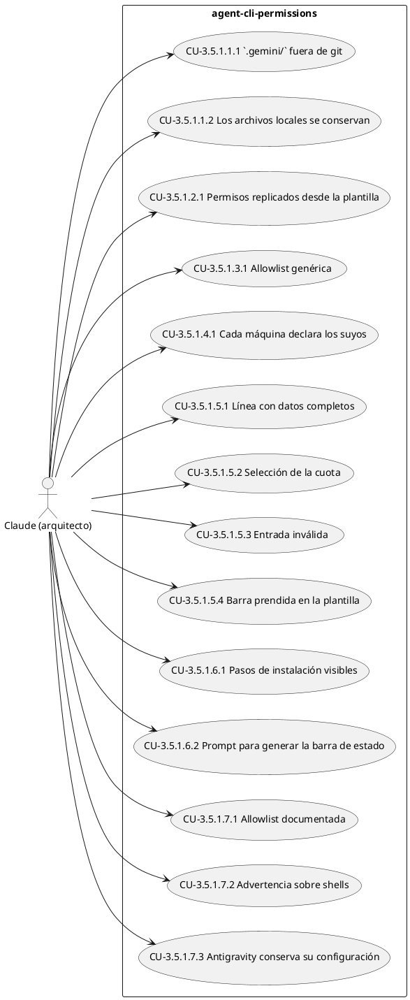

**CU-3.5.1.1.1 [3.5.1.1] `.gemini/` fuera de git** — Actor: Claude (arquitecto)

- **WHEN** se ejecuta `git ls-files .gemini`
- **THEN** no devuelve ningún archivo
- **AND** `.gitignore` contiene `.gemini/`

**CU-3.5.1.1.2 [3.5.1.1] Los archivos locales se conservan** — Actor: Claude (arquitecto)

- **WHEN** se deja de versionar `.gemini/`
- **THEN** los archivos de `.gemini/` siguen existiendo en el disco
- **AND** la configuración real del CLI en `~/.gemini/antigravity-cli/` no se modifica

**CU-3.5.1.2.1 [3.5.1.2] Permisos replicados desde la plantilla** — Actor: Claude (arquitecto)

- **WHEN** se instala `templates/antigravity/settings.json` en una máquina nueva
- **THEN** el `settings.json` resultante contiene los tres valores de permisos anteriores

**CU-3.5.1.3.1 [3.5.1.3] Allowlist genérica** — Actor: Claude (arquitecto)

- **WHEN** se lee `permissions.allow` de `templates/antigravity/settings.json`
- **THEN** contiene esos siete comandos
- **AND** no contiene rutas de sesión ni comandos específicos de un proyecto

**CU-3.5.1.4.1 [3.5.1.4] Cada máquina declara los suyos** — Actor: Claude (arquitecto)

- **WHEN** se instala la plantilla en una máquina nueva
- **THEN** la persona reemplaza el placeholder por las carpetas de sus propios proyectos
- **AND** la plantilla versionada no contiene rutas reales ni el nombre de usuario

**CU-3.5.1.5.1 [3.5.1.5] Línea con datos completos** — Actor: Claude (arquitecto)

- **WHEN** la entrada es `{"workspace":{"project_dir":"C:/x/mi-proyecto"},"context_window":{"used_percentage":42.4},"quota":{"gemini-5h":{"remaining_fraction":0.75,"reset_in_seconds":5400}},"model":{"display_name":"Modelo Ejemplo"}}`
- **THEN** la línea, sin secuencias ANSI, empieza con `mi-proyecto   42%   25% 1h30m`
- **AND** termina con `Modelo Ejemplo`

**CU-3.5.1.5.2 [3.5.1.5] Selección de la cuota** — Actor: Claude (arquitecto)

- **WHEN** la entrada trae `3p-5h` con `remaining_fraction` 1 y `gemini-5h` con `remaining_fraction` 0.75
- **THEN** la cuota mostrada es `25%`, tomada de `gemini-5h`

**CU-3.5.1.5.3 [3.5.1.5] Entrada inválida** — Actor: Claude (arquitecto)

- **WHEN** la entrada estándar no es un JSON válido
- **THEN** la barra usa el nombre del directorio actual como proyecto, `0%` de contexto y `0%` de cuota
- **AND** no produce ningún error

**CU-3.5.1.5.4 [3.5.1.5] Barra prendida en la plantilla** — Actor: Claude (arquitecto)

- **WHEN** se lee `statusLine` de `templates/antigravity/settings.json`
- **THEN** tiene `"enabled": true`

**CU-3.5.1.6.1 [3.5.1.6] Pasos de instalación visibles** — Actor: Claude (arquitecto)

- **WHEN** se lee la sección de setup por máquina del `README.md` y de `docs/modo-de-uso.md`
- **THEN** describen dónde copiar `templates/antigravity/settings.json`
- **AND** indican reemplazar los placeholders de `trustedWorkspaces` y de `statusLine`

**CU-3.5.1.6.2 [3.5.1.6] Prompt para generar la barra de estado** — Actor: Claude (arquitecto)

- **WHEN** se lee `templates/antigravity/README.md`
- **THEN** incluye el prompt que se ejecuta en el CLI del Agente para generar `statusline.bat` y `statusline_new.ps1` a partir de esta spec
- **AND** indica que, si la barra no aparece, hay que revisar que `statusLine.enabled` sea `true` en el `settings.json` instalado

**CU-3.5.1.7.1 [3.5.1.7] Allowlist documentada** — Actor: Claude (arquitecto)

- **WHEN** se lee la sección de setup por máquina de `README.md` y de `docs/modo-de-uso.md`
- **THEN** indica dónde se configura la ejecución automática en Cursor
- **AND** lista esos cinco comandos

**CU-3.5.1.7.2 [3.5.1.7] Advertencia sobre shells** — Actor: Claude (arquitecto)

- **WHEN** se lee `templates/cursor/README.md`
- **THEN** advierte que sumar `powershell` o `cmd.exe` a la allowlist equivale a permitir cualquier comando

**CU-3.5.1.7.3 [3.5.1.7] Antigravity conserva su configuración** — Actor: Claude (arquitecto)

- **WHEN** se lee esta spec después del change
- **THEN** siguen vigentes los requisitos de baseline de permisos, allowlist, workspaces de confianza, barra de estado e instalación por máquina de Antigravity

#### Casos de uso de doc-folder-structure [3.5.2]

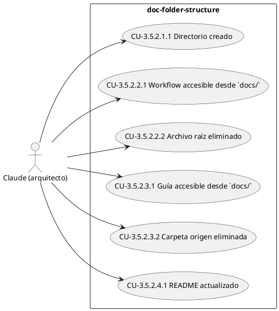

**CU-3.5.2.1.1 [3.5.2.1] Directorio creado** — Actor: Claude (arquitecto)

- **WHEN** se inspecciona la raíz del repositorio
- **THEN** existe el directorio `docs/`

**CU-3.5.2.2.1 [3.5.2.2] Workflow accesible desde `docs/`** — Actor: Claude (arquitecto)

- **WHEN** se navega a `docs/workflow.md`
- **THEN** el archivo contiene el contenido completo del workflow SDD Híbrido (roles, onboarding, flujo por change, capa de seguridad)

**CU-3.5.2.2.2 [3.5.2.2] Archivo raíz eliminado** — Actor: Claude (arquitecto)

- **WHEN** se inspecciona la raíz del repositorio
- **THEN** no existe `WORKFLOW.md` en la raíz

**CU-3.5.2.3.1 [3.5.2.3] Guía accesible desde `docs/`** — Actor: Claude (arquitecto)

- **WHEN** se navega a `docs/modo-de-uso.md` y a `docs/modo-de-uso.docx`
- **THEN** ambos archivos existen y son los originales de la guía de uso del workflow

**CU-3.5.2.3.2 [3.5.2.3] Carpeta origen eliminada** — Actor: Claude (arquitecto)

- **WHEN** se inspecciona la raíz del repositorio
- **THEN** no existe el directorio `Modo de Uso/`

**CU-3.5.2.4.1 [3.5.2.4] README actualizado** — Actor: Claude (arquitecto)

- **WHEN** se lee `README.md`
- **THEN** contiene referencias a `docs/workflow.md` y a `docs/modo-de-uso.md`
- **AND** no quedan referencias a `WORKFLOW.md` ni a `Modo de Uso/` fuera de `docs/`

#### Casos de uso de docs-portable-paths [3.5.3]

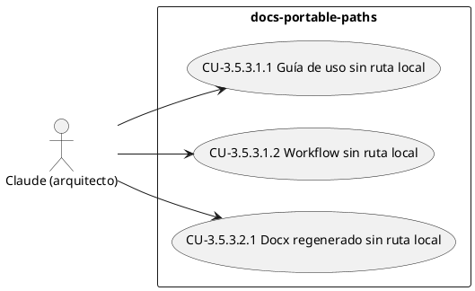

**CU-3.5.3.1.1 [3.5.3.1] Guía de uso sin ruta local** — Actor: Claude (arquitecto)

- **WHEN** se lee `docs/modo-de-uso.md`
- **THEN** el comando `cd` del Paso 1 usa el placeholder `{ruta-del-proyecto}`
- **AND** el documento no contiene `C:\Users`

**CU-3.5.3.1.2 [3.5.3.1] Workflow sin ruta local** — Actor: Claude (arquitecto)

- **WHEN** se lee `docs/workflow.md`
- **THEN** la ruta del `config.json` del perfil global de OpenSpec se expresa como `$env:APPDATA\openspec\config.json`
- **AND** el documento no contiene `C:\Users`

**CU-3.5.3.2.1 [3.5.3.2] Docx regenerado sin ruta local** — Actor: Claude (arquitecto)

- **WHEN** se inspecciona el contenido de `docs/modo-de-uso.docx`
- **THEN** contiene el placeholder `{ruta-del-proyecto}`
- **AND** no contiene `C:\Users`

#### Casos de uso de project-claude-md [3.5.4]

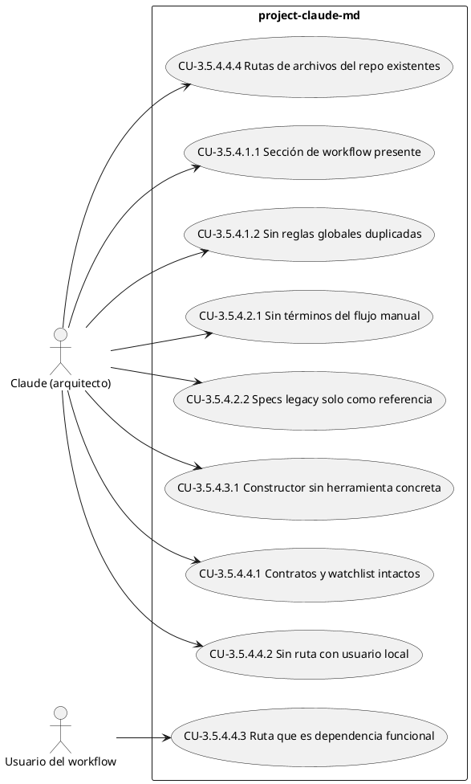

**CU-3.5.4.1.1 [3.5.4.1] Sección de workflow presente** — Actor: Claude (arquitecto)

- **WHEN** se lee el `CLAUDE.md` de un proyecto alineado
- **THEN** existe una sección "Workflow SDD / OpenSpec"
- **AND** la sección menciona `~/.claude/CLAUDE.md` y `/opsx:propose`

**CU-3.5.4.1.2 [3.5.4.1] Sin reglas globales duplicadas** — Actor: Claude (arquitecto)

- **WHEN** se lee el `CLAUDE.md` de un proyecto alineado
- **THEN** no contiene secciones de roles Claude/Agente, de flujo por change, de reglas de Git ni de seguridad universal copiadas de las reglas globales

**CU-3.5.4.2.1 [3.5.4.2] Sin términos del flujo manual** — Actor: Claude (arquitecto)

- **WHEN** se busca en el `CLAUDE.md` de un proyecto alineado "prompt para Copilot", "Bash Headless", "Fase 0 — LEER" y "OPCX"
- **THEN** no hay coincidencias

**CU-3.5.4.2.2 [3.5.4.2] Specs legacy solo como referencia** — Actor: Claude (arquitecto)

- **WHEN** el proyecto conserva `specs/` con features anteriores a OpenSpec
- **THEN** el `CLAUDE.md` los presenta como referencia legacy
- **AND** indica que los changes nuevos se crean en `openspec/changes/`

**CU-3.5.4.3.1 [3.5.4.3] Constructor sin herramienta concreta** — Actor: Claude (arquitecto)

- **WHEN** el `CLAUDE.md` de un proyecto alineado se refiere a quien implementa
- **THEN** usa "el Agente"
- **AND** no usa "Copilot", "Gemini", "Antigravity" ni "Cursor" como rol

**CU-3.5.4.4.1 [3.5.4.4] Contratos y watchlist intactos** — Actor: Claude (arquitecto)

- **WHEN** se compara el `CLAUDE.md` alineado con la versión de la rama principal
- **THEN** las secciones de contratos de comportamiento, reglas de arquitectura y watchlist tienen el mismo contenido
- **AND** las únicas diferencias son rutas con usuario local reemplazadas por placeholders

**CU-3.5.4.4.2 [3.5.4.4] Sin ruta con usuario local** — Actor: Claude (arquitecto)

- **WHEN** se busca `C:\Users` en el `CLAUDE.md` alineado
- **THEN** no hay coincidencias

**CU-3.5.4.4.3 [3.5.4.4] Ruta que es dependencia funcional** — Actor: Usuario del workflow

- **WHEN** una regla depende de una ruta absoluta del escritorio del usuario
- **THEN** el `CLAUDE.md` alineado la expresa con un placeholder como `{escritorio}\<carpeta>`
- **AND** la regla aclara que es el escritorio del usuario de cada equipo

**CU-3.5.4.4.4 [3.5.4.4] Rutas de archivos del repo existentes** — Actor: Claude (arquitecto)

- **WHEN** el `CLAUDE.md` alineado cita un archivo del repo
- **THEN** el archivo existe en la rama principal del proyecto en la ruta citada

#### Casos de uso de project-context-schema [3.5.5]

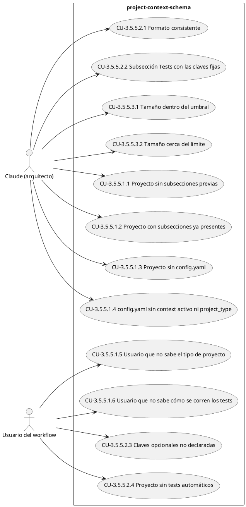

**CU-3.5.5.1.1 [3.5.5.1] Proyecto sin subsecciones previas** — Actor: Claude (arquitecto)

- **WHEN** una skill agrega una subsección por primera vez a un `context:` que no tiene ninguna
- **THEN** la subsección se appendea al final del texto existente, separada por una línea en blanco
- **AND** el contenido previo de `context:` queda intacto

**CU-3.5.5.1.2 [3.5.5.1] Proyecto con subsecciones ya presentes** — Actor: Claude (arquitecto)

- **WHEN** una skill actualiza una subsección que ya existe (por ejemplo, agrega un término al Glosario)
- **THEN** solo se reemplaza el bloque entre su encabezado y el siguiente `##` (o el final del texto)
- **AND** las demás subsecciones y el contenido previo a ellas no cambian

**CU-3.5.5.1.3 [3.5.5.1] Proyecto sin config.yaml** — Actor: Claude (arquitecto)

- **WHEN** una skill necesita escribir una subsección y el proyecto no tiene `openspec/config.yaml` (por ejemplo, tras `openspec init` en OpenSpec 1.4.1)
- **THEN** crea el archivo con `schema: spec-driven`, el `project_type` que indique el usuario y un `context:` con la descripción del proyecto
- **AND** recién después appendea la subsección al final del `context:`

**CU-3.5.5.1.4 [3.5.5.1] config.yaml sin context activo ni project_type** — Actor: Claude (arquitecto)

- **WHEN** una skill necesita escribir una subsección y `openspec/config.yaml` no tiene `context:` activo (por ejemplo, el que genera `openspec init` en OpenSpec 1.14.x, con el `context:` solo comentado) o no tiene `project_type`
- **THEN** agrega las claves que faltan, preguntando `project_type` en la misma pregunta que la subsección `## Tests`
- **AND** el resto del archivo, incluidos los comentarios, queda intacto

**CU-3.5.5.1.5 [3.5.5.1] Usuario que no sabe el tipo de proyecto** — Actor: Usuario del workflow

- **WHEN** se pregunta `project_type` y el usuario responde que no sabe
- **THEN** la skill lo deduce del repo, lo escribe con el comentario `# inferido — revisar` en la misma línea
- **AND** lo menciona en el resumen final para que se revise

**CU-3.5.5.1.6 [3.5.5.1] Usuario que no sabe cómo se corren los tests** — Actor: Usuario del workflow

- **WHEN** se pregunta `## Tests` y el usuario responde que no sabe
- **THEN** si el repo muestra cómo se corren (por ejemplo, pytest con archivos `test_*.py`, o `scripts.test` en `package.json`), la skill escribe ese `comando` junto con `- timeout: 5` por defecto, y menciona los dos en el resumen final como inferidos
- **AND** si el repo no lo muestra, no escribe `## Tests` (tampoco `comando: ninguno`), deja el comando como pendiente en el Test Plan y lo vuelve a preguntar en el próximo propose

**CU-3.5.5.2.1 [3.5.5.2] Formato consistente** — Actor: Claude (arquitecto)

- **WHEN** se genera o actualiza cualquiera de las cuatro subsecciones
- **THEN** cada ítem sigue el formato `- <clave>: <descripción>`
- **AND** "Actores y Procesos de Negocio" separa actores de procesos bajo sus propios sub-encabezados

**CU-3.5.5.2.2 [3.5.5.2] Subsección Tests con las claves fijas** — Actor: Claude (arquitecto)

- **WHEN** se genera la subsección `## Tests` de un proyecto con tests automáticos
- **THEN** incluye al menos `- comando: <comando>` y `- timeout: <minutos>`
- **AND** no incluye claves distintas de `comando`, `comando-rapido`, `timeout`, `entorno` y `excluir`

**CU-3.5.5.2.3 [3.5.5.2] Claves opcionales no declaradas** — Actor: Usuario del workflow

- **WHEN** el usuario no declara `comando-rapido`, `entorno` o `excluir`
- **THEN** esas claves no aparecen en `## Tests`
- **AND** la pregunta muestra el timeout como `<n> min`

**CU-3.5.5.2.4 [3.5.5.2] Proyecto sin tests automáticos** — Actor: Usuario del workflow

- **WHEN** el usuario indica que el proyecto no tiene forma de correr tests automáticos
- **THEN** la subsección `## Tests` queda con `- comando: ninguno`
- **AND** no se pregunta de nuevo en los proposes siguientes

**CU-3.5.5.3.1 [3.5.5.3] Tamaño dentro del umbral** — Actor: Claude (arquitecto)

- **WHEN** el `context:` resultante después de escribir queda por debajo de 40KB
- **THEN** la skill escribe sin advertencias

**CU-3.5.5.3.2 [3.5.5.3] Tamaño cerca del límite** — Actor: Claude (arquitecto)

- **WHEN** el `context:` resultante después de escribir superaría 40KB
- **THEN** la skill advierte antes de escribir, mostrando el tamaño estimado, y deja la decisión de qué recortar al usuario

#### Casos de uso de project-onboarding [3.5.6]

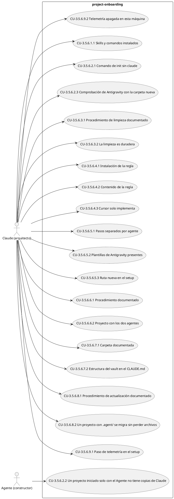

**CU-3.5.6.1.1 [3.5.6.1] Skills y comandos instalados** — Actor: Claude (arquitecto)

- **WHEN** se lee el setup por máquina del `README.md` y de `docs/workflow.md`
- **THEN** describen copiar todas las skills de `skills/` a `~/.claude/skills/`
- **AND** describen copiar los comandos de `.claude/commands/opsx/` a `~/.claude/commands/opsx/`

**CU-3.5.6.2.1 [3.5.6.2] Comando de init sin claude** — Actor: Claude (arquitecto)

- **WHEN** se leen `README.md`, `docs/workflow.md` y `docs/modo-de-uso.md`
- **THEN** ningún comando `openspec init` incluye `claude` en `--tools`
- **AND** los comandos indicados son `openspec init --tools antigravity` y `openspec init --tools cursor`
- **AND** ninguna guía contiene el paso de "liberar el slot de apply"

**CU-3.5.6.2.2 [3.5.6.2] Un proyecto iniciado solo con el Agente no tiene copias de Claude** — Actor: Agente (constructor)

- **WHEN** se ejecuta `openspec init --tools <agente>` en un directorio nuevo y luego `openspec update`
- **THEN** existen los comandos o skills del Agente (`.agents/skills/openspec-apply-change/` con Antigravity, `.cursor/commands/opsx-apply.md` con Cursor)
- **AND** no existe la carpeta `.claude/` en el proyecto

**CU-3.5.6.2.3 [3.5.6.2] Comprobación de Antigravity con la carpeta nueva** — Actor: Claude (arquitecto)

- **WHEN** se leen las guías en el paso de comprobar la instalación de Antigravity
- **THEN** indican `.agents/skills/openspec-apply-change/` y no `.agent/skills/openspec-apply-change/`

**CU-3.5.6.3.1 [3.5.6.3] Procedimiento de limpieza documentado** — Actor: Claude (arquitecto)

- **WHEN** se lee la sección de proyecto existente con OpenSpec de `docs/workflow.md` y de `docs/modo-de-uso.md`
- **THEN** indica eliminar `.claude/commands/opsx/` y las skills `.claude/skills/openspec-*`
- **AND** indica commitear la eliminación aparte, desde la rama principal

**CU-3.5.6.3.2 [3.5.6.3] La limpieza es duradera** — Actor: Claude (arquitecto)

- **WHEN** se eliminan las copias locales de Claude de un proyecto y se ejecuta `openspec update`
- **THEN** las copias no se vuelven a generar

**CU-3.5.6.4.1 [3.5.6.4] Instalación de la regla** — Actor: Claude (arquitecto)

- **WHEN** se lee la sección "Sumar un proyecto al workflow" de `README.md` y la equivalente de `docs/workflow.md` y `docs/modo-de-uso.md`
- **THEN** indican, para Cursor, copiar `$env:SDD_CONFIG_REPO\templates\cursor\sdd-workflow.mdc` a `.cursor\rules\sdd-workflow.mdc` del proyecto

**CU-3.5.6.4.2 [3.5.6.4] Contenido de la regla** — Actor: Claude (arquitecto)

- **WHEN** se lee `templates/cursor/sdd-workflow.mdc`
- **THEN** su frontmatter tiene `alwaysApply: true`
- **AND** indica leer `$env:OBSIDIAN_VAULT\_global\reglas-globales.md` (fallback `C:\TPA\_global\reglas-globales.md`)
- **AND** define el rol de constructor con commits en `change/{nombre}`, formato `{type}: {desc}` y trailer `Spec-ID`

**CU-3.5.6.4.3 [3.5.6.4] Cursor solo implementa** — Actor: Claude (arquitecto)

- **WHEN** se lee `templates/cursor/sdd-workflow.mdc`
- **THEN** indica que el Agente solo ejecuta `/opsx-apply`
- **AND** indica que `/opsx-propose`, `/opsx-verify`, `/opsx-archive`, `/opsx-explore` y `/opsx-sync` corresponden a Claude y no deben ejecutarse en Cursor

**CU-3.5.6.5.1 [3.5.6.5] Pasos separados por agente** — Actor: Claude (arquitecto)

- **WHEN** se lee el setup por máquina de `README.md` y de `docs/modo-de-uso.md`
- **THEN** hay un bloque de pasos para Antigravity y otro para Cursor
- **AND** se indica seguir solo el del agente que se usa

**CU-3.5.6.5.2 [3.5.6.5] Plantillas de Antigravity presentes** — Actor: Claude (arquitecto)

- **WHEN** se listan los archivos de `templates/`
- **THEN** existen `templates/antigravity/GEMINI.md` y `templates/antigravity/settings.json`

**CU-3.5.6.5.3 [3.5.6.5] Ruta nueva en el setup** — Actor: Claude (arquitecto)

- **WHEN** se busca el paso que instala `GEMINI.md` en `README.md` y `docs/modo-de-uso.md`
- **THEN** copia `templates\antigravity\GEMINI.md` a `~/.gemini/GEMINI.md`
- **AND** ninguna guía menciona `templates\gemini\`

**CU-3.5.6.6.1 [3.5.6.6] Procedimiento documentado** — Actor: Claude (arquitecto)

- **WHEN** se lee la sección de proyecto existente con OpenSpec de `docs/workflow.md` y de `docs/modo-de-uso.md`
- **THEN** describe los dos pasos anteriores
- **AND** indica que borrar `.agents/` (y `.agent/`) es opcional, solo si se deja Antigravity, en un commit aparte desde la rama principal

**CU-3.5.6.6.2 [3.5.6.6] Proyecto con los dos agentes** — Actor: Claude (arquitecto)

- **WHEN** en un proyecto con Antigravity se ejecutan los pasos de la guía
- **THEN** existen `.cursor/commands/opsx-apply.md` y `.cursor/rules/sdd-workflow.mdc`
- **AND** siguen existiendo las skills de Antigravity
- **AND** no existe la carpeta `.claude/` creada por el proceso

**CU-3.5.6.7.1 [3.5.6.7] Carpeta documentada** — Actor: Claude (arquitecto)

- **WHEN** se leen `README.md`, `docs/workflow.md` y `docs/modo-de-uso.md`
- **THEN** mencionan `projects/<proyecto>/apply/` y su exclusión de git

**CU-3.5.6.7.2 [3.5.6.7] Estructura del vault en el CLAUDE.md** — Actor: Claude (arquitecto)

- **WHEN** se lee la estructura del vault del `CLAUDE.md` global
- **THEN** incluye `apply\` bajo cada proyecto, marcada como local y no versionada

**CU-3.5.6.8.1 [3.5.6.8] Procedimiento de actualización documentado** — Actor: Claude (arquitecto)

- **WHEN** se lee la sección "Actualizar OpenSpec en un proyecto existente" de `docs/workflow.md` y de `docs/modo-de-uso.md`
- **THEN** indica `openspec update` y la revisión del diff antes de commitear
- **AND** explica qué hacer con la carpeta `.agent/` que puede quedar

**CU-3.5.6.8.2 [3.5.6.8] Un proyecto con .agent/ se migra sin perder archivos** — Actor: Claude (arquitecto)

- **WHEN** en un directorio con `.agent/` generada por OpenSpec 1.4.1 se ejecuta `openspec update` con OpenSpec 1.14.3
- **THEN** existe `.agents/skills/openspec-apply-change/`
- **AND** `.agent/` no se borra sola cuando sus archivos difieren

**CU-3.5.6.9.1 [3.5.6.9] Paso de telemetría en el setup** — Actor: Claude (arquitecto)

- **WHEN** se lee el setup por máquina de `README.md` y de `docs/modo-de-uso.md`
- **THEN** incluye el comando para desactivar la telemetría y el de comprobación

**CU-3.5.6.9.2 [3.5.6.9] Telemetría apagada en esta máquina** — Actor: Claude (arquitecto)

- **WHEN** se ejecuta `openspec config get telemetry.enabled`
- **THEN** devuelve `false`

#### Casos de uso de srs-generation [3.5.7]

```plantuml
@startuml
left to right direction
actor "Claude (arquitecto)" as A1
actor "Usuario del workflow" as A2
rectangle "srs-generation" {
  usecase "CU-3.5.7.1.1 Misma estructura en cualquier proyecto" as UC_3_5_7_1_1
  usecase "CU-3.5.7.1.2 Sección sin contenido disponible" as UC_3_5_7_1_2
  usecase "CU-3.5.7.1.3 Numeración sin duplicados" as UC_3_5_7_1_3
  usecase "CU-3.5.7.2.1 Encabezado y estado del documento" as UC_3_5_7_2_1
  usecase "CU-3.5.7.2.2 Secciones en formato de tabla" as UC_3_5_7_2_2
  usecase "CU-3.5.7.3.1 Primera asignación de IDs" as UC_3_5_7_3_1
  usecase "CU-3.5.7.3.2 Regeneración con requirements nuevos" as UC_3_5_7_3_2
  usecase "CU-3.5.7.3.3 Caso de Uso cita su requirement" as UC_3_5_7_3_3
  usecase "CU-3.5.7.3.4 Orden de las capabilities por ID" as UC_3_5_7_3_4
  usecase "CU-3.5.7.3.5 ID de caso de uso derivado del requirement" as UC_3_5_7_3_5
  usecase "CU-3.5.7.3.6 Los IDs de casos de uso no cambian al agregar capabilities" as UC_3_5_7_3_6
  usecase "CU-3.5.7.4.1 Valores por defecto aplicados" as UC_3_5_7_4_1
  usecase "CU-3.5.7.4.2 Excepción marcada en la entrevista" as UC_3_5_7_4_2
  usecase "CU-3.5.7.4.3 Corrección manual respetada" as UC_3_5_7_4_3
  usecase "CU-3.5.7.5.1 Proyecto con specs vigentes" as UC_3_5_7_5_1
  usecase "CU-3.5.7.5.2 Clasificación visible y corregible" as UC_3_5_7_5_2
  usecase "CU-3.5.7.5.3 Requisito no funcional sin prioridad todavía" as UC_3_5_7_5_3
  usecase "CU-3.5.7.6.1 Caso de uso simple" as UC_3_5_7_6_1
  usecase "CU-3.5.7.6.2 Caso de uso con varios pasos de un solo actor" as UC_3_5_7_6_2
  usecase "CU-3.5.7.6.3 Caso de uso con interacción entre actores" as UC_3_5_7_6_3
  usecase "CU-3.5.7.7.1 Proyecto por debajo del umbral" as UC_3_5_7_7_1
  usecase "CU-3.5.7.7.2 Proyecto por encima del umbral" as UC_3_5_7_7_2
  usecase "CU-3.5.7.7.3 Alcance acotado a capabilities" as UC_3_5_7_7_3
  usecase "CU-3.5.7.8.1 Desglose de cobertura al final" as UC_3_5_7_8_1
  usecase "CU-3.5.7.9.1 Matriz generada automáticamente" as UC_3_5_7_9_1
  usecase "CU-3.5.7.9.2 La matriz cita los IDs de caso de uso y de requirement" as UC_3_5_7_9_2
  usecase "CU-3.5.7.10.1 Primera generación" as UC_3_5_7_10_1
  usecase "CU-3.5.7.10.2 Regeneración sin gaps nuevos" as UC_3_5_7_10_2
  usecase "CU-3.5.7.10.3 Regeneración con un gap nuevo" as UC_3_5_7_10_3
  usecase "CU-3.5.7.10.4 Migración de datos existentes en `docs/srs.meta.yaml`" as UC_3_5_7_10_4
  usecase "CU-3.5.7.11.1 Proyecto sin ninguna spec" as UC_3_5_7_11_1
  usecase "CU-3.5.7.11.2 Proyecto con specs parciales" as UC_3_5_7_11_2
  usecase "CU-3.5.7.12.1 Regenerar un SRS existente" as UC_3_5_7_12_1
  usecase "CU-3.5.7.12.2 El usuario cancela la regeneración" as UC_3_5_7_12_2
  usecase "CU-3.5.7.13.1 Archive en un proyecto que ya usa SRS" as UC_3_5_7_13_1
  usecase "CU-3.5.7.13.2 Archive en un proyecto sin SRS" as UC_3_5_7_13_2
  usecase "CU-3.5.7.13.3 Usuario que posterga la generación" as UC_3_5_7_13_3
  usecase "CU-3.5.7.14.1 Requirement basado en spec" as UC_3_5_7_14_1
  usecase "CU-3.5.7.14.2 Requirement inferido" as UC_3_5_7_14_2
  usecase "CU-3.5.7.15.1 Archivo de secretos ignorado" as UC_3_5_7_15_1
  usecase "CU-3.5.7.15.2 Ruta absoluta con usuario local" as UC_3_5_7_15_2
}
A1 --> UC_3_5_7_1_1
A1 --> UC_3_5_7_1_2
A1 --> UC_3_5_7_1_3
A1 --> UC_3_5_7_2_1
A1 --> UC_3_5_7_2_2
A1 --> UC_3_5_7_3_1
A1 --> UC_3_5_7_3_2
A1 --> UC_3_5_7_3_3
A1 --> UC_3_5_7_3_4
A1 --> UC_3_5_7_3_5
A1 --> UC_3_5_7_3_6
A1 --> UC_3_5_7_4_1
A1 --> UC_3_5_7_4_2
A1 --> UC_3_5_7_4_3
A1 --> UC_3_5_7_5_1
A1 --> UC_3_5_7_5_2
A1 --> UC_3_5_7_5_3
A1 --> UC_3_5_7_6_1
A1 --> UC_3_5_7_6_2
A1 --> UC_3_5_7_6_3
A1 --> UC_3_5_7_7_1
A1 --> UC_3_5_7_7_2
A1 --> UC_3_5_7_7_3
A1 --> UC_3_5_7_8_1
A1 --> UC_3_5_7_9_1
A1 --> UC_3_5_7_9_2
A1 --> UC_3_5_7_10_1
A1 --> UC_3_5_7_10_2
A1 --> UC_3_5_7_10_3
A1 --> UC_3_5_7_10_4
A1 --> UC_3_5_7_11_1
A1 --> UC_3_5_7_11_2
A1 --> UC_3_5_7_12_1
A2 --> UC_3_5_7_12_2
A1 --> UC_3_5_7_13_1
A1 --> UC_3_5_7_13_2
A2 --> UC_3_5_7_13_3
A1 --> UC_3_5_7_14_1
A1 --> UC_3_5_7_14_2
A1 --> UC_3_5_7_15_1
A2 --> UC_3_5_7_15_2
@enduml
```

**CU-3.5.7.1.1 [3.5.7.1] Misma estructura en cualquier proyecto** — Actor: Claude (arquitecto)

- **WHEN** se invoca `srs-generate` en dos proyectos distintos
- **THEN** `docs/srs.md` de ambos tiene las mismas secciones y la misma numeración
- **AND** solo difiere el contenido de cada subsección, tomado del proyecto destino

**CU-3.5.7.1.2 [3.5.7.1] Sección sin contenido disponible** — Actor: Claude (arquitecto)

- **WHEN** una sección de la estructura fija no tiene información disponible en specs, código ni entrevista todavía
- **THEN** la sección igual aparece en `docs/srs.md`, marcada como pendiente, en vez de omitirse

**CU-3.5.7.1.3 [3.5.7.1] Numeración sin duplicados** — Actor: Claude (arquitecto)

- **WHEN** se genera `docs/srs.md`
- **THEN** ningún número de sección se usa para dos secciones distintas, aunque el documento de referencia lo haga

**CU-3.5.7.2.1 [3.5.7.2] Encabezado y estado del documento** — Actor: Claude (arquitecto)

- **WHEN** se genera `docs/srs.md` y quedan secciones marcadas como pendientes o inferidas
- **THEN** el encabezado indica estado "borrador"
- **AND** cuando no queda ninguna, indica "completo"

**CU-3.5.7.2.2 [3.5.7.2] Secciones en formato de tabla** — Actor: Claude (arquitecto)

- **WHEN** se generan 3.1/3.2, 3.3 y 3.6
- **THEN** cada objetivo de negocio, cada actor, cada proceso de negocio y cada requisito no funcional aparece como una fila o tabla individual, no como párrafo

**CU-3.5.7.3.1 [3.5.7.3] Primera asignación de IDs** — Actor: Claude (arquitecto)

- **WHEN** se genera el SRS por primera vez en un proyecto con capabilities
- **THEN** cada requirement de 3.5/3.6 recibe un ID jerárquico
- **AND** el mapeo queda guardado en `docs/srs.meta.yaml`

**CU-3.5.7.3.2 [3.5.7.3] Regeneración con requirements nuevos** — Actor: Claude (arquitecto)

- **WHEN** se agrega una capability o un requirement nuevo y se regenera el SRS
- **THEN** los IDs ya asignados no cambian
- **AND** lo nuevo recibe el siguiente número libre

**CU-3.5.7.3.3 [3.5.7.3] Caso de Uso cita su requirement** — Actor: Claude (arquitecto)

- **WHEN** un Caso de Uso de 3.4 proviene del escenario de un requirement de 3.5
- **THEN** el título del Caso de Uso cita el ID de ese requirement

**CU-3.5.7.3.4 [3.5.7.3] Orden de las capabilities por ID** — Actor: Claude (arquitecto)

- **WHEN** se agrega una capability cuyo nombre es alfabéticamente anterior a las existentes y se regenera el SRS
- **THEN** en 3.5 o 3.6 la capability nueva aparece después de las existentes, ordenadas por su ID jerárquico
- **AND** los IDs de las capabilities existentes no cambian

**CU-3.5.7.3.5 [3.5.7.3] ID de caso de uso derivado del requirement** — Actor: Claude (arquitecto)

- **WHEN** un requirement con ID `3.5.2.3` tiene dos escenarios
- **THEN** sus casos de uso se llaman `CU-3.5.2.3.1` y `CU-3.5.2.3.2`, en el orden de los escenarios

**CU-3.5.7.3.6 [3.5.7.3] Los IDs de casos de uso no cambian al agregar capabilities** — Actor: Claude (arquitecto)

- **WHEN** se agrega una capability nueva y se regenera el SRS
- **THEN** cada caso de uso existente conserva su ID `CU-<ID del requirement>.<n>`
- **AND** los casos de uso nuevos usan los IDs de sus propios requirements

**CU-3.5.7.4.1 [3.5.7.4] Valores por defecto aplicados** — Actor: Claude (arquitecto)

- **WHEN** se genera el SRS y nadie marcó excepciones
- **THEN** cada requirement muestra Riesgo: Bajo, Dependencia: Ninguna identificada y Dificultad: Nominal

**CU-3.5.7.4.2 [3.5.7.4] Excepción marcada en la entrevista** — Actor: Claude (arquitecto)

- **WHEN** en la entrevista se indica que un requirement tiene riesgo alto
- **THEN** ese requirement muestra el valor indicado y el resto conserva el default

**CU-3.5.7.4.3 [3.5.7.4] Corrección manual respetada** — Actor: Claude (arquitecto)

- **WHEN** alguien edita el atributo de un requirement en `docs/srs.meta.yaml` y se regenera el SRS
- **THEN** el documento generado usa el valor editado, no el default

**CU-3.5.7.5.1 [3.5.7.5] Proyecto con specs vigentes** — Actor: Claude (arquitecto)

- **WHEN** se invoca `srs-generate` en un proyecto que tiene una o más capabilities en `openspec/specs/`
- **THEN** cada capability aparece en 3.5 o 3.6 según su clasificación, con sus requirements y escenarios
- **AND** cada requirement de 3.6 muestra una prioridad

**CU-3.5.7.5.2 [3.5.7.5] Clasificación visible y corregible** — Actor: Claude (arquitecto)

- **WHEN** se genera el SRS de un proyecto con capabilities de distinto tipo
- **THEN** el documento deja explícita la clasificación aplicada a cada capability para que se pueda corregir a mano

**CU-3.5.7.5.3 [3.5.7.5] Requisito no funcional sin prioridad todavía** — Actor: Claude (arquitecto)

- **WHEN** una capability se clasifica en 3.6 y no tiene prioridad asignada en `docs/srs.meta.yaml`
- **THEN** queda marcada como pendiente hasta que la entrevista guiada la complete

**CU-3.5.7.6.1 [3.5.7.6] Caso de uso simple** — Actor: Claude (arquitecto)

- **WHEN** un escenario de una spec tiene un único actor y un solo paso en el `WHEN`
- **THEN** el Caso de Uso correspondiente en 3.4 incluye su diagrama UML de caso de uso en PlantUML
- **AND** no se agrega diagrama Mermaid

**CU-3.5.7.6.2 [3.5.7.6] Caso de uso con varios pasos de un solo actor** — Actor: Claude (arquitecto)

- **WHEN** un escenario tiene varios pasos secuenciales de un mismo actor
- **THEN** el Caso de Uso incluye, además del diagrama de caso de uso en PlantUML, un flowchart en Mermaid con esos pasos

**CU-3.5.7.6.3 [3.5.7.6] Caso de uso con interacción entre actores** — Actor: Claude (arquitecto)

- **WHEN** un escenario involucra a dos o más actores interactuando
- **THEN** el Caso de Uso incluye, además del diagrama de caso de uso en PlantUML, un sequence diagram en Mermaid con esa interacción

**CU-3.5.7.7.1 [3.5.7.7] Proyecto por debajo del umbral** — Actor: Claude (arquitecto)

- **WHEN** se invoca `srs-generate` sin acotar el alcance en un proyecto con pocos escenarios
- **THEN** la skill genera un diagrama de caso de uso por escenario (D7) sin pedir acotar

**CU-3.5.7.7.2 [3.5.7.7] Proyecto por encima del umbral** — Actor: Claude (arquitecto)

- **WHEN** se invoca `srs-generate` en un proyecto cuyo total de escenarios en alcance supera el umbral
- **THEN** la skill muestra el conteo y una estimación de tamaño y pide confirmación u ofrece acotar
- **AND** si se continúa, genera un solo diagrama de casos de uso por capability en vez de uno por escenario

**CU-3.5.7.7.3 [3.5.7.7] Alcance acotado a capabilities** — Actor: Claude (arquitecto)

- **WHEN** se invoca `srs-generate` con un alcance que limita las capabilities a incluir
- **THEN** el SRS generado solo cubre esas capabilities
- **AND** si el subconjunto queda por debajo del umbral, vuelven los diagramas por escenario

**CU-3.5.7.8.1 [3.5.7.8] Desglose de cobertura al final** — Actor: Claude (arquitecto)

- **WHEN** se genera `docs/srs.md`
- **THEN** su última sección muestra el desglose por origen (specs / inferido / entrevista / pendiente)

**CU-3.5.7.9.1 [3.5.7.9] Matriz generada automáticamente** — Actor: Claude (arquitecto)

- **WHEN** 3.4 y 3.5 ya están completas
- **THEN** 3.7 muestra una tabla con cada Caso de Uso y los Requisitos Funcionales que le corresponden, sin que nadie la arme a mano

**CU-3.5.7.9.2 [3.5.7.9] La matriz cita los IDs de caso de uso y de requirement** — Actor: Claude (arquitecto)

- **WHEN** se genera 3.7
- **THEN** cada fila muestra el ID `CU-…` y el ID jerárquico del requirement funcional correspondiente

**CU-3.5.7.10.1 [3.5.7.10] Primera generación** — Actor: Claude (arquitecto)

- **WHEN** se invoca `srs-generate` por primera vez en un proyecto y las subsecciones de Glosario/Objetivos/Actores-Procesos no existen todavía en `context:`
- **THEN** la skill hace la entrevista guiada completa antes de escribir `docs/srs.md`
- **AND** persiste las respuestas en las subsecciones correspondientes de `context:` en `openspec/config.yaml`

**CU-3.5.7.10.2 [3.5.7.10] Regeneración sin gaps nuevos** — Actor: Claude (arquitecto)

- **WHEN** se invoca `srs-generate` de nuevo y no hay actores, procesos, términos ni objetivos nuevos desde la última corrida
- **THEN** la skill no repite ninguna pregunta de la entrevista y usa las subsecciones de `context:` tal cual están

**CU-3.5.7.10.3 [3.5.7.10] Regeneración con un gap nuevo** — Actor: Claude (arquitecto)

- **WHEN** se invoca `srs-generate` de nuevo y apareció una capability nueva en 3.6 sin prioridad asignada
- **THEN** la skill pregunta solo por esa prioridad y la guarda en `docs/srs.meta.yaml`
- **AND** no vuelve a preguntar por el resto de las secciones

**CU-3.5.7.10.4 [3.5.7.10] Migración de datos existentes en `docs/srs.meta.yaml`** — Actor: Claude (arquitecto)

- **WHEN** `docs/srs.meta.yaml` de un proyecto ya tiene glosario, actores, procesos u objetivos de una corrida anterior a este change
- **THEN** la skill los migra a las subsecciones correspondientes de `context:` en la primera corrida siguiente
- **AND** los quita de `docs/srs.meta.yaml`
- **AND** no vuelve a preguntar por ellos en la entrevista

**CU-3.5.7.11.1 [3.5.7.11] Proyecto sin ninguna spec** — Actor: Claude (arquitecto)

- **WHEN** se invoca `srs-generate` en un proyecto cuyo `openspec/specs/` no existe o está vacío
- **THEN** la skill ofrece el modo bootstrap antes de generar un SRS con 3.5/3.6 vacías
- **AND**, si el usuario acepta, cada sección de 3.5/3.6 que no venga de una spec queda marcada como "inferido del código, sin spec formal — revisar"

**CU-3.5.7.11.2 [3.5.7.11] Proyecto con specs parciales** — Actor: Claude (arquitecto)

- **WHEN** se invoca `srs-generate` en un proyecto que tiene algunas capabilities documentadas y zonas de código sin spec asociada
- **THEN** la skill combina en el mismo SRS las secciones basadas en spec (sin marca) con las inferidas por bootstrap (marcadas), sin mezclarlas sin distinción

**CU-3.5.7.12.1 [3.5.7.12] Regenerar un SRS existente** — Actor: Claude (arquitecto)

- **WHEN** se invoca `srs-generate` en un proyecto que ya tiene `docs/srs.md`
- **THEN** la skill muestra qué secciones cambiarían respecto del contenido actual antes de escribir
- **AND** solo sobrescribe el archivo si el usuario confirma

**CU-3.5.7.12.2 [3.5.7.12] El usuario cancela la regeneración** — Actor: Usuario del workflow

- **WHEN** se muestra el resumen de cambios y el usuario no confirma
- **THEN** `docs/srs.md` queda intacto

**CU-3.5.7.13.1 [3.5.7.13] Archive en un proyecto que ya usa SRS** — Actor: Claude (arquitecto)

- **WHEN** se completa `/opsx:archive` en un proyecto que tiene `docs/srs.md`
- **THEN** el resumen final del archive ofrece regenerar el SRS, con las opciones "Regenerar ahora" y "Más tarde"
- **AND** el archive se considera completo independientemente de si el usuario acepta o no

**CU-3.5.7.13.2 [3.5.7.13] Archive en un proyecto sin SRS** — Actor: Claude (arquitecto)

- **WHEN** se completa `/opsx:archive` en un proyecto que no tiene `docs/srs.md`
- **THEN** el resumen final del archive ofrece generar el SRS, con las opciones "Generar ahora" y "Más tarde"
- **AND** la pregunta avisa que la primera generación incluye una entrevista corta
- **AND** el archive se considera completo independientemente de si el usuario acepta o no

**CU-3.5.7.13.3 [3.5.7.13] Usuario que posterga la generación** — Actor: Usuario del workflow

- **WHEN** en un proyecto sin `docs/srs.md` el usuario contesta "Más tarde"
- **THEN** no se crea ningún archivo de SRS
- **AND** el próximo archive del proyecto vuelve a ofrecerlo

**CU-3.5.7.14.1 [3.5.7.14] Requirement basado en spec** — Actor: Claude (arquitecto)

- **WHEN** un requirement del SRS proviene de `openspec/specs/<capability>/spec.md`
- **THEN** el SRS cita esa capability como fuente del requirement

**CU-3.5.7.14.2 [3.5.7.14] Requirement inferido** — Actor: Claude (arquitecto)

- **WHEN** un requirement del SRS proviene del modo bootstrap
- **THEN** el SRS lo marca como inferido en vez de citar una spec inexistente

**CU-3.5.7.15.1 [3.5.7.15] Archivo de secretos ignorado** — Actor: Claude (arquitecto)

- **WHEN** el modo bootstrap recorre el código de un proyecto que tiene `.env` o `secrets/` en su `.gitignore`
- **THEN** el contenido de esos archivos no aparece en `docs/srs.md`

**CU-3.5.7.15.2 [3.5.7.15] Ruta absoluta con usuario local** — Actor: Usuario del workflow

- **WHEN** el bootstrap encuentra en el código una ruta absoluta con el nombre de usuario de la máquina
- **THEN** el SRS generado reemplaza esa parte de la ruta por un placeholder en vez de copiarla literal

#### Casos de uso de test-driven-verification [3.5.8]

```plantuml
@startuml
left to right direction
actor "Claude (arquitecto)" as A1
actor "Agente (constructor)" as A2
rectangle "test-driven-verification" {
  usecase "CU-3.5.8.1.1 Change con escenarios testeables" as UC_3_5_8_1_1
  usecase "CU-3.5.8.1.2 Escenario sin forma de testearse automáticamente" as UC_3_5_8_1_2
  usecase "CU-3.5.8.1.3 Proyecto sin subsección Tests" as UC_3_5_8_1_3
  usecase "CU-3.5.8.2.1 Test movido o renombrado" as UC_3_5_8_2_1
  usecase "CU-3.5.8.2.2 Test sin marcador" as UC_3_5_8_2_2
  usecase "CU-3.5.8.3.1 Orden de las tareas" as UC_3_5_8_3_1
  usecase "CU-3.5.8.3.2 Proyecto sin infraestructura de tests" as UC_3_5_8_3_2
  usecase "CU-3.5.8.4.1 Change que mueve funciones existentes" as UC_3_5_8_4_1
  usecase "CU-3.5.8.4.2 Cambio de comportamiento intencional" as UC_3_5_8_4_2
  usecase "CU-3.5.8.5.1 Todos los tests del plan pasan" as UC_3_5_8_5_1
  usecase "CU-3.5.8.5.2 Un test del plan falla" as UC_3_5_8_5_2
  usecase "CU-3.5.8.5.3 Entorno de test no disponible" as UC_3_5_8_5_3
  usecase "CU-3.5.8.6.1 Change que solo agrega archivos" as UC_3_5_8_6_1
  usecase "CU-3.5.8.6.2 Regresión fuera del diff" as UC_3_5_8_6_2
  usecase "CU-3.5.8.6.3 Test que ya fallaba" as UC_3_5_8_6_3
  usecase "CU-3.5.8.6.4 Archivo existente modificado sin caracterización" as UC_3_5_8_6_4
  usecase "CU-3.5.8.6.5 Salida sin nombres de los tests que fallan" as UC_3_5_8_6_5
  usecase "CU-3.5.8.6.6 Suite lenta" as UC_3_5_8_6_6
  usecase "CU-3.5.8.7.1 Test que no prueba el escenario" as UC_3_5_8_7_1
  usecase "CU-3.5.8.7.2 Revisión de diseño sobre el diff" as UC_3_5_8_7_2
  usecase "CU-3.5.8.8.1 Escenario manual sin motivo" as UC_3_5_8_8_1
  usecase "CU-3.5.8.8.2 Demasiados escenarios manuales" as UC_3_5_8_8_2
  usecase "CU-3.5.8.8.3 Proyecto sin tests automáticos" as UC_3_5_8_8_3
  usecase "CU-3.5.8.9.1 Salida de tests con un comando sugerido" as UC_3_5_8_9_1
  usecase "CU-3.5.8.9.2 Reporte sin logs" as UC_3_5_8_9_2
  usecase "CU-3.5.8.10.1 Change creado antes de la regla" as UC_3_5_8_10_1
  usecase "CU-3.5.8.11.1 Test en rojo al terminar la tarea" as UC_3_5_8_11_1
  usecase "CU-3.5.8.11.2 Formato del marcador en el CLAUDE.md global" as UC_3_5_8_11_2
  usecase "CU-3.5.8.12.1 Resumen presente y consistente" as UC_3_5_8_12_1
  usecase "CU-3.5.8.12.2 Tarea marcada sin evidencia" as UC_3_5_8_12_2
  usecase "CU-3.5.8.12.3 Resumen ausente" as UC_3_5_8_12_3
  usecase "CU-3.5.8.12.4 Vault inexistente" as UC_3_5_8_12_4
}
A1 --> UC_3_5_8_1_1
A1 --> UC_3_5_8_1_2
A1 --> UC_3_5_8_1_3
A2 --> UC_3_5_8_2_1
A1 --> UC_3_5_8_2_2
A1 --> UC_3_5_8_3_1
A1 --> UC_3_5_8_3_2
A1 --> UC_3_5_8_4_1
A1 --> UC_3_5_8_4_2
A1 --> UC_3_5_8_5_1
A1 --> UC_3_5_8_5_2
A1 --> UC_3_5_8_5_3
A1 --> UC_3_5_8_6_1
A1 --> UC_3_5_8_6_2
A1 --> UC_3_5_8_6_3
A1 --> UC_3_5_8_6_4
A1 --> UC_3_5_8_6_5
A1 --> UC_3_5_8_6_6
A1 --> UC_3_5_8_7_1
A1 --> UC_3_5_8_7_2
A1 --> UC_3_5_8_8_1
A1 --> UC_3_5_8_8_2
A1 --> UC_3_5_8_8_3
A1 --> UC_3_5_8_9_1
A1 --> UC_3_5_8_9_2
A1 --> UC_3_5_8_10_1
A2 --> UC_3_5_8_11_1
A1 --> UC_3_5_8_11_2
A1 --> UC_3_5_8_12_1
A1 --> UC_3_5_8_12_2
A1 --> UC_3_5_8_12_3
A1 --> UC_3_5_8_12_4
@enduml
```

**CU-3.5.8.1.1 [3.5.8.1] Change con escenarios testeables** — Actor: Claude (arquitecto)

- **WHEN** se hace propose de un change cuyas delta specs tienen escenarios y el proyecto declara un comando de tests
- **THEN** `design.md` contiene `## Test Plan` con una fila por escenario, cada una con su ID `Sxx` y un test automático
- **AND** la sección indica el comando de tests del proyecto

**CU-3.5.8.1.2 [3.5.8.1] Escenario sin forma de testearse automáticamente** — Actor: Claude (arquitecto)

- **WHEN** un escenario no se puede cubrir con un test automático (por ejemplo, UI sin framework de test o Power Query)
- **THEN** su fila del Test Plan dice `manual`, con el motivo y los pasos para verificarlo a mano

**CU-3.5.8.1.3 [3.5.8.1] Proyecto sin subsección Tests** — Actor: Claude (arquitecto)

- **WHEN** se hace propose en un proyecto cuyo `context:` no tiene `## Tests`
- **THEN** la skill pregunta una sola vez el comando, el tiempo máximo y los requisitos de entorno
- **AND** los guarda en la subsección `## Tests` del `context:` (capability `project-context-schema`) antes de escribir el Test Plan

**CU-3.5.8.2.1 [3.5.8.2] Test movido o renombrado** — Actor: Agente (constructor)

- **WHEN** el Agente implementa el test de `S03` en un archivo o con un nombre distinto del previsto en el Test Plan, pero con el marcador correcto
- **THEN** el verify lo encuentra por el marcador y no reporta el escenario como faltante

**CU-3.5.8.2.2 [3.5.8.2] Test sin marcador** — Actor: Claude (arquitecto)

- **WHEN** ningún test del repo contiene el marcador de un ID automático del Test Plan
- **THEN** el verify reporta CRITICAL "Escenario <ID> sin test"

**CU-3.5.8.3.1 [3.5.8.3] Orden de las tareas** — Actor: Claude (arquitecto)

- **WHEN** se genera `tasks.md` de un change con Test Plan automático
- **THEN** las tareas que escriben los tests de `Sxx` aparecen antes que las tareas que implementan esos escenarios
- **AND** cada tarea de test nombra sus IDs y el comando para correrla

**CU-3.5.8.3.2 [3.5.8.3] Proyecto sin infraestructura de tests** — Actor: Claude (arquitecto)

- **WHEN** el proyecto declara un comando de tests pero todavía no tiene carpeta de tests ni dependencias de test
- **THEN** la primera tarea del change arma esa infraestructura
- **AND** `proposal.md` lo menciona en Impact

**CU-3.5.8.4.1 [3.5.8.4] Change que mueve funciones existentes** — Actor: Claude (arquitecto)

- **WHEN** el diseño prevé mover o modificar funciones de un archivo existente
- **THEN** el Test Plan tiene al menos un `Cxx` para ese archivo, con las funciones que fija
- **AND** en `tasks.md` la tarea del `Cxx` aparece antes que la tarea que modifica ese archivo

**CU-3.5.8.4.2 [3.5.8.4] Cambio de comportamiento intencional** — Actor: Claude (arquitecto)

- **WHEN** el change modifica a propósito el comportamiento de una parte existente
- **THEN** el Test Plan explica qué cambia y por qué, de una de dos formas: el `Cxx` fija el comportamiento actual y dice cómo cambia (y la tarea actualiza ese test), o el `Cxx` deja afuera la parte que cambia y lo indica en su columna "Cambio intencional", con el `Sxx` que cubre el comportamiento nuevo
- **AND** ninguna parte del comportamiento existente que se modifica queda sin un `Cxx` o un `Sxx` que la cubra

**CU-3.5.8.5.1 [3.5.8.5] Todos los tests del plan pasan** — Actor: Claude (arquitecto)

- **WHEN** cada ID automático tiene su test y el comando de tests termina con todos ellos en verde
- **THEN** el reporte marca esos IDs como cubiertos, sin issues CRITICAL por tests

**CU-3.5.8.5.2 [3.5.8.5] Un test del plan falla** — Actor: Claude (arquitecto)

- **WHEN** el test con marcador `S02` falla al ejecutar el comando
- **THEN** el verify reporta CRITICAL "Escenario S02: test fallando", con el nombre del test

**CU-3.5.8.5.3 [3.5.8.5] Entorno de test no disponible** — Actor: Claude (arquitecto)

- **WHEN** la subsección `## Tests` declara un entorno (por ejemplo, un servicio de docker compose) que no está levantado o no responde
- **THEN** el verify reporta CRITICAL "no se pudo ejecutar" con el motivo
- **AND** no intenta levantar otro entorno ni usar configuración de producción

**CU-3.5.8.6.1 [3.5.8.6] Change que solo agrega archivos** — Actor: Claude (arquitecto)

- **WHEN** el diff contra la rama principal solo agrega archivos de código y el Test Plan no fuerza la suite
- **THEN** el verify corre solo los tests del plan

**CU-3.5.8.6.2 [3.5.8.6] Regresión fuera del diff** — Actor: Claude (arquitecto)

- **WHEN** el change modifica un archivo existente y un test que pasa en la rama principal falla en la rama del change
- **THEN** el verify reporta CRITICAL "Regresión: <test>"

**CU-3.5.8.6.3 [3.5.8.6] Test que ya fallaba** — Actor: Claude (arquitecto)

- **WHEN** un test falla tanto en la rama principal como en la rama del change
- **THEN** el verify reporta WARNING "fallaba antes del change" y no lo cuenta como regresión

**CU-3.5.8.6.4 [3.5.8.6] Archivo existente modificado sin caracterización** — Actor: Claude (arquitecto)

- **WHEN** el diff modifica un archivo de código existente que no aparece en ningún `Cxx` del Test Plan
- **THEN** el verify reporta CRITICAL "Código existente modificado sin test de caracterización: <archivo>"

**CU-3.5.8.6.5 [3.5.8.6] Salida sin nombres de los tests que fallan** — Actor: Claude (arquitecto)

- **WHEN** hay tests que fallan y la salida del comando declarado no muestra sus nombres
- **THEN** el verify reporta WARNING "no se pudo comparar por nombre" y recomienda declarar en `## Tests` un `comando` que los muestre
- **AND** no agrega flags ni modifica el comando para obtener esos nombres

**CU-3.5.8.6.6 [3.5.8.6] Suite lenta** — Actor: Claude (arquitecto)

- **WHEN** la subsección `## Tests` declara `comando-rapido`
- **THEN** el verify usa ese comando en lugar de la suite completa
- **AND** el reporte avisa que no se corrió la suite completa

**CU-3.5.8.7.1 [3.5.8.7] Test que no prueba el escenario** — Actor: Claude (arquitecto)

- **WHEN** el test de `S04` pasa pero no tiene ninguna afirmación sobre lo que dice el THEN del escenario
- **THEN** el verify reporta WARNING "S04: el test no comprueba el THEN del escenario"

**CU-3.5.8.7.2 [3.5.8.7] Revisión de diseño sobre el diff** — Actor: Claude (arquitecto)

- **WHEN** el verify revisa las decisiones del `design.md` y la `## Security Layer`
- **THEN** lee el diff del change contra la rama principal y los archivos que el diff toca
- **AND** no hace búsquedas por palabras clave en el resto del repositorio

**CU-3.5.8.8.1 [3.5.8.8] Escenario manual sin motivo** — Actor: Claude (arquitecto)

- **WHEN** una fila `manual` del Test Plan no tiene motivo o no tiene pasos
- **THEN** el verify reporta WARNING con el ID

**CU-3.5.8.8.2 [3.5.8.8] Demasiados escenarios manuales** — Actor: Claude (arquitecto)

- **WHEN** un proyecto con comando de tests tiene un Test Plan con más de la mitad de sus escenarios en `manual`
- **THEN** el verify reporta WARNING con el porcentaje

**CU-3.5.8.8.3 [3.5.8.8] Proyecto sin tests automáticos** — Actor: Claude (arquitecto)

- **WHEN** el comando de tests del proyecto es `ninguno` y todo el Test Plan es `manual`
- **THEN** el verify no reporta WARNING por el porcentaje
- **AND** controla las tareas manuales como parte de la completitud

**CU-3.5.8.9.1 [3.5.8.9] Salida de tests con un comando sugerido** — Actor: Claude (arquitecto)

- **WHEN** la salida de los tests sugiere correr otro comando (por ejemplo, un script de migración)
- **THEN** el verify no lo ejecuta y lo menciona como recomendación en el reporte

**CU-3.5.8.9.2 [3.5.8.9] Reporte sin logs** — Actor: Claude (arquitecto)

- **WHEN** un test falla con una traza larga
- **THEN** el reporte muestra el nombre del test, el ID y una línea de motivo
- **AND** ni el reporte ni el `context.md` del vault copian la traza completa

**CU-3.5.8.10.1 [3.5.8.10] Change creado antes de la regla** — Actor: Claude (arquitecto)

- **WHEN** se hace verify de un change cuyo `design.md` no tiene `## Test Plan`
- **THEN** el verify aplica el método anterior
- **AND** el reporte empieza con el aviso "Change sin Test Plan: verificación por inferencia"

**CU-3.5.8.11.1 [3.5.8.11] Test en rojo al terminar la tarea** — Actor: Agente (constructor)

- **WHEN** el Agente termina de escribir el test de una tarea y el test falla por un motivo que no es la implementación pendiente
- **THEN** no marca la tarea como hecha y escala al usuario si no puede resolverlo

**CU-3.5.8.11.2 [3.5.8.11] Formato del marcador en el CLAUDE.md global** — Actor: Claude (arquitecto)

- **WHEN** se busca `test-plan: <nombre-change>/<ID>` en el `CLAUDE.md` global
- **THEN** aparece en la regla 9

**CU-3.5.8.12.1 [3.5.8.12] Resumen presente y consistente** — Actor: Claude (arquitecto)

- **WHEN** el verify encuentra el archivo del change y cada `[x]` tiene evidencia y respaldo en el diff
- **THEN** el reporte indica que la evidencia fue contrastada y cita la ruta

**CU-3.5.8.12.2 [3.5.8.12] Tarea marcada sin evidencia** — Actor: Claude (arquitecto)

- **WHEN** una tarea `[x]` no aparece con evidencia en el archivo
- **THEN** el verify reporta CRITICAL "tarea sin evidencia" con su ID

**CU-3.5.8.12.3 [3.5.8.12] Resumen ausente** — Actor: Claude (arquitecto)

- **WHEN** no existe el archivo del change en el vault
- **THEN** el verify reporta CRITICAL "sin resumen del apply"
- **AND** recomienda pedirle la copia al Agente o entregar la evidencia

**CU-3.5.8.12.4 [3.5.8.12] Vault inexistente** — Actor: Claude (arquitecto)

- **WHEN** el vault no existe en la máquina
- **THEN** el verify reporta CRITICAL "no se pudo contrastar la evidencia" y lo anota en el reporte
- **AND** no inventa evidencia ni da el change por verificado

#### Casos de uso de spec-purpose [3.5.9]

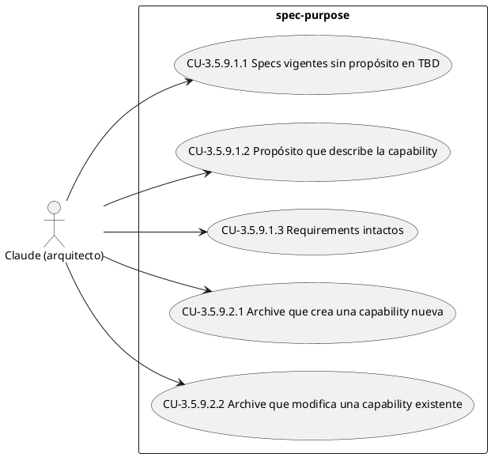

**CU-3.5.9.1.1 [3.5.9.1] Specs vigentes sin propósito en TBD** — Actor: Claude (arquitecto)

- **WHEN** se busca "TBD - created by archiving change" en `openspec/specs/**/spec.md`
- **THEN** no hay ninguna coincidencia

**CU-3.5.9.1.2 [3.5.9.1] Propósito que describe la capability** — Actor: Claude (arquitecto)

- **WHEN** se lee el `## Purpose` de cualquier spec vigente
- **THEN** describe en una o dos oraciones qué define la capability, consistente con sus requirements

**CU-3.5.9.1.3 [3.5.9.1] Requirements intactos** — Actor: Claude (arquitecto)

- **WHEN** se completa el propósito de una spec
- **THEN** solo cambia la sección `## Purpose`
- **AND** los requirements y escenarios de la spec quedan iguales

**CU-3.5.9.2.1 [3.5.9.2] Archive que crea una capability nueva** — Actor: Claude (arquitecto)

- **WHEN** se archiva un change cuyo sync crea `openspec/specs/<capability>/spec.md` con el propósito en TBD
- **THEN** el `## Purpose` queda con el texto derivado del `proposal.md`
- **AND** el resumen del archive muestra el propósito escrito

**CU-3.5.9.2.2 [3.5.9.2] Archive que modifica una capability existente** — Actor: Claude (arquitecto)

- **WHEN** se archiva un change cuyo sync modifica una spec que ya tiene propósito redactado
- **THEN** su `## Purpose` no cambia

#### Casos de uso de agent-templates [3.5.10]

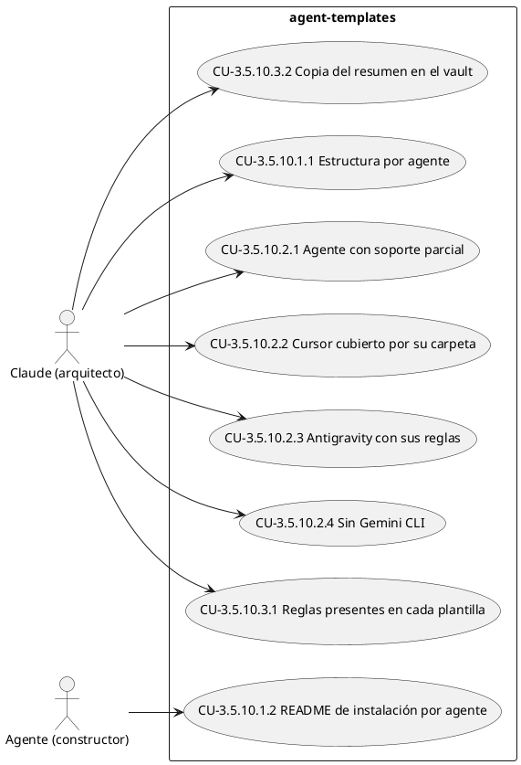

**CU-3.5.10.1.1 [3.5.10.1] Estructura por agente** — Actor: Claude (arquitecto)

- **WHEN** se listan los archivos de `templates/`
- **THEN** existen `templates/antigravity/settings.json`, `templates/antigravity/GEMINI.md`, `templates/copilot/copilot-instructions.md`, `templates/cursor/sdd-workflow.mdc` y `templates/comun/AGENTS.md`
- **AND** cada carpeta tiene su `README.md`
- **AND** en la raíz de `templates/` solo está `README.md`
- **AND** no existe `templates/gemini/`

**CU-3.5.10.1.2 [3.5.10.1] README de instalación por agente** — Actor: Agente (constructor)

- **WHEN** se lee el `README.md` de la carpeta de un agente
- **THEN** indica para qué agente es y el destino de instalación de cada archivo

**CU-3.5.10.2.1 [3.5.10.2] Agente con soporte parcial** — Actor: Claude (arquitecto)

- **WHEN** se lee la fila de Codex en la matriz
- **THEN** la columna de reglas apunta a `templates/comun/AGENTS.md`
- **AND** las columnas de permisos y barra de estado dicen "no verificado"

**CU-3.5.10.2.2 [3.5.10.2] Cursor cubierto por su carpeta** — Actor: Claude (arquitecto)

- **WHEN** se lee la fila de Cursor en la matriz
- **THEN** la columna de reglas apunta a `templates/cursor/sdd-workflow.mdc`
- **AND** la columna de permisos remite a `templates/cursor/README.md`
- **AND** la columna de barra de estado dice "no verificado"

**CU-3.5.10.2.3 [3.5.10.2] Antigravity con sus reglas** — Actor: Claude (arquitecto)

- **WHEN** se lee la fila de Antigravity en la matriz
- **THEN** la columna de reglas apunta a `templates/antigravity/GEMINI.md` con destino `~/.gemini/GEMINI.md`

**CU-3.5.10.2.4 [3.5.10.2] Sin Gemini CLI** — Actor: Claude (arquitecto)

- **WHEN** se lee `templates/README.md`
- **THEN** no hay fila ni carpeta de Gemini CLI
- **AND** una nota indica que Google lo retiró, con enlace al anuncio

**CU-3.5.10.3.1 [3.5.10.3] Reglas presentes en cada plantilla** — Actor: Claude (arquitecto)

- **WHEN** se buscan "Evidencia antes de `[x]`", "Test primero = falla primero" y "No debilitar tests" en las cuatro plantillas de reglas
- **THEN** aparecen en las cuatro

**CU-3.5.10.3.2 [3.5.10.3] Copia del resumen en el vault** — Actor: Claude (arquitecto)

- **WHEN** se lee la regla 7 de cada una de las cuatro plantillas y la del `CLAUDE.md` global
- **THEN** indica guardar la copia en `projects/<proyecto>/apply/AAAA-MM-DD-<change>.md`
- **AND** indica que lleva fecha, rama y commit, sin datos personales ni credenciales
- **AND** indica que el Agente no la commitea ni la pushea

#### Casos de uso de security-layer-matrix [3.6.1]

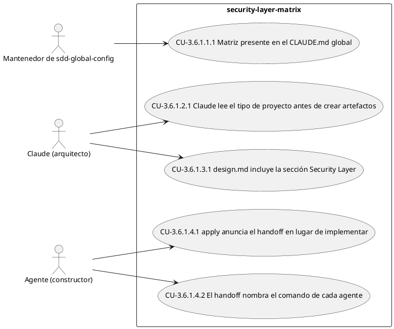

**CU-3.6.1.1.1 [3.6.1.1] Matriz presente en el CLAUDE.md global** — Actor: Mantenedor de sdd-global-config

- **WHEN** se lee el CLAUDE.md global
- **THEN** contiene la sección `## Capa de Seguridad por Tipo de Proyecto`
- **AND** define controles mínimos para `frontend`, `backend-api`, `etl` / `scripts` y `fullstack`

**CU-3.6.1.2.1 [3.6.1.2] Claude lee el tipo de proyecto antes de crear artefactos** — Actor: Claude (arquitecto)

- **WHEN** Claude va a crear un artefacto (`proposal.md`, `design.md`, `specs/*.md`) en un proyecto con OpenSpec
- **THEN** lee `project_type` del bloque `context:` de `openspec/config.yaml`
- **AND** aplica los controles mínimos de ese tipo

**CU-3.6.1.3.1 [3.6.1.3] design.md incluye la sección Security Layer** — Actor: Claude (arquitecto)

- **WHEN** se crea un nuevo change y se genera su `design.md`
- **THEN** el `design.md` contiene una sección `## Security Layer`
- **AND** la sección lista los controles del tipo de proyecto que aplican al change y cómo se implementan

**CU-3.6.1.4.1 [3.6.1.4] apply anuncia el handoff en lugar de implementar** — Actor: Agente (constructor)

- **WHEN** Claude ejecuta `/opsx:apply` sobre un change con tareas pendientes
- **THEN** anuncia el handoff al Agente y lista las tareas pendientes
- **AND** no realiza cambios de código

**CU-3.6.1.4.2 [3.6.1.4] El handoff nombra el comando de cada agente** — Actor: Agente (constructor)

- **WHEN** Claude anuncia el handoff al terminar `/opsx:propose` o `/opsx:apply`
- **THEN** el anuncio incluye `/openspec-apply-change {nombre}` para Antigravity y `/opsx-apply {nombre}` para Cursor

### 3.5 Requisitos Funcionales

#### 3.5.1 agent-cli-permissions

Clasificación: Funcional (heurística de palabras clave).

Propósito: Define cómo se replica en cada máquina la configuración del CLI del Agente sin versionar la configuración personal: baseline de permisos, allowlist base de comandos, workspaces de confianza declarados por máquina, barra de estado especificada por comportamiento e instalación documentada paso a paso.

**3.5.1.1 La configuración personal del CLI del Agente no se versiona**

El repositorio SHALL NOT versionar la carpeta `.gemini/` con archivos de configuración personal del CLI del Agente, porque contienen rutas de la máquina, workspaces de confianza y permisos. El repositorio SHALL versionar en su lugar una plantilla de `settings.json` sin datos de la máquina en `templates/antigravity/settings.json`.

- Riesgo: Bajo · Dependencia: Ninguna identificada · Dificultad: Nominal
- Escenarios: 2
- Origen: `openspec/specs/agent-cli-permissions/spec.md`

**3.5.1.2 Baseline de permisos del Agente en una máquina nueva**

Una máquina que use esta configuración SHALL tener en `~/.gemini/antigravity-cli/settings.json` los valores `toolPermission` en `always-proceed`, `artifactReviewPolicy` en `always-proceed` y `allowNonWorkspaceAccess` en `true`.

- Riesgo: Bajo · Dependencia: Ninguna identificada · Dificultad: Nominal
- Escenarios: 1
- Origen: `openspec/specs/agent-cli-permissions/spec.md`

**3.5.1.3 Allowlist base de comandos**

La plantilla SHALL incluir en `permissions.allow` únicamente los comandos genéricos `cmd.exe`, `git status`, `git diff`, `git branch`, `git restore`, `openspec` y `powershell`. La plantilla SHALL NOT incluir comandos puntuales, como un `git commit` con archivos de un proyecto o scripts de una sesión identificados por un id.

- Riesgo: Bajo · Dependencia: Ninguna identificada · Dificultad: Nominal
- Escenarios: 1
- Origen: `openspec/specs/agent-cli-permissions/spec.md`

**3.5.1.4 Workspaces de confianza declarados por máquina**

La plantilla SHALL incluir `trustedWorkspaces` con un valor de ejemplo con placeholder, y cada máquina SHALL declarar sus propios workspaces de confianza. Los workspaces reales SHALL NOT versionarse.

- Riesgo: Bajo · Dependencia: Ninguna identificada · Dificultad: Nominal
- Escenarios: 1
- Origen: `openspec/specs/agent-cli-permissions/spec.md`

**3.5.1.5 Barra de estado especificada por comportamiento**

La barra de estado del CLI del Agente SHALL generarse en cada máquina por el propio CLI a partir de este requisito, y el repositorio SHALL NOT versionar sus scripts. La plantilla SHALL configurar `statusLine` con `"enabled": true` y un comando que apunte a `statusline.bat` dentro de `~/.gemini/antigravity-cli/scratch/`. La barra SHALL leer por entrada estándar el JSON que envía el CLI y escribir una única línea con el formato `<proyecto>   <contexto>%   <cuota>% <reinicio>  (<rama>)  <modelo>`, con tres espacios entre proyecto, contexto y cuota, y dos espacios antes de la rama y del modelo. Los campos SHALL obtenerse así:

- `<proyecto>`: el último segmento de `workspace.project_dir`; si no existe, el de `cwd`; si no hay entrada válida, el nombre del directorio actual; `desconocido` si nada de lo anterior aplica.
- `<contexto>`: `context_window.used_percentage` redondeado, o `0` si falta, en verde con secuencias ANSI.
- `<cuota>` y `<reinicio>`, de la cuota de 5 horas: se usa `3p-5h` cuando existe y su `remaining_fraction` es menor que 1; si no, `gemini-5h`; si no, `3p-5h`. `<cuota>` es el redondeo de `(1 - remaining_fraction) * 100`, o `0` si no hay cuota. `<reinicio>` es `<h>h<mm>m` calculado desde `reset_in_seconds` cuando es mayor que 0, y se omite en otro caso.
- `<rama>`: la salida de `git rev-parse --abbrev-ref HEAD` ejecutado en `cwd` (o en el directorio actual si `cwd` no existe); el bloque `(<rama>)` se omite si no hay repositorio.
- `<modelo>`: `model.display_name`, o `model.id` si falta; se omite si no hay ninguno.

La barra SHALL NOT fallar ante una entrada vacía o un JSON inválido.

- Riesgo: Bajo · Dependencia: Ninguna identificada · Dificultad: Nominal
- Escenarios: 4
- Origen: `openspec/specs/agent-cli-permissions/spec.md`

**3.5.1.6 La instalación por máquina está documentada**

El `README.md`, `templates/antigravity/README.md` y la guía de uso (`docs/modo-de-uso.md`) SHALL describir la instalación por máquina de la plantilla de permisos y cómo pedirle al CLI del Agente que genere la barra de estado a partir del requisito «Barra de estado», indicando el destino y los valores que hay que completar, y qué hacer si la barra no aparece (`statusLine.enabled` en `false`).

- Riesgo: Bajo · Dependencia: Ninguna identificada · Dificultad: Nominal
- Escenarios: 2
- Origen: `openspec/specs/agent-cli-permissions/spec.md`

**3.5.1.7 Permisos de ejecución del Agente en Cursor documentados**

El setup por máquina de `README.md`, `templates/cursor/README.md` y `docs/modo-de-uso.md` SHALL describir cómo configurar en Cursor la ejecución automática de comandos del Agente con una allowlist genérica: `git status`, `git diff`, `git branch`, `git restore` y `openspec`. La documentación SHALL advertir que agregar `powershell` o `cmd.exe` permite ejecutar cualquier comando sin confirmación y SHALL NOT incluir rutas reales ni el nombre de usuario. Esta configuración vive en el IDE de Cursor y no se versiona; los requisitos de permisos de Antigravity de esta spec no cambian.

- Riesgo: Bajo · Dependencia: Ninguna identificada · Dificultad: Nominal
- Escenarios: 3
- Origen: `openspec/specs/agent-cli-permissions/spec.md`

#### 3.5.2 doc-folder-structure

Clasificación: Funcional (heurística de palabras clave).

Propósito: Define que la documentación de reglas de negocio del proyecto vive en una carpeta `docs/` en la raíz (`workflow.md` y la guía de uso) y que `README.md` la referencia como punto de entrada.

**3.5.2.1 Carpeta `docs/` existe en la raíz del proyecto**

El proyecto SHALL tener un directorio `docs/` en la raíz como carpeta canónica para toda la documentación de reglas de negocio del workflow SDD Híbrido.

- Riesgo: Bajo · Dependencia: Ninguna identificada · Dificultad: Nominal
- Escenarios: 1
- Origen: `openspec/specs/doc-folder-structure/spec.md`

**3.5.2.2 `workflow.md` reside en `docs/`**

El archivo de workflow SDD Híbrido SHALL estar ubicado en `docs/workflow.md`. El archivo `WORKFLOW.md` en la raíz SHALL ser eliminado.

- Riesgo: Bajo · Dependencia: Ninguna identificada · Dificultad: Nominal
- Escenarios: 2
- Origen: `openspec/specs/doc-folder-structure/spec.md`

**3.5.2.3 La guía de uso reside en `docs/`**

La guía de uso SHALL estar ubicada en `docs/modo-de-uso.md` (fuente) y `docs/modo-de-uso.docx` (versión derivada). La carpeta `Modo de Uso/` SHALL ser eliminada.

- Riesgo: Bajo · Dependencia: Ninguna identificada · Dificultad: Nominal
- Escenarios: 2
- Origen: `openspec/specs/doc-folder-structure/spec.md`

**3.5.2.4 `README.md` referencia `docs/` como punto de entrada**

El `README.md` SHALL incluir una sección que dirija al lector a `docs/` para la documentación detallada del workflow y reglas de negocio.

- Riesgo: Bajo · Dependencia: Ninguna identificada · Dificultad: Nominal
- Escenarios: 1
- Origen: `openspec/specs/doc-folder-structure/spec.md`

#### 3.5.3 docs-portable-paths

Clasificación: Funcional (heurística de palabras clave).

Propósito: Garantiza que la documentación de `docs/` funcione en cualquier máquina sin exponer datos del entorno local: sin rutas absolutas con el usuario de la PC y con el `.docx` de la guía de uso siempre alineado con su `.md`.

**3.5.3.1 La documentación de `docs/` no incluye rutas absolutas del entorno local**

Los documentos de `docs/` (`.md` y `.docx`) SHALL NOT contener rutas absolutas que revelen el usuario o la máquina local (por ejemplo `C:\Users\<usuario>\...`). Las rutas SHALL expresarse con placeholders entre llaves (por ejemplo `{ruta-del-proyecto}`) o con variables de entorno (por ejemplo `$env:APPDATA`).

- Riesgo: Bajo · Dependencia: Ninguna identificada · Dificultad: Nominal
- Escenarios: 2
- Origen: `openspec/specs/docs-portable-paths/spec.md`

**3.5.3.2 El `.docx` de la guía de uso refleja el `.md`**

`docs/modo-de-uso.docx` SHALL regenerarse desde `docs/modo-de-uso.md` cada vez que este cambie, de modo que ambos tengan el mismo contenido.

- Riesgo: Bajo · Dependencia: Ninguna identificada · Dificultad: Nominal
- Escenarios: 1
- Origen: `openspec/specs/docs-portable-paths/spec.md`

#### 3.5.4 project-claude-md

Clasificación: Funcional (heurística de palabras clave).

Propósito: Define el contenido de los `CLAUDE.md` de cada proyecto: conservan lo propio del proyecto y remiten al flujo OpenSpec global, sin instruir el flujo SDD manual y nombrando al constructor como "el Agente".

**3.5.4.1 El CLAUDE.md de proyecto remite al flujo global**

El `CLAUDE.md` de un proyecto que usa OpenSpec SHALL incluir una sección "Workflow SDD / OpenSpec" que remita a las reglas globales (`~/.claude/CLAUDE.md`) e indique que las features nuevas empiezan con `/opsx:propose`. El archivo SHALL NOT repetir las reglas globales del workflow (roles, flujo por change, reglas de Git, seguridad universal).

- Riesgo: Bajo · Dependencia: Ninguna identificada · Dificultad: Nominal
- Escenarios: 2
- Origen: `openspec/specs/project-claude-md/spec.md`

**3.5.4.2 El CLAUDE.md de proyecto no instruye el flujo SDD manual**

El `CLAUDE.md` de un proyecto que usa OpenSpec SHALL NOT instruir a Claude a generar prompts para un agente concreto, a crear `spec.yaml`, `Task.md` o `threat-model.md` como artefactos de changes nuevos, a seguir fases OPCX ni a usar `change-map.md` como fuente del change activo. El `specs/` legacy y `change-map.md` SHALL mencionarse, si existen, solo como referencia histórica, y el change activo SHALL obtenerse con `openspec list --json`.

- Riesgo: Bajo · Dependencia: Ninguna identificada · Dificultad: Nominal
- Escenarios: 2
- Origen: `openspec/specs/project-claude-md/spec.md`

**3.5.4.3 El rol de constructor se nombra "el Agente"**

El `CLAUDE.md` de un proyecto que usa OpenSpec SHALL nombrar al constructor como "el Agente" y SHALL NOT atribuir el rol a una herramienta concreta (Copilot, Gemini, Antigravity, Cursor). Los nombres de archivo y comandos que impone una herramienta, como `.github/copilot-instructions.md`, `.cursor/rules/sdd-workflow.mdc` o `/opsx-apply`, SHALL conservarse tal cual.

- Riesgo: Bajo · Dependencia: Ninguna identificada · Dificultad: Nominal
- Escenarios: 1
- Origen: `openspec/specs/project-claude-md/spec.md`

**3.5.4.4 El contenido propio del proyecto se conserva**

Al alinear un `CLAUDE.md`, el contenido propio del proyecto (descripción, stack, arquitectura, contratos de comportamiento, reglas de arquitectura, restricciones del entorno, IDs de recursos, riesgos, watchlist y estado) SHALL conservarse sin cambios de significado. Las rutas absolutas que revelen el usuario local SHALL reemplazarse por placeholders con llaves (por ejemplo `{proyectos}`) o rutas relativas; cuando la ruta sea una dependencia funcional de la regla (por ejemplo consultas Power Query que apuntan al escritorio del usuario), el placeholder SHALL conservar el sentido (por ejemplo `{escritorio}\normalizacionLeads`) y la regla SHALL aclarar que corresponde al usuario de cada equipo. Las rutas de archivos del repo que queden SHALL corresponder a archivos existentes.

- Riesgo: Bajo · Dependencia: Ninguna identificada · Dificultad: Nominal
- Escenarios: 4
- Origen: `openspec/specs/project-claude-md/spec.md`

#### 3.5.5 project-context-schema

Clasificación: Funcional (heurística de palabras clave).

Propósito: Define la convención de subsecciones fijas y opcionales (`## Glosario`, `## Actores y Procesos de Negocio`, `## Objetivos de Negocio`) dentro del campo `context:` de `openspec/config.yaml`, para que el conocimiento de negocio del proyecto viva en un único lugar reusado por toda operación de OpenSpec, con edición quirúrgica por subsección y advertencia de tamaño antes del límite del CLI.

**3.5.5.1 Subsecciones estructuradas dentro de `context:`**

El campo `context:` de `openspec/config.yaml` SHALL admitir subsecciones opcionales con encabezados Markdown fijos — `## Glosario`, `## Actores y Procesos de Negocio` (con sub-encabezados `### Actores` y `### Procesos`), `## Objetivos de Negocio`, `## Tests` — para conocimiento del proyecto reusable en toda operación de OpenSpec. Cualquier skill que escriba ahí SHALL appendear estas subsecciones al final del texto existente y NO SHALL sobrescribir ni reordenar el contenido previo a ellas. Si `openspec/config.yaml` no existe, o existe sin un `context:` activo (ausente o solo comentado) o sin `project_type`, la skill que necesite escribir una subsección SHALL completar lo que falta antes de escribirla — `schema: spec-driven` si falta el archivo, `project_type` preguntado una vez al usuario, `context:` con una línea que describa el proyecto — sin tocar el resto del archivo (claves, `rules` y comentarios existentes).

- Riesgo: Bajo · Dependencia: Ninguna identificada · Dificultad: Nominal
- Escenarios: 6
- Origen: `openspec/specs/project-context-schema/spec.md`

**3.5.5.2 Formato de cada subsección**

Cada subsección SHALL usar una lista simple `- <clave>: <descripción>`: Glosario (término/definición), Objetivos de Negocio (id/descripción). "Actores y Procesos de Negocio" SHALL tener dos sub-listas bajo `### Actores` y `### Procesos`, cada una con el mismo formato (nombre/descripción). "Tests" SHALL usar claves fijas: `comando` (obligatoria; el valor `ninguno` indica que el proyecto no tiene tests automáticos), `comando-rapido` (opcional), `timeout` (obligatoria cuando `comando` no es `ninguno`, en minutos), `entorno` (opcional: requisitos para correr los tests, por ejemplo servicios de docker compose de test) y `excluir` (opcional: rutas que no cuentan como código para los tests de caracterización). Las claves opcionales que no se declaran SHALL omitirse: no se escriben con valores de relleno como "no declarado" o "ninguno". Al preguntar, la skill SHALL mostrar el `timeout` con su unidad (minutos).

- Riesgo: Bajo · Dependencia: Ninguna identificada · Dificultad: Nominal
- Escenarios: 4
- Origen: `openspec/specs/project-context-schema/spec.md`

**3.5.5.3 Advertencia de tamaño antes de escribir**

Antes de escribir en `context:`, una skill SHALL calcular el tamaño resultante en bytes y SHALL advertir si supera un umbral de alerta (40KB) sin bloquear la escritura, dado que el CLI de OpenSpec descarta el campo `context` completo (no solo el excedente) si supera su límite duro de 50KB.

- Riesgo: Bajo · Dependencia: Ninguna identificada · Dificultad: Nominal
- Escenarios: 2
- Origen: `openspec/specs/project-context-schema/spec.md`

#### 3.5.6 project-onboarding

Clasificación: Funcional (heurística de palabras clave).

Propósito: Define cómo se prepara una máquina y cómo se inicia un proyecto en el workflow: el setup instala las skills y los comandos globales de Claude, los proyectos se inician solo con el Agente (`openspec init --tools <agente>`) y los que tienen copias locales de Claude se limpian para que no pisen a las globales.

**3.5.6.1 El setup por máquina instala skills y comandos globales de Claude**

El setup por máquina SHALL instalar en `~/.claude/skills/` todas las skills de `skills/` y en `~/.claude/commands/opsx/` los comandos de `.claude/commands/opsx/`, porque los comandos son lo que ejecutan `/opsx:*` y las skills los complementan.

- Riesgo: Bajo · Dependencia: Ninguna identificada · Dificultad: Nominal
- Escenarios: 1
- Origen: `openspec/specs/project-onboarding/spec.md`

**3.5.6.2 Los proyectos se inician solo con el Agente**

Las guías SHALL indicar `openspec init --tools <agente>` para iniciar un proyecto, con `<agente>` igual a `antigravity` o `cursor`, y SHALL NOT incluir `claude` en `--tools`, para que Claude use los comandos y skills globales. Las guías SHALL indicar cómo comprobar la instalación: `.agents/skills/openspec-apply-change/` para Antigravity o `.cursor/commands/opsx-apply.md` para Cursor. Las guías SHALL NOT pedir "liberar el slot de apply".

- Riesgo: Bajo · Dependencia: Ninguna identificada · Dificultad: Nominal
- Escenarios: 3
- Origen: `openspec/specs/project-onboarding/spec.md`

**3.5.6.3 Los proyectos con copias locales de Claude se limpian**

Las guías SHALL describir cómo eliminar de un proyecto existente las copias locales de Claude: los comandos de `.claude/commands/opsx/` y las skills `.claude/skills/openspec-*`. Las guías SHALL indicar que, si están versionadas, la eliminación se commitea aparte y desde la rama principal, y que `openspec update` no las vuelve a generar.

- Riesgo: Bajo · Dependencia: Ninguna identificada · Dificultad: Nominal
- Escenarios: 2
- Origen: `openspec/specs/project-onboarding/spec.md`

**3.5.6.4 Reglas del Agente por proyecto en Cursor**

El repositorio SHALL versionar la plantilla `templates/cursor/sdd-workflow.mdc`, y las guías SHALL indicar copiarla a `.cursor/rules/sdd-workflow.mdc` de cada proyecto que usa Cursor como Agente. La plantilla SHALL aplicarse siempre (`alwaysApply: true`), remitir al espejo del vault `_global/reglas-globales.md` y no contener rutas con el usuario local.

- Riesgo: Bajo · Dependencia: Ninguna identificada · Dificultad: Nominal
- Escenarios: 3
- Origen: `openspec/specs/project-onboarding/spec.md`

**3.5.6.5 El setup por máquina se hace por agente**

El setup por máquina de `README.md` y `docs/modo-de-uso.md` SHALL tener pasos separados para cada agente (Antigravity: `GEMINI.md` y `settings.json`; Cursor: ejecución automática) e indicar que cada persona sigue solo los del agente que usa. El paso de Antigravity SHALL copiar `templates\antigravity\GEMINI.md` a `~/.gemini/GEMINI.md`. El repositorio SHALL seguir versionando las plantillas de Antigravity.

- Riesgo: Bajo · Dependencia: Ninguna identificada · Dificultad: Nominal
- Escenarios: 3
- Origen: `openspec/specs/project-onboarding/spec.md`

**3.5.6.6 Agregar Cursor a proyectos existentes**

Las guías SHALL describir cómo sumar Cursor a un proyecto que ya usa OpenSpec con Antigravity: ejecutar `openspec init --tools cursor` (conserva la configuración y suma la herramienta) e instalar `.cursor/rules/sdd-workflow.mdc`. Las guías SHALL indicar que las carpetas de Antigravity (`.agents/` y la anterior `.agent/`) solo se eliminan si el proyecto deja de usar Antigravity, en un commit aparte y desde la rama principal.

- Riesgo: Bajo · Dependencia: Ninguna identificada · Dificultad: Nominal
- Escenarios: 2
- Origen: `openspec/specs/project-onboarding/spec.md`

**3.5.6.7 El vault documenta la carpeta de resúmenes del apply**

Las guías SHALL describir la carpeta `projects/<proyecto>/apply/` del vault (dónde el Agente deja la copia del resumen del apply) e indicar que `projects/*/apply/` está en el `.gitignore` del vault, por lo que no se sube a git y el verify solo se corre en la máquina del apply. El `CLAUDE.md` global SHALL incluir `apply/` en la estructura del vault.

- Riesgo: Bajo · Dependencia: Ninguna identificada · Dificultad: Nominal
- Escenarios: 2
- Origen: `openspec/specs/project-onboarding/spec.md`

**3.5.6.8 Actualizar OpenSpec en un proyecto existente**

Las guías SHALL describir cómo actualizar un proyecto que ya usa OpenSpec: ejecutar `openspec update`, revisar con `git status` y `git diff` lo que cambió y commitearlo aparte. Si el proyecto tenía `.agent/`, las guías SHALL indicar que `openspec update` crea `.agents/` y deja `.agent/` cuando sus archivos difieren, y que se compara y elimina `.agent/` en un commit aparte desde la rama principal.

- Riesgo: Bajo · Dependencia: Ninguna identificada · Dificultad: Nominal
- Escenarios: 2
- Origen: `openspec/specs/project-onboarding/spec.md`

**3.5.6.9 La telemetría de OpenSpec se desactiva por máquina**

El setup por máquina de `README.md` y `docs/modo-de-uso.md` SHALL indicar `openspec config set telemetry.enabled false`, con la comprobación `openspec config get telemetry.enabled`, porque las máquinas de la empresa no deben enviar telemetría de uso a terceros.

- Riesgo: Bajo · Dependencia: Ninguna identificada · Dificultad: Nominal
- Escenarios: 2
- Origen: `openspec/specs/project-onboarding/spec.md`

#### 3.5.7 srs-generation

Clasificación: Funcional. La spec contiene todas las palabras clave de la heurística porque las define, no porque sea un requisito no funcional.

Propósito: Define la skill `srs-generate`, que arma y mantiene `docs/srs.md` por agregación de las specs vigentes: estructura fija, IDs jerárquicos estables, casos de uso con diagramas, matriz de trazabilidad, entrevista guiada para las secciones de negocio, modo bootstrap, regeneración segura y exclusión de secrets.

**3.5.7.1 Estructura fija del SRS**

`docs/srs.md` SHALL seguir siempre el mismo esqueleto de secciones y numeración, tomado de la Parte 1 (el SRS de ejemplo) del documento de referencia del usuario: `1. Introducción` (1.1 Alcance, 1.2 Objetivos), `2. Información del Dominio del Problema` (2.1 Introducción al dominio, 2.2 Glosario de Términos), `3. Necesidades de Negocio` (3.1 Objetivos de negocio de clientes/usuarios, 3.2 Objetivos de Negocio, 3.3 Actores y Procesos de Negocio, 3.4 Casos de Uso, 3.5 Requisitos Funcionales, 3.6 Requisitos No Funcionales, 3.7 Matriz de Trazabilidad). La skill NO SHALL usar una estructura distinta ni copiar el contenido específico del proyecto de ejemplo del documento de referencia (Chef, Plato, Reserva, etc.).

- Riesgo: Bajo · Dependencia: Ninguna identificada · Dificultad: Nominal
- Escenarios: 3
- Origen: `openspec/specs/srs-generation/spec.md`

**3.5.7.2 Portada, tabla de contenidos y formato de tabla**

`docs/srs.md` SHALL abrir con un encabezado de identificación (título del documento, nombre del proyecto, fecha de generación y estado: "borrador" si quedan secciones pendientes o inferidas, "completo" si no) seguido de una tabla de contenidos derivada de sus propios headings. Las secciones "3.1/3.2 Objetivos de Negocio", "3.3 Actores y Procesos de Negocio" y "3.6 Requisitos No Funcionales" SHALL presentarse en formato de tabla, como en el documento de referencia, y no como texto corrido.

- Riesgo: Bajo · Dependencia: Ninguna identificada · Dificultad: Nominal
- Escenarios: 2
- Origen: `openspec/specs/srs-generation/spec.md`

**3.5.7.3 Identificadores jerárquicos estables**

Cada requirement de 3.5/3.6 SHALL recibir un identificador jerárquico (`3.5.<n>.<m>` / `3.6.<n>.<m>`, con `<n>` = orden de la capability y `<m>` = orden del requirement dentro de ella). El mapeo capability+requirement → ID SHALL persistirse en `docs/srs.meta.yaml`. Un ID ya asignado NO SHALL reasignarse ni renumerarse en regeneraciones posteriores: los requirements nuevos toman el siguiente número libre. Las capabilities SHALL presentarse en 3.5/3.6 ordenadas por su ID jerárquico y NO por nombre de carpeta, de modo que una capability nueva con nombre alfabéticamente anterior quede al final y no desplace a las existentes. Cada Caso de Uso de 3.4 SHALL tener el ID `CU-<ID del requirement>.<n>`, con `<n>` = posición del escenario dentro de su requirement (1, 2, …) y NO un número correlativo global, y su título SHALL citar además el ID del requirement del que proviene. Agregar capabilities o requirements NO SHALL cambiar el ID de los casos de uso existentes. La Matriz de Trazabilidad de 3.7 SHALL usar esos IDs.

- Riesgo: Bajo · Dependencia: Ninguna identificada · Dificultad: Nominal
- Escenarios: 6
- Origen: `openspec/specs/srs-generation/spec.md`

**3.5.7.4 Atributos de Riesgo, Dependencia y Dificultad por requirement**

Cada requirement de 3.5/3.6 SHALL mostrar los atributos Riesgo, Dependencia y Dificultad. La skill SHALL aplicarles un valor por defecto (Riesgo: Bajo, Dependencia: Ninguna identificada, Dificultad: Nominal) y SHALL hacer una única pregunta consolidada en la entrevista guiada para marcar excepciones, en vez de preguntar los tres atributos por cada requirement. Los valores SHALL poder corregirse editando `docs/srs.meta.yaml`, indexados por el ID jerárquico del requirement, y la siguiente regeneración SHALL respetarlos.

- Riesgo: Bajo · Dependencia: Ninguna identificada · Dificultad: Nominal
- Escenarios: 3
- Origen: `openspec/specs/srs-generation/spec.md`

**3.5.7.5 Requisitos Funcionales y No Funcionales por agregación, con prioridad**

La skill SHALL completar "3.5 Requisitos Funcionales" y "3.6 Requisitos No Funcionales" leyendo `openspec/specs/**/spec.md` (capabilities vigentes) del proyecto destino, agrupando cada capability según la heurística de palabras clave (performance, seguridad, escalabilidad, disponibilidad, usabilidad, mantenibilidad, compliance sobre `## Purpose` y los requirements). Cada requirement en 3.6 SHALL llevar una prioridad (por ejemplo Deseable/Alta/Crítica/Media, como en el documento de referencia) obtenida de la entrevista guiada o de `docs/srs.meta.yaml`.

- Riesgo: Bajo · Dependencia: Ninguna identificada · Dificultad: Nominal
- Escenarios: 3
- Origen: `openspec/specs/srs-generation/spec.md`

**3.5.7.6 Casos de Uso con diagrama UML y, cuando corresponda, diagrama de flujo o secuencia**

Cada `#### Scenario:` de una spec del proyecto destino SHALL convertirse en un Caso de Uso dentro de "3.4 Casos de Uso", con un diagrama UML de caso de uso en PlantUML (actor(es) inferido(s) del `WHEN`, sistema y el caso de uso como óvalo). Cuando el `WHEN/THEN` del escenario tenga más de un paso o involucre más de un actor, la skill SHALL agregar además un diagrama Mermaid: flowchart para una secuencia de pasos de un solo actor, sequence diagram cuando hay interacción entre dos o más actores. La skill NO SHALL usar PlantUML para flujo/secuencia ni Mermaid para el diagrama de caso de uso.

- Riesgo: Bajo · Dependencia: Ninguna identificada · Dificultad: Nominal
- Escenarios: 3
- Origen: `openspec/specs/srs-generation/spec.md`

**3.5.7.7 Guard de escala y alcance acotado**

La skill SHALL aceptar un alcance opcional (lista de capabilities a incluir; por defecto, todas). Antes de generar, la skill SHALL contar los escenarios y requirements en alcance y mostrar el conteo con una estimación del tamaño; si supera un umbral configurable (por defecto ~40 casos de uso), la skill SHALL pedir confirmación u ofrecer acotar el alcance antes de continuar. Por encima del umbral, la skill SHALL generar un solo diagrama de casos de uso por capability (modo agrupado) en vez de uno por escenario, y NO SHALL generar los diagramas Mermaid de flujo/secuencia por escenario salvo que el alcance acotado quede por debajo del umbral.

- Riesgo: Bajo · Dependencia: Ninguna identificada · Dificultad: Nominal
- Escenarios: 3
- Origen: `openspec/specs/srs-generation/spec.md`

**3.5.7.8 Semáforo de cobertura**

`docs/srs.md` SHALL cerrar con una sección de cobertura que muestre qué porcentaje del contenido proviene de specs, de inferencia (bootstrap), de la entrevista guiada o sigue pendiente (secciones marcadas TBD).

- Riesgo: Bajo · Dependencia: Ninguna identificada · Dificultad: Nominal
- Escenarios: 1
- Origen: `openspec/specs/srs-generation/spec.md`

**3.5.7.9 Matriz de Trazabilidad**

La skill SHALL completar "3.7 Matriz de Trazabilidad" cruzando automáticamente los Casos de Uso de 3.4 con los Requisitos Funcionales de 3.5, sin trabajo manual adicional. Cada fila SHALL citar el ID del caso de uso (`CU-…`) y el ID del requirement funcional del que proviene.

- Riesgo: Bajo · Dependencia: Ninguna identificada · Dificultad: Nominal
- Escenarios: 2
- Origen: `openspec/specs/srs-generation/spec.md`

**3.5.7.10 Entrevista guiada para secciones sin fuente formal**

Para "2.2 Glosario de Términos", "3.1/3.2 Objetivos de Negocio" y "3.3 Actores y Procesos de Negocio" — que no salen de ninguna spec ni del código — la skill SHALL ofrecer una entrevista guiada corta la primera vez que se genera el SRS del proyecto. Las respuestas de Glosario, Objetivos de Negocio, Actores y Procesos de Negocio SHALL persistirse en las subsecciones correspondientes del `context:` de `openspec/config.yaml` (capability `project-context-schema`), NO SHALL persistirse en `docs/srs.meta.yaml`. La prioridad de cada Requisito No Funcional (3.6) SHALL seguir persistiéndose en `docs/srs.meta.yaml`, sin cambios. En regeneraciones siguientes, la skill SHALL leer las subsecciones de `context:` primero y SHALL preguntar solo por los gaps nuevos desde la última corrida (un actor, proceso, término u objetivo que aparece en un escenario nuevo, o una capability sin prioridad asignada en 3.6), sin repetir preguntas ya respondidas.

- Riesgo: Bajo · Dependencia: Ninguna identificada · Dificultad: Nominal
- Escenarios: 4
- Origen: `openspec/specs/srs-generation/spec.md`

**3.5.7.11 Modo bootstrap para proyectos sin specs de OpenSpec**

Si `openspec/specs/` está vacío o no cubre partes evidentes del proyecto, la skill SHALL ofrecer un modo bootstrap que lee código, README y configuración existentes para completar un primer borrador de 3.5/3.6, marcando cada sección resultante como inferida. El modo bootstrap NO SHALL sustituir a la entrevista guiada para las secciones de negocio (2.2, 3.1-3.3): esas siempre se completan por entrevista, nunca por inferencia automática del código.

- Riesgo: Bajo · Dependencia: Ninguna identificada · Dificultad: Nominal
- Escenarios: 2
- Origen: `openspec/specs/srs-generation/spec.md`

**3.5.7.12 Regeneración segura con confirmación**

Si `docs/srs.md` ya existe, la skill SHALL mostrar un resumen de las secciones que cambiarían antes de sobrescribir el archivo y SHALL pedir confirmación explícita. La skill NO SHALL sobrescribir `docs/srs.md` sin confirmación.

- Riesgo: Bajo · Dependencia: Ninguna identificada · Dificultad: Nominal
- Escenarios: 2
- Origen: `openspec/specs/srs-generation/spec.md`

**3.5.7.13 Enganche opcional en el archive**

`skills/openspec-archive-change/SKILL.md` y `.claude/commands/opsx/archive.md` SHALL ofrecer, al final de todo archive, el SRS del proyecto: regenerarlo si `docs/srs.md` ya existe, o generarlo por primera vez si no existe, invocando `srs-generate` solo si el usuario acepta. La oferta SHALL hacerse en todos los proyectos y en cada archive. El archive NO SHALL bloquearse ni generar el SRS sin la aceptación del usuario.

- Riesgo: Bajo · Dependencia: Ninguna identificada · Dificultad: Nominal
- Escenarios: 3
- Origen: `openspec/specs/srs-generation/spec.md`

**3.5.7.14 Trazabilidad de origen por requirement**

Cada requirement que aparece en 3.5/3.6 del SRS generado SHALL indicar su fuente: la capability y ruta del `spec.md` de origen, la marca de "inferido del código" cuando viene del modo bootstrap, o la marca de "entrevista" cuando el dato (como la prioridad) viene de `docs/srs.meta.yaml`.

- Riesgo: Bajo · Dependencia: Ninguna identificada · Dificultad: Nominal
- Escenarios: 2
- Origen: `openspec/specs/srs-generation/spec.md`

**3.5.7.15 Exclusión de secrets y rutas absolutas en el bootstrap**

El modo bootstrap NO SHALL leer ni citar el contenido de archivos excluidos por el `.gitignore` del proyecto destino, ni de `*.env`, `*.key`, `*.pem`, `*.p12` o `secrets/` aunque no estén en `.gitignore`. Antes de incluir un valor literal encontrado en código o configuración, la skill SHALL descartar strings que matcheen patrones típicos de credenciales, y SHALL reemplazar rutas absolutas que contengan el nombre de usuario de la máquina por un placeholder.

- Riesgo: Bajo · Dependencia: Ninguna identificada · Dificultad: Nominal
- Escenarios: 2
- Origen: `openspec/specs/srs-generation/spec.md`

#### 3.5.8 test-driven-verification

Clasificación: Funcional (heurística de palabras clave).

Propósito: Define cómo se verifica un change con tests ejecutados en vez de inferencia: Test Plan por escenario en el `design.md`, marcadores de ID, tests primero y de caracterización en `tasks.md`, ejecución segura en el verify con suite completa cuando se modifica código existente, verificación manual justificada y compatibilidad con changes sin Test Plan.

**3.5.8.1 Test Plan por escenario en el diseño**

Al crear un change, `openspec-propose` (skill y comando `/opsx:propose`) SHALL incluir en `design.md` una sección `## Test Plan` que liste cada escenario de las delta specs del change con un ID estable dentro del change (`S01`, `S02`…), el requirement y el escenario al que corresponde, y su verificación: un test automático (archivo previsto) o `manual` con motivo y pasos concretos. La sección SHALL indicar el comando de tests que se va a usar, tomado de la subsección `## Tests` del `context:` de `openspec/config.yaml`.

- Riesgo: Bajo · Dependencia: Ninguna identificada · Dificultad: Nominal
- Escenarios: 3
- Origen: `openspec/specs/test-driven-verification/spec.md`

**3.5.8.2 Marcador de ID en cada test**

Cada test automático del Test Plan SHALL llevar, en su nombre o en un comentario o docstring, el marcador `test-plan: <nombre-change>/<ID>` (por ejemplo `test-plan: patentamientos-etl-multiformato/S03`). El verify SHALL buscar los tests por ese marcador y NO SHALL depender del nombre ni de la ruta del archivo de test.

- Riesgo: Bajo · Dependencia: Ninguna identificada · Dificultad: Nominal
- Escenarios: 2
- Origen: `openspec/specs/test-driven-verification/spec.md`

**3.5.8.3 Tests primero en tasks.md**

`openspec-propose` SHALL ordenar `tasks.md` de modo que las tareas de tests precedan a las de implementación que cubren: los tests de caracterización antes de modificar el código existente que fijan, y los tests de escenarios antes de implementar esos escenarios. Cada tarea de test SHALL indicar los IDs que cubre y el comando para correrla. Si el proyecto no tiene infraestructura de tests pero declara un comando, SHALL agregar una tarea inicial para armarla y mencionarlo en `proposal.md`.

- Riesgo: Bajo · Dependencia: Ninguna identificada · Dificultad: Nominal
- Escenarios: 2
- Origen: `openspec/specs/test-driven-verification/spec.md`

**3.5.8.4 Tests de caracterización del código existente modificado**

Cuando un change modifica código existente (funciones, variables o constantes globales, endpoints que ya existían), el Test Plan SHALL incluir tests de caracterización (`C01`, `C02`…) que fijen el comportamiento actual de las partes tocadas, con el archivo existente al que corresponden. En `tasks.md`, el Agente SHALL escribirlos y correrlos en verde antes de modificar ese código, y correrlos de nuevo después. Si el change cambia ese comportamiento a propósito, el Test Plan SHALL explicarlo y la tarea SHALL actualizar el test.

- Riesgo: Bajo · Dependencia: Ninguna identificada · Dificultad: Nominal
- Escenarios: 2
- Origen: `openspec/specs/test-driven-verification/spec.md`

**3.5.8.5 Verify ejecuta los tests del plan**

Para un change con `## Test Plan`, `openspec-verify-change` (skill y comando `/opsx:verify`) SHALL ejecutar el comando de tests declarado y reportar como CRITICAL cada ID automático (`Sxx` o `Cxx`) sin test encontrado por su marcador o con su test fallando. Si los tests no se pueden ejecutar (comando ausente, entorno no disponible, error de ejecución o tiempo máximo superado), SHALL reportar CRITICAL "no se pudo ejecutar" con el motivo y NO SHALL dar el change por verificado.

- Riesgo: Bajo · Dependencia: Ninguna identificada · Dificultad: Nominal
- Escenarios: 3
- Origen: `openspec/specs/test-driven-verification/spec.md`

**3.5.8.6 Suite completa cuando el change modifica código existente**

El verify SHALL determinar con el diff contra la rama principal (`main` o `master`) si el change modifica archivos de código existentes, sin contar los archivos de `openspec/`, `docs/`, los tests, los `.md` y las rutas de `excluir`. Si solo agrega archivos, SHALL correr solo los tests del plan. Si modifica código existente, o si el Test Plan lo fuerza, SHALL correr además la suite completa en la rama del change y en la rama principal, y comparar: un test que pasa en la principal y falla en la rama es CRITICAL (regresión); uno que ya fallaba en la principal es WARNING ("fallaba antes del change"). La comparación SHALL hacerse con los nombres de los tests que fallan en cada lado, tomados de la salida del comando tal cual se ejecutó; si esa salida no muestra los nombres de los tests que fallan, SHALL reportar WARNING y recomendar declarar en `## Tests` un `comando` que los muestre. SHALL reportar CRITICAL cada archivo de código existente modificado que no tenga ningún `Cxx` en el Test Plan.

- Riesgo: Bajo · Dependencia: Ninguna identificada · Dificultad: Nominal
- Escenarios: 6
- Origen: `openspec/specs/test-driven-verification/spec.md`

**3.5.8.7 Revisión del contenido de los tests**

El verify SHALL leer cada test del plan y comprobar que verifique el THEN de su escenario (o, para un `Cxx`, el comportamiento que dice fijar). Si el test no tiene afirmaciones sobre el resultado, o reemplaza con mocks justo la parte que el escenario pide probar, SHALL reportar WARNING con el ID y el motivo. Para diseño y seguridad SHALL leer el diff del change contra la rama principal y NO SHALL buscar por palabras clave en todo el repositorio.

- Riesgo: Bajo · Dependencia: Ninguna identificada · Dificultad: Nominal
- Escenarios: 2
- Origen: `openspec/specs/test-driven-verification/spec.md`

**3.5.8.8 Verificación manual justificada**

Cada ID `manual` del Test Plan SHALL tener motivo y pasos concretos, y una tarea en `tasks.md` que los ejecute. El verify SHALL controlar esas tareas como parte de la completitud y SHALL mostrar en el reporte el porcentaje de escenarios manuales. Si ese porcentaje supera el 50% en un proyecto cuyo comando de tests no es `ninguno`, SHALL reportar WARNING.

- Riesgo: Bajo · Dependencia: Ninguna identificada · Dificultad: Nominal
- Escenarios: 3
- Origen: `openspec/specs/test-driven-verification/spec.md`

**3.5.8.9 Seguridad al ejecutar tests**

El verify SHALL ejecutar solo los comandos declarados en la subsección `## Tests` (`comando` o `comando-rapido`), tal cual están escritos (sin agregar flags ni opciones, ni siquiera de reporte), con el tiempo máximo declarado, y NO SHALL ejecutar comandos armados a partir de la salida de los tests ni del contenido del repositorio. Para correr la suite en la rama principal SHALL usar un worktree temporal fuera del repositorio y eliminarlo al terminar. En el reporte y en el vault SHALL incluir solo nombres de tests y resultados, sin copiar logs completos.

- Riesgo: Bajo · Dependencia: Ninguna identificada · Dificultad: Nominal
- Escenarios: 2
- Origen: `openspec/specs/test-driven-verification/spec.md`

**3.5.8.10 Compatibilidad con changes sin Test Plan**

Si el `design.md` de un change no tiene `## Test Plan` (changes creados antes de esta regla), el verify SHALL usar el método de verificación anterior (búsqueda por requirement y escenario) y SHALL avisar al principio del reporte que el change no tiene Test Plan.

- Riesgo: Bajo · Dependencia: Ninguna identificada · Dificultad: Nominal
- Escenarios: 1
- Origen: `openspec/specs/test-driven-verification/spec.md`

**3.5.8.11 Regla para el Agente**

Las instrucciones del Agente (`templates/copilot/copilot-instructions.md`, `templates/antigravity/GEMINI.md`) y el `CLAUDE.md` global SHALL indicar que una tarea de tests no se marca `[x]` si su test no pasa, que los tests llevan el marcador `test-plan: <nombre-change>/<ID>` y que los tests de caracterización se corren en verde antes de modificar el código que fijan.

- Riesgo: Bajo · Dependencia: Ninguna identificada · Dificultad: Nominal
- Escenarios: 2
- Origen: `openspec/specs/test-driven-verification/spec.md`

**3.5.8.12 El verify lee el resumen del apply desde el vault**

`/opsx:verify` y `openspec-verify-change` SHALL leer `projects/<proyecto>/apply/AAAA-MM-DD-<change>.md` del vault, contrastar cada `[x]` con su evidencia y con el diff, y citar la ruta sin pegar su contenido. SHALL reportar CRITICAL cuando falta evidencia o el archivo, o cuando no existe el vault, y NO SHALL dar la evidencia por verificada, salvo que el usuario la entregue por otra vía.

- Riesgo: Bajo · Dependencia: Ninguna identificada · Dificultad: Nominal
- Escenarios: 4
- Origen: `openspec/specs/test-driven-verification/spec.md`

#### 3.5.9 spec-purpose

Clasificación: Funcional (heurística de palabras clave).

Propósito: Define que toda spec vigente tiene un `## Purpose` redactado y que el archive lo completa al crear una capability nueva, reemplazando el texto TBD que deja el CLI de OpenSpec.

**3.5.9.1 Toda spec vigente tiene propósito**

Cada `openspec/specs/<capability>/spec.md` SHALL tener una sección `## Purpose` con un texto que describa qué cubre la capability. NO SHALL contener el texto "TBD - created by archiving change" que deja el CLI de OpenSpec.

- Riesgo: Bajo · Dependencia: Ninguna identificada · Dificultad: Nominal
- Escenarios: 3
- Origen: `openspec/specs/spec-purpose/spec.md`

**3.5.9.2 El archive completa el propósito de capabilities nuevas**

Cuando el sync del archive crea una spec nueva en `openspec/specs/` con el `## Purpose` en TBD, el archive SHALL reemplazar ese texto por un propósito derivado de la descripción de la capability en la sección "New Capabilities" del `proposal.md` del change, y SHALL mostrarlo en el resumen final para que el usuario lo revise. NO SHALL modificar el `## Purpose` de specs que ya tienen uno redactado.

- Riesgo: Bajo · Dependencia: Ninguna identificada · Dificultad: Nominal
- Escenarios: 2
- Origen: `openspec/specs/spec-purpose/spec.md`

#### 3.5.10 agent-templates

Clasificación: Funcional (heurística de palabras clave).

Propósito: Define la estructura de plantillas por agente en `templates/` (una carpeta por agente con sus reglas, su configuración cuando el agente la soporta y un README de instalación) y la matriz que indica qué soporta cada agente según su documentación oficial.

**3.5.10.1 Una carpeta por agente en templates**

`templates/` SHALL tener una carpeta por agente soportado (`antigravity/`, `copilot/`, `cursor/`) y una carpeta `comun/` para lo que lee más de un agente. Cada carpeta SHALL contener un `README.md` que diga para qué agente es, qué archivos trae y dónde se instala cada uno. NO SHALL quedar plantillas sueltas en la raíz de `templates/`, salvo `templates/README.md`, ni una carpeta `gemini/`.

- Riesgo: Bajo · Dependencia: Ninguna identificada · Dificultad: Nominal
- Escenarios: 2
- Origen: `openspec/specs/agent-templates/spec.md`

**3.5.10.2 Matriz de soporte por agente**

`templates/README.md` SHALL tener una tabla con una fila por agente soportado (Antigravity, Copilot, Codex, Cursor) y columnas para reglas, permisos y barra de estado, indicando en cada celda la plantilla o el documento que lo cubre o, si no hay, el motivo ("no soportado" o "no verificado"). Una capacidad SHALL figurar como cubierta solo si la documentación oficial del agente la confirma. La matriz NO SHALL incluir Gemini CLI, retirado por Google.

- Riesgo: Bajo · Dependencia: Ninguna identificada · Dificultad: Nominal
- Escenarios: 4
- Origen: `openspec/specs/agent-templates/spec.md`

**3.5.10.3 Mismas reglas de ejecución en todas las plantillas de reglas**

Los archivos de reglas de las plantillas (`templates/antigravity/GEMINI.md`, `templates/copilot/copilot-instructions.md`, `templates/cursor/sdd-workflow.mdc` y `templates/comun/AGENTS.md`) SHALL incluir las mismas 7 reglas de ejecución del Agente del `CLAUDE.md` global. La regla 7 SHALL pedir además guardar una copia completa del resumen final en `projects/<proyecto>/apply/AAAA-MM-DD-<change>.md` del vault.

- Riesgo: Bajo · Dependencia: Ninguna identificada · Dificultad: Nominal
- Escenarios: 2
- Origen: `openspec/specs/agent-templates/spec.md`

### 3.6 Requisitos No Funcionales

#### 3.6.1 security-layer-matrix

Clasificación: No Funcional (seguridad). Prioridad de la capability: **Crítica** (entrevista guiada).

Propósito: Define los controles de seguridad mínimos por tipo de proyecto: la matriz en el `CLAUDE.md` global, la declaración de `project_type` en cada proyecto, la sección `## Security Layer` obligatoria en cada `design.md` y el rol de Claude en el apply.

| Campo | Valor |
|---|---|
| ID | 3.6.1.1 |
| Requisito | Matriz de seguridad en CLAUDE.md global |
| Descripción | El CLAUDE.md global SHALL contener una sección `## Capa de Seguridad por Tipo de Proyecto` con los controles mínimos para cada tipo:  **`frontend`** - JWT: almacenar en httpOnly cookie, nunca en localStorage; implementar refresh token y validación de expiración - CSP: Content-Security-Policy header definido - XSS: sanitizar todo input antes de renderizar en el DOM - CSRF: token anti-CSRF en formularios con estado  **`backend-api`** - JWT: middleware de validación en cada endpoint protegido - Rate limiting: respuesta 429 con Retry-After header - Auth/Authz: 401 para no autenticados, 403 para no autorizados - Validación de inputs: jsonschema o equivalente en todos los endpoints - CORS: lista blanca de dominios, nunca `*` en producción  **`etl` / `scripts`** - Secrets: nunca hardcodeados — `.env` en `.gitignore` o variables del scheduler - Logging: no loguear PII, documentos ni credenciales - Error handling: capturar todas las excepciones, exit code != 0 en fallos - Inputs externos: validar formato antes de procesar  **`fullstack`** - Aplicar todos los controles de `frontend` + `backend-api` - Definir boundary explícito frontend/backend en el design.md del change |
| Prioridad | Crítica |
| Riesgo | Bajo |
| Dependencia | Ninguna identificada |
| Dificultad | Nominal |
| Origen | `openspec/specs/security-layer-matrix/spec.md` |

| Campo | Valor |
|---|---|
| ID | 3.6.1.2 |
| Requisito | Declaración de project_type por proyecto |
| Descripción | Cada proyecto que usa OpenSpec SHALL declarar `project_type` en el bloque `context:` de `openspec/config.yaml`. Claude lee este campo al crear cualquier artefacto. |
| Prioridad | Crítica |
| Riesgo | Bajo |
| Dependencia | Ninguna identificada |
| Dificultad | Nominal |
| Origen | `openspec/specs/security-layer-matrix/spec.md` |

| Campo | Valor |
|---|---|
| ID | 3.6.1.3 |
| Requisito | Security Layer en cada design.md |
| Descripción | Todo `design.md` de un change SHALL incluir una sección `## Security Layer` que liste qué controles del tipo de proyecto aplican a ese cambio específico y cómo se implementan. |
| Prioridad | Crítica |
| Riesgo | Bajo |
| Dependencia | Ninguna identificada |
| Dificultad | Nominal |
| Origen | `openspec/specs/security-layer-matrix/spec.md` |

| Campo | Valor |
|---|---|
| ID | 3.6.1.4 |
| Requisito | Rol de Claude en apply |
| Descripción | Cuando Claude ejecuta `/opsx:apply`, Claude SHALL NOT escribir código; en cambio, SHALL: 1. Leer los artefactos del change (proposal, specs, design, tasks) 2. Anunciar: "Este change está listo para implementación. Ejecutá en el Agente: `/openspec-apply-change {nombre}` (Antigravity) o `/opsx-apply {nombre}` (Cursor)" 3. Listar las tareas pendientes como resumen para el Agente 4. Recordar: "Cuando el Agente termine, ejecutá `/opsx:verify {nombre}` aquí" |
| Prioridad | Crítica |
| Riesgo | Bajo |
| Dependencia | Ninguna identificada |
| Dificultad | Nominal |
| Origen | `openspec/specs/security-layer-matrix/spec.md` |

### 3.7 Matriz de Trazabilidad

Cruce de cada caso de uso (3.4) con el requisito funcional (3.5) del que proviene. Los casos de uso de requisitos no funcionales figuran con su ID de 3.6.

| Caso de uso | Escenario | Requisito |
|---|---|---|
| CU-3.5.1.1.1 | `.gemini/` fuera de git | 3.5.1.1 |
| CU-3.5.1.1.2 | Los archivos locales se conservan | 3.5.1.1 |
| CU-3.5.1.2.1 | Permisos replicados desde la plantilla | 3.5.1.2 |
| CU-3.5.1.3.1 | Allowlist genérica | 3.5.1.3 |
| CU-3.5.1.4.1 | Cada máquina declara los suyos | 3.5.1.4 |
| CU-3.5.1.5.1 | Línea con datos completos | 3.5.1.5 |
| CU-3.5.1.5.2 | Selección de la cuota | 3.5.1.5 |
| CU-3.5.1.5.3 | Entrada inválida | 3.5.1.5 |
| CU-3.5.1.5.4 | Barra prendida en la plantilla | 3.5.1.5 |
| CU-3.5.1.6.1 | Pasos de instalación visibles | 3.5.1.6 |
| CU-3.5.1.6.2 | Prompt para generar la barra de estado | 3.5.1.6 |
| CU-3.5.1.7.1 | Allowlist documentada | 3.5.1.7 |
| CU-3.5.1.7.2 | Advertencia sobre shells | 3.5.1.7 |
| CU-3.5.1.7.3 | Antigravity conserva su configuración | 3.5.1.7 |
| CU-3.5.2.1.1 | Directorio creado | 3.5.2.1 |
| CU-3.5.2.2.1 | Workflow accesible desde `docs/` | 3.5.2.2 |
| CU-3.5.2.2.2 | Archivo raíz eliminado | 3.5.2.2 |
| CU-3.5.2.3.1 | Guía accesible desde `docs/` | 3.5.2.3 |
| CU-3.5.2.3.2 | Carpeta origen eliminada | 3.5.2.3 |
| CU-3.5.2.4.1 | README actualizado | 3.5.2.4 |
| CU-3.5.3.1.1 | Guía de uso sin ruta local | 3.5.3.1 |
| CU-3.5.3.1.2 | Workflow sin ruta local | 3.5.3.1 |
| CU-3.5.3.2.1 | Docx regenerado sin ruta local | 3.5.3.2 |
| CU-3.5.4.1.1 | Sección de workflow presente | 3.5.4.1 |
| CU-3.5.4.1.2 | Sin reglas globales duplicadas | 3.5.4.1 |
| CU-3.5.4.2.1 | Sin términos del flujo manual | 3.5.4.2 |
| CU-3.5.4.2.2 | Specs legacy solo como referencia | 3.5.4.2 |
| CU-3.5.4.3.1 | Constructor sin herramienta concreta | 3.5.4.3 |
| CU-3.5.4.4.1 | Contratos y watchlist intactos | 3.5.4.4 |
| CU-3.5.4.4.2 | Sin ruta con usuario local | 3.5.4.4 |
| CU-3.5.4.4.3 | Ruta que es dependencia funcional | 3.5.4.4 |
| CU-3.5.4.4.4 | Rutas de archivos del repo existentes | 3.5.4.4 |
| CU-3.5.5.1.1 | Proyecto sin subsecciones previas | 3.5.5.1 |
| CU-3.5.5.1.2 | Proyecto con subsecciones ya presentes | 3.5.5.1 |
| CU-3.5.5.1.3 | Proyecto sin config.yaml | 3.5.5.1 |
| CU-3.5.5.1.4 | config.yaml sin context activo ni project_type | 3.5.5.1 |
| CU-3.5.5.1.5 | Usuario que no sabe el tipo de proyecto | 3.5.5.1 |
| CU-3.5.5.1.6 | Usuario que no sabe cómo se corren los tests | 3.5.5.1 |
| CU-3.5.5.2.1 | Formato consistente | 3.5.5.2 |
| CU-3.5.5.2.2 | Subsección Tests con las claves fijas | 3.5.5.2 |
| CU-3.5.5.2.3 | Claves opcionales no declaradas | 3.5.5.2 |
| CU-3.5.5.2.4 | Proyecto sin tests automáticos | 3.5.5.2 |
| CU-3.5.5.3.1 | Tamaño dentro del umbral | 3.5.5.3 |
| CU-3.5.5.3.2 | Tamaño cerca del límite | 3.5.5.3 |
| CU-3.5.6.1.1 | Skills y comandos instalados | 3.5.6.1 |
| CU-3.5.6.2.1 | Comando de init sin claude | 3.5.6.2 |
| CU-3.5.6.2.2 | Un proyecto iniciado solo con el Agente no tiene copias de Claude | 3.5.6.2 |
| CU-3.5.6.2.3 | Comprobación de Antigravity con la carpeta nueva | 3.5.6.2 |
| CU-3.5.6.3.1 | Procedimiento de limpieza documentado | 3.5.6.3 |
| CU-3.5.6.3.2 | La limpieza es duradera | 3.5.6.3 |
| CU-3.5.6.4.1 | Instalación de la regla | 3.5.6.4 |
| CU-3.5.6.4.2 | Contenido de la regla | 3.5.6.4 |
| CU-3.5.6.4.3 | Cursor solo implementa | 3.5.6.4 |
| CU-3.5.6.5.1 | Pasos separados por agente | 3.5.6.5 |
| CU-3.5.6.5.2 | Plantillas de Antigravity presentes | 3.5.6.5 |
| CU-3.5.6.5.3 | Ruta nueva en el setup | 3.5.6.5 |
| CU-3.5.6.6.1 | Procedimiento documentado | 3.5.6.6 |
| CU-3.5.6.6.2 | Proyecto con los dos agentes | 3.5.6.6 |
| CU-3.5.6.7.1 | Carpeta documentada | 3.5.6.7 |
| CU-3.5.6.7.2 | Estructura del vault en el CLAUDE.md | 3.5.6.7 |
| CU-3.5.6.8.1 | Procedimiento de actualización documentado | 3.5.6.8 |
| CU-3.5.6.8.2 | Un proyecto con .agent/ se migra sin perder archivos | 3.5.6.8 |
| CU-3.5.6.9.1 | Paso de telemetría en el setup | 3.5.6.9 |
| CU-3.5.6.9.2 | Telemetría apagada en esta máquina | 3.5.6.9 |
| CU-3.5.7.1.1 | Misma estructura en cualquier proyecto | 3.5.7.1 |
| CU-3.5.7.1.2 | Sección sin contenido disponible | 3.5.7.1 |
| CU-3.5.7.1.3 | Numeración sin duplicados | 3.5.7.1 |
| CU-3.5.7.2.1 | Encabezado y estado del documento | 3.5.7.2 |
| CU-3.5.7.2.2 | Secciones en formato de tabla | 3.5.7.2 |
| CU-3.5.7.3.1 | Primera asignación de IDs | 3.5.7.3 |
| CU-3.5.7.3.2 | Regeneración con requirements nuevos | 3.5.7.3 |
| CU-3.5.7.3.3 | Caso de Uso cita su requirement | 3.5.7.3 |
| CU-3.5.7.3.4 | Orden de las capabilities por ID | 3.5.7.3 |
| CU-3.5.7.3.5 | ID de caso de uso derivado del requirement | 3.5.7.3 |
| CU-3.5.7.3.6 | Los IDs de casos de uso no cambian al agregar capabilities | 3.5.7.3 |
| CU-3.5.7.4.1 | Valores por defecto aplicados | 3.5.7.4 |
| CU-3.5.7.4.2 | Excepción marcada en la entrevista | 3.5.7.4 |
| CU-3.5.7.4.3 | Corrección manual respetada | 3.5.7.4 |
| CU-3.5.7.5.1 | Proyecto con specs vigentes | 3.5.7.5 |
| CU-3.5.7.5.2 | Clasificación visible y corregible | 3.5.7.5 |
| CU-3.5.7.5.3 | Requisito no funcional sin prioridad todavía | 3.5.7.5 |
| CU-3.5.7.6.1 | Caso de uso simple | 3.5.7.6 |
| CU-3.5.7.6.2 | Caso de uso con varios pasos de un solo actor | 3.5.7.6 |
| CU-3.5.7.6.3 | Caso de uso con interacción entre actores | 3.5.7.6 |
| CU-3.5.7.7.1 | Proyecto por debajo del umbral | 3.5.7.7 |
| CU-3.5.7.7.2 | Proyecto por encima del umbral | 3.5.7.7 |
| CU-3.5.7.7.3 | Alcance acotado a capabilities | 3.5.7.7 |
| CU-3.5.7.8.1 | Desglose de cobertura al final | 3.5.7.8 |
| CU-3.5.7.9.1 | Matriz generada automáticamente | 3.5.7.9 |
| CU-3.5.7.9.2 | La matriz cita los IDs de caso de uso y de requirement | 3.5.7.9 |
| CU-3.5.7.10.1 | Primera generación | 3.5.7.10 |
| CU-3.5.7.10.2 | Regeneración sin gaps nuevos | 3.5.7.10 |
| CU-3.5.7.10.3 | Regeneración con un gap nuevo | 3.5.7.10 |
| CU-3.5.7.10.4 | Migración de datos existentes en `docs/srs.meta.yaml` | 3.5.7.10 |
| CU-3.5.7.11.1 | Proyecto sin ninguna spec | 3.5.7.11 |
| CU-3.5.7.11.2 | Proyecto con specs parciales | 3.5.7.11 |
| CU-3.5.7.12.1 | Regenerar un SRS existente | 3.5.7.12 |
| CU-3.5.7.12.2 | El usuario cancela la regeneración | 3.5.7.12 |
| CU-3.5.7.13.1 | Archive en un proyecto que ya usa SRS | 3.5.7.13 |
| CU-3.5.7.13.2 | Archive en un proyecto sin SRS | 3.5.7.13 |
| CU-3.5.7.13.3 | Usuario que posterga la generación | 3.5.7.13 |
| CU-3.5.7.14.1 | Requirement basado en spec | 3.5.7.14 |
| CU-3.5.7.14.2 | Requirement inferido | 3.5.7.14 |
| CU-3.5.7.15.1 | Archivo de secretos ignorado | 3.5.7.15 |
| CU-3.5.7.15.2 | Ruta absoluta con usuario local | 3.5.7.15 |
| CU-3.5.8.1.1 | Change con escenarios testeables | 3.5.8.1 |
| CU-3.5.8.1.2 | Escenario sin forma de testearse automáticamente | 3.5.8.1 |
| CU-3.5.8.1.3 | Proyecto sin subsección Tests | 3.5.8.1 |
| CU-3.5.8.2.1 | Test movido o renombrado | 3.5.8.2 |
| CU-3.5.8.2.2 | Test sin marcador | 3.5.8.2 |
| CU-3.5.8.3.1 | Orden de las tareas | 3.5.8.3 |
| CU-3.5.8.3.2 | Proyecto sin infraestructura de tests | 3.5.8.3 |
| CU-3.5.8.4.1 | Change que mueve funciones existentes | 3.5.8.4 |
| CU-3.5.8.4.2 | Cambio de comportamiento intencional | 3.5.8.4 |
| CU-3.5.8.5.1 | Todos los tests del plan pasan | 3.5.8.5 |
| CU-3.5.8.5.2 | Un test del plan falla | 3.5.8.5 |
| CU-3.5.8.5.3 | Entorno de test no disponible | 3.5.8.5 |
| CU-3.5.8.6.1 | Change que solo agrega archivos | 3.5.8.6 |
| CU-3.5.8.6.2 | Regresión fuera del diff | 3.5.8.6 |
| CU-3.5.8.6.3 | Test que ya fallaba | 3.5.8.6 |
| CU-3.5.8.6.4 | Archivo existente modificado sin caracterización | 3.5.8.6 |
| CU-3.5.8.6.5 | Salida sin nombres de los tests que fallan | 3.5.8.6 |
| CU-3.5.8.6.6 | Suite lenta | 3.5.8.6 |
| CU-3.5.8.7.1 | Test que no prueba el escenario | 3.5.8.7 |
| CU-3.5.8.7.2 | Revisión de diseño sobre el diff | 3.5.8.7 |
| CU-3.5.8.8.1 | Escenario manual sin motivo | 3.5.8.8 |
| CU-3.5.8.8.2 | Demasiados escenarios manuales | 3.5.8.8 |
| CU-3.5.8.8.3 | Proyecto sin tests automáticos | 3.5.8.8 |
| CU-3.5.8.9.1 | Salida de tests con un comando sugerido | 3.5.8.9 |
| CU-3.5.8.9.2 | Reporte sin logs | 3.5.8.9 |
| CU-3.5.8.10.1 | Change creado antes de la regla | 3.5.8.10 |
| CU-3.5.8.11.1 | Test en rojo al terminar la tarea | 3.5.8.11 |
| CU-3.5.8.11.2 | Formato del marcador en el CLAUDE.md global | 3.5.8.11 |
| CU-3.5.8.12.1 | Resumen presente y consistente | 3.5.8.12 |
| CU-3.5.8.12.2 | Tarea marcada sin evidencia | 3.5.8.12 |
| CU-3.5.8.12.3 | Resumen ausente | 3.5.8.12 |
| CU-3.5.8.12.4 | Vault inexistente | 3.5.8.12 |
| CU-3.5.9.1.1 | Specs vigentes sin propósito en TBD | 3.5.9.1 |
| CU-3.5.9.1.2 | Propósito que describe la capability | 3.5.9.1 |
| CU-3.5.9.1.3 | Requirements intactos | 3.5.9.1 |
| CU-3.5.9.2.1 | Archive que crea una capability nueva | 3.5.9.2 |
| CU-3.5.9.2.2 | Archive que modifica una capability existente | 3.5.9.2 |
| CU-3.5.10.1.1 | Estructura por agente | 3.5.10.1 |
| CU-3.5.10.1.2 | README de instalación por agente | 3.5.10.1 |
| CU-3.5.10.2.1 | Agente con soporte parcial | 3.5.10.2 |
| CU-3.5.10.2.2 | Cursor cubierto por su carpeta | 3.5.10.2 |
| CU-3.5.10.2.3 | Antigravity con sus reglas | 3.5.10.2 |
| CU-3.5.10.2.4 | Sin Gemini CLI | 3.5.10.2 |
| CU-3.5.10.3.1 | Reglas presentes en cada plantilla | 3.5.10.3 |
| CU-3.5.10.3.2 | Copia del resumen en el vault | 3.5.10.3 |
| CU-3.6.1.1.1 | Matriz presente en el CLAUDE.md global | 3.6.1.1 (no funcional) |
| CU-3.6.1.2.1 | Claude lee el tipo de proyecto antes de crear artefactos | 3.6.1.2 (no funcional) |
| CU-3.6.1.3.1 | design.md incluye la sección Security Layer | 3.6.1.3 (no funcional) |
| CU-3.6.1.4.1 | apply anuncia el handoff en lugar de implementar | 3.6.1.4 (no funcional) |
| CU-3.6.1.4.2 | El handoff nombra el comando de cada agente | 3.6.1.4 (no funcional) |

## Cobertura

Conteo por elemento del documento (requirements, casos de uso, ítems de entrevista y propósitos de capability):

| Origen | Elementos | % |
|---|---|---|
| Specs formales | 220 | 89,1 % |
| Inferido del código (bootstrap) | 0 | 0,0 % |
| Entrevista guiada | 27 | 10,9 % |
| Pendiente (Purpose en TBD) | 0 | 0,0 % |
