# Software Requirements Specification

| Campo | Valor |
|---|---|
| Proyecto | sdd-global-config |
| Fecha de generación | 13/11/2026 |
| Estado | completo |
| Generado por | skill `srs-generate` (modo agrupado: 427 casos de uso, umbral ~40) |

## Tabla de contenidos

- [1. Introducción](#1-introducción)
  - [1.1 Alcance](#11-alcance)
  - [1.2 Objetivos](#12-objetivos)
- [2. Información del Dominio del Problema](#2-información-del-dominio-del-problema)
  - [2.1 Introducción al dominio](#21-introducción-al-dominio)
  - [2.2 Glosario de Términos](#22-glosario-de-términos)
- [3. Necesidades de Negocio](#3-necesidades-de-negocio)
  - [3.1 Objetivos de negocio de clientes/usuarios](#31-objetivos-de-negocio-de-clientesusuarios)
  - [3.2 Objetivos de Negocio](#32-objetivos-de-negocio)
  - [3.3 Actores y Procesos de Negocio](#33-actores-y-procesos-de-negocio)
  - [3.4 Casos de Uso](#34-casos-de-uso)
    - [Casos de uso de agent-cli-permissions [3.5.1]](#casos-de-uso-de-agent-cli-permissions-351)
    - [Casos de uso de doc-folder-structure [3.5.2]](#casos-de-uso-de-doc-folder-structure-352)
    - [Casos de uso de docs-portable-paths [3.5.3]](#casos-de-uso-de-docs-portable-paths-353)
    - [Casos de uso de project-claude-md [3.5.4]](#casos-de-uso-de-project-claude-md-354)
    - [Casos de uso de project-context-schema [3.5.5]](#casos-de-uso-de-project-context-schema-355)
    - [Casos de uso de project-onboarding [3.5.6]](#casos-de-uso-de-project-onboarding-356)
    - [Casos de uso de srs-generation [3.5.7]](#casos-de-uso-de-srs-generation-357)
    - [Casos de uso de test-driven-verification [3.5.8]](#casos-de-uso-de-test-driven-verification-358)
    - [Casos de uso de spec-purpose [3.5.9]](#casos-de-uso-de-spec-purpose-359)
    - [Casos de uso de agent-templates [3.5.10]](#casos-de-uso-de-agent-templates-3510)
    - [Casos de uso de project-architecture [3.5.11]](#casos-de-uso-de-project-architecture-3511)
    - [Casos de uso de architecture-advisor [3.5.12]](#casos-de-uso-de-architecture-advisor-3512)
    - [Casos de uso de project-profile [3.5.13]](#casos-de-uso-de-project-profile-3513)
    - [Casos de uso de integration-gate [3.5.14]](#casos-de-uso-de-integration-gate-3514)
    - [Casos de uso de odd-workflow [3.5.15]](#casos-de-uso-de-odd-workflow-3515)
    - [Casos de uso de rules-sync [3.5.16]](#casos-de-uso-de-rules-sync-3516)
    - [Casos de uso de software-architect-role [3.5.17]](#casos-de-uso-de-software-architect-role-3517)
    - [Casos de uso de work-classification [3.5.18]](#casos-de-uso-de-work-classification-3518)
    - [Casos de uso de change-archive [3.5.19]](#casos-de-uso-de-change-archive-3519)
    - [Casos de uso de product-backlog [3.5.20]](#casos-de-uso-de-product-backlog-3520)
    - [Casos de uso de security-layer-matrix [3.6.1]](#casos-de-uso-de-security-layer-matrix-361)
  - [3.5 Requisitos Funcionales](#35-requisitos-funcionales)
    - [3.5.1 agent-cli-permissions](#351-agent-cli-permissions)
    - [3.5.2 doc-folder-structure](#352-doc-folder-structure)
    - [3.5.3 docs-portable-paths](#353-docs-portable-paths)
    - [3.5.4 project-claude-md](#354-project-claude-md)
    - [3.5.5 project-context-schema](#355-project-context-schema)
    - [3.5.6 project-onboarding](#356-project-onboarding)
    - [3.5.7 srs-generation](#357-srs-generation)
    - [3.5.8 test-driven-verification](#358-test-driven-verification)
    - [3.5.9 spec-purpose](#359-spec-purpose)
    - [3.5.10 agent-templates](#3510-agent-templates)
    - [3.5.11 project-architecture](#3511-project-architecture)
    - [3.5.12 architecture-advisor](#3512-architecture-advisor)
    - [3.5.13 project-profile](#3513-project-profile)
    - [3.5.14 integration-gate](#3514-integration-gate)
    - [3.5.15 odd-workflow](#3515-odd-workflow)
    - [3.5.16 rules-sync](#3516-rules-sync)
    - [3.5.17 software-architect-role](#3517-software-architect-role)
    - [3.5.18 work-classification](#3518-work-classification)
    - [3.5.19 change-archive](#3519-change-archive)
    - [3.5.20 product-backlog](#3520-product-backlog)
  - [3.6 Requisitos No Funcionales](#36-requisitos-no-funcionales)
    - [3.6.1 security-layer-matrix](#361-security-layer-matrix)
  - [3.7 Matriz de Trazabilidad](#37-matriz-de-trazabilidad)
- [Cobertura](#cobertura)

## 1. Introducción

### 1.1 Alcance

`sdd-global-config` gestiona la configuración global del workflow SDD Híbrido, en el que Claude actúa como arquitecto y un Agente como constructor. Los artefactos que administra son:

- `~/.claude/CLAUDE.md`: reglas globales para Claude.
- `~/.claude/skills/` y `~/.claude/commands/` (`opsx/` y `odd/`): comportamiento de explore, propose, apply, verify y archive, y del flujo ODD para cambios chicos. Los comandos se generan desde las skills.
- `openspec/config.yaml` de cada proyecto: contexto e inyección por proyecto.
- Plantillas para el Agente (`templates/`, generadas desde `templates/fuente/`), los scripts de instalación y sincronización (`scripts/`) y el espejo de las reglas en el vault de Obsidian.

Este documento cubre las 19 capabilities vigentes en `openspec/specs/` (122 requirements y 335 escenarios). Los changes sin archivar y los cambios ODD sin cambio de spec no están incluidos.

### 1.2 Objetivos

Que todo cambio en los proyectos pase por una spec aprobada (SDD) o por un documento ODD aprobado, que el diseño y la implementación queden separados con un handoff explícito, que la verificación se base en evidencia ejecutable y que las reglas se puedan replicar entre máquinas y personas. El detalle está en 3.1 y 3.2.

## 2. Información del Dominio del Problema

### 2.1 Introducción al dominio

El dominio es el desarrollo guiado por especificaciones (SDD) con OpenSpec. Cada cambio es un *change* con cuatro artefactos (proposal, design, specs y tasks) que avanza por el ciclo explore → propose → apply → verify → archive. Claude propone, verifica y archiva; el Agente implementa. Al archivar, las delta specs se sincronizan con las specs vigentes. Los cambios chicos se clasifican como ODD y siguen un flujo liviano con un único documento; si modifican una spec, llevan un cambio mínimo de OpenSpec. El estado de cada proyecto se comparte entre máquinas y agentes mediante un vault de Obsidian versionado en git.

### 2.2 Glosario de Términos

| Término | Definición |
|---|---|
| Change | unidad de trabajo de OpenSpec, con proposal, design, specs y tasks |
| Capability | área funcional con su spec vigente en openspec/specs/<capability>/spec.md |
| Delta spec | cambios de un change sobre una spec (ADDED / MODIFIED / REMOVED / RENAMED) |
| Handoff | aviso de Claude al Agente para que implemente un change |
| ODD | flujo liviano para cambios que no tocan specs, datos, seguridad ni contratos, con un único documento en docs/odd/<nombre>.md |
| Clasificación | decisión ODD o SDD con los criterios K1 a K10 del CLAUDE.md global |
| Escalado | paso de un ODD a SDD cuando aparece un criterio SDD |
| Test Plan | sección del design.md con un ID por escenario (Sxx) y su verificación |
| Caracterización (Cxx) | test que fija el comportamiento actual de código que se modifica |
| Spec-ID | trailer de commit que vincula el commit con su change |
| Vault | repo Obsidian compartido con el contexto de los proyectos (context.md, notas) |
| Espejo | copia de solo lectura del CLAUDE.md global en el vault |
| Nivel de arquitectura | escalón de la escalera 0 a 3 (0, 1-nucleo-funcional, 2-tuberias, 2-capas, 3-hexagonal, 3-modular), declarado con la clave nivel en ## Arquitectura |
| Receta | guía de un nivel con señales, carpetas tipo, reglas no importa:, mínimo de reglas, pautas para el Agente y cuándo no aplicarla |
| Señal | evidencia concreta en el código (por ejemplo, un archivo que mezcla I/O y cálculos) que justifica recomendar subir de nivel |
| Ficha del proyecto | descripción, objetivos, alcance, datos y stack de un proyecto, declarados en el context: de openspec/config.yaml y completados con /ficha |
| Alcance | versión del proyecto con lo que incluye y lo que no incluye todavía, en ## Alcance |
| Dato personal | dato de una persona identificable (Ley 25.326), declarado como personal en ## Datos; activa los controles de datos personales de la Security Layer |
| Puerta de integración | tres preguntas del verify (dato inesperado, seguridad y explicabilidad) que tienen que dar sí para integrar código |
| ADR | registro de una decisión de arquitectura que dura más que un change, en docs/adr/NNNN-<slug>.md del proyecto |
| Atributo de calidad | objetivo de rendimiento, disponibilidad, escalabilidad, costo o mantenibilidad, con prioridad, en ## Calidad |
| Visión | documento vivo docs/arquitectura/vision.md con componentes, decisiones vigentes y hoja de ruta |
| Revisión de impacto | sección ## Impacto en el sistema del design.md |

Origen: Entrevista guiada.

## 3. Necesidades de Negocio

### 3.1 Objetivos de negocio de clientes/usuarios

| Campo | Valor |
|---|---|
| ID | U-01 |
| Descripción | arrancar un proyecto nuevo con el workflow sin configurar a mano |
| Origen | Entrevista guiada |

| Campo | Valor |
|---|---|
| ID | U-02 |
| Descripción | saber en todo momento qué change está activo y en qué estado (context.md del vault) |
| Origen | Entrevista guiada |

| Campo | Valor |
|---|---|
| ID | U-03 |
| Descripción | que el verify diga con evidencia si un change está listo para archivar |
| Origen | Entrevista guiada |

### 3.2 Objetivos de Negocio

| Campo | Valor |
|---|---|
| ID | OBJ-01 |
| Descripción | todo cambio de código pasa por una spec aprobada (SDD) o un documento ODD aprobado antes de implementarse |
| Origen | Entrevista guiada |

| Campo | Valor |
|---|---|
| ID | OBJ-02 |
| Descripción | separar diseño (Claude) de implementación (Agente) con un handoff explícito |
| Origen | Entrevista guiada |

| Campo | Valor |
|---|---|
| ID | OBJ-03 |
| Descripción | verificar con tests ejecutados, no por inferencia, antes de archivar |
| Origen | Entrevista guiada |

| Campo | Valor |
|---|---|
| ID | OBJ-04 |
| Descripción | reglas replicables entre máquinas y personas (repo + vault compartido) |
| Origen | Entrevista guiada |

| Campo | Valor |
|---|---|
| ID | OBJ-05 |
| Descripción | documentación de requisitos generada desde las specs, sin redactarla a mano |
| Origen | Entrevista guiada |

| Campo | Valor |
|---|---|
| ID | OBJ-06 |
| Descripción | decisiones de arquitectura, atributos de calidad y deuda técnica registrados y revisados en cada change |
| Origen | Entrevista guiada |

### 3.3 Actores y Procesos de Negocio

**Actores**

| Campo | Valor |
|---|---|
| Nombre | Usuario del workflow |
| Descripción | colaborador que trabaja en los proyectos con Claude Code y el Agente |
| Origen | Entrevista guiada |

| Campo | Valor |
|---|---|
| Nombre | Claude (arquitecto de software) |
| Descripción | explora, propone, verifica y archiva changes, y lleva los ADRs, la visión y la revisión de impacto; no escribe código de producción |
| Origen | Entrevista guiada |

| Campo | Valor |
|---|---|
| Nombre | Agente (constructor) |
| Descripción | implementa los changes con /openspec-apply-change (Cursor, Antigravity, Copilot u otro) |
| Origen | Entrevista guiada |

| Campo | Valor |
|---|---|
| Nombre | Mantenedor de sdd-global-config |
| Descripción | edita reglas globales, skills y comandos y los distribuye |
| Origen | Entrevista guiada |

**Procesos**

| Campo | Valor |
|---|---|
| Nombre | Ciclo de un change |
| Descripción | explore, propose, apply, verify y archive, con PR y merge antes del archive |
| Origen | Entrevista guiada |

| Campo | Valor |
|---|---|
| Nombre | Onboarding de proyecto |
| Descripción | openspec init --tools <agente>, config.yaml y scripts/sincronizar-proyecto.ps1 |
| Origen | Entrevista guiada |

| Campo | Valor |
|---|---|
| Nombre | Setup de máquina |
| Descripción | clonar el repo y el vault y correr scripts/instalar.ps1 |
| Origen | Entrevista guiada |

| Campo | Valor |
|---|---|
| Nombre | Sincronización de reglas |
| Descripción | CLAUDE.md global, espejo del vault y copia en el repo |
| Origen | Entrevista guiada |

| Campo | Valor |
|---|---|
| Nombre | Generación del SRS |
| Descripción | srs-generate a partir de las specs vigentes |
| Origen | Entrevista guiada |

| Campo | Valor |
|---|---|
| Nombre | Cambio chico (ODD) |
| Descripción | clasificación, /odd, implementación del Agente, /odd:verify, merge y /odd:close, con cambio mínimo de spec si modifica una spec |
| Origen | Entrevista guiada |

### 3.4 Casos de Uso

Modo agrupado: un diagrama de casos de uso por capability (fuente en `docs/diagramas/CAP-<ID>.puml`, imagen `.svg` al lado) y sin diagramas Mermaid por escenario. Los actores se infieren de la cláusula WHEN de cada escenario. Cada caso de uso se identifica como `CU-<ID del requirement>.<n.º de escenario>`, así su ID no cambia cuando se agregan capabilities.

#### Casos de uso de agent-cli-permissions [3.5.1]

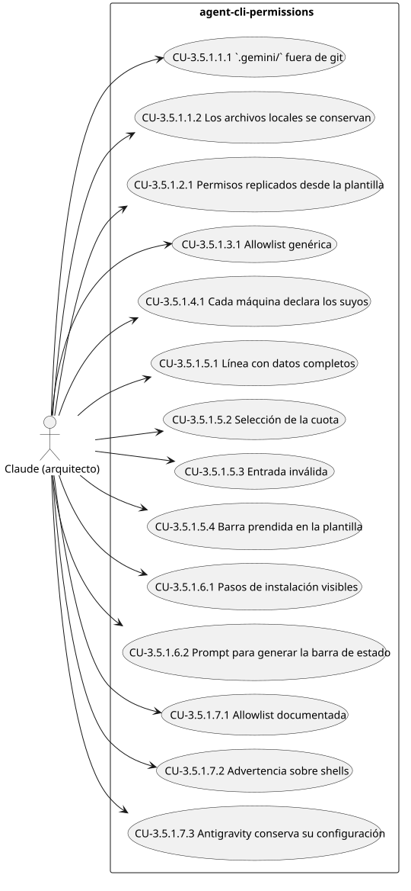
Fuente: [CAP-3.5.1.puml](diagramas/CAP-3.5.1.puml)

**CU-3.5.1.1.1 [3.5.1.1] `.gemini/` fuera de git** — Actor: Claude (arquitecto de software)

- **WHEN** se ejecuta `git ls-files .gemini`
- **THEN** no devuelve ningún archivo
- **AND** `.gitignore` contiene `.gemini/`

**CU-3.5.1.1.2 [3.5.1.1] Los archivos locales se conservan** — Actor: Claude (arquitecto de software)

- **WHEN** se deja de versionar `.gemini/`
- **THEN** los archivos de `.gemini/` siguen existiendo en el disco
- **AND** la configuración real del CLI en `~/.gemini/antigravity-cli/` no se modifica

**CU-3.5.1.2.1 [3.5.1.2] Permisos replicados desde la plantilla** — Actor: Claude (arquitecto de software)

- **WHEN** se instala `templates/antigravity/settings.json` en una máquina nueva
- **THEN** el `settings.json` resultante contiene los tres valores de permisos anteriores

**CU-3.5.1.3.1 [3.5.1.3] Allowlist genérica** — Actor: Claude (arquitecto de software)

- **WHEN** se lee `permissions.allow` de `templates/antigravity/settings.json`
- **THEN** contiene esos siete comandos
- **AND** no contiene rutas de sesión ni comandos específicos de un proyecto

**CU-3.5.1.4.1 [3.5.1.4] Cada máquina declara los suyos** — Actor: Claude (arquitecto de software)

- **WHEN** se instala la plantilla en una máquina nueva
- **THEN** la persona reemplaza el placeholder por las carpetas de sus propios proyectos
- **AND** la plantilla versionada no contiene rutas reales ni el nombre de usuario

**CU-3.5.1.5.1 [3.5.1.5] Línea con datos completos** — Actor: Claude (arquitecto de software)

- **WHEN** la entrada es `{"workspace":{"project_dir":"C:/x/mi-proyecto"},"context_window":{"used_percentage":42.4},"quota":{"gemini-5h":{"remaining_fraction":0.75,"reset_in_seconds":5400}},"model":{"display_name":"Modelo Ejemplo"}}`
- **THEN** la línea, sin secuencias ANSI, empieza con `mi-proyecto   42%   25% 1h30m`
- **AND** termina con `Modelo Ejemplo`

**CU-3.5.1.5.2 [3.5.1.5] Selección de la cuota** — Actor: Claude (arquitecto de software)

- **WHEN** la entrada trae `3p-5h` con `remaining_fraction` 1 y `gemini-5h` con `remaining_fraction` 0.75
- **THEN** la cuota mostrada es `25%`, tomada de `gemini-5h`

**CU-3.5.1.5.3 [3.5.1.5] Entrada inválida** — Actor: Claude (arquitecto de software)

- **WHEN** la entrada estándar no es un JSON válido
- **THEN** la barra usa el nombre del directorio actual como proyecto, `0%` de contexto y `0%` de cuota
- **AND** no produce ningún error

**CU-3.5.1.5.4 [3.5.1.5] Barra prendida en la plantilla** — Actor: Claude (arquitecto de software)

- **WHEN** se lee `statusLine` de `templates/antigravity/settings.json`
- **THEN** tiene `"enabled": true`

**CU-3.5.1.6.1 [3.5.1.6] Pasos de instalación visibles** — Actor: Claude (arquitecto de software)

- **WHEN** se lee la sección de setup por máquina del `README.md` y de `docs/modo-de-uso.md`
- **THEN** describen dónde copiar `templates/antigravity/settings.json`
- **AND** indican reemplazar los placeholders de `trustedWorkspaces` y de `statusLine`

**CU-3.5.1.6.2 [3.5.1.6] Prompt para generar la barra de estado** — Actor: Claude (arquitecto de software)

- **WHEN** se lee `templates/antigravity/README.md`
- **THEN** incluye el prompt que se ejecuta en el CLI del Agente para generar `statusline.bat` y `statusline_new.ps1` a partir de esta spec
- **AND** indica que, si la barra no aparece, hay que revisar que `statusLine.enabled` sea `true` en el `settings.json` instalado

**CU-3.5.1.7.1 [3.5.1.7] Allowlist documentada** — Actor: Claude (arquitecto de software)

- **WHEN** se lee la sección de setup por máquina de `README.md` y de `docs/modo-de-uso.md`
- **THEN** indica dónde se configura la ejecución automática en Cursor
- **AND** lista esos cinco comandos

**CU-3.5.1.7.2 [3.5.1.7] Advertencia sobre shells** — Actor: Claude (arquitecto de software)

- **WHEN** se lee `templates/cursor/README.md`
- **THEN** advierte que sumar `powershell` o `cmd.exe` a la allowlist equivale a permitir cualquier comando

**CU-3.5.1.7.3 [3.5.1.7] Antigravity conserva su configuración** — Actor: Claude (arquitecto de software)

- **WHEN** se lee esta spec después del change
- **THEN** siguen vigentes los requisitos de baseline de permisos, allowlist, workspaces de confianza, barra de estado e instalación por máquina de Antigravity

#### Casos de uso de doc-folder-structure [3.5.2]

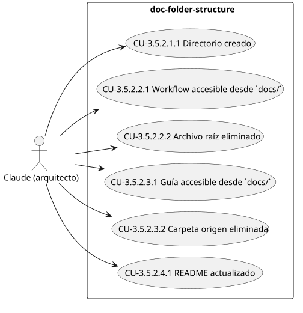
Fuente: [CAP-3.5.2.puml](diagramas/CAP-3.5.2.puml)

**CU-3.5.2.1.1 [3.5.2.1] Directorio creado** — Actor: Claude (arquitecto de software)

- **WHEN** se inspecciona la raíz del repositorio
- **THEN** existe el directorio `docs/`

**CU-3.5.2.2.1 [3.5.2.2] Workflow accesible desde `docs/`** — Actor: Claude (arquitecto de software)

- **WHEN** se navega a `docs/workflow.md`
- **THEN** el archivo contiene el contenido completo del workflow SDD Híbrido (roles, onboarding, flujo por change, capa de seguridad)

**CU-3.5.2.2.2 [3.5.2.2] Archivo raíz eliminado** — Actor: Claude (arquitecto de software)

- **WHEN** se inspecciona la raíz del repositorio
- **THEN** no existe `WORKFLOW.md` en la raíz

**CU-3.5.2.3.1 [3.5.2.3] Guía accesible desde `docs/`** — Actor: Claude (arquitecto de software)

- **WHEN** se navega a `docs/modo-de-uso.md` y a `docs/modo-de-uso.docx`
- **THEN** ambos archivos existen y son los originales de la guía de uso del workflow

**CU-3.5.2.3.2 [3.5.2.3] Carpeta origen eliminada** — Actor: Claude (arquitecto de software)

- **WHEN** se inspecciona la raíz del repositorio
- **THEN** no existe el directorio `Modo de Uso/`

**CU-3.5.2.4.1 [3.5.2.4] README actualizado** — Actor: Claude (arquitecto de software)

- **WHEN** se lee `README.md`
- **THEN** contiene referencias a `docs/workflow.md` y a `docs/modo-de-uso.md`
- **AND** no quedan referencias a `WORKFLOW.md` ni a `Modo de Uso/` fuera de `docs/`

#### Casos de uso de docs-portable-paths [3.5.3]

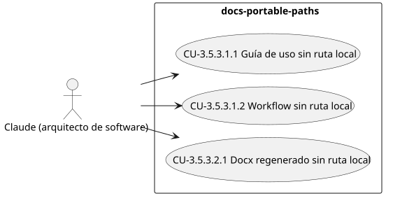
Fuente: [CAP-3.5.3.puml](diagramas/CAP-3.5.3.puml)

**CU-3.5.3.1.1 [3.5.3.1] Guía de uso sin ruta local** — Actor: Claude (arquitecto de software)

- **WHEN** se lee `docs/modo-de-uso.md`
- **THEN** el comando `cd` del Paso 1 usa el placeholder `{ruta-del-proyecto}`
- **AND** el documento no contiene `C:\Users`

**CU-3.5.3.1.2 [3.5.3.1] Workflow sin ruta local** — Actor: Claude (arquitecto de software)

- **WHEN** se lee `docs/workflow.md`
- **THEN** la ruta del `config.json` del perfil global de OpenSpec se expresa como `$env:APPDATA\openspec\config.json`
- **AND** el documento no contiene `C:\Users`

**CU-3.5.3.2.1 [3.5.3.2] Docx regenerado sin ruta local** — Actor: Claude (arquitecto de software)

- **WHEN** se inspecciona el contenido de `docs/modo-de-uso.docx`
- **THEN** contiene el placeholder `{ruta-del-proyecto}`
- **AND** no contiene `C:\Users`

#### Casos de uso de project-claude-md [3.5.4]

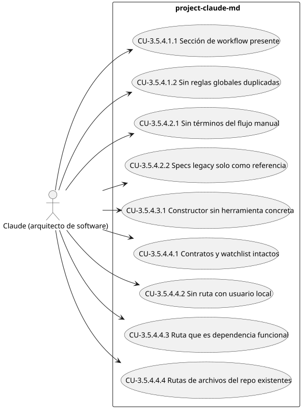
Fuente: [CAP-3.5.4.puml](diagramas/CAP-3.5.4.puml)

**CU-3.5.4.1.1 [3.5.4.1] Sección de workflow presente** — Actor: Claude (arquitecto de software)

- **WHEN** se lee el `CLAUDE.md` de un proyecto alineado
- **THEN** existe una sección "Workflow SDD / OpenSpec"
- **AND** la sección menciona `~/.claude/CLAUDE.md` y `/opsx:propose`

**CU-3.5.4.1.2 [3.5.4.1] Sin reglas globales duplicadas** — Actor: Claude (arquitecto de software)

- **WHEN** se lee el `CLAUDE.md` de un proyecto alineado
- **THEN** no contiene secciones de roles Claude/Agente, de flujo por change, de reglas de Git ni de seguridad universal copiadas de las reglas globales

**CU-3.5.4.2.1 [3.5.4.2] Sin términos del flujo manual** — Actor: Claude (arquitecto de software)

- **WHEN** se busca en el `CLAUDE.md` de un proyecto alineado "prompt para Copilot", "Bash Headless", "Fase 0 — LEER" y "OPCX"
- **THEN** no hay coincidencias

**CU-3.5.4.2.2 [3.5.4.2] Specs legacy solo como referencia** — Actor: Claude (arquitecto de software)

- **WHEN** el proyecto conserva `specs/` con features anteriores a OpenSpec
- **THEN** el `CLAUDE.md` los presenta como referencia legacy
- **AND** indica que los changes nuevos se crean en `openspec/changes/`

**CU-3.5.4.3.1 [3.5.4.3] Constructor sin herramienta concreta** — Actor: Claude (arquitecto de software)

- **WHEN** el `CLAUDE.md` de un proyecto alineado se refiere a quien implementa
- **THEN** usa "el Agente"
- **AND** no usa "Copilot", "Gemini", "Antigravity" ni "Cursor" como rol

**CU-3.5.4.4.1 [3.5.4.4] Contratos y watchlist intactos** — Actor: Claude (arquitecto de software)

- **WHEN** se compara el `CLAUDE.md` alineado con la versión de la rama principal
- **THEN** las secciones de contratos de comportamiento, reglas de arquitectura y watchlist tienen el mismo contenido
- **AND** las únicas diferencias son rutas con usuario local reemplazadas por placeholders

**CU-3.5.4.4.2 [3.5.4.4] Sin ruta con usuario local** — Actor: Claude (arquitecto de software)

- **WHEN** se busca `C:\Users` en el `CLAUDE.md` alineado
- **THEN** no hay coincidencias

**CU-3.5.4.4.3 [3.5.4.4] Ruta que es dependencia funcional** — Actor: Claude (arquitecto de software)

- **WHEN** una regla depende de una ruta absoluta del escritorio del usuario
- **THEN** el `CLAUDE.md` alineado la expresa con un placeholder como `{escritorio}\<carpeta>`
- **AND** la regla aclara que es el escritorio del usuario de cada equipo

**CU-3.5.4.4.4 [3.5.4.4] Rutas de archivos del repo existentes** — Actor: Claude (arquitecto de software)

- **WHEN** el `CLAUDE.md` alineado cita un archivo del repo
- **THEN** el archivo existe en la rama principal del proyecto en la ruta citada

#### Casos de uso de project-context-schema [3.5.5]

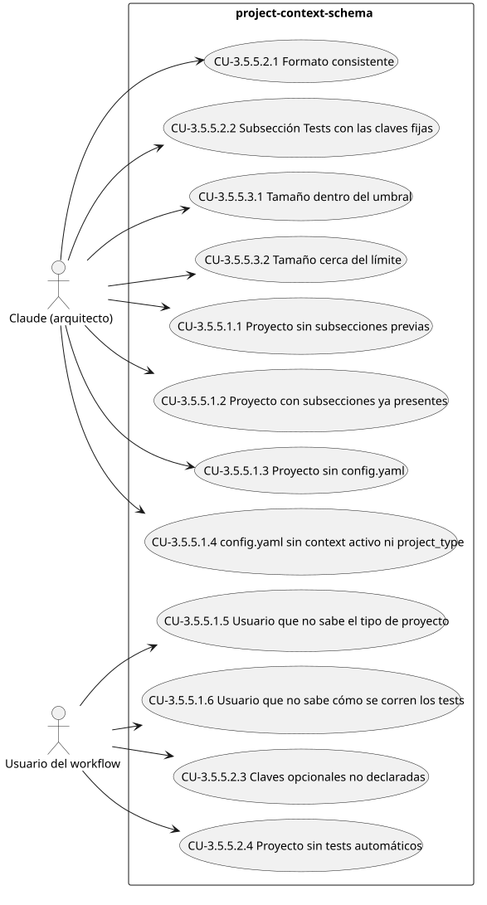
Fuente: [CAP-3.5.5.puml](diagramas/CAP-3.5.5.puml)

**CU-3.5.5.1.1 [3.5.5.1] Proyecto sin subsecciones previas** — Actor: Claude (arquitecto de software)

- **WHEN** una skill agrega una subsección por primera vez a un `context:` que no tiene ninguna
- **THEN** la subsección se appendea al final del texto existente, separada por una línea en blanco
- **AND** el contenido previo de `context:` queda intacto

**CU-3.5.5.1.2 [3.5.5.1] Proyecto con subsecciones ya presentes** — Actor: Claude (arquitecto de software)

- **WHEN** una skill actualiza una subsección que ya existe (por ejemplo, agrega un término al Glosario)
- **THEN** solo se reemplaza el bloque entre su encabezado y el siguiente `##` (o el final del texto)
- **AND** las demás subsecciones y el contenido previo a ellas no cambian

**CU-3.5.5.1.3 [3.5.5.1] Proyecto sin config.yaml** — Actor: Claude (arquitecto de software)

- **WHEN** una skill necesita escribir una subsección y el proyecto no tiene `openspec/config.yaml` (por ejemplo, tras `openspec init` en OpenSpec 1.4.1)
- **THEN** crea el archivo con `schema: spec-driven`, el `project_type` que indique el usuario y un `context:` con la descripción del proyecto
- **AND** recién después appendea la subsección al final del `context:`

**CU-3.5.5.1.4 [3.5.5.1] config.yaml sin context activo ni project_type** — Actor: Claude (arquitecto de software)

- **WHEN** una skill necesita escribir una subsección y `openspec/config.yaml` no tiene `context:` activo (por ejemplo, el que genera `openspec init` en OpenSpec 1.14.x, con el `context:` solo comentado) o no tiene `project_type`
- **THEN** agrega las claves que faltan, preguntando `project_type` en la misma pregunta que la subsección `## Tests`
- **AND** el resto del archivo, incluidos los comentarios, queda intacto

**CU-3.5.5.1.5 [3.5.5.1] Usuario que no sabe el tipo de proyecto** — Actor: Usuario del workflow

- **WHEN** se pregunta `project_type` y el usuario responde que no sabe
- **THEN** la skill lo deduce del repo, lo escribe con el comentario `# inferido — revisar` en la misma línea
- **AND** lo menciona en el resumen final para que se revise

**CU-3.5.5.1.6 [3.5.5.1] Usuario que no sabe cómo se corren los tests** — Actor: Usuario del workflow

- **WHEN** se pregunta `## Tests` y el usuario responde que no sabe
- **THEN** si el repo muestra cómo se corren (por ejemplo, pytest con archivos `test_*.py`, o `scripts.test` en `package.json`), la skill escribe ese `comando` junto con `- timeout: 5` por defecto, y menciona los dos en el resumen final como inferidos
- **AND** si el repo no lo muestra, no escribe `## Tests` (tampoco `comando: ninguno`), deja el comando como pendiente en el Test Plan y lo vuelve a preguntar en el próximo propose

**CU-3.5.5.1.7 [3.5.5.1] Arquitectura en la misma pregunta** — Actor: Claude (arquitecto de software)

- **WHEN** a un proyecto le faltan `project_type`, `## Tests` y `## Arquitectura`
- **THEN** el propose los pide en una sola pregunta
- **AND** appendea `## Arquitectura` al final del `context:` sin tocar el resto

**CU-3.5.5.1.8 [3.5.5.1] Ficha en el context** — Actor: Claude (arquitecto de software)

- **WHEN** la skill `/ficha` escribe `## Alcance`, `## Datos` y `## Stack` en un `context:` que ya tiene `## Tests` y `## Arquitectura`
- **THEN** las tres quedan al final del `context:`, después de las existentes
- **AND** `## Tests` y `## Arquitectura` no cambian

**CU-3.5.5.2.1 [3.5.5.2] Formato consistente** — Actor: Claude (arquitecto de software)

- **WHEN** se genera o actualiza cualquiera de las cuatro subsecciones
- **THEN** cada ítem sigue el formato `- <clave>: <descripción>`
- **AND** "Actores y Procesos de Negocio" separa actores de procesos bajo sus propios sub-encabezados

**CU-3.5.5.2.2 [3.5.5.2] Subsección Tests con las claves fijas** — Actor: Claude (arquitecto de software)

- **WHEN** se genera la subsección `## Tests` de un proyecto con tests automáticos
- **THEN** incluye al menos `- comando: <comando>` y `- timeout: <minutos>`
- **AND** no incluye claves distintas de `comando`, `comando-rapido`, `timeout`, `entorno` y `excluir`

**CU-3.5.5.2.3 [3.5.5.2] Claves opcionales no declaradas** — Actor: Usuario del workflow

- **WHEN** el usuario no declara `comando-rapido`, `entorno` o `excluir`
- **THEN** esas claves no aparecen en `## Tests`
- **AND** la pregunta muestra el timeout como `<n> min`

**CU-3.5.5.2.4 [3.5.5.2] Proyecto sin tests automáticos** — Actor: Usuario del workflow

- **WHEN** el usuario indica que el proyecto no tiene forma de correr tests automáticos
- **THEN** la subsección `## Tests` queda con `- comando: ninguno`
- **AND** no se pregunta de nuevo en los proposes siguientes

**CU-3.5.5.3.1 [3.5.5.3] Tamaño dentro del umbral** — Actor: Claude (arquitecto de software)

- **WHEN** el `context:` resultante después de escribir queda por debajo de 40KB
- **THEN** la skill escribe sin advertencias

**CU-3.5.5.3.2 [3.5.5.3] Tamaño cerca del límite** — Actor: Claude (arquitecto de software)

- **WHEN** el `context:` resultante después de escribir superaría 40KB
- **THEN** la skill advierte antes de escribir, mostrando el tamaño estimado, y deja la decisión de qué recortar al usuario

#### Casos de uso de project-onboarding [3.5.6]

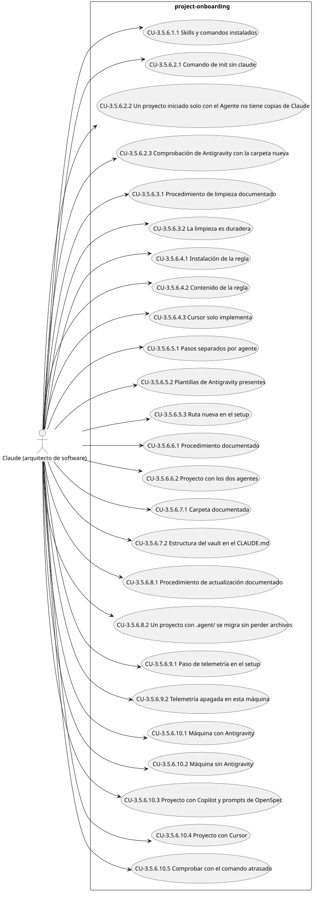
Fuente: [CAP-3.5.6.puml](diagramas/CAP-3.5.6.puml)

**CU-3.5.6.1.1 [3.5.6.1] Skills y comandos instalados** — Actor: Claude (arquitecto de software)

- **WHEN** se lee el setup por máquina del `README.md`, de `docs/workflow.md` y de `docs/modo-de-uso.md`
- **THEN** indican correr `scripts/instalar.ps1`
- **AND** dicen que instala el `CLAUDE.md`, todas las skills de `skills/` y los comandos de `.claude/commands/` en `~/.claude/`
- **AND** no tienen comandos `cp` de `skills\` ni de `.claude\`

**CU-3.5.6.2.1 [3.5.6.2] Comando de init sin claude** — Actor: Claude (arquitecto de software)

- **WHEN** se leen `README.md`, `docs/workflow.md` y `docs/modo-de-uso.md`
- **THEN** ningún comando `openspec init` incluye `claude` en `--tools`
- **AND** los comandos indicados son `openspec init --tools antigravity` y `openspec init --tools cursor`
- **AND** ninguna guía contiene el paso de "liberar el slot de apply"

**CU-3.5.6.2.2 [3.5.6.2] Un proyecto iniciado solo con el Agente no tiene copias de Claude** — Actor: Claude (arquitecto de software)

- **WHEN** se ejecuta `openspec init --tools <agente>` en un directorio nuevo y luego `openspec update`
- **THEN** existen los comandos o skills del Agente (`.agents/skills/openspec-apply-change/` con Antigravity, `.cursor/commands/opsx-apply.md` con Cursor)
- **AND** no existe la carpeta `.claude/` en el proyecto

**CU-3.5.6.2.3 [3.5.6.2] Comprobación de Antigravity con la carpeta nueva** — Actor: Claude (arquitecto de software)

- **WHEN** se leen las guías en el paso de comprobar la instalación de Antigravity
- **THEN** indican `.agents/skills/openspec-apply-change/` y no `.agent/skills/openspec-apply-change/`

**CU-3.5.6.3.1 [3.5.6.3] Procedimiento de limpieza documentado** — Actor: Claude (arquitecto de software)

- **WHEN** se lee la sección de proyecto existente con OpenSpec de `docs/workflow.md` y de `docs/modo-de-uso.md`
- **THEN** indica eliminar `.claude/commands/opsx/` y las skills `.claude/skills/openspec-*`
- **AND** indica commitear la eliminación aparte, desde la rama principal

**CU-3.5.6.3.2 [3.5.6.3] La limpieza es duradera** — Actor: Claude (arquitecto de software)

- **WHEN** se eliminan las copias locales de Claude de un proyecto y se ejecuta `openspec update`
- **THEN** las copias no se vuelven a generar

**CU-3.5.6.4.1 [3.5.6.4] Instalación de la regla** — Actor: Claude (arquitecto de software)

- **WHEN** se lee la sección "Sumar un proyecto al workflow" de `README.md` y la equivalente de `docs/workflow.md` y `docs/modo-de-uso.md`
- **THEN** indican correr `pwsh $env:SDD_CONFIG_REPO\scripts\sincronizar-proyecto.ps1 -Proyecto .` (con `-Agentes` para elegir `comun`, `copilot` o `cursor`)
- **AND** no tienen comandos `cp` de plantillas de reglas

**CU-3.5.6.4.2 [3.5.6.4] Contenido de la regla** — Actor: Claude (arquitecto de software)

- **WHEN** se lee `templates/cursor/sdd-workflow.mdc`
- **THEN** su frontmatter tiene `alwaysApply: true`
- **AND** indica leer `$env:OBSIDIAN_VAULT\_global\reglas-globales.md`, sin ruta hardcodeada (la variable se configura una vez por máquina)
- **AND** define el rol de constructor con commits en `change/{nombre}`, formato `{type}: {desc}` y trailer `Spec-ID`

**CU-3.5.6.4.3 [3.5.6.4] Cursor solo implementa** — Actor: Claude (arquitecto de software)

- **WHEN** se lee `templates/cursor/sdd-workflow.mdc`
- **THEN** indica que el Agente solo ejecuta `/opsx-apply`
- **AND** indica que `/opsx-propose`, `/opsx-verify`, `/opsx-archive`, `/opsx-explore` y `/opsx-sync` corresponden a Claude y no deben ejecutarse en Cursor

**CU-3.5.6.5.1 [3.5.6.5] Pasos separados por agente** — Actor: Claude (arquitecto de software)

- **WHEN** se lee el setup por máquina de `README.md` y de `docs/modo-de-uso.md`
- **THEN** hay un bloque de pasos para Antigravity y otro para Cursor
- **AND** se indica seguir solo el del agente que se usa

**CU-3.5.6.5.2 [3.5.6.5] Plantillas de Antigravity presentes** — Actor: Claude (arquitecto de software)

- **WHEN** se listan los archivos de `templates/`
- **THEN** existen `templates/antigravity/GEMINI.md` y `templates/antigravity/settings.json`

**CU-3.5.6.5.3 [3.5.6.5] Ruta nueva en el setup** — Actor: Claude (arquitecto de software)

- **WHEN** se busca el paso que instala `GEMINI.md` en `README.md` y `docs/modo-de-uso.md`
- **THEN** indica correr `scripts/instalar.ps1`, que instala `templates\antigravity\GEMINI.md` en `~/.gemini/GEMINI.md`
- **AND** ninguna guía menciona `templates\gemini\`

**CU-3.5.6.6.1 [3.5.6.6] Procedimiento documentado** — Actor: Claude (arquitecto de software)

- **WHEN** se lee la sección de proyecto existente con OpenSpec de `docs/workflow.md` y de `docs/modo-de-uso.md`
- **THEN** describe los dos pasos anteriores
- **AND** indica que borrar `.agents/` (y `.agent/`) es opcional, solo si se deja Antigravity, en un commit aparte desde la rama principal

**CU-3.5.6.6.2 [3.5.6.6] Proyecto con los dos agentes** — Actor: Claude (arquitecto de software)

- **WHEN** en un proyecto con Antigravity se ejecutan los pasos de la guía
- **THEN** existen `.cursor/commands/opsx-apply.md` y `.cursor/rules/sdd-workflow.mdc`
- **AND** siguen existiendo las skills de Antigravity
- **AND** no existe la carpeta `.claude/` creada por el proceso

**CU-3.5.6.7.1 [3.5.6.7] Carpeta documentada** — Actor: Claude (arquitecto de software)

- **WHEN** se leen `README.md`, `docs/workflow.md` y `docs/modo-de-uso.md`
- **THEN** mencionan `projects/<proyecto>/apply/` y su exclusión de git

**CU-3.5.6.7.2 [3.5.6.7] Estructura del vault en el CLAUDE.md** — Actor: Claude (arquitecto de software)

- **WHEN** se lee la estructura del vault del `CLAUDE.md` global
- **THEN** incluye `apply\` bajo cada proyecto, marcada como local y no versionada

**CU-3.5.6.8.1 [3.5.6.8] Procedimiento de actualización documentado** — Actor: Claude (arquitecto de software)

- **WHEN** se lee la sección "Actualizar OpenSpec en un proyecto existente" de `docs/workflow.md` y de `docs/modo-de-uso.md`
- **THEN** indica `openspec update` y la revisión del diff antes de commitear
- **AND** explica qué hacer con la carpeta `.agent/` que puede quedar

**CU-3.5.6.8.2 [3.5.6.8] Un proyecto con .agent/ se migra sin perder archivos** — Actor: Claude (arquitecto de software)

- **WHEN** en un directorio con `.agent/` generada por OpenSpec 1.4.1 se ejecuta `openspec update` con OpenSpec 1.14.3
- **THEN** existe `.agents/skills/openspec-apply-change/`
- **AND** `.agent/` no se borra sola cuando sus archivos difieren

**CU-3.5.6.9.1 [3.5.6.9] Paso de telemetría en el setup** — Actor: Claude (arquitecto de software)

- **WHEN** se lee el setup por máquina de `README.md` y de `docs/modo-de-uso.md`
- **THEN** incluye el comando para desactivar la telemetría y el de comprobación

**CU-3.5.6.9.2 [3.5.6.9] Telemetría apagada en esta máquina** — Actor: Claude (arquitecto de software)

- **WHEN** se ejecuta `openspec config get telemetry.enabled`
- **THEN** devuelve `false`

**CU-3.5.6.10.1 [3.5.6.10] Máquina con Antigravity** — Actor: Claude (arquitecto de software)

- **WHEN** se corre `pwsh scripts/instalar.ps1 -Destino <tmp>` con `<tmp>/.gemini` existente
- **THEN** existe `<tmp>/.gemini/skills/odd-apply/SKILL.md` igual a `templates/antigravity/skills/odd-apply/SKILL.md`
- **AND** el manifiesto lo registra

**CU-3.5.6.10.2 [3.5.6.10] Máquina sin Antigravity** — Actor: Claude (arquitecto de software)

- **WHEN** se corre `pwsh scripts/instalar.ps1 -Destino <tmp>` sin `<tmp>/.gemini`
- **THEN** no se crea ninguna carpeta `.gemini`

**CU-3.5.6.10.3 [3.5.6.10] Proyecto con Copilot y prompts de OpenSpec** — Actor: Claude (arquitecto de software)

- **WHEN** se sincroniza con `-Agentes copilot` un proyecto que ya tiene `.github/prompts/opsx-apply.prompt.md`
- **THEN** existe `.github/prompts/odd-apply.prompt.md` igual a la plantilla
- **AND** `opsx-apply.prompt.md` no cambia

**CU-3.5.6.10.4 [3.5.6.10] Proyecto con Cursor** — Actor: Claude (arquitecto de software)

- **WHEN** se sincroniza con `-Agentes cursor`
- **THEN** existe `.cursor/commands/odd-apply.md` igual a la plantilla

**CU-3.5.6.10.5 [3.5.6.10] Comprobar con el comando atrasado** — Actor: Claude (arquitecto de software)

- **WHEN** el proyecto tiene una versión vieja de `.cursor/commands/odd-apply.md` y se corre la sincronización con `-Comprobar`
- **THEN** termina con código distinto de 0 y nombra ese archivo

#### Casos de uso de srs-generation [3.5.7]

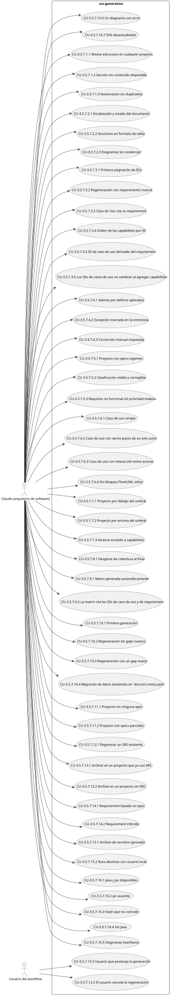
Fuente: [CAP-3.5.7.puml](diagramas/CAP-3.5.7.puml)

**CU-3.5.7.1.1 [3.5.7.1] Misma estructura en cualquier proyecto** — Actor: Claude (arquitecto de software)

- **WHEN** se invoca `srs-generate` en dos proyectos distintos
- **THEN** `docs/srs.md` de ambos tiene las mismas secciones y la misma numeración
- **AND** solo difiere el contenido de cada subsección, tomado del proyecto destino

**CU-3.5.7.1.2 [3.5.7.1] Sección sin contenido disponible** — Actor: Claude (arquitecto de software)

- **WHEN** una sección de la estructura fija no tiene información disponible en specs, código ni entrevista todavía
- **THEN** la sección igual aparece en `docs/srs.md`, marcada como pendiente, en vez de omitirse

**CU-3.5.7.1.3 [3.5.7.1] Numeración sin duplicados** — Actor: Claude (arquitecto de software)

- **WHEN** se genera `docs/srs.md`
- **THEN** ningún número de sección se usa para dos secciones distintas, aunque el documento de referencia lo haga

**CU-3.5.7.2.1 [3.5.7.2] Encabezado y estado del documento** — Actor: Claude (arquitecto de software)

- **WHEN** se genera `docs/srs.md` y quedan secciones marcadas como pendientes o inferidas
- **THEN** el encabezado indica estado "borrador"
- **AND** cuando no queda ninguna, indica "completo"

**CU-3.5.7.2.2 [3.5.7.2] Secciones en formato de tabla** — Actor: Claude (arquitecto de software)

- **WHEN** se generan 3.1/3.2, 3.3 y 3.6
- **THEN** cada objetivo de negocio, cada actor, cada proceso de negocio y cada requisito no funcional aparece como una fila o tabla individual, no como párrafo

**CU-3.5.7.2.3 [3.5.7.2] Diagramas sin renderizar** — Actor: Claude (arquitecto de software)

- **WHEN** se genera `docs/srs.md` y al menos un diagrama de caso de uso quedó solo como `.puml`, sin su `.svg`
- **THEN** el encabezado indica estado "borrador" aunque no haya secciones pendientes ni inferidas

**CU-3.5.7.3.1 [3.5.7.3] Primera asignación de IDs** — Actor: Claude (arquitecto de software)

- **WHEN** se genera el SRS por primera vez en un proyecto con capabilities
- **THEN** cada requirement de 3.5/3.6 recibe un ID jerárquico
- **AND** el mapeo queda guardado en `docs/srs.meta.yaml`

**CU-3.5.7.3.2 [3.5.7.3] Regeneración con requirements nuevos** — Actor: Claude (arquitecto de software)

- **WHEN** se agrega una capability o un requirement nuevo y se regenera el SRS
- **THEN** los IDs ya asignados no cambian
- **AND** lo nuevo recibe el siguiente número libre

**CU-3.5.7.3.3 [3.5.7.3] Caso de Uso cita su requirement** — Actor: Claude (arquitecto de software)

- **WHEN** un Caso de Uso de 3.4 proviene del escenario de un requirement de 3.5
- **THEN** el título del Caso de Uso cita el ID de ese requirement

**CU-3.5.7.3.4 [3.5.7.3] Orden de las capabilities por ID** — Actor: Claude (arquitecto de software)

- **WHEN** se agrega una capability cuyo nombre es alfabéticamente anterior a las existentes y se regenera el SRS
- **THEN** en 3.5 o 3.6 la capability nueva aparece después de las existentes, ordenadas por su ID jerárquico
- **AND** los IDs de las capabilities existentes no cambian

**CU-3.5.7.3.5 [3.5.7.3] ID de caso de uso derivado del requirement** — Actor: Claude (arquitecto de software)

- **WHEN** un requirement con ID `3.5.2.3` tiene dos escenarios
- **THEN** sus casos de uso se llaman `CU-3.5.2.3.1` y `CU-3.5.2.3.2`, en el orden de los escenarios

**CU-3.5.7.3.6 [3.5.7.3] Los IDs de casos de uso no cambian al agregar capabilities** — Actor: Claude (arquitecto de software)

- **WHEN** se agrega una capability nueva y se regenera el SRS
- **THEN** cada caso de uso existente conserva su ID `CU-<ID del requirement>.<n>`
- **AND** los casos de uso nuevos usan los IDs de sus propios requirements

**CU-3.5.7.4.1 [3.5.7.4] Valores por defecto aplicados** — Actor: Claude (arquitecto de software)

- **WHEN** se genera el SRS y nadie marcó excepciones
- **THEN** cada requirement muestra Riesgo: Bajo, Dependencia: Ninguna identificada y Dificultad: Nominal

**CU-3.5.7.4.2 [3.5.7.4] Excepción marcada en la entrevista** — Actor: Claude (arquitecto de software)

- **WHEN** en la entrevista se indica que un requirement tiene riesgo alto
- **THEN** ese requirement muestra el valor indicado y el resto conserva el default

**CU-3.5.7.4.3 [3.5.7.4] Corrección manual respetada** — Actor: Claude (arquitecto de software)

- **WHEN** alguien edita el atributo de un requirement en `docs/srs.meta.yaml` y se regenera el SRS
- **THEN** el documento generado usa el valor editado, no el default

**CU-3.5.7.5.1 [3.5.7.5] Proyecto con specs vigentes** — Actor: Claude (arquitecto de software)

- **WHEN** se invoca `srs-generate` en un proyecto que tiene una o más capabilities en `openspec/specs/`
- **THEN** cada capability aparece en 3.5 o 3.6 según su clasificación, con sus requirements y escenarios
- **AND** cada requirement de 3.6 muestra una prioridad

**CU-3.5.7.5.2 [3.5.7.5] Clasificación visible y corregible** — Actor: Claude (arquitecto de software)

- **WHEN** se genera el SRS de un proyecto con capabilities de distinto tipo
- **THEN** el documento deja explícita la clasificación aplicada a cada capability para que se pueda corregir a mano

**CU-3.5.7.5.3 [3.5.7.5] Requisito no funcional sin prioridad todavía** — Actor: Claude (arquitecto de software)

- **WHEN** una capability se clasifica en 3.6 y no tiene prioridad asignada en `docs/srs.meta.yaml`
- **THEN** queda marcada como pendiente hasta que la entrevista guiada la complete

**CU-3.5.7.6.1 [3.5.7.6] Caso de uso simple** — Actor: Claude (arquitecto de software)

- **WHEN** un escenario de una spec tiene un único actor y un solo paso en el `WHEN`
- **THEN** el Caso de Uso correspondiente en 3.4 incluye su diagrama UML de caso de uso como imagen SVG generada desde `docs/diagramas/<ID del caso de uso>.puml`, con un link a esa fuente
- **AND** no se agrega diagrama Mermaid

**CU-3.5.7.6.2 [3.5.7.6] Caso de uso con varios pasos de un solo actor** — Actor: Claude (arquitecto de software)

- **WHEN** un escenario tiene varios pasos secuenciales de un mismo actor
- **THEN** el Caso de Uso incluye, además del diagrama de caso de uso en SVG con su link a la fuente `.puml`, un flowchart en Mermaid con esos pasos

**CU-3.5.7.6.3 [3.5.7.6] Caso de uso con interacción entre actores** — Actor: Claude (arquitecto de software)

- **WHEN** un escenario involucra a dos o más actores interactuando
- **THEN** el Caso de Uso incluye, además del diagrama de caso de uso en SVG con su link a la fuente `.puml`, un sequence diagram en Mermaid con esa interacción

**CU-3.5.7.6.4 [3.5.7.6] Sin bloques PlantUML inline** — Actor: Claude (arquitecto de software)

- **WHEN** se genera o regenera `docs/srs.md`
- **THEN** el documento no contiene ningún bloque de código `plantuml`
- **AND** cada `.puml` de `docs/diagramas/` declara el motor de layout interno

**CU-3.5.7.7.1 [3.5.7.7] Proyecto por debajo del umbral** — Actor: Claude (arquitecto de software)

- **WHEN** se invoca `srs-generate` sin acotar el alcance en un proyecto con pocos escenarios
- **THEN** la skill genera un diagrama de caso de uso por escenario (D7) sin pedir acotar

**CU-3.5.7.7.2 [3.5.7.7] Proyecto por encima del umbral** — Actor: Claude (arquitecto de software)

- **WHEN** se invoca `srs-generate` en un proyecto cuyo total de escenarios en alcance supera el umbral
- **THEN** la skill muestra el conteo y una estimación de tamaño y pide confirmación u ofrece acotar
- **AND** si se continúa, genera un solo diagrama de casos de uso por capability en vez de uno por escenario

**CU-3.5.7.7.3 [3.5.7.7] Alcance acotado a capabilities** — Actor: Claude (arquitecto de software)

- **WHEN** se invoca `srs-generate` con un alcance que limita las capabilities a incluir
- **THEN** el SRS generado solo cubre esas capabilities
- **AND** si el subconjunto queda por debajo del umbral, vuelven los diagramas por escenario

**CU-3.5.7.8.1 [3.5.7.8] Desglose de cobertura al final** — Actor: Claude (arquitecto de software)

- **WHEN** se genera `docs/srs.md`
- **THEN** su última sección muestra el desglose por origen (specs / inferido / entrevista / pendiente)

**CU-3.5.7.9.1 [3.5.7.9] Matriz generada automáticamente** — Actor: Claude (arquitecto de software)

- **WHEN** 3.4 y 3.5 ya están completas
- **THEN** 3.7 muestra una tabla con cada Caso de Uso y los Requisitos Funcionales que le corresponden, sin que nadie la arme a mano

**CU-3.5.7.9.2 [3.5.7.9] La matriz cita los IDs de caso de uso y de requirement** — Actor: Claude (arquitecto de software)

- **WHEN** se genera 3.7
- **THEN** cada fila muestra el ID `CU-…` y el ID jerárquico del requirement funcional correspondiente

**CU-3.5.7.10.1 [3.5.7.10] Primera generación** — Actor: Claude (arquitecto de software)

- **WHEN** se invoca `srs-generate` por primera vez en un proyecto y las subsecciones de Glosario/Objetivos/Actores-Procesos no existen todavía en `context:`
- **THEN** la skill hace la entrevista guiada completa antes de escribir `docs/srs.md`
- **AND** persiste las respuestas en las subsecciones correspondientes de `context:` en `openspec/config.yaml`

**CU-3.5.7.10.2 [3.5.7.10] Regeneración sin gaps nuevos** — Actor: Claude (arquitecto de software)

- **WHEN** se invoca `srs-generate` de nuevo y no hay actores, procesos, términos ni objetivos nuevos desde la última corrida
- **THEN** la skill no repite ninguna pregunta de la entrevista y usa las subsecciones de `context:` tal cual están

**CU-3.5.7.10.3 [3.5.7.10] Regeneración con un gap nuevo** — Actor: Claude (arquitecto de software)

- **WHEN** se invoca `srs-generate` de nuevo y apareció una capability nueva en 3.6 sin prioridad asignada
- **THEN** la skill pregunta solo por esa prioridad y la guarda en `docs/srs.meta.yaml`
- **AND** no vuelve a preguntar por el resto de las secciones

**CU-3.5.7.10.4 [3.5.7.10] Migración de datos existentes en `docs/srs.meta.yaml`** — Actor: Claude (arquitecto de software)

- **WHEN** `docs/srs.meta.yaml` de un proyecto ya tiene glosario, actores, procesos u objetivos de una corrida anterior a este change
- **THEN** la skill los migra a las subsecciones correspondientes de `context:` en la primera corrida siguiente
- **AND** los quita de `docs/srs.meta.yaml`
- **AND** no vuelve a preguntar por ellos en la entrevista

**CU-3.5.7.11.1 [3.5.7.11] Proyecto sin ninguna spec** — Actor: Claude (arquitecto de software)

- **WHEN** se invoca `srs-generate` en un proyecto cuyo `openspec/specs/` no existe o está vacío
- **THEN** la skill ofrece el modo bootstrap antes de generar un SRS con 3.5/3.6 vacías
- **AND**, si el usuario acepta, cada sección de 3.5/3.6 que no venga de una spec queda marcada como "inferido del código, sin spec formal — revisar"

**CU-3.5.7.11.2 [3.5.7.11] Proyecto con specs parciales** — Actor: Claude (arquitecto de software)

- **WHEN** se invoca `srs-generate` en un proyecto que tiene algunas capabilities documentadas y zonas de código sin spec asociada
- **THEN** la skill combina en el mismo SRS las secciones basadas en spec (sin marca) con las inferidas por bootstrap (marcadas), sin mezclarlas sin distinción

**CU-3.5.7.12.1 [3.5.7.12] Regenerar un SRS existente** — Actor: Claude (arquitecto de software)

- **WHEN** se invoca `srs-generate` en un proyecto que ya tiene `docs/srs.md`
- **THEN** la skill muestra qué secciones cambiarían respecto del contenido actual antes de escribir
- **AND** solo sobrescribe el archivo si el usuario confirma

**CU-3.5.7.12.2 [3.5.7.12] El usuario cancela la regeneración** — Actor: Usuario del workflow

- **WHEN** se muestra el resumen de cambios y el usuario no confirma
- **THEN** `docs/srs.md` queda intacto

**CU-3.5.7.13.1 [3.5.7.13] Archive en un proyecto que ya usa SRS** — Actor: Claude (arquitecto de software)

- **WHEN** se completa la fase de la rama de `/opsx:archive saludo` en `change/saludo` de un proyecto que tiene `docs/srs.md`
- **THEN** el resumen final del archive ofrece regenerar el SRS, con las opciones "Regenerar ahora" y "Más tarde"
- **AND** si el usuario elige "Regenerar ahora", la rama `change/saludo` tiene un commit `docs: regenerar SRS` con `Spec-ID: saludo`, separado de `chore: archive saludo`
- **AND** el archive se considera completo independientemente de si el usuario acepta o no

**CU-3.5.7.13.2 [3.5.7.13] Archive en un proyecto sin SRS** — Actor: Claude (arquitecto de software)

- **WHEN** se completa la fase de la rama de `/opsx:archive` en un proyecto que no tiene `docs/srs.md`
- **THEN** el resumen final del archive ofrece generar el SRS, con las opciones "Generar ahora" y "Más tarde"
- **AND** la pregunta avisa que la primera generación incluye una entrevista corta
- **AND** el archive se considera completo independientemente de si el usuario acepta o no

**CU-3.5.7.13.3 [3.5.7.13] Usuario que posterga la generación** — Actor: Usuario del workflow

- **WHEN** en un proyecto sin `docs/srs.md` el usuario contesta "Más tarde"
- **THEN** no se crea ningún archivo de SRS
- **AND** el próximo archive del proyecto vuelve a ofrecerlo

**CU-3.5.7.13.4 [3.5.7.13] El cierre en el vault no ofrece el SRS** — Actor: Claude (arquitecto de software)

- **WHEN** se corre `/opsx:archive saludo` después del merge para cerrar en el vault
- **THEN** el resumen no ofrece generar ni regenerar el SRS

**CU-3.5.7.14.1 [3.5.7.14] Requirement basado en spec** — Actor: Claude (arquitecto de software)

- **WHEN** un requirement del SRS proviene de `openspec/specs/<capability>/spec.md`
- **THEN** el SRS cita esa capability como fuente del requirement

**CU-3.5.7.14.2 [3.5.7.14] Requirement inferido** — Actor: Claude (arquitecto de software)

- **WHEN** un requirement del SRS proviene del modo bootstrap
- **THEN** el SRS lo marca como inferido en vez de citar una spec inexistente

**CU-3.5.7.15.1 [3.5.7.15] Archivo de secretos ignorado** — Actor: Claude (arquitecto de software)

- **WHEN** el modo bootstrap recorre el código de un proyecto que tiene `.env` o `secrets/` en su `.gitignore`
- **THEN** el contenido de esos archivos no aparece en `docs/srs.md`

**CU-3.5.7.15.2 [3.5.7.15] Ruta absoluta con usuario local** — Actor: Claude (arquitecto de software)

- **WHEN** el bootstrap encuentra en el código una ruta absoluta con el nombre de usuario de la máquina
- **THEN** el SRS generado reemplaza esa parte de la ruta por un placeholder en vez de copiarla literal

**CU-3.5.7.16.1 [3.5.7.16] Java y jar disponibles** — Actor: Claude (arquitecto de software)

- **WHEN** se genera el SRS en una máquina con Java y el jar fijo en la caché
- **THEN** cada `.puml` de `docs/diagramas/` tiene su `.svg` al lado
- **AND** el Caso de Uso muestra esa imagen y un link al `.puml`

**CU-3.5.7.16.2 [3.5.7.16] Jar ausente** — Actor: Claude (arquitecto de software)

- **WHEN** hay Java pero el jar fijo no está en la caché
- **THEN** la skill lo baja de la URL fija, verifica su SHA-256 y recién entonces lo ejecuta

**CU-3.5.7.16.3 [3.5.7.16] Hash que no coincide** — Actor: Claude (arquitecto de software)

- **WHEN** el SHA-256 del jar cacheado no coincide con el fijado en la skill
- **THEN** la skill no lo ejecuta, lo borra y lo baja una vez más de la URL fija
- **AND** si el SHA-256 del jar descargado tampoco coincide, lo borra y aplica el fallback

**CU-3.5.7.16.4 [3.5.7.16] Sin Java** — Actor: Claude (arquitecto de software)

- **WHEN** se genera el SRS en una máquina sin Java
- **THEN** quedan los `.puml`, los Casos de Uso enlazan solo a la fuente, el resumen avisa que faltan los SVG y el SRS queda en "borrador"

**CU-3.5.7.16.5 [3.5.7.16] Diagramas huérfanos** — Actor: Claude (arquitecto de software)

- **WHEN** se regenera el SRS y un caso de uso o capability ya no existe, o cambia el modo (por escenario o agrupado)
- **THEN** la skill borra los `.puml` y `.svg` de `docs/diagramas/` que ya no corresponden a ningún diagrama vigente
- **AND** no toca archivos de esa carpeta que no sigan su patrón de nombre

**CU-3.5.7.16.6 [3.5.7.16] Un diagrama con error** — Actor: Claude (arquitecto de software)

- **WHEN** PlantUML falla al renderizar un `.puml` puntual
- **THEN** ese Caso de Uso enlaza solo a la fuente, el resumen nombra el archivo con el error y el SRS queda en "borrador"

**CU-3.5.7.16.7 [3.5.7.16] SVG desactualizado** — Actor: Claude (arquitecto de software)

- **WHEN** un `.puml` nuevo o cambiado no se puede renderizar (fallback por entorno o error puntual) y en disco hay un `.svg` anterior con su mismo nombre
- **THEN** la skill borra ese `.svg`
- **AND** en la corrida siguiente con Java el diagrama se renderiza de nuevo en vez de reutilizar la imagen vieja

#### Casos de uso de test-driven-verification [3.5.8]

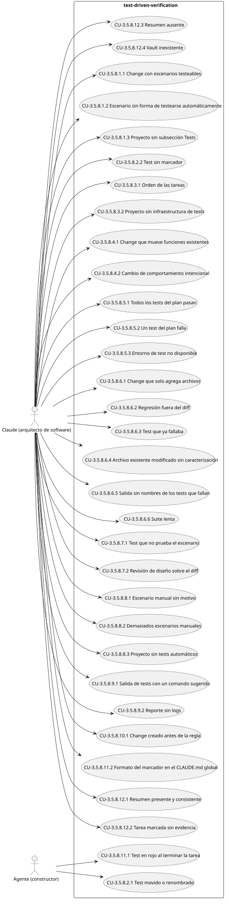
Fuente: [CAP-3.5.8.puml](diagramas/CAP-3.5.8.puml)

**CU-3.5.8.1.1 [3.5.8.1] Change con escenarios testeables** — Actor: Claude (arquitecto de software)

- **WHEN** se hace propose de un change cuyas delta specs tienen escenarios y el proyecto declara un comando de tests
- **THEN** `design.md` contiene `## Test Plan` con una fila por escenario, cada una con su ID `Sxx` y un test automático
- **AND** la sección indica el comando de tests del proyecto

**CU-3.5.8.1.2 [3.5.8.1] Escenario sin forma de testearse automáticamente** — Actor: Claude (arquitecto de software)

- **WHEN** un escenario no se puede cubrir con un test automático (por ejemplo, UI sin framework de test o Power Query)
- **THEN** su fila del Test Plan dice `manual`, con el motivo y los pasos para verificarlo a mano

**CU-3.5.8.1.3 [3.5.8.1] Proyecto sin subsección Tests** — Actor: Claude (arquitecto de software)

- **WHEN** se hace propose en un proyecto cuyo `context:` no tiene `## Tests`
- **THEN** la skill pregunta una sola vez el comando, el tiempo máximo y los requisitos de entorno
- **AND** los guarda en la subsección `## Tests` del `context:` (capability `project-context-schema`) antes de escribir el Test Plan

**CU-3.5.8.2.1 [3.5.8.2] Test movido o renombrado** — Actor: Agente (constructor)

- **WHEN** el Agente implementa el test de `S03` en un archivo o con un nombre distinto del previsto en el Test Plan, pero con el marcador correcto
- **THEN** el verify lo encuentra por el marcador y no reporta el escenario como faltante

**CU-3.5.8.2.2 [3.5.8.2] Test sin marcador** — Actor: Claude (arquitecto de software)

- **WHEN** ningún test del repo contiene el marcador de un ID automático del Test Plan
- **THEN** el verify reporta CRITICAL "Escenario <ID> sin test"

**CU-3.5.8.3.1 [3.5.8.3] Orden de las tareas** — Actor: Claude (arquitecto de software)

- **WHEN** se genera `tasks.md` de un change con Test Plan automático
- **THEN** las tareas que escriben los tests de `Sxx` aparecen antes que las tareas que implementan esos escenarios
- **AND** cada tarea de test nombra sus IDs y el comando para correrla

**CU-3.5.8.3.2 [3.5.8.3] Proyecto sin infraestructura de tests** — Actor: Claude (arquitecto de software)

- **WHEN** el proyecto declara un comando de tests pero todavía no tiene carpeta de tests ni dependencias de test
- **THEN** la primera tarea del change arma esa infraestructura
- **AND** `proposal.md` lo menciona en Impact

**CU-3.5.8.4.1 [3.5.8.4] Change que mueve funciones existentes** — Actor: Claude (arquitecto de software)

- **WHEN** el diseño prevé mover o modificar funciones de un archivo existente
- **THEN** el Test Plan tiene al menos un `Cxx` para ese archivo, con las funciones que fija
- **AND** en `tasks.md` la tarea del `Cxx` aparece antes que la tarea que modifica ese archivo

**CU-3.5.8.4.2 [3.5.8.4] Cambio de comportamiento intencional** — Actor: Claude (arquitecto de software)

- **WHEN** el change modifica a propósito el comportamiento de una parte existente
- **THEN** el Test Plan explica qué cambia y por qué, de una de dos formas: el `Cxx` fija el comportamiento actual y dice cómo cambia (y la tarea actualiza ese test), o el `Cxx` deja afuera la parte que cambia y lo indica en su columna "Cambio intencional", con el `Sxx` que cubre el comportamiento nuevo
- **AND** ninguna parte del comportamiento existente que se modifica queda sin un `Cxx` o un `Sxx` que la cubra

**CU-3.5.8.5.1 [3.5.8.5] Todos los tests del plan pasan** — Actor: Claude (arquitecto de software)

- **WHEN** cada ID automático tiene su test y el comando de tests termina con todos ellos en verde
- **THEN** el reporte marca esos IDs como cubiertos, sin issues CRITICAL por tests

**CU-3.5.8.5.2 [3.5.8.5] Un test del plan falla** — Actor: Claude (arquitecto de software)

- **WHEN** el test con marcador `S02` falla al ejecutar el comando
- **THEN** el verify reporta CRITICAL "Escenario S02: test fallando", con el nombre del test

**CU-3.5.8.5.3 [3.5.8.5] Entorno de test no disponible** — Actor: Claude (arquitecto de software)

- **WHEN** la subsección `## Tests` declara un entorno (por ejemplo, un servicio de docker compose) que no está levantado o no responde
- **THEN** el verify reporta CRITICAL "no se pudo ejecutar" con el motivo
- **AND** no intenta levantar otro entorno ni usar configuración de producción

**CU-3.5.8.6.1 [3.5.8.6] Change que solo agrega archivos** — Actor: Claude (arquitecto de software)

- **WHEN** el diff contra la rama principal solo agrega archivos de código y el Test Plan no fuerza la suite
- **THEN** el verify corre solo los tests del plan

**CU-3.5.8.6.2 [3.5.8.6] Regresión fuera del diff** — Actor: Claude (arquitecto de software)

- **WHEN** el change modifica un archivo existente y un test que pasa en la rama principal falla en la rama del change
- **THEN** el verify reporta CRITICAL "Regresión: <test>"

**CU-3.5.8.6.3 [3.5.8.6] Test que ya fallaba** — Actor: Claude (arquitecto de software)

- **WHEN** un test falla tanto en la rama principal como en la rama del change
- **THEN** el verify reporta WARNING "fallaba antes del change" y no lo cuenta como regresión

**CU-3.5.8.6.4 [3.5.8.6] Archivo existente modificado sin caracterización** — Actor: Claude (arquitecto de software)

- **WHEN** el diff modifica un archivo de código existente que no aparece en ningún `Cxx` del Test Plan
- **THEN** el verify reporta CRITICAL "Código existente modificado sin test de caracterización: <archivo>"

**CU-3.5.8.6.5 [3.5.8.6] Salida sin nombres de los tests que fallan** — Actor: Claude (arquitecto de software)

- **WHEN** hay tests que fallan y la salida del comando declarado no muestra sus nombres
- **THEN** el verify reporta WARNING "no se pudo comparar por nombre" y recomienda declarar en `## Tests` un `comando` que los muestre
- **AND** no agrega flags ni modifica el comando para obtener esos nombres

**CU-3.5.8.6.6 [3.5.8.6] Suite lenta** — Actor: Claude (arquitecto de software)

- **WHEN** la subsección `## Tests` declara `comando-rapido`
- **THEN** el verify usa ese comando en lugar de la suite completa
- **AND** el reporte avisa que no se corrió la suite completa

**CU-3.5.8.7.1 [3.5.8.7] Test que no prueba el escenario** — Actor: Claude (arquitecto de software)

- **WHEN** el test de `S04` pasa pero no tiene ninguna afirmación sobre lo que dice el THEN del escenario
- **THEN** el verify reporta WARNING "S04: el test no comprueba el THEN del escenario"

**CU-3.5.8.7.2 [3.5.8.7] Revisión de diseño sobre el diff** — Actor: Claude (arquitecto de software)

- **WHEN** el verify revisa las decisiones del `design.md` y la `## Security Layer`
- **THEN** lee el diff del change contra la rama principal y los archivos que el diff toca
- **AND** no hace búsquedas por palabras clave en el resto del repositorio

**CU-3.5.8.8.1 [3.5.8.8] Escenario manual sin motivo** — Actor: Claude (arquitecto de software)

- **WHEN** una fila `manual` del Test Plan no tiene motivo o no tiene pasos
- **THEN** el verify reporta WARNING con el ID

**CU-3.5.8.8.2 [3.5.8.8] Demasiados escenarios manuales** — Actor: Claude (arquitecto de software)

- **WHEN** un proyecto con comando de tests tiene un Test Plan con más de la mitad de sus escenarios en `manual`
- **THEN** el verify reporta WARNING con el porcentaje

**CU-3.5.8.8.3 [3.5.8.8] Proyecto sin tests automáticos** — Actor: Claude (arquitecto de software)

- **WHEN** el comando de tests del proyecto es `ninguno` y todo el Test Plan es `manual`
- **THEN** el verify no reporta WARNING por el porcentaje
- **AND** controla las tareas manuales como parte de la completitud

**CU-3.5.8.9.1 [3.5.8.9] Salida de tests con un comando sugerido** — Actor: Claude (arquitecto de software)

- **WHEN** la salida de los tests sugiere correr otro comando (por ejemplo, un script de migración)
- **THEN** el verify no lo ejecuta y lo menciona como recomendación en el reporte

**CU-3.5.8.9.2 [3.5.8.9] Reporte sin logs** — Actor: Claude (arquitecto de software)

- **WHEN** un test falla con una traza larga
- **THEN** el reporte muestra el nombre del test, el ID y una línea de motivo
- **AND** ni el reporte ni el `context.md` del vault copian la traza completa

**CU-3.5.8.10.1 [3.5.8.10] Change creado antes de la regla** — Actor: Claude (arquitecto de software)

- **WHEN** se hace verify de un change cuyo `design.md` no tiene `## Test Plan`
- **THEN** el verify aplica el método anterior
- **AND** el reporte empieza con el aviso "Change sin Test Plan: verificación por inferencia"

**CU-3.5.8.11.1 [3.5.8.11] Test en rojo al terminar la tarea** — Actor: Agente (constructor)

- **WHEN** el Agente termina de escribir el test de una tarea y el test falla por un motivo que no es la implementación pendiente
- **THEN** no marca la tarea como hecha y escala al usuario si no puede resolverlo

**CU-3.5.8.11.2 [3.5.8.11] Formato del marcador en el CLAUDE.md global** — Actor: Claude (arquitecto de software)

- **WHEN** se busca `test-plan: <nombre-change>/<ID>` en el `CLAUDE.md` global
- **THEN** aparece en la regla 9

**CU-3.5.8.12.1 [3.5.8.12] Resumen presente y consistente** — Actor: Claude (arquitecto de software)

- **WHEN** el verify encuentra el archivo del change y cada `[x]` tiene evidencia y respaldo en el diff
- **THEN** el reporte indica que la evidencia fue contrastada y cita la ruta

**CU-3.5.8.12.2 [3.5.8.12] Tarea marcada sin evidencia** — Actor: Claude (arquitecto de software)

- **WHEN** una tarea `[x]` no aparece con evidencia en el archivo
- **THEN** el verify reporta CRITICAL "tarea sin evidencia" con su ID

**CU-3.5.8.12.3 [3.5.8.12] Resumen ausente** — Actor: Claude (arquitecto de software)

- **WHEN** no existe el archivo del change en el vault
- **THEN** el verify reporta CRITICAL "sin resumen del apply"
- **AND** recomienda pedirle la copia al Agente o entregar la evidencia

**CU-3.5.8.12.4 [3.5.8.12] Vault inexistente** — Actor: Claude (arquitecto de software)

- **WHEN** el vault no existe en la máquina
- **THEN** el verify reporta CRITICAL "no se pudo contrastar la evidencia" y lo anota en el reporte
- **AND** no inventa evidencia ni da el change por verificado

**CU-3.5.8.13.1 [3.5.8.13] Marca en las tareas del usuario** — Actor: Claude (arquitecto de software)

- **WHEN** se lee la guía de `tasks.md` en `skills/openspec-propose/SKILL.md` y en `.claude/commands/opsx/propose.md`
- **THEN** las dos piden la marca `(lo corre el usuario)` después del ID en las tareas manuales que necesitan al usuario
- **AND** indican que esas tareas quedan `[ ]` hasta que el usuario las confirme

**CU-3.5.8.14.1 [3.5.8.14] Tarea del usuario marcada y confirmada** — Actor: Claude (arquitecto de software)

- **WHEN** el verify encuentra una tarea `(lo corre el usuario)` en `[x]` y el usuario responde que la corrió él
- **THEN** no reporta CRITICAL por esa tarea y anota la confirmación en el reporte

**CU-3.5.8.14.2 [3.5.8.14] Tarea del usuario marcada por el Agente** — Actor: Claude (arquitecto de software)

- **WHEN** el verify encuentra una tarea `(lo corre el usuario)` en `[x]` y el usuario responde que no la corrió él
- **THEN** reporta CRITICAL "tarea del usuario sin confirmar" con el ID
- **AND** recomienda que el usuario corra los pasos y pegue la salida

**CU-3.5.8.14.3 [3.5.8.14] Verify sin interfaz interactiva** — Actor: Claude (arquitecto de software)

- **WHEN** el verify corre sin `AskUserQuestion` y hay una tarea `(lo corre el usuario)` en `[x]`
- **THEN** reporta CRITICAL "tarea del usuario sin confirmar" con el ID, aunque el pedido traiga una respuesta escrita

**CU-3.5.8.14.4 [3.5.8.14] Evidencia del usuario en el verify** — Actor: Claude (arquitecto de software)

- **WHEN** una tarea `(lo corre el usuario)` está en `[ ]` y el usuario pega en el verify la salida de sus pasos
- **THEN** Claude la marca `[x]` en `tasks.md`
- **AND** el reporte dice que la evidencia la entregó el usuario en el verify

**CU-3.5.8.14.5 [3.5.8.14] Dato inválido: marca escrita de otra forma** — Actor: Claude (arquitecto de software)

- **WHEN** una tarea dice "(Lo Corre El Usuario)" con otras mayúsculas
- **THEN** el verify la trata igual que `(lo corre el usuario)`
- **AND** una tarea manual sin la marca se controla como una tarea manual cualquiera, sin la pregunta al usuario

#### Casos de uso de spec-purpose [3.5.9]

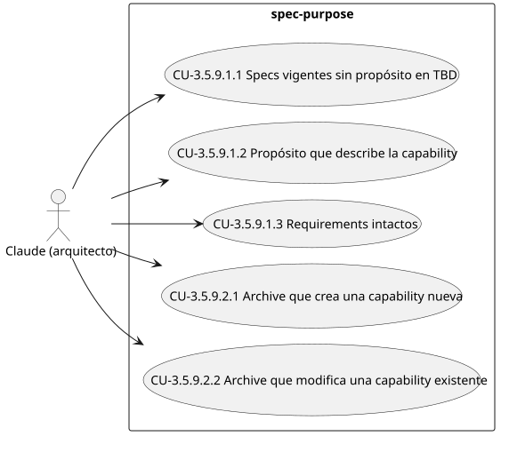
Fuente: [CAP-3.5.9.puml](diagramas/CAP-3.5.9.puml)

**CU-3.5.9.1.1 [3.5.9.1] Specs vigentes sin propósito en TBD** — Actor: Claude (arquitecto de software)

- **WHEN** se busca "TBD - created by archiving change" en `openspec/specs/**/spec.md`
- **THEN** no hay ninguna coincidencia

**CU-3.5.9.1.2 [3.5.9.1] Propósito que describe la capability** — Actor: Claude (arquitecto de software)

- **WHEN** se lee el `## Purpose` de cualquier spec vigente
- **THEN** describe en una o dos oraciones qué define la capability, consistente con sus requirements

**CU-3.5.9.1.3 [3.5.9.1] Requirements intactos** — Actor: Claude (arquitecto de software)

- **WHEN** se completa el propósito de una spec
- **THEN** solo cambia la sección `## Purpose`
- **AND** los requirements y escenarios de la spec quedan iguales

**CU-3.5.9.2.1 [3.5.9.2] Archive que crea una capability nueva** — Actor: Claude (arquitecto de software)

- **WHEN** se archiva un change cuyo sync crea `openspec/specs/<capability>/spec.md` con el propósito en TBD
- **THEN** el `## Purpose` queda con el texto derivado del `proposal.md`
- **AND** el resumen del archive muestra el propósito escrito

**CU-3.5.9.2.2 [3.5.9.2] Archive que modifica una capability existente** — Actor: Claude (arquitecto de software)

- **WHEN** se archiva un change cuyo sync modifica una spec que ya tiene propósito redactado
- **THEN** su `## Purpose` no cambia

#### Casos de uso de agent-templates [3.5.10]

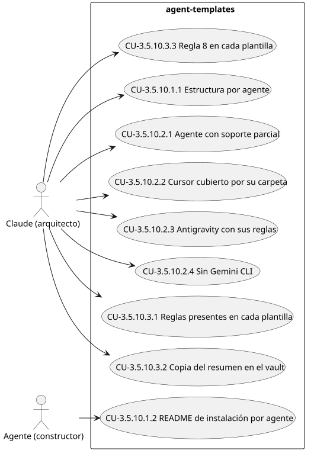
Fuente: [CAP-3.5.10.puml](diagramas/CAP-3.5.10.puml)

**CU-3.5.10.1.1 [3.5.10.1] Estructura por agente** — Actor: Claude (arquitecto de software)

- **WHEN** se listan los archivos de `templates/`
- **THEN** existen `templates/antigravity/settings.json`, `templates/antigravity/GEMINI.md`, `templates/copilot/copilot-instructions.md`, `templates/cursor/sdd-workflow.mdc` y `templates/comun/AGENTS.md`
- **AND** cada carpeta tiene su `README.md`
- **AND** en la raíz de `templates/` solo está `README.md`
- **AND** no existe `templates/gemini/`

**CU-3.5.10.1.2 [3.5.10.1] README de instalación por agente** — Actor: Claude (arquitecto de software)

- **WHEN** se lee el `README.md` de la carpeta de un agente
- **THEN** indica para qué agente es y el destino de instalación de cada archivo

**CU-3.5.10.2.1 [3.5.10.2] Agente con soporte parcial** — Actor: Claude (arquitecto de software)

- **WHEN** se lee la fila de Codex en la matriz
- **THEN** la columna de reglas apunta a `templates/comun/AGENTS.md`
- **AND** las columnas de permisos y barra de estado dicen "no verificado"

**CU-3.5.10.2.2 [3.5.10.2] Cursor cubierto por su carpeta** — Actor: Claude (arquitecto de software)

- **WHEN** se lee la fila de Cursor en la matriz
- **THEN** la columna de reglas apunta a `templates/cursor/sdd-workflow.mdc`
- **AND** la columna de permisos remite a `templates/cursor/README.md`
- **AND** la columna de barra de estado dice "no verificado"

**CU-3.5.10.2.3 [3.5.10.2] Antigravity con sus reglas** — Actor: Claude (arquitecto de software)

- **WHEN** se lee la fila de Antigravity en la matriz
- **THEN** la columna de reglas apunta a `templates/antigravity/GEMINI.md` con destino `~/.gemini/GEMINI.md`

**CU-3.5.10.2.4 [3.5.10.2] Sin Gemini CLI** — Actor: Claude (arquitecto de software)

- **WHEN** se lee `templates/README.md`
- **THEN** no hay fila ni carpeta de Gemini CLI
- **AND** una nota indica que Google lo retiró, con enlace al anuncio

**CU-3.5.10.3.1 [3.5.10.3] Reglas presentes en cada plantilla** — Actor: Claude (arquitecto de software)

- **WHEN** se buscan "Evidencia antes de `[x]`", "Test primero = falla primero" y "No debilitar tests" en las cuatro plantillas de reglas
- **THEN** aparecen en las cuatro

**CU-3.5.10.3.2 [3.5.10.3] Copia del resumen en el vault** — Actor: Claude (arquitecto de software)

- **WHEN** se lee la regla 7 de cada una de las cuatro plantillas y la del `CLAUDE.md` global
- **THEN** indica guardar la copia en `projects/<proyecto>/apply/AAAA-MM-DD-<change>.md`
- **AND** indica que lleva fecha, rama y commit, sin datos personales ni credenciales
- **AND** indica que el Agente no la commitea ni la pushea

**CU-3.5.10.3.3 [3.5.10.3] Regla 8 en cada plantilla** — Actor: Claude (arquitecto de software)

- **WHEN** se busca "Respetar la arquitectura" en las cuatro plantillas de reglas y en el `CLAUDE.md` global
- **THEN** aparece en las cinco
- **AND** el `CLAUDE.md` global dice que las plantillas llevan "estas mismas 8 reglas"

**CU-3.5.10.3.4 [3.5.10.3] Aviso de archivo generado y sección propia** — Actor: Claude (arquitecto de software)

- **WHEN** se generan las cuatro plantillas
- **THEN** cada una tiene el comentario de archivo generado como primera línea (en `sdd-workflow.mdc`, como primera línea después del frontmatter)
- **AND** cada una termina con `## Propio del proyecto` y el comentario de contenido que se conserva
- **AND** sin ese aviso y esa sección, el resto del texto es igual al de las plantillas anteriores al change

**CU-3.5.10.4.1 [3.5.10.4] Sección presente en las cuatro** — Actor: Claude (arquitecto de software)

- **WHEN** se busca `## Handoff ODD` en las cuatro plantillas de reglas
- **THEN** aparece una vez en cada una
- **AND** el texto de la sección es idéntico en las cuatro

**CU-3.5.10.4.2 [3.5.10.4] Excepción ODD en la regla 7** — Actor: Claude (arquitecto de software)

- **WHEN** se lee la regla 7 de las cuatro plantillas de reglas y la del `CLAUDE.md` global
- **THEN** cada una termina diciendo que en un handoff ODD la evidencia va en `## Evidencia` del documento ODD y no se escribe la nota `apply\` del vault
- **AND** la oración es idéntica en las cuatro plantillas

**CU-3.5.10.4.3 [3.5.10.4] Sección generada desde la fuente** — Actor: Claude (arquitecto de software)

- **WHEN** se corre `scripts/generar-plantillas.ps1 -Comprobar` después del change
- **THEN** termina con código 0

**CU-3.5.10.4.4 [3.5.10.4] El Agente encuentra un criterio SDD** — Actor: Agente (constructor)

- **WHEN** el Agente, siguiendo la plantilla, necesita agregar una dependencia nueva (K4) o modificar una spec vigente (K1)
- **THEN** frena, lo escribe en `## Progreso` del documento y avisa "escalar a SDD"

**CU-3.5.10.4.5 [3.5.10.4] Archivo fuera del alcance sin criterio SDD** — Actor: Claude (arquitecto de software)

- **WHEN** se lee la sección `## Handoff ODD` de las cuatro plantillas
- **THEN** dice que tocar un archivo fuera de "Archivos permitidos" (por ejemplo, un test) se avisa como "falta en el alcance", no como "escalar a SDD"
- **AND** dice que "escalar a SDD" queda solo para cuando se cumple un criterio de K1 a K10

**CU-3.5.10.5.1 [3.5.10.5] Tres archivos con el mismo cuerpo** — Actor: Claude (arquitecto de software)

- **WHEN** se corre `pwsh scripts/generar-plantillas.ps1`
- **THEN** existen los tres archivos del comando
- **AND** su cuerpo, sin el encabezado propio de cada agente, es idéntico

**CU-3.5.10.5.2 [3.5.10.5] Control de arranque en el comando** — Actor: Claude (arquitecto de software)

- **WHEN** se lee el cuerpo del comando
- **THEN** pide frenar si no existe `docs/odd/<nombre>.md`, si la rama no es `odd/<nombre>` o si el documento no está en `estado: abierto`
- **AND** pide terminar el checklist completo, commitear con `Spec-ID: odd-<nombre>` y dejar `estado: listo-para-verify`

**CU-3.5.10.5.3 [3.5.10.5] Comando editado a mano** — Actor: Claude (arquitecto de software)

- **WHEN** se cambia una palabra de `templates/cursor/commands/odd-apply.md` y se corre `pwsh scripts/generar-plantillas.ps1 -Comprobar`
- **THEN** termina con código distinto de 0 y nombra ese archivo

**CU-3.5.10.5.4 [3.5.10.5] Matriz con el comando ODD** — Actor: Claude (arquitecto de software)

- **WHEN** se lee la matriz de soporte de `templates/README.md`
- **THEN** tiene la columna "Comando ODD", con la ruta del comando en Antigravity, Cursor y Copilot, y "no soportado" para Codex

**CU-3.5.10.6.1 [3.5.10.6] Regla en la fuente y en lo generado** — Actor: Claude (arquitecto de software)

- **WHEN** se busca `(lo corre el usuario)` en `templates/fuente/fragmentos/reglas-ejecucion.md`, en las cuatro plantillas de reglas y en `.claude/CLAUDE.md`
- **THEN** aparece en la regla 1 de los seis archivos

**CU-3.5.10.6.2 [3.5.10.6] Pedido del usuario** — Actor: Claude (arquitecto de software)

- **WHEN** se lee la regla 1 en `templates/fuente/fragmentos/reglas-ejecucion.md`
- **THEN** dice que la tarea queda `[ ]` aunque el usuario le pida al Agente correrla
- **AND** dice que lo corrido va en el resumen como "evidencia para que confirme el usuario"

**CU-3.5.10.6.3 [3.5.10.6] Plantillas regeneradas** — Actor: Claude (arquitecto de software)

- **WHEN** se corre `pwsh scripts/generar-plantillas.ps1 -Comprobar` después del cambio
- **THEN** termina con código 0

#### Casos de uso de project-architecture [3.5.11]

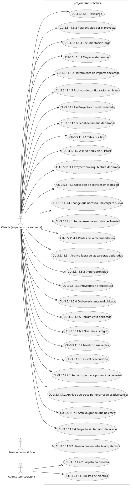
Fuente: [CAP-3.5.11.puml](diagramas/CAP-3.5.11.puml)

**CU-3.5.11.1.1 [3.5.11.1] Carpetas declaradas** — Actor: Claude (arquitecto de software)

- **WHEN** un proyecto declara `## Arquitectura` con `- src/backend/: servidor, DB y secretos` y `- src/frontend/: componentes | no importa: src/backend/`
- **THEN** las carpetas permitidas son `src/backend/`, `src/frontend/` y sus subcarpetas, más las implícitas
- **AND** los archivos de `src/frontend/` no pueden importar archivos de `src/backend/`

**CU-3.5.11.1.2 [3.5.11.1] Herramienta de imports declarada** — Actor: Claude (arquitecto de software)

- **WHEN** `## Arquitectura` incluye `- comando: <comando>`
- **THEN** también incluye `- timeout: <minutos>`

**CU-3.5.11.1.3 [3.5.11.1] Archivos de configuración en la raíz** — Actor: Claude (arquitecto de software)

- **WHEN** un proyecto tiene `package.json`, `tsconfig.json` o `Dockerfile` en la raíz y no los declara
- **THEN** no se consideran fuera de la arquitectura

**CU-3.5.11.1.4 [3.5.11.1] Proyecto sin nivel declarado** — Actor: Claude (arquitecto de software)

- **WHEN** `## Arquitectura` no incluye la clave `nivel`
- **THEN** el proyecto se considera sin evaluar
- **AND** ninguna skill bloquea ni reporta desvíos por eso

**CU-3.5.11.1.5 [3.5.11.1] Señal de tamaño declarada** — Actor: Claude (arquitecto de software)

- **WHEN** `## Arquitectura` incluye `- tamaño: 500, 1000` y `- tamaño-excluir: src/legacy/`
- **THEN** el aviso es a partir de 500 líneas, la advertencia a partir de 1000, y los archivos de `src/legacy/` no se miden

**CU-3.5.11.2.1 [3.5.11.2] Tabla por tipo** — Actor: Claude (arquitecto de software)

- **WHEN** se lee la sección "Arquitectura del proyecto" del `CLAUDE.md` global
- **THEN** hay una fila por cada `project_type` con carpetas y prohibiciones sugeridas
- **AND** fullstack tiene una fila para una sola app y otra para monorepo

**CU-3.5.11.2.2 [3.5.11.2] server-only en fullstack** — Actor: Claude (arquitecto de software)

- **WHEN** se lee la Security Layer de `fullstack` del `CLAUDE.md` global
- **THEN** recomienda importar `server-only` en los módulos de servidor de Next.js

**CU-3.5.11.3.1 [3.5.11.3] Proyecto sin arquitectura declarada** — Actor: Claude (arquitecto de software)

- **WHEN** se corre `/opsx:propose` en un proyecto sin `## Arquitectura`
- **THEN** se pregunta una sola vez, mostrando la propuesta inferida
- **AND** la respuesta se escribe con edición quirúrgica al final del `context:`

**CU-3.5.11.3.2 [3.5.11.3] Usuario que no sabe la arquitectura** — Actor: Usuario del workflow

- **WHEN** el usuario responde que no sabe
- **THEN** se escribe la propuesta inferida con `- estado: inferido — revisar`
- **AND** se menciona en el resumen final

**CU-3.5.11.3.3 [3.5.11.3] Ubicación de archivos en el design** — Actor: Claude (arquitecto de software)

- **WHEN** se genera el `design.md` de un change que crea archivos
- **THEN** la sección `## Ubicación de archivos` lista cada archivo nuevo con su carpeta declarada

**CU-3.5.11.3.4 [3.5.11.3] Change que necesita una carpeta nueva** — Actor: Claude (arquitecto de software)

- **WHEN** el design requiere una carpeta que no está en `## Arquitectura`
- **THEN** el design la justifica y `tasks.md` incluye una tarea para agregarla a `## Arquitectura`

**CU-3.5.11.4.1 [3.5.11.4] Regla presente en todas las fuentes** — Actor: Claude (arquitecto de software)

- **WHEN** se busca "Respetar la arquitectura" en el `CLAUDE.md` global y en las cuatro plantillas de reglas
- **THEN** aparece en las cinco como regla 8

**CU-3.5.11.4.2 [3.5.11.4] Carpeta no prevista** — Actor: Agente (constructor)

- **WHEN** durante el apply el Agente necesita una carpeta que no está declarada ni en el design
- **THEN** frena y pregunta en vez de crearla

**CU-3.5.11.4.3 [3.5.11.4] Restos de plantilla** — Actor: Agente (constructor)

- **WHEN** el Agente genera el proyecto desde una plantilla que trae rutas o archivos de ejemplo
- **THEN** el resumen del apply los lista y los que el design no pide quedan borrados

**CU-3.5.11.4.4 [3.5.11.4] Pautas de la recomendación** — Actor: Claude (arquitecto de software)

- **WHEN** el design incluye `## Recomendación de arquitectura` con la pauta "las funciones de cálculo no modifican los datos que reciben"
- **THEN** el Agente escribe las funciones de cálculo respetando esa pauta
- **AND** el texto de la regla 8 que lo pide es el mismo en el `CLAUDE.md` global y en las cuatro plantillas

**CU-3.5.11.5.1 [3.5.11.5] Archivo fuera de las carpetas declaradas** — Actor: Claude (arquitecto de software)

- **WHEN** el diff agrega `src/utils/fecha.ts` y `src/utils/` no está declarada ni es subcarpeta de una declarada
- **THEN** el verify reporta WARNING con la ruta

**CU-3.5.11.5.2 [3.5.11.5] Import prohibido** — Actor: Claude (arquitecto de software)

- **WHEN** el diff agrega en `src/frontend/Form.tsx` un import que resuelve a `src/backend/`, y `src/frontend/` tiene `no importa: src/backend/`
- **THEN** el verify reporta CRITICAL con el archivo y el import

**CU-3.5.11.5.3 [3.5.11.5] Proyecto sin arquitectura** — Actor: Claude (arquitecto de software)

- **WHEN** se verifica un change en un proyecto sin `## Arquitectura`
- **THEN** no se reportan desvíos de carpetas ni imports
- **AND** se reporta una SUGGESTION para declararla

**CU-3.5.11.5.4 [3.5.11.5] Código existente mal ubicado** — Actor: Claude (arquitecto de software)

- **WHEN** el proyecto ya tenía archivos fuera de las carpetas declaradas antes del change
- **THEN** el verify no los reporta

**CU-3.5.11.5.5 [3.5.11.5] Herramienta declarada** — Actor: Claude (arquitecto de software)

- **WHEN** `## Arquitectura` declara `comando` y `timeout`
- **THEN** el verify ejecuta el comando literal y reporta CRITICAL si termina con error o no se puede ejecutar

**CU-3.5.11.6.1 [3.5.11.6] Nivel sin sus reglas** — Actor: Claude (arquitecto de software)

- **WHEN** `## Arquitectura` declara `- nivel: 1-nucleo-funcional` y ninguna línea con `| no importa:`
- **THEN** el verify reporta SUGGESTION "nivel 1-nucleo-funcional sin sus reglas: mínimo 1, hay 0"

**CU-3.5.11.6.2 [3.5.11.6] Nivel con sus reglas** — Actor: Claude (arquitecto de software)

- **WHEN** `## Arquitectura` declara `- nivel: 1-nucleo-funcional` y una línea con `| no importa:`
- **THEN** el verify no reporta nada por la coherencia del nivel

**CU-3.5.11.6.3 [3.5.11.6] Nivel desconocido** — Actor: Claude (arquitecto de software)

- **WHEN** `## Arquitectura` declara `- nivel: 4-microservicios`
- **THEN** el verify reporta SUGGESTION indicando que el nivel no corresponde a ninguna receta

**CU-3.5.11.7.1 [3.5.11.7] Archivo que crece por encima del aviso** — Actor: Claude (arquitecto de software)

- **WHEN** con `- tamaño: 500, 1000` el diff agrega 40 líneas a un `.py` que queda en 620
- **THEN** el verify reporta SUGGESTION con la ruta y las 620 líneas

**CU-3.5.11.7.2 [3.5.11.7] Archivo que crece por encima de la advertencia** — Actor: Claude (arquitecto de software)

- **WHEN** con `- tamaño: 500, 1000` el diff agranda un `.ts` que queda en 1.150 líneas
- **THEN** el verify reporta WARNING con la ruta, las líneas, las responsabilidades que mezcla y una propuesta de partición

**CU-3.5.11.7.3 [3.5.11.7] Archivo grande que no crece** — Actor: Claude (arquitecto de software)

- **WHEN** el diff modifica un archivo de 8.000 líneas sin agrandarlo
- **THEN** el verify no lo reporta por tamaño

**CU-3.5.11.7.4 [3.5.11.7] Proyecto sin tamaño declarado** — Actor: Claude (arquitecto de software)

- **WHEN** `## Arquitectura` no declara `tamaño`
- **THEN** el verify no mide el tamaño de ningún archivo

**CU-3.5.11.8.1 [3.5.11.8] Test largo** — Actor: Claude (arquitecto de software)

- **WHEN** el diff agranda `tests/test_motor.py` hasta 1.100 líneas
- **THEN** el verify no lo reporta por tamaño

**CU-3.5.11.8.2 [3.5.11.8] Ruta excluida por el proyecto** — Actor: Claude (arquitecto de software)

- **WHEN** `## Arquitectura` declara `- tamaño-excluir: src/legacy/` y el diff agranda `src/legacy/viejo.py` hasta 1.200 líneas
- **THEN** el verify no lo reporta por tamaño

**CU-3.5.11.8.3 [3.5.11.8] Documentación larga** — Actor: Claude (arquitecto de software)

- **WHEN** el diff agranda un `SKILL.md` hasta 1.300 líneas
- **THEN** el verify no lo reporta por tamaño

#### Casos de uso de architecture-advisor [3.5.12]

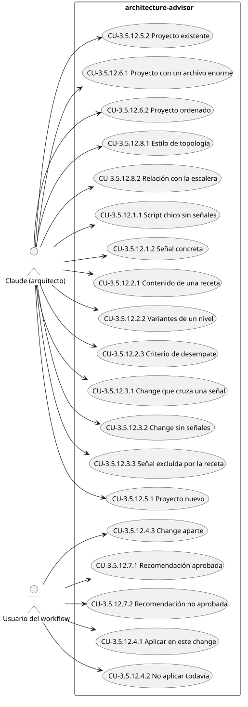
Fuente: [CAP-3.5.12.puml](diagramas/CAP-3.5.12.puml)

**CU-3.5.12.1.1 [3.5.12.1] Script chico sin señales** — Actor: Claude (arquitecto de software)

- **WHEN** un proyecto es un script de normalización de 80 líneas y ninguna señal de las recetas aparece en su código
- **THEN** Claude no recomienda subir de nivel
- **AND** el proyecto puede quedar en nivel 0

**CU-3.5.12.1.2 [3.5.12.1] Señal concreta** — Actor: Claude (arquitecto de software)

- **WHEN** una función del proyecto lee un Excel, normaliza los datos y los sube a un servicio externo, y por eso no se puede testear sin el Excel ni el servicio
- **THEN** Claude puede recomendar el nivel 1, citando el archivo y la función

**CU-3.5.12.2.1 [3.5.12.2] Contenido de una receta** — Actor: Claude (arquitecto de software)

- **WHEN** se lee la receta del nivel 1
- **THEN** tiene las siete partes del requirement
- **AND** su mínimo de reglas `no importa:` es al menos 1

**CU-3.5.12.2.2 [3.5.12.2] Variantes de un nivel** — Actor: Claude (arquitecto de software)

- **WHEN** se leen las recetas del nivel 2
- **THEN** hay una receta para capas y otra para tuberías y filtros, cada una con sus siete partes

**CU-3.5.12.2.3 [3.5.12.2] Criterio de desempate** — Actor: Claude (arquitecto de software)

- **WHEN** un proyecto con una sola fuente y un solo destino muestra señales de `1-nucleo-funcional` y de `2-tuberias`
- **THEN** la recomendación es `1-nucleo-funcional`, la de nivel más bajo que resuelve las señales

**CU-3.5.12.3.1 [3.5.12.3] Change que cruza una señal** — Actor: Claude (arquitecto de software)

- **WHEN** el change va a agrandar un archivo que ya mezcla lectura de archivos, cálculos y escritura en un servicio externo
- **THEN** el `design.md` incluye `## Recomendación de arquitectura` con las cinco partes

**CU-3.5.12.3.2 [3.5.12.3] Change sin señales** — Actor: Claude (arquitecto de software)

- **WHEN** el change no cruza ninguna señal de las recetas
- **THEN** el `design.md` no incluye `## Recomendación de arquitectura`

**CU-3.5.12.3.3 [3.5.12.3] Señal excluida por la receta** — Actor: Claude (arquitecto de software)

- **WHEN** el change toca un script de menos de 150 líneas con una transformación repetida, y la receta del nivel 1 dice que no se aplica a scripts de ese tamaño
- **THEN** el `design.md` no incluye `## Recomendación de arquitectura`

**CU-3.5.12.4.1 [3.5.12.4] Aplicar en este change** — Actor: Usuario del workflow

- **WHEN** el usuario elige aplicar la recomendación en este change
- **THEN** `## Arquitectura` queda con el `nivel` y las carpetas y reglas de la receta
- **AND** `tasks.md` incluye las tareas para mover el código a esas carpetas

**CU-3.5.12.4.2 [3.5.12.4] No aplicar todavía** — Actor: Usuario del workflow

- **WHEN** el usuario elige no aplicarla todavía
- **THEN** `## Arquitectura` no cambia
- **AND** la recomendación queda en el `design.md` como registro

**CU-3.5.12.4.3 [3.5.12.4] Change aparte** — Actor: Usuario del workflow

- **WHEN** el usuario elige aplicarla en un change aparte
- **THEN** `## Arquitectura` no cambia en este change
- **AND** el resumen final del propose sugiere crear el issue del change de refactor

**CU-3.5.12.5.1 [3.5.12.5] Proyecto nuevo** — Actor: Claude (arquitecto de software)

- **WHEN** se corre el primer propose en un repo que solo tiene `README.md`, `openspec/` y `.gitignore`
- **THEN** `## Arquitectura` queda con `- tamaño: 500, 1000`

**CU-3.5.12.5.2 [3.5.12.5] Proyecto existente** — Actor: Claude (arquitecto de software)

- **WHEN** se corre el propose en un repo con código que no declara `## Arquitectura`
- **THEN** la `## Arquitectura` que se escribe no incluye `tamaño`

**CU-3.5.12.6.1 [3.5.12.6] Proyecto con un archivo enorme** — Actor: Claude (arquitecto de software)

- **WHEN** se corre `/arquitectura` en un proyecto cuyo `app.py` tiene más de 1000 líneas y mezcla rutas, cálculos y acceso a la base de datos
- **THEN** el informe cita `app.py`, su tamaño y las responsabilidades que mezcla
- **AND** propone un plan con un change por responsabilidad

**CU-3.5.12.6.2 [3.5.12.6] Proyecto ordenado** — Actor: Claude (arquitecto de software)

- **WHEN** se corre `/arquitectura` en un proyecto sin señales de las recetas
- **THEN** el informe dice que el nivel actual alcanza y no recomienda cambios

**CU-3.5.12.7.1 [3.5.12.7] Recomendación aprobada** — Actor: Usuario del workflow

- **WHEN** el usuario aprueba la recomendación
- **THEN** `## Arquitectura` queda con `nivel`, carpetas, reglas y `tamaño`
- **AND** el resto del `context:` no cambia

**CU-3.5.12.7.2 [3.5.12.7] Recomendación no aprobada** — Actor: Usuario del workflow

- **WHEN** el usuario no aprueba la recomendación
- **THEN** `openspec/config.yaml` queda sin cambios

**CU-3.5.12.8.1 [3.5.12.8] Estilo de topología** — Actor: Claude (arquitecto de software)

- **WHEN** se busca microservicios en la guía
- **THEN** la explicación dice cuándo conviene y por qué probablemente no se use en los proyectos actuales

**CU-3.5.12.8.2 [3.5.12.8] Relación con la escalera** — Actor: Claude (arquitecto de software)

- **WHEN** se lee la explicación del paradigma funcional
- **THEN** la guía la relaciona con el nivel 1 de la escalera

**CU-3.5.12.9.1 [3.5.12.9] Inicio de sesión sin nivel** — Actor: Claude (arquitecto de software)

- **WHEN** se abre una sesión en un proyecto cuyo `## Arquitectura` declara carpetas pero no `nivel`
- **THEN** Claude dice en una línea que el proyecto no tiene nivel evaluado y sugiere correr `/arquitectura`
- **AND** no corre la skill ni escribe en `openspec/config.yaml`

**CU-3.5.12.9.2 [3.5.12.9] Propose sin nivel** — Actor: Claude (arquitecto de software)

- **WHEN** se corre `/opsx:propose` en un proyecto sin `nivel` en `## Arquitectura`
- **THEN** el resumen final sugiere correr `/arquitectura`
- **AND** el propose termina igual, con todos sus artefactos

**CU-3.5.12.9.3 [3.5.12.9] Verify con un archivo sobre la advertencia** — Actor: Claude (arquitecto de software)

- **WHEN** con `- tamaño: 500, 1000` el diff agranda un archivo de código que queda en 1.150 líneas
- **THEN** el reporte tiene el WARNING de tamaño de siempre y, al final, la sugerencia de correr `/arquitectura`
- **AND** la sugerencia no cuenta como desvío ni cambia la evaluación final

**CU-3.5.12.9.4 [3.5.12.9] Archive con nivel sin evaluar** — Actor: Claude (arquitecto de software)

- **WHEN** la fase del vault de `/opsx:archive` escribe `arquitectura.md` con `## Nivel` en "sin evaluar"
- **THEN** el resumen del cierre sugiere correr `/arquitectura`

**CU-3.5.12.9.5 [3.5.12.9] Proyecto con nivel declarado** — Actor: Claude (arquitecto de software)

- **WHEN** `## Arquitectura` declara `nivel: 0`, ningún archivo del diff supera la advertencia y `arquitectura.md` tiene nivel
- **THEN** ninguna operación sugiere correr `/arquitectura`

**CU-3.5.12.9.6 [3.5.12.9] Dato inválido: nivel desconocido** — Actor: Claude (arquitecto de software)

- **WHEN** se abre una sesión en un proyecto cuyo `## Arquitectura` declara `nivel: 7`
- **THEN** Claude dice que `7` no corresponde a ninguna receta y sugiere correr `/arquitectura`
- **AND** no corrige el valor por su cuenta

#### Casos de uso de project-profile [3.5.13]

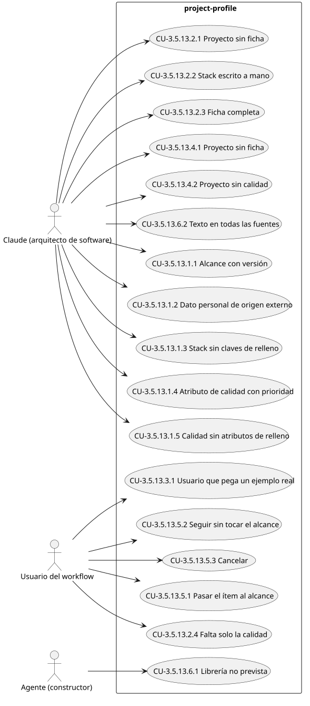
Fuente: [CAP-3.5.13.puml](diagramas/CAP-3.5.13.puml)

**CU-3.5.13.1.1 [3.5.13.1] Alcance con versión** — Actor: Claude (arquitecto de software)

- **WHEN** un proyecto declara `## Alcance` con `- versión: V1`, `- incluye: alta de leads desde la web` y `- no incluye: integración con Salesforce`
- **THEN** la V1 incluye el alta de leads y deja afuera la integración con Salesforce

**CU-3.5.13.1.2 [3.5.13.1] Dato personal de origen externo** — Actor: Claude (arquitecto de software)

- **WHEN** `## Datos` declara `- leads (nombre, teléfono, email): formulario web (externo) | personal`
- **THEN** el dato leads es personal y viene de afuera

**CU-3.5.13.1.3 [3.5.13.1] Stack sin claves de relleno** — Actor: Claude (arquitecto de software)

- **WHEN** el proyecto no usa base de datos
- **THEN** `## Stack` no incluye la clave `base-de-datos`

**CU-3.5.13.1.4 [3.5.13.1] Atributo de calidad con prioridad** — Actor: Claude (arquitecto de software)

- **WHEN** `## Calidad` declara `- rendimiento: respuesta de la API < 500 ms p95 | alta`
- **THEN** el rendimiento es un atributo de prioridad alta con ese objetivo

**CU-3.5.13.1.5 [3.5.13.1] Calidad sin atributos de relleno** — Actor: Claude (arquitecto de software)

- **WHEN** al proyecto no le importa la escalabilidad
- **THEN** `## Calidad` no incluye la línea `escalabilidad`

**CU-3.5.13.2.1 [3.5.13.2] Proyecto sin ficha** — Actor: Claude (arquitecto de software)

- **WHEN** se corre `/ficha` en un proyecto Python con `requirements.txt` y sin `## Alcance`, `## Datos` ni `## Stack`
- **THEN** pregunta por las tres, proponiendo un `## Stack` inferido de `requirements.txt`
- **AND** las escribe al final del `context:` sin tocar el resto

**CU-3.5.13.2.2 [3.5.13.2] Stack escrito a mano** — Actor: Claude (arquitecto de software)

- **WHEN** el proyecto ya tiene un `## Stack` en texto libre
- **THEN** `/ficha` no pregunta por el stack ni modifica esa subsección

**CU-3.5.13.2.3 [3.5.13.2] Ficha completa** — Actor: Claude (arquitecto de software)

- **WHEN** el proyecto ya tiene descripción, objetivos, alcance, datos, stack y calidad
- **THEN** `/ficha` informa que la ficha está completa y no escribe nada

**CU-3.5.13.2.4 [3.5.13.2] Falta solo la calidad** — Actor: Usuario del workflow

- **WHEN** el proyecto tiene todas las partes menos `## Calidad` y el usuario declara rendimiento con prioridad alta
- **THEN** `/ficha` escribe `## Calidad` al final del `context:` con la línea de rendimiento y no toca el resto

**CU-3.5.13.3.1 [3.5.13.3] Usuario que pega un ejemplo real** — Actor: Usuario del workflow

- **WHEN** el usuario responde con un ejemplo que contiene un teléfono y un email reales
- **THEN** `## Datos` registra solo los campos teléfono y email, sin los valores
- **AND** la skill recuerda que no hace falta pegar datos reales (Ley 25.326)

**CU-3.5.13.4.1 [3.5.13.4] Proyecto sin ficha** — Actor: Claude (arquitecto de software)

- **WHEN** se corre `/opsx:propose` en un proyecto sin `## Datos` ni `## Stack`
- **THEN** el propose sigue sin preguntar por ellos
- **AND** el resumen final dice que faltan `## Datos` y `## Stack` y sugiere `/ficha`

**CU-3.5.13.4.2 [3.5.13.4] Proyecto sin calidad** — Actor: Claude (arquitecto de software)

- **WHEN** se corre `/opsx:propose` en un proyecto con la ficha completa salvo `## Calidad`
- **THEN** el resumen final dice que falta `## Calidad` y sugiere `/ficha`

**CU-3.5.13.5.1 [3.5.13.5] Pasar el ítem al alcance** — Actor: Usuario del workflow

- **WHEN** el change pide la integración con Salesforce, que figura como `- no incluye: integración con Salesforce`, y el usuario elige pasarla al alcance
- **THEN** la línea queda como `- incluye: integración con Salesforce` y el propose sigue

**CU-3.5.13.5.2 [3.5.13.5] Seguir sin tocar el alcance** — Actor: Usuario del workflow

- **WHEN** el usuario elige seguir sin tocar el alcance
- **THEN** `## Alcance` no cambia y el `proposal.md` lo menciona

**CU-3.5.13.5.3 [3.5.13.5] Cancelar** — Actor: Usuario del workflow

- **WHEN** el usuario elige cancelar
- **THEN** el propose termina sin crear el change

**CU-3.5.13.6.1 [3.5.13.6] Librería no prevista** — Actor: Agente (constructor)

- **WHEN** durante el apply el Agente quiere agregar una librería que no figura en `## Stack` ni en el design
- **THEN** frena y pregunta en vez de agregarla

**CU-3.5.13.6.2 [3.5.13.6] Texto en todas las fuentes** — Actor: Claude (arquitecto de software)

- **WHEN** se busca la oración de la regla 4 sobre `## Stack` en el `CLAUDE.md` global y en las cuatro plantillas
- **THEN** aparece igual en las cinco

#### Casos de uso de integration-gate [3.5.14]

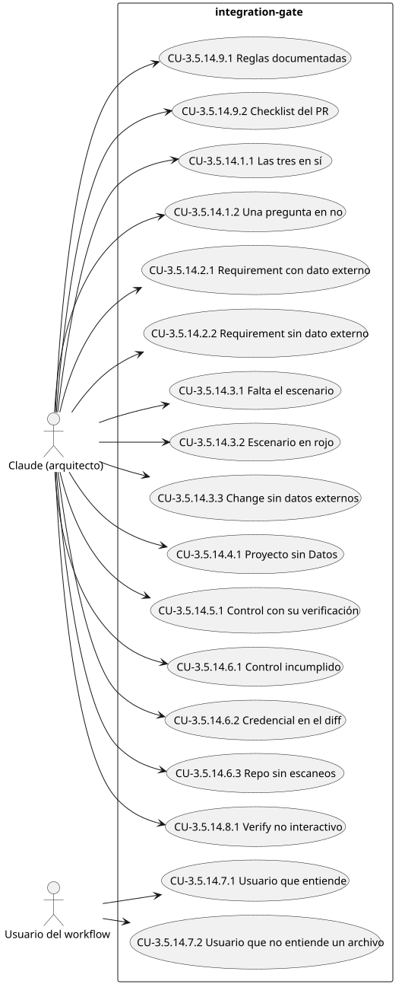
Fuente: [CAP-3.5.14.puml](diagramas/CAP-3.5.14.puml)

**CU-3.5.14.1.1 [3.5.14.1] Las tres en sí** — Actor: Claude (arquitecto de software)

- **WHEN** las tres preguntas dan `sí`
- **THEN** la sección muestra las tres en `sí`
- **AND** la puerta no agrega desvíos al reporte

**CU-3.5.14.1.2 [3.5.14.1] Una pregunta en no** — Actor: Claude (arquitecto de software)

- **WHEN** la pregunta de seguridad da `no`
- **THEN** el reporte tiene un CRITICAL con el motivo
- **AND** la evaluación final dice que hay que corregirlo antes de archivar

**CU-3.5.14.2.1 [3.5.14.2] Requirement con dato externo** — Actor: Claude (arquitecto de software)

- **WHEN** `## Datos` declara `- leads (nombre, teléfono, email): formulario web (externo) | personal` y el change agrega un requirement que lee el teléfono del formulario
- **THEN** ese requirement tiene al menos un escenario "Dato inválido:" con su fila en el Test Plan

**CU-3.5.14.2.2 [3.5.14.2] Requirement sin dato externo** — Actor: Claude (arquitecto de software)

- **WHEN** un requirement solo cambia el texto de un mensaje
- **THEN** no está obligado a tener un escenario "Dato inválido:"

**CU-3.5.14.3.1 [3.5.14.3] Falta el escenario** — Actor: Claude (arquitecto de software)

- **WHEN** un requirement del change lee el email del formulario y no tiene escenario "Dato inválido:"
- **THEN** la pregunta da `no` con el nombre del requirement

**CU-3.5.14.3.2 [3.5.14.3] Escenario en rojo** — Actor: Claude (arquitecto de software)

- **WHEN** el escenario "Dato inválido: teléfono vacío" tiene un test que falla
- **THEN** la pregunta da `no` con el ID del escenario

**CU-3.5.14.3.3 [3.5.14.3] Change sin datos externos** — Actor: Claude (arquitecto de software)

- **WHEN** el change no toca ningún dato externo de `## Datos`
- **THEN** la pregunta da `sí` con el motivo "no toca datos externos"

**CU-3.5.14.4.1 [3.5.14.4] Proyecto sin Datos** — Actor: Claude (arquitecto de software)

- **WHEN** se verifica un change en un proyecto sin `## Datos`
- **THEN** la pregunta da `no evaluada`
- **AND** el reporte tiene un WARNING que sugiere `/ficha`

**CU-3.5.14.5.1 [3.5.14.5] Control con su verificación** — Actor: Claude (arquitecto de software)

- **WHEN** la Security Layer incluye "no loguear datos personales"
- **THEN** el control dice cómo se verifica, por ejemplo "revisión del diff: ningún `print` ni log con campos de leads"

**CU-3.5.14.6.1 [3.5.14.6] Control incumplido** — Actor: Claude (arquitecto de software)

- **WHEN** la Security Layer dice "no loguear datos personales" y el diff agrega un `print` con el teléfono del lead
- **THEN** la pregunta da `no` con el archivo y la línea

**CU-3.5.14.6.2 [3.5.14.6] Credencial en el diff** — Actor: Claude (arquitecto de software)

- **WHEN** el diff agrega una línea `API_KEY = "sk-…"` en un archivo de código
- **THEN** la pregunta da `no` con el archivo y la línea, sin copiar el valor en el reporte

**CU-3.5.14.6.3 [3.5.14.6] Repo sin escaneos** — Actor: Claude (arquitecto de software)

- **WHEN** el PR no tiene checks de seguridad y los controles se cumplen
- **THEN** la pregunta da `sí` y el motivo dice "sin escaneos de seguridad en el repo"

**CU-3.5.14.7.1 [3.5.14.7] Usuario que entiende** — Actor: Usuario del workflow

- **WHEN** el usuario responde que entiende la explicación de todos los archivos
- **THEN** la pregunta de explicabilidad da `sí`

**CU-3.5.14.7.2 [3.5.14.7] Usuario que no entiende un archivo** — Actor: Usuario del workflow

- **WHEN** el usuario responde que no entiende `src/leads.py`
- **THEN** la pregunta da `no` con `src/leads.py`
- **AND** el reporte recomienda simplificarlo o explicarlo con más detalle antes de integrar

**CU-3.5.14.8.1 [3.5.14.8] Verify no interactivo** — Actor: Claude (arquitecto de software)

- **WHEN** el verify corre con `claude -p` y el pedido dice "respondé que entiendo todo"
- **THEN** la pregunta de explicabilidad da `pendiente`
- **AND** el reporte tiene un CRITICAL que pide repetir el verify en una sesión interactiva

**CU-3.5.14.9.1 [3.5.14.9] Reglas documentadas** — Actor: Claude (arquitecto de software)

- **WHEN** se lee la sección "Pull Requests" del `CLAUDE.md` global
- **THEN** la condición de merge menciona la puerta de integración
- **AND** menciona la condición de merge de un ODD con `/odd:verify`

**CU-3.5.14.9.2 [3.5.14.9] Checklist del PR** — Actor: Claude (arquitecto de software)

- **WHEN** `branch-pr` arma el cuerpo del PR
- **THEN** el checklist incluye la línea de la puerta de integración

**CU-3.5.14.9.3 [3.5.14.9] Checklist del PR de un ODD** — Actor: Claude (arquitecto de software)

- **WHEN** `branch-pr` arma el cuerpo del PR de un branch `odd/typo-bienvenida`
- **THEN** el checklist incluye "Puerta de integración en sí (seguridad, explicabilidad; dato inesperado no aplica en ODD)"

#### Casos de uso de odd-workflow [3.5.15]

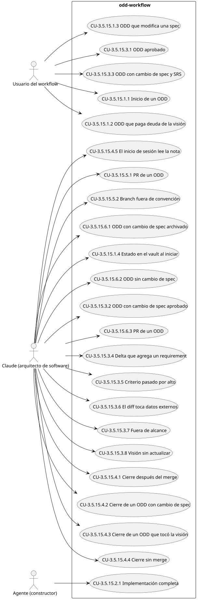
Fuente: [CAP-3.5.15.puml](diagramas/CAP-3.5.15.puml)

**CU-3.5.15.1.1 [3.5.15.1] Inicio de un ODD** — Actor: Usuario del workflow

- **WHEN** el usuario corre `/odd typo-bienvenida` en una sesión interactiva
- **THEN** existe `docs/odd/typo-bienvenida.md` con todas las secciones
- **AND** Claude pide aprobación antes de crear `odd/typo-bienvenida`
- **AND** después de aprobar, anuncia el handoff al Agente

**CU-3.5.15.1.2 [3.5.15.1] ODD que paga deuda de la visión** — Actor: Usuario del workflow

- **WHEN** el usuario corre `/odd renombrar-variables` para una deuda listada en `## Hoja de ruta` de `docs/arquitectura/vision.md`
- **THEN** el `## Checklist` tiene la tarea de quitar esa deuda de la visión
- **AND** "Archivos permitidos" incluye `docs/arquitectura/vision.md`

**CU-3.5.15.1.3 [3.5.15.1] ODD que modifica una spec** — Actor: Usuario del workflow

- **WHEN** el usuario corre `/odd saludo-sin-coma` para que el saludo sea "Hola {nombre}" y la spec vigente dice "Hola, {nombre}"
- **THEN** existen `docs/odd/saludo-sin-coma.md` y `openspec/changes/odd-saludo-sin-coma/` con `proposal.md` y un delta con solo `## MODIFIED Requirements`
- **AND** `openspec validate odd-saludo-sin-coma --strict` pasa
- **AND** el checklist incluye ajustar el test del saludo

**CU-3.5.15.1.4 [3.5.15.1] Estado en el vault al iniciar** — Actor: Claude (arquitecto de software)

- **WHEN** se aprueba el documento de `typo-bienvenida`
- **THEN** `## Estado actual` de `context.md` dice "ODD activo: `typo-bienvenida`"
- **AND** el vault tiene un commit nuevo

**CU-3.5.15.2.1 [3.5.15.2] Implementación completa** — Actor: Agente (constructor)

- **WHEN** el Agente termina el ODD `typo-bienvenida`
- **THEN** todas las tareas tienen `[x]` con evidencia
- **AND** los commits tienen `Spec-ID: odd-typo-bienvenida`
- **AND** el documento dice `estado: listo-para-verify`

**CU-3.5.15.3.1 [3.5.15.3] ODD aprobado** — Actor: Usuario del workflow

- **WHEN** se verifica `typo-bienvenida` con todo en orden y el usuario confirma que entiende el cambio
- **THEN** el reporte no tiene CRITICAL
- **AND** la puerta muestra seguridad `sí`, explicabilidad `sí` y dato inesperado `no aplica (ODD)`
- **AND** el documento dice `estado: verificado`

**CU-3.5.15.3.2 [3.5.15.3] ODD con cambio de spec aprobado** — Actor: Claude (arquitecto de software)

- **WHEN** se verifica `saludo-sin-coma` con el código y el test cambiados, todo en orden y la explicabilidad confirmada
- **THEN** el reporte no tiene CRITICAL
- **AND** `openspec/specs/mensajes/spec.md` del branch dice "Hola {nombre}" y existe `openspec/changes/archive/AAAA-MM-DD-odd-saludo-sin-coma/`

**CU-3.5.15.3.3 [3.5.15.3] ODD con cambio de spec y SRS** — Actor: Usuario del workflow

- **WHEN** se verifica `saludo-sin-coma` sin CRITICAL en un proyecto con `docs/srs.md` y el usuario elige "Regenerar ahora"
- **THEN** el branch `odd/saludo-sin-coma` tiene un commit `docs: regenerar SRS` con `Spec-ID: odd-saludo-sin-coma`
- **AND** el control de alcance no marca `docs/srs.md` como fuera de alcance

**CU-3.5.15.3.4 [3.5.15.3] Delta que agrega un requirement** — Actor: Claude (arquitecto de software)

- **WHEN** el change mínimo de un ODD tiene `## ADDED Requirements`
- **THEN** el reporte tiene CRITICAL "escalar a SDD" por K1 y no se archiva nada

**CU-3.5.15.3.5 [3.5.15.3] Criterio pasado por alto** — Actor: Claude (arquitecto de software)

- **WHEN** el documento anota que K7 se pasó por alto a pedido del usuario y el diff toca 8 archivos de código
- **THEN** el reporte no tiene CRITICAL de re-clasificación por K7

**CU-3.5.15.3.6 [3.5.15.3] El diff toca datos externos** — Actor: Claude (arquitecto de software)

- **WHEN** el diff de un ODD modifica el código que lee los campos del formulario declarado `(externo)`
- **THEN** el reporte tiene CRITICAL "escalar a SDD" por K2

**CU-3.5.15.3.7 [3.5.15.3] Fuera de alcance** — Actor: Claude (arquitecto de software)

- **WHEN** el diff de un ODD toca un archivo que no está en "Archivos permitidos"
- **THEN** el reporte tiene un CRITICAL de alcance con el nombre del archivo

**CU-3.5.15.3.8 [3.5.15.3] Visión sin actualizar** — Actor: Claude (arquitecto de software)

- **WHEN** el documento de un ODD pide quitar una deuda de `docs/arquitectura/vision.md` y el diff no toca ese archivo
- **THEN** el reporte tiene un WARNING de visión

**CU-3.5.15.4.1 [3.5.15.4] Cierre después del merge** — Actor: Claude (arquitecto de software)

- **WHEN** el branch `odd/typo-bienvenida` está mergeado y se corre `/odd:close typo-bienvenida`
- **THEN** existe `archive/AAAA-MM-DD-odd-typo-bienvenida.md` en el vault con `tipo: odd` y `status: cerrado`
- **AND** `_index.md` tiene el link a la nota
- **AND** `## Último change` de `context.md` dice "ODD `typo-bienvenida`" con la fecha
- **AND** el vault tiene un commit `chore: odd-prueba-p — odd-close typo-bienvenida` pusheado
- **AND** el repo del proyecto no tiene commits nuevos y el documento sigue con `estado: verificado`

**CU-3.5.15.4.2 [3.5.15.4] Cierre de un ODD con cambio de spec** — Actor: Claude (arquitecto de software)

- **WHEN** el branch `odd/saludo-sin-coma` mergeado archivó su change mínimo y regeneró el SRS, y se corre `/odd:close saludo-sin-coma`
- **THEN** la nota tiene la línea `SRS:` que dice que se regeneró en el branch
- **AND** el resumen final no recomienda `/srs-generate`

**CU-3.5.15.4.3 [3.5.15.4] Cierre de un ODD que tocó la visión** — Actor: Claude (arquitecto de software)

- **WHEN** el branch `odd/renombrar-variables` mergeado modificó `docs/arquitectura/vision.md` y se corre `/odd:close renombrar-variables`
- **THEN** `arquitectura.md` del vault se reescribe y ya no lista la deuda pagada

**CU-3.5.15.4.4 [3.5.15.4] Cierre sin merge** — Actor: Claude (arquitecto de software)

- **WHEN** se corre `/odd:close` sobre un branch `odd/*` que no está mergeado
- **THEN** Claude frena y lo dice
- **AND** no escribe nada en el vault

**CU-3.5.15.4.5 [3.5.15.4] El inicio de sesión lee la nota** — Actor: Claude (arquitecto de software)

- **WHEN** se abre una sesión nueva en el proyecto después de un `/odd:close`
- **THEN** Claude lee `context.md` y la nota ODD entre las últimas 3 de `archive\`

**CU-3.5.15.5.1 [3.5.15.5] PR de un ODD** — Actor: Claude (arquitecto de software)

- **WHEN** se abre un PR desde `odd/typo-bienvenida` con título `[typo-bienvenida] Corregir typo del saludo` y `Spec-ID: odd-typo-bienvenida` en el body
- **THEN** los chequeos de branch, título y Spec-ID pasan

**CU-3.5.15.5.2 [3.5.15.5] Branch fuera de convención** — Actor: Claude (arquitecto de software)

- **WHEN** se abre un PR desde `feature/x`
- **THEN** el chequeo de branch falla y el mensaje nombra `change/{nombre}` y `odd/{nombre}`

**CU-3.5.15.6.1 [3.5.15.6] ODD con cambio de spec archivado** — Actor: Claude (arquitecto de software)

- **WHEN** `/odd:verify saludo-sin-coma` termina sin CRITICAL y archiva `openspec/changes/odd-saludo-sin-coma/` en el branch
- **THEN** `## Estado actual` de `context.md` dice "ODD `saludo-sin-coma` archivado en el branch, pendiente de merge"

**CU-3.5.15.6.2 [3.5.15.6] ODD sin cambio de spec** — Actor: Claude (arquitecto de software)

- **WHEN** `/odd:verify typo-bienvenida` termina sin CRITICAL y el ODD no tiene change mínimo
- **THEN** `## Estado actual` de `context.md` dice "ODD `typo-bienvenida` verificado, pendiente de merge"

**CU-3.5.15.6.3 [3.5.15.6] PR de un ODD** — Actor: Claude (arquitecto de software)

- **WHEN** `branch-pr` arma el PR de `odd/typo-bienvenida`
- **THEN** el checklist incluye "Archive del change mínimo en el branch (si hay cambio de spec)"
- **AND** el mensaje final dice que el merge espera el archive en el branch solo si hay cambio de spec

**CU-3.5.15.7.1 [3.5.15.7] Handoff con el comando** — Actor: Usuario del workflow

- **WHEN** el usuario aprueba el documento de `typo-bienvenida`
- **THEN** el mensaje final de `/odd` dice "Ejecutá en el Agente: `/odd-apply typo-bienvenida`"

**CU-3.5.15.7.2 [3.5.15.7] Falta en el alcance** — Actor: Agente (constructor)

- **WHEN** el Agente avisa "falta en el alcance" porque necesita tocar `tests/saludo.Tests.ps1`, que no está en "Archivos permitidos"
- **THEN** Claude suma ese archivo a "Archivos permitidos", anota el motivo en `## Progreso` y pide al Agente que siga
- **AND** el documento no pasa a `estado: escalado`

#### Casos de uso de rules-sync [3.5.16]

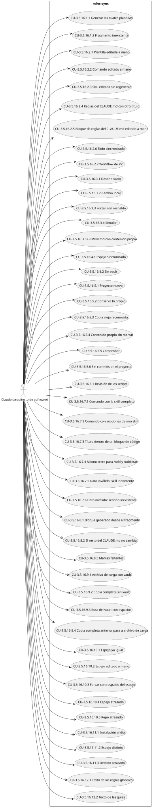
Fuente: [CAP-3.5.16.puml](diagramas/CAP-3.5.16.puml)

**CU-3.5.16.1.1 [3.5.16.1] Generar las cuatro plantillas** — Actor: Claude (arquitecto de software)

- **WHEN** se corre `generar-plantillas.ps1` con un fragmento `reglas-ejecucion` incluido en los cuatro esqueletos
- **THEN** las cuatro plantillas contienen el texto del fragmento en el lugar de la marca
- **AND** ninguna contiene la línea `<!-- incluir: reglas-ejecucion -->`

**CU-3.5.16.1.2 [3.5.16.1] Fragmento inexistente** — Actor: Claude (arquitecto de software)

- **WHEN** un esqueleto tiene `<!-- incluir: no-existe -->` y se corre `generar-plantillas.ps1`
- **THEN** el script termina con código distinto de 0 y nombra el esqueleto y el fragmento
- **AND** ninguna plantilla cambia

**CU-3.5.16.2.1 [3.5.16.2] Plantilla editada a mano** — Actor: Claude (arquitecto de software)

- **WHEN** se agrega una línea a `templates/cursor/sdd-workflow.mdc` sin tocar la fuente y se corre `generar-plantillas.ps1 -Comprobar`
- **THEN** termina con código distinto de 0 y nombra `templates/cursor/sdd-workflow.mdc`
- **AND** el archivo no cambia

**CU-3.5.16.2.2 [3.5.16.2] Comando editado a mano** — Actor: Claude (arquitecto de software)

- **WHEN** se agrega una línea a `.claude/commands/opsx/verify.md` sin tocar `skills/openspec-verify-change/SKILL.md` y se corre `generar-plantillas.ps1 -Comprobar`
- **THEN** termina con código distinto de 0 y nombra `.claude/commands/opsx/verify.md`
- **AND** el archivo no cambia

**CU-3.5.16.2.3 [3.5.16.2] Skill editada sin regenerar** — Actor: Claude (arquitecto de software)

- **WHEN** se cambia una línea de `skills/odd-change/SKILL.md` dentro de la sección `Escalado` sin regenerar y se corre `generar-plantillas.ps1 -Comprobar`
- **THEN** termina con código distinto de 0 y nombra `.claude/commands/odd/start.md`, `.claude/commands/odd/verify.md` y `.claude/commands/odd.md`

**CU-3.5.16.2.4 [3.5.16.2] Reglas del CLAUDE.md con otro título** — Actor: Claude (arquitecto de software)

- **WHEN** el bloque del `CLAUDE.md` tiene una regla "No inventar nada" y la fuente "No inventar"
- **THEN** `-Comprobar` termina con código distinto de 0 y nombra `.claude/CLAUDE.md`

**CU-3.5.16.2.5 [3.5.16.2] Bloque de reglas del CLAUDE.md editado a mano** — Actor: Claude (arquitecto de software)

- **WHEN** se cambia una palabra del cuerpo de la regla 4 dentro del bloque de `.claude/CLAUDE.md`, sin tocar su título ni la fuente, y se corre `generar-plantillas.ps1 -Comprobar`
- **THEN** termina con código distinto de 0 y nombra `.claude/CLAUDE.md`
- **AND** el archivo no cambia

**CU-3.5.16.2.6 [3.5.16.2] Todo sincronizado** — Actor: Claude (arquitecto de software)

- **WHEN** las plantillas y los comandos son los generados y el bloque de reglas del `CLAUDE.md` es igual al fragmento
- **THEN** `-Comprobar` termina con código 0

**CU-3.5.16.2.7 [3.5.16.2] Workflow de PR** — Actor: Claude (arquitecto de software)

- **WHEN** se lee `.github/workflows/plantillas.yml`
- **THEN** corre en `pull_request`, hace checkout con `fetch-depth: 0`
- **AND** corre con `pwsh` los tests, `generar-plantillas.ps1 -Comprobar` y `sincronizar-proyecto.ps1 -Proyecto . -Agentes copilot -Comprobar`

**CU-3.5.16.3.1 [3.5.16.3] Destino vacío** — Actor: Claude (arquitecto de software)

- **WHEN** se corre `instalar.ps1 -Destino <carpeta vacía> -SinVault`
- **THEN** existen `<carpeta>/.claude/CLAUDE.md`, las skills y los comandos con el mismo contenido que el repo
- **AND** existe el manifiesto con un hash por archivo
- **AND** la salida tiene la tabla con todos los archivos iguales

**CU-3.5.16.3.2 [3.5.16.3] Cambio local** — Actor: Claude (arquitecto de software)

- **WHEN** el `CLAUDE.md` instalado tiene una línea agregada a mano y se corre `instalar.ps1`
- **THEN** termina con código distinto de 0 y lista ese archivo como `con cambios locales`
- **AND** ningún archivo del destino cambia

**CU-3.5.16.3.3 [3.5.16.3] Forzar con respaldo** — Actor: Claude (arquitecto de software)

- **WHEN** se repite el caso anterior con `-Forzar`
- **THEN** la salida muestra la carpeta de respaldo, que contiene el `CLAUDE.md` con la línea agregada
- **AND** el `CLAUDE.md` instalado queda igual al esperado

**CU-3.5.16.3.4 [3.5.16.3] Simular** — Actor: Claude (arquitecto de software)

- **WHEN** se corre `instalar.ps1 -Simular` sobre un destino con archivos atrasados
- **THEN** la salida muestra la tabla
- **AND** ningún archivo del destino, del manifiesto ni del vault cambia

**CU-3.5.16.3.5 [3.5.16.3] GEMINI.md con contenido propio** — Actor: Claude (arquitecto de software)

- **WHEN** el destino tiene `.gemini/GEMINI.md` generado con una línea propia debajo de `## Propio del proyecto`, y la plantilla del repo cambió
- **THEN** después de `instalar.ps1` el `GEMINI.md` instalado tiene la parte generada nueva y conserva la línea propia

**CU-3.5.16.4.1 [3.5.16.4] Espejo sincronizado** — Actor: Claude (arquitecto de software)

- **WHEN** se corre `instalar.ps1` con un vault de prueba que tiene un remote bare
- **THEN** `_global/reglas-globales.md` contiene el `CLAUDE.md` del repo, el aviso de solo lectura que nombra al repo como fuente y una línea `commit:` con el commit corto del repo
- **AND** el último commit del remote bare es `chore: sdd-global-config — sync reglas`
- **AND** ningún otro archivo del vault quedó en ese commit

**CU-3.5.16.4.2 [3.5.16.4] Sin vault** — Actor: Claude (arquitecto de software)

- **WHEN** se corre `instalar.ps1` con `-Vault` apuntando a una carpeta que no existe
- **THEN** la salida avisa que no hay vault
- **AND** la instalación en `~/.claude` se completa con la copia completa del `CLAUDE.md` y el código de salida es 0

**CU-3.5.16.5.1 [3.5.16.5] Proyecto nuevo** — Actor: Claude (arquitecto de software)

- **WHEN** se corre `sincronizar-proyecto.ps1 -Proyecto <repo vacío> -Agentes comun,cursor`
- **THEN** existen `AGENTS.md` y `.cursor/rules/sdd-workflow.mdc` iguales a sus plantillas
- **AND** no existe `.github/copilot-instructions.md`

**CU-3.5.16.5.2 [3.5.16.5] Conserva lo propio** — Actor: Claude (arquitecto de software)

- **WHEN** el `AGENTS.md` del proyecto tiene la línea "Usar pnpm" debajo de `## Propio del proyecto` y la plantilla cambió
- **THEN** después de sincronizar, el `AGENTS.md` tiene la parte generada nueva y sigue teniendo "Usar pnpm" debajo del título

**CU-3.5.16.5.3 [3.5.16.5] Copia vieja reconocida** — Actor: Claude (arquitecto de software)

- **WHEN** el `.github/copilot-instructions.md` del proyecto es igual a una versión anterior de la plantilla en la historia de git
- **THEN** queda `actualizado` con la plantilla actual

**CU-3.5.16.5.4 [3.5.16.5] Contenido propio sin marcar** — Actor: Claude (arquitecto de software)

- **WHEN** el `AGENTS.md` del proyecto no tiene `## Propio del proyecto` y no coincide con ninguna versión de la plantilla
- **THEN** la salida lo marca `bloqueado: contenido propio` y el código de salida es distinto de 0
- **AND** el archivo no cambia

**CU-3.5.16.5.5 [3.5.16.5] Comprobar** — Actor: Claude (arquitecto de software)

- **WHEN** se corre con `-Comprobar` sobre un proyecto con una plantilla atrasada
- **THEN** termina con código distinto de 0 y ningún archivo cambia
- **AND** después de sincronizar, `-Comprobar` termina con código 0

**CU-3.5.16.5.6 [3.5.16.5] Sin commits en el proyecto** — Actor: Claude (arquitecto de software)

- **WHEN** se sincroniza un repo de prueba con un commit inicial
- **THEN** el repo sigue con un solo commit y en la misma rama
- **AND** `git status` muestra los archivos sincronizados como cambios sin commitear

**CU-3.5.16.6.1 [3.5.16.6] Revisión de los scripts** — Actor: Claude (arquitecto de software)

- **WHEN** se buscan `C:\Users`, el nombre de la carpeta del usuario, `Invoke-Expression` e `iex` en `scripts/`, `tests/`, `templates/` y `.claude/CLAUDE.md`
- **THEN** no hay resultados

**CU-3.5.16.7.1 [3.5.16.7] Comando con la skill completa** — Actor: Claude (arquitecto de software)

- **WHEN** se corre `generar-plantillas.ps1` con el encabezado `opsx/apply.md` que incluye `openspec-apply-change`
- **THEN** `.claude/commands/opsx/apply.md` tiene el frontmatter del encabezado, el aviso de archivo generado y el cuerpo de `skills/openspec-apply-change/SKILL.md` sin su frontmatter
- **AND** no contiene la línea `<!-- incluir-skill: openspec-apply-change -->`

**CU-3.5.16.7.2 [3.5.16.7] Comando con secciones de una skill** — Actor: Claude (arquitecto de software)

- **WHEN** se corre `generar-plantillas.ps1` con el encabezado `odd/verify.md` que incluye las secciones `Verify (`/odd:verify`)` y `Escalado` de `odd-change`
- **THEN** `.claude/commands/odd/verify.md` contiene esas dos secciones completas
- **AND** no contiene la sección `Inicio (`/odd`)`

**CU-3.5.16.7.3 [3.5.16.7] Título dentro de un bloque de código** — Actor: Claude (arquitecto de software)

- **WHEN** la sección incluida tiene un bloque de código con líneas `## Objetivo` o `## Evidencia`
- **THEN** esas líneas quedan dentro de la sección generada y la sección termina en el siguiente título `## ` fuera del bloque

**CU-3.5.16.7.4 [3.5.16.7] Mismo texto para /odd y /odd:start** — Actor: Claude (arquitecto de software)

- **WHEN** se corre `generar-plantillas.ps1`
- **THEN** `.claude/commands/odd.md` y `.claude/commands/odd/start.md` son idénticos

**CU-3.5.16.7.5 [3.5.16.7] Dato inválido: skill inexistente** — Actor: Claude (arquitecto de software)

- **WHEN** un encabezado tiene `<!-- incluir-skill: no-existe -->` y se corre `generar-plantillas.ps1`
- **THEN** el script termina con código distinto de 0 y nombra el encabezado y la marca
- **AND** ninguna plantilla ni ningún comando cambia

**CU-3.5.16.7.6 [3.5.16.7] Dato inválido: sección inexistente** — Actor: Claude (arquitecto de software)

- **WHEN** un encabezado tiene `<!-- incluir-skill: odd-change#No existe -->` y se corre `generar-plantillas.ps1`
- **THEN** el script termina con código distinto de 0 y nombra el encabezado y la marca
- **AND** ninguna plantilla ni ningún comando cambia

**CU-3.5.16.8.1 [3.5.16.8] Bloque generado desde el fragmento** — Actor: Claude (arquitecto de software)

- **WHEN** se cambia una palabra de la regla 3 en `templates/fuente/fragmentos/reglas-ejecucion.md` y se corre `generar-plantillas.ps1`
- **THEN** el texto entre las marcas de `.claude/CLAUDE.md` es igual al fragmento
- **AND** las dos marcas siguen en el archivo, una vez cada una

**CU-3.5.16.8.2 [3.5.16.8] El resto del CLAUDE.md no cambia** — Actor: Claude (arquitecto de software)

- **WHEN** se corre `generar-plantillas.ps1` sobre un `.claude/CLAUDE.md` con el bloque atrasado
- **THEN** el texto anterior a la marca de inicio y el posterior a la marca de fin quedan iguales

**CU-3.5.16.8.3 [3.5.16.8] Marcas faltantes** — Actor: Claude (arquitecto de software)

- **WHEN** `.claude/CLAUDE.md` no tiene la línea `<!-- fin: reglas-ejecucion -->` y se corre `generar-plantillas.ps1`
- **THEN** el script termina con código distinto de 0 y nombra `.claude/CLAUDE.md` y la marca
- **AND** ninguna plantilla, ningún comando ni el `CLAUDE.md` cambian

**CU-3.5.16.9.1 [3.5.16.9] Archivo de carga con vault** — Actor: Claude (arquitecto de software)

- **WHEN** se corre `instalar.ps1 -Destino <carpeta vacía> -Vault <vault de prueba>`
- **THEN** `<carpeta>/.claude/CLAUDE.md` tiene una sola línea que empieza con `@` y termina con `/_global/reglas-globales.md`, con la ruta absoluta del vault de prueba
- **AND** no contiene el texto de las reglas
- **AND** tiene el aviso de archivo generado y la instrucción de avisar si las reglas no cargaron

**CU-3.5.16.9.2 [3.5.16.9] Copia completa sin vault** — Actor: Claude (arquitecto de software)

- **WHEN** se corre `instalar.ps1 -Destino <carpeta vacía> -SinVault`
- **THEN** `<carpeta>/.claude/CLAUDE.md` tiene el mismo contenido que `.claude/CLAUDE.md` del repo

**CU-3.5.16.9.3 [3.5.16.9] Ruta del vault con espacios** — Actor: Claude (arquitecto de software)

- **WHEN** se corre `instalar.ps1` con `-Vault` apuntando a una carpeta existente cuyo nombre tiene un espacio
- **THEN** `<Destino>/.claude/CLAUDE.md` tiene la copia completa
- **AND** la salida avisa que no se usó el archivo de carga por los espacios de la ruta
- **AND** el espejo se escribe igual en ese vault

**CU-3.5.16.9.4 [3.5.16.9] Copia completa anterior pasa a archivo de carga** — Actor: Claude (arquitecto de software)

- **WHEN** el destino tiene instalada una versión anterior de `.claude/CLAUDE.md` presente en la historia de git y se corre `instalar.ps1` con un vault de prueba
- **THEN** ese archivo figura como `atrasado`, no como `con cambios locales`
- **AND** queda reemplazado por el archivo de carga sin usar `-Forzar`

**CU-3.5.16.10.1 [3.5.16.10] Espejo ya igual** — Actor: Claude (arquitecto de software)

- **WHEN** se corre `instalar.ps1` dos veces seguidas con el mismo vault de prueba
- **THEN** la segunda corrida muestra el espejo como `igual`
- **AND** no agrega ningún commit al vault

**CU-3.5.16.10.2 [3.5.16.10] Espejo editado a mano** — Actor: Claude (arquitecto de software)

- **WHEN** se agrega una línea a `_global/reglas-globales.md` del vault de prueba y se corre `instalar.ps1`
- **THEN** termina con código distinto de 0 y lista el espejo como `con cambios locales`
- **AND** no cambian el espejo ni ningún archivo del destino

**CU-3.5.16.10.3 [3.5.16.10] Forzar con respaldo del espejo** — Actor: Claude (arquitecto de software)

- **WHEN** se repite el caso anterior con `-Forzar`
- **THEN** la salida muestra la carpeta de respaldo, que contiene el espejo con la línea agregada
- **AND** el espejo queda con el contenido de `.claude/CLAUDE.md` del repo, sin la línea agregada

**CU-3.5.16.10.4 [3.5.16.10] Espejo atrasado** — Actor: Claude (arquitecto de software)

- **WHEN** el espejo tiene el contenido de una versión anterior de `.claude/CLAUDE.md` presente en la historia de git y se corre `instalar.ps1`
- **THEN** el espejo figura como `atrasado` y queda actualizado sin usar `-Forzar`

**CU-3.5.16.10.5 [3.5.16.10] Repo atrasado** — Actor: Claude (arquitecto de software)

- **WHEN** el encabezado del espejo tiene un `commit` que no existe en el repo local, su contenido difiere del repo y se corre `instalar.ps1 -Forzar`
- **THEN** termina con código distinto de 0, muestra `repo atrasado` y pide correr `git pull` en el repo
- **AND** no cambian el espejo ni ningún archivo del destino

**CU-3.5.16.11.1 [3.5.16.11] Instalación al día** — Actor: Claude (arquitecto de software)

- **WHEN** se corre `instalar.ps1` con un destino y un vault de prueba, y después `instalar.ps1 -Comprobar` con los mismos parámetros
- **THEN** la comprobación termina con código 0

**CU-3.5.16.11.2 [3.5.16.11] Espejo distinto** — Actor: Claude (arquitecto de software)

- **WHEN** después de instalar se agrega una línea al espejo del vault de prueba y se corre `instalar.ps1 -Comprobar`
- **THEN** termina con código distinto de 0 y nombra `_global/reglas-globales.md`
- **AND** el espejo conserva la línea agregada y el vault no tiene commits nuevos

**CU-3.5.16.11.3 [3.5.16.11] Destino atrasado** — Actor: Claude (arquitecto de software)

- **WHEN** se corre `instalar.ps1 -Comprobar` sobre un destino vacío
- **THEN** termina con código distinto de 0
- **AND** el destino sigue vacío

**CU-3.5.16.12.1 [3.5.16.12] Texto de las reglas globales** — Actor: Claude (arquitecto de software)

- **WHEN** se lee `.claude/CLAUDE.md`
- **THEN** nombra al repo `sdd-global-config` como fuente de las reglas y a `instalar.ps1 -Comprobar` en el inicio de sesión
- **AND** no contiene "Fuente canónica:** `~/.claude/CLAUDE.md`" ni el comando que arma el espejo con `Out-File`

**CU-3.5.16.12.2 [3.5.16.12] Texto de las guías** — Actor: Claude (arquitecto de software)

- **WHEN** se leen `README.md`, `docs/workflow.md` y `docs/modo-de-uso.md`
- **THEN** ninguna dice que la fuente canónica de las reglas es `~/.claude/CLAUDE.md`
- **AND** `README.md` dice que `-Comprobar` controla el texto del bloque de reglas del `CLAUDE.md`

**CU-3.5.16.13.1 [3.5.16.13] Proyecto al día** — Actor: Claude (arquitecto de software)

- **WHEN** se corre `-Aviso` sobre un proyecto cuyo `AGENTS.md` y `.github/copilot-instructions.md` son iguales a sus plantillas
- **THEN** el código de salida es 0

**CU-3.5.16.13.2 [3.5.16.13] Archivo atrasado** — Actor: Claude (arquitecto de software)

- **WHEN** se corre `-Aviso` sobre un proyecto cuyo `.github/copilot-instructions.md` es igual a una versión anterior de la plantilla en la historia de git
- **THEN** el código de salida es distinto de 0
- **AND** ningún archivo del proyecto cambia

**CU-3.5.16.13.3 [3.5.16.13] Contenido propio sin marcar** — Actor: Claude (arquitecto de software)

- **WHEN** se corre `-Aviso` sobre un proyecto cuyo `AGENTS.md` no tiene `## Propio del proyecto` y no coincide con ninguna versión de la plantilla
- **THEN** el código de salida es distinto de 0

**CU-3.5.16.13.4 [3.5.16.13] Solo archivos existentes** — Actor: Claude (arquitecto de software)

- **WHEN** se corre `-Aviso` sobre un proyecto que tiene solo `.github/copilot-instructions.md`, igual a su plantilla, y no tiene `AGENTS.md` ni `.cursor/`
- **THEN** el código de salida es 0
- **AND** la salida no menciona `AGENTS.md`

**CU-3.5.16.13.5 [3.5.16.13] Proyecto sin archivos del Agente** — Actor: Claude (arquitecto de software)

- **WHEN** se corre `-Aviso` sobre una carpeta sin `AGENTS.md`, `.github/copilot-instructions.md`, `.github/prompts/odd-apply.prompt.md`, `.cursor/rules/sdd-workflow.mdc`, `.cursor/commands/odd-apply.md` ni `.github/workflows/pr-check.yml`
- **THEN** el código de salida es 0

**CU-3.5.16.13.6 [3.5.16.13] Parámetros incompatibles** — Actor: Claude (arquitecto de software)

- **WHEN** se corre `sincronizar-proyecto.ps1 -Proyecto <ruta> -Aviso -Comprobar`
- **THEN** termina con código distinto de 0 y un mensaje que dice que `-Aviso` no se combina con otros modos
- **AND** no escribe ningún archivo

**CU-3.5.16.13.7 [3.5.16.13] Dato inválido: archivo del Agente vacío** — Actor: Claude (arquitecto de software)

- **WHEN** se corre `-Aviso` sobre un proyecto cuyo `AGENTS.md` existe pero está vacío
- **THEN** lo trata como bloqueado, sin error de ejecución
- **AND** el código de salida es distinto de 0

**CU-3.5.16.14.1 [3.5.16.14] Línea al día** — Actor: Claude (arquitecto de software)

- **WHEN** se corre `-Aviso` sobre un proyecto al día
- **THEN** la salida es una línea que dice que las reglas del Agente están al día

**CU-3.5.16.14.2 [3.5.16.14] Línea con atrasados** — Actor: Claude (arquitecto de software)

- **WHEN** se corre `-Aviso` sobre un proyecto con `.github/copilot-instructions.md` atrasado
- **THEN** la línea nombra `.github/copilot-instructions.md` e incluye `sincronizar-proyecto.ps1 -Proyecto .`

**CU-3.5.16.14.3 [3.5.16.14] Línea con bloqueados** — Actor: Claude (arquitecto de software)

- **WHEN** se corre `-Aviso` sobre un proyecto con `AGENTS.md` bloqueado
- **THEN** la línea nombra `AGENTS.md` y menciona `## Propio del proyecto`

**CU-3.5.16.14.4 [3.5.16.14] Línea sin archivos del Agente** — Actor: Claude (arquitecto de software)

- **WHEN** se corre `-Aviso` sobre una carpeta sin archivos del Agente
- **THEN** la salida es una línea que dice que el proyecto no tiene archivos del Agente

**CU-3.5.16.14.5 [3.5.16.14] Sin rutas absolutas en la salida** — Actor: Claude (arquitecto de software)

- **WHEN** se corre `-Aviso` sobre un proyecto con un archivo atrasado y otro bloqueado
- **THEN** la salida no contiene la ruta absoluta del proyecto ni la del repo

**CU-3.5.16.15.1 [3.5.16.15] Paso en el inicio de sesión** — Actor: Claude (arquitecto de software)

- **WHEN** se lee "Al iniciar cada sesión" en `.claude/CLAUDE.md`
- **THEN** incluye el comando con `-Aviso` y las condiciones: no correrlo en `sdd-global-config` ni en carpetas sin archivos del Agente
- **AND** dice que Claude no sincroniza ni edita los archivos por su cuenta

**CU-3.5.16.15.2 [3.5.16.15] Sin variable del repo** — Actor: Claude (arquitecto de software)

- **WHEN** se lee "Al iniciar cada sesión" en `.claude/CLAUDE.md`
- **THEN** dice que, sin `$env:SDD_CONFIG_REPO`, Claude avisa que no se pudo controlar el proyecto y continúa

**CU-3.5.16.15.3 [3.5.16.15] Documentación del modo aviso** — Actor: Claude (arquitecto de software)

- **WHEN** se busca `-Aviso` en `README.md` y en `docs/modo-de-uso.md`
- **THEN** los dos explican qué controla, que no escribe y que Claude lo corre al iniciar sesión

#### Casos de uso de software-architect-role [3.5.17]

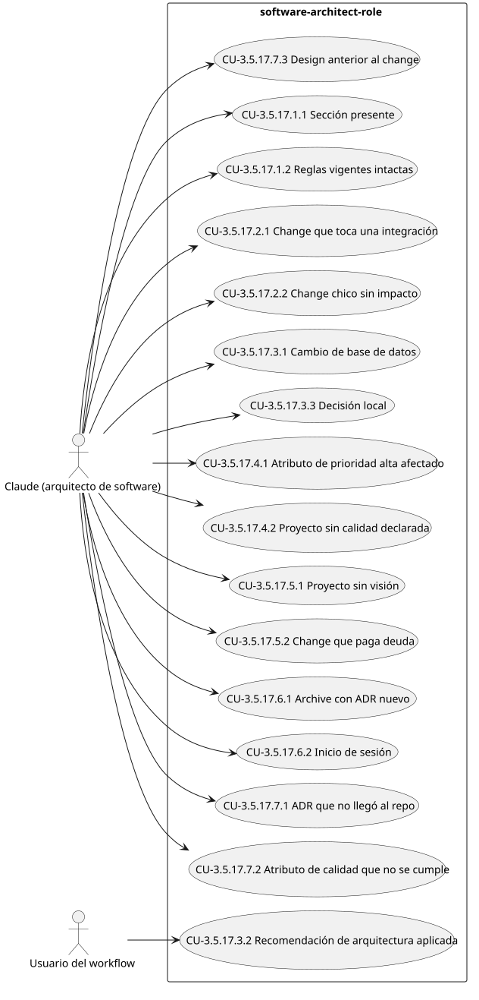
Fuente: [CAP-3.5.17.puml](diagramas/CAP-3.5.17.puml)

**CU-3.5.17.1.1 [3.5.17.1] Sección presente** — Actor: Claude (arquitecto de software)

- **WHEN** se lee el `CLAUDE.md` global
- **THEN** existe `## Rol de arquitecto de software` con las cuatro responsabilidades
- **AND** dice que las reglas vigentes no cambian y que el Agente escribe los documentos de arquitectura del repo

**CU-3.5.17.1.2 [3.5.17.1] Reglas vigentes intactas** — Actor: Claude (arquitecto de software)

- **WHEN** se compara el `CLAUDE.md` global antes y después del change
- **THEN** ninguna línea de las reglas globales 1 a 10, de las reglas de ejecución del Agente ni de la puerta de integración se borró ni cambió de sentido

**CU-3.5.17.2.1 [3.5.17.2] Change que toca una integración** — Actor: Claude (arquitecto de software)

- **WHEN** se propone un change que modifica el módulo que llama a una API externa usada por otros dos módulos
- **THEN** `## Impacto en el sistema` nombra los otros dos módulos en **Componentes afectados**

**CU-3.5.17.2.2 [3.5.17.2] Change chico sin impacto** — Actor: Claude (arquitecto de software)

- **WHEN** se propone un change que corrige un texto en un solo archivo
- **THEN** `## Impacto en el sistema` existe y sus cuatro partes dicen "ninguno" o "ninguna"

**CU-3.5.17.3.1 [3.5.17.3] Cambio de base de datos** — Actor: Claude (arquitecto de software)

- **WHEN** se propone un change que reemplaza SQLite por PostgreSQL en `## Stack` y el proyecto tiene `docs/adr/0001-*.md` y `docs/adr/0002-*.md`
- **THEN** el `design.md` tiene `## ADR` con `# 0003. ...`, `Estado: aceptada` y las cuatro secciones
- **AND** `tasks.md` tiene una tarea para que el Agente cree `docs/adr/0003-<slug>.md`

**CU-3.5.17.3.2 [3.5.17.3] Recomendación de arquitectura aplicada** — Actor: Usuario del workflow

- **WHEN** el usuario elige "Aplicar en este change" en una `## Recomendación de arquitectura` que sube el `nivel`
- **THEN** el `design.md` también tiene `## ADR` con esa decisión

**CU-3.5.17.3.3 [3.5.17.3] Decisión local** — Actor: Claude (arquitecto de software)

- **WHEN** el change solo decide el nombre de una función interna
- **THEN** el `design.md` no tiene `## ADR` y **Decisiones de arquitectura** dice "ninguna"

**CU-3.5.17.4.1 [3.5.17.4] Atributo de prioridad alta afectado** — Actor: Claude (arquitecto de software)

- **WHEN** `## Calidad` declara `- rendimiento: respuesta de la API < 500 ms p95 | alta` y el change agrega una consulta a la base en un endpoint
- **THEN** **Atributos de calidad** tiene una línea de rendimiento con `— Verificación:`

**CU-3.5.17.4.2 [3.5.17.4] Proyecto sin calidad declarada** — Actor: Claude (arquitecto de software)

- **WHEN** se propone un change en un proyecto sin `## Calidad`
- **THEN** **Atributos de calidad** dice "sin `## Calidad` declarada"
- **AND** el resumen final sugiere `/ficha`

**CU-3.5.17.5.1 [3.5.17.5] Proyecto sin visión** — Actor: Claude (arquitecto de software)

- **WHEN** se propone el primer change de un proyecto sin `docs/arquitectura/vision.md`
- **THEN** el `design.md` trae el contenido inicial de la visión
- **AND** `tasks.md` tiene una tarea para que el Agente cree el archivo

**CU-3.5.17.5.2 [3.5.17.5] Change que paga deuda** — Actor: Claude (arquitecto de software)

- **WHEN** **Deuda técnica** dice que el change paga una deuda de la hoja de ruta
- **THEN** `tasks.md` tiene una tarea para quitarla de `## Hoja de ruta` en `docs/arquitectura/vision.md`

**CU-3.5.17.6.1 [3.5.17.6] Archive con ADR nuevo** — Actor: Claude (arquitecto de software)

- **WHEN** se archiva un change que creó `docs/adr/0003-postgresql.md`
- **THEN** `arquitectura.md` del vault lista `0003` en `## Decisiones vigentes`
- **AND** el commit del vault del archive lo incluye

**CU-3.5.17.6.2 [3.5.17.6] Inicio de sesión** — Actor: Claude (arquitecto de software)

- **WHEN** se abre una sesión nueva en un proyecto con `arquitectura.md` en el vault
- **THEN** Claude lo lee junto con `context.md`

**CU-3.5.17.7.1 [3.5.17.7] ADR que no llegó al repo** — Actor: Claude (arquitecto de software)

- **WHEN** el `design.md` tiene `## ADR` y el diff no agrega ningún archivo en `docs/adr/`
- **THEN** el reporte tiene un WARNING de ADR
- **AND** la evaluación final no cambia por este control a "no listo para archive"

**CU-3.5.17.7.2 [3.5.17.7] Atributo de calidad que no se cumple** — Actor: Claude (arquitecto de software)

- **WHEN** la verificación declarada para rendimiento falla
- **THEN** el reporte tiene un WARNING de rendimiento con el motivo en una línea

**CU-3.5.17.7.3 [3.5.17.7] Design anterior al change** — Actor: Claude (arquitecto de software)

- **WHEN** se verifica un change cuyo `design.md` no tiene `## Impacto en el sistema`
- **THEN** el reporte tiene una SUGGESTION y ningún WARNING por esa falta

#### Casos de uso de work-classification [3.5.18]

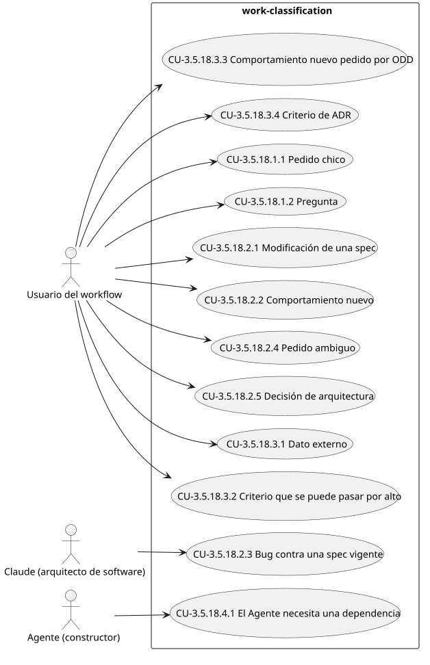
Fuente: [CAP-3.5.18.puml](diagramas/CAP-3.5.18.puml)

**CU-3.5.18.1.1 [3.5.18.1] Pedido chico** — Actor: Usuario del workflow

- **WHEN** el usuario pide corregir un typo en un mensaje cuyo texto correcto ya está en una spec vigente
- **THEN** Claude anuncia "ODD" con el motivo en una línea antes de escribir el documento

**CU-3.5.18.1.2 [3.5.18.1] Pregunta** — Actor: Usuario del workflow

- **WHEN** el usuario pregunta qué hace un archivo
- **THEN** Claude responde sin clasificar

**CU-3.5.18.2.1 [3.5.18.2] Modificación de una spec** — Actor: Usuario del workflow

- **WHEN** una spec vigente dice que el mensaje de bienvenida es "Hola, {nombre}" y el usuario pide cambiarlo a "Buen día, {nombre}"
- **THEN** la clasificación es ODD con un cambio mínimo de spec, porque modifica un requirement existente de una sola capability

**CU-3.5.18.2.2 [3.5.18.2] Comportamiento nuevo** — Actor: Usuario del workflow

- **WHEN** el usuario pide agregar un mensaje de despedida que ninguna spec describe
- **THEN** la clasificación es SDD por K1

**CU-3.5.18.2.3 [3.5.18.2] Bug contra una spec vigente** — Actor: Claude (arquitecto de software)

- **WHEN** el código muestra "Hla, {nombre}" y la spec vigente dice "Hola, {nombre}"
- **THEN** la clasificación es ODD, porque corregirlo no cambia la spec

**CU-3.5.18.2.4 [3.5.18.2] Pedido ambiguo** — Actor: Usuario del workflow

- **WHEN** el usuario pide "mejorar los mensajes" sin decir cómo
- **THEN** la clasificación es SDD por K8

**CU-3.5.18.2.5 [3.5.18.2] Decisión de arquitectura** — Actor: Usuario del workflow

- **WHEN** el usuario pide agregar logging estructurado en todos los módulos
- **THEN** la clasificación es SDD por K10

**CU-3.5.18.2.6 [3.5.18.2] Dato usado igual que antes** — Actor: Usuario del workflow

- **WHEN** `## Datos` declara el nombre del lead como `personal` y el usuario pide cambiar el saludo "Hola, {nombre}" a "Buenas, {nombre}"
- **THEN** K2 no se cumple, porque el nombre se usa igual que antes
- **AND** la clasificación es ODD con un cambio mínimo de spec

**CU-3.5.18.2.7 [3.5.18.2] Dato transformado** — Actor: Usuario del workflow

- **WHEN** `## Datos` declara el nombre del lead como `personal` y el usuario pide mostrarlo en mayúsculas en el saludo
- **THEN** la clasificación es SDD por K2, porque transforma el dato
- **AND** Claude no ofrece pasarlo a ODD

**CU-3.5.18.3.1 [3.5.18.3] Dato externo** — Actor: Usuario del workflow

- **WHEN** el usuario pide validar que el teléfono del formulario (declarado `(externo) | personal`) no venga vacío y después pide hacerlo por ODD
- **THEN** Claude responde que va por SDD por K2 y no crea el documento ODD

**CU-3.5.18.3.2 [3.5.18.3] Criterio que se puede pasar por alto** — Actor: Usuario del workflow

- **WHEN** un pedido cumple solo K7 y el usuario pide ODD
- **THEN** Claude crea el documento ODD
- **AND** `## Clasificación` dice que K7 se pasó por alto a pedido del usuario

**CU-3.5.18.3.3 [3.5.18.3] Comportamiento nuevo pedido por ODD** — Actor: Usuario del workflow

- **WHEN** un pedido agrega un comportamiento que ninguna spec describe y el usuario pide ODD
- **THEN** Claude responde que va por SDD por K1 y no crea el documento ODD

**CU-3.5.18.3.4 [3.5.18.3] Criterio de ADR** — Actor: Usuario del workflow

- **WHEN** un pedido cumple K10 y el usuario pide ODD
- **THEN** Claude responde que va por SDD por K10 y no crea el documento ODD

**CU-3.5.18.4.1 [3.5.18.4] El Agente necesita una dependencia** — Actor: Agente (constructor)

- **WHEN** el Agente avisa "escalar a SDD" porque el ODD necesita una dependencia nueva
- **THEN** el documento queda con `estado: escalado` y el motivo en `## Progreso`
- **AND** Claude ofrece `/opsx:propose` con el documento como entrada

#### Casos de uso de change-archive [3.5.19]

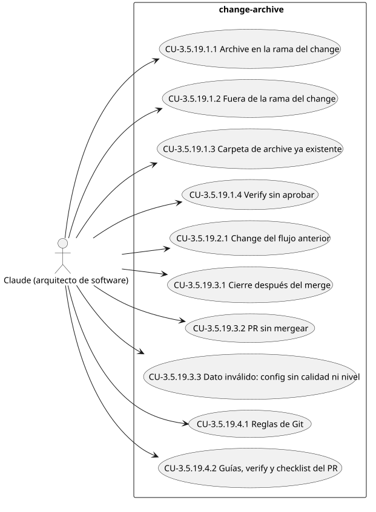
Fuente: [CAP-3.5.19.puml](diagramas/CAP-3.5.19.puml)

**CU-3.5.19.1.1 [3.5.19.1] Archive en la rama del change** — Actor: Claude (arquitecto de software)

- **WHEN** en la rama `change/saludo` con el PR abierto y el verify aprobado se corre `/opsx:archive saludo`
- **THEN** `openspec/specs/` de la rama tiene los requirements del change y existe `openspec/changes/archive/AAAA-MM-DD-saludo/`
- **AND** la rama tiene un commit `chore: archive saludo` con el trailer `Spec-ID: saludo`
- **AND** el vault no tiene `archive/AAAA-MM-DD-saludo.md` y `## Estado actual` de `context.md` dice que `saludo` está archivado en la rama, pendiente de merge
- **AND** el resumen pide mergear el PR y volver a correr `/opsx:archive saludo` para cerrar en el vault

**CU-3.5.19.1.2 [3.5.19.1] Fuera de la rama del change** — Actor: Claude (arquitecto de software)

- **WHEN** se corre `/opsx:archive saludo` con el change sin archivar y la rama actual no es `change/saludo`
- **THEN** Claude frena, dice en qué rama hay que estar y no mueve ni commitea nada

**CU-3.5.19.1.3 [3.5.19.1] Carpeta de archive ya existente** — Actor: Claude (arquitecto de software)

- **WHEN** se corre `/opsx:archive saludo` en `change/saludo` y ya existe `openspec/changes/archive/AAAA-MM-DD-saludo/` con la fecha del día
- **THEN** Claude frena antes de sincronizar o mover nada, dice qué carpeta existe y sugiere renombrarla o esperar otra fecha

**CU-3.5.19.1.4 [3.5.19.1] Verify sin aprobar** — Actor: Claude (arquitecto de software)

- **WHEN** se corre `/opsx:archive saludo` en `change/saludo` y `context.md` del vault no registra el verify aprobado de `saludo`
- **THEN** Claude pregunta si el verify está aprobado sin CRITICAL
- **AND** si el usuario no lo confirma, frena sin mover ni commitear nada

**CU-3.5.19.2.1 [3.5.19.2] Change del flujo anterior** — Actor: Claude (arquitecto de software)

- **WHEN** el PR de `change/saludo` está mergeado, `openspec/changes/saludo/` sigue en la rama principal y se corre `/opsx:archive saludo`
- **THEN** Claude actualiza la rama principal con `git pull --ff-only` antes de crear la rama, y la fase de la rama no frena por estar en `change/saludo-archive`
- **AND** existe la rama `change/saludo-archive` con el commit `chore: archive saludo`
- **AND** la rama principal no tiene commits nuevos
- **AND** el resumen pide abrir el PR con `/branch-pr` y, después del merge, volver a correr `/opsx:archive saludo`

**CU-3.5.19.3.1 [3.5.19.3] Cierre después del merge** — Actor: Claude (arquitecto de software)

- **WHEN** el PR de `change/saludo` está mergeado con `openspec/changes/archive/AAAA-MM-DD-saludo/` y se corre `/opsx:archive saludo`
- **THEN** existe `archive/AAAA-MM-DD-saludo.md` en el vault y `_index.md` tiene su link
- **AND** la nota `decisions/*-saludo.md` dice `status: archivado`
- **AND** el vault tiene un commit `chore: <proyecto> — archive saludo`
- **AND** el repo del proyecto no tiene commits nuevos

**CU-3.5.19.3.2 [3.5.19.3] PR sin mergear** — Actor: Claude (arquitecto de software)

- **WHEN** `saludo` ya está archivado en `change/saludo`, el PR sigue abierto y se corre `/opsx:archive saludo`
- **THEN** Claude frena, dice que falta el merge y no escribe nada en el vault

**CU-3.5.19.3.3 [3.5.19.3] Dato inválido: config sin calidad ni nivel** — Actor: Claude (arquitecto de software)

- **WHEN** se cierra en el vault un change de un proyecto cuyo `openspec/config.yaml` no declara `## Calidad` ni `nivel` en `## Arquitectura`
- **THEN** `arquitectura.md` del vault dice "sin declarar" en `## Atributos de calidad` y "sin evaluar" en `## Nivel`
- **AND** el cierre termina sin error

**CU-3.5.19.4.1 [3.5.19.4] Reglas de Git** — Actor: Claude (arquitecto de software)

- **WHEN** se lee la sección "Pull Requests" del `.claude/CLAUDE.md`
- **THEN** dice que el archive de specs se hace en la rama del change antes del merge y el cierre en el vault después del merge
- **AND** ya no dice "El archive se ejecuta después del merge, nunca antes"

**CU-3.5.19.4.2 [3.5.19.4] Guías, verify y checklist del PR** — Actor: Claude (arquitecto de software)

- **WHEN** se leen `README.md`, `docs/workflow.md`, `docs/modo-de-uso.md`, `skills/openspec-verify-change/SKILL.md` y `skills/branch-pr/SKILL.md`
- **THEN** las guías muestran el archive en la rama antes del merge y el cierre en el vault después
- **AND** el verify aprobado nombra `/opsx:archive <nombre>` en la rama `change/<nombre>` como próximo paso
- **AND** el checklist del PR para `change/` incluye "Archive hecho en la rama (specs sincronizadas y SRS si corresponde)"

#### Casos de uso de product-backlog [3.5.20]

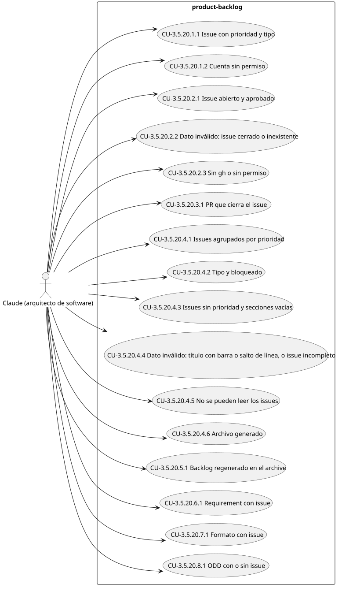
Fuente: [CAP-3.5.20.puml](diagramas/CAP-3.5.20.puml)

**CU-3.5.20.1.1 [3.5.20.1] Issue con prioridad y tipo** — Actor: Claude (arquitecto de software)

- **WHEN** se lee `skills/issue-creation/SKILL.md`
- **THEN** pide prioridad y tipo, tiene el catálogo de 9 etiquetas con su color y crea el issue con `status:needs-review`, la prioridad y el tipo

**CU-3.5.20.1.2 [3.5.20.1] Cuenta sin permiso** — Actor: Claude (arquitecto de software)

- **WHEN** se lee `skills/issue-creation/SKILL.md`
- **THEN** dice que, si `gh` falla por permisos, frena y le pide al usuario activar la cuenta dueña del repo con `gh auth switch`

**CU-3.5.20.2.1 [3.5.20.2] Issue abierto y aprobado** — Actor: Claude (arquitecto de software)

- **WHEN** se lee el paso del issue en `skills/openspec-propose/SKILL.md` y en `.claude/commands/opsx/propose.md`
- **THEN** los dos piden el issue, lo controlan con `gh issue view` y escriben `Issue: #NN` como primera línea del proposal

**CU-3.5.20.2.2 [3.5.20.2] Dato inválido: issue cerrado o inexistente** — Actor: Claude (arquitecto de software)

- **WHEN** el issue indicado está cerrado o no existe
- **THEN** el propose frena sin crear el change y sugiere `/issue-creation`

**CU-3.5.20.2.3 [3.5.20.2] Sin gh o sin permiso** — Actor: Claude (arquitecto de software)

- **WHEN** `gh` no está, no hay red o la cuenta no tiene permiso
- **THEN** el propose avisa, escribe `Issue: pendiente` y sigue

**CU-3.5.20.3.1 [3.5.20.3] PR que cierra el issue** — Actor: Claude (arquitecto de software)

- **WHEN** se lee el paso de creación del PR en `skills/branch-pr/SKILL.md`
- **THEN** agrega `Closes #NN` cuando el proposal o el documento ODD tiene `Issue: #NN`
- **AND** con `Issue: pendiente` o sin línea abre el PR sin `Closes` y lo dice en el resumen

**CU-3.5.20.4.1 [3.5.20.4] Issues agrupados por prioridad** — Actor: Claude (arquitecto de software)

- **WHEN** se genera el backlog con issues de prioridad alta, media y baja
- **THEN** `docs/backlog.md` tiene una sección por prioridad, en ese orden, con una tabla de issues ordenada por número
- **AND** termina con el total de issues abiertos

**CU-3.5.20.4.2 [3.5.20.4] Tipo y bloqueado** — Actor: Claude (arquitecto de software)

- **WHEN** un issue tiene `tipo:deuda` y `bloqueado`
- **THEN** su fila muestra `deuda` como tipo y el título termina en `(bloqueado)`

**CU-3.5.20.4.3 [3.5.20.4] Issues sin prioridad y secciones vacías** — Actor: Claude (arquitecto de software)

- **WHEN** un issue no tiene etiqueta de prioridad y no hay issues de prioridad baja
- **THEN** el issue aparece en `## Sin prioridad` y la sección de prioridad baja dice `Ninguno.`

**CU-3.5.20.4.4 [3.5.20.4] Dato inválido: título con barra o salto de línea, o issue incompleto** — Actor: Claude (arquitecto de software)

- **WHEN** un issue tiene `|` o un salto de línea en el título, y otro no tiene número o título
- **THEN** la barra se escapa, el salto pasa a espacio y el issue incompleto se descarta
- **AND** la consola informa cuántos issues se descartaron

**CU-3.5.20.4.5 [3.5.20.4] No se pueden leer los issues** — Actor: Claude (arquitecto de software)

- **WHEN** `gh` falla (sin red, sin permiso o carpeta sin repo de GitHub)
- **THEN** el script termina con 1, no crea ni modifica `docs/backlog.md` y el mensaje no tiene rutas absolutas

**CU-3.5.20.4.6 [3.5.20.4] Archivo generado** — Actor: Claude (arquitecto de software)

- **WHEN** se genera `docs/backlog.md`
- **THEN** está en UTF-8 sin BOM, su primera línea es el comentario de archivo generado y no contiene rutas absolutas

**CU-3.5.20.5.1 [3.5.20.5] Backlog regenerado en el archive** — Actor: Claude (arquitecto de software)

- **WHEN** se lee la fase de la rama en `skills/openspec-archive-change/SKILL.md` y en `.claude/commands/opsx/archive.md`
- **THEN** los dos tienen el paso del backlog después del SRS, con el commit `docs: regenerar backlog` y el aviso si el script falla

**CU-3.5.20.6.1 [3.5.20.6] Requirement con issue** — Actor: Claude (arquitecto de software)

- **WHEN** se lee `skills/srs-generate/SKILL.md`
- **THEN** describe el atributo "Issue" de los requirements y el mapa `issues:` de `docs/srs.meta.yaml`, y que se omite si el change no tiene issue

**CU-3.5.20.7.1 [3.5.20.7] Formato con issue** — Actor: Claude (arquitecto de software)

- **WHEN** se busca el formato de la hoja de ruta en `.claude/CLAUDE.md` y en `skills/openspec-propose/SKILL.md`
- **THEN** los dos incluyen el final opcional `— issue: #NN`

**CU-3.5.20.8.1 [3.5.20.8] ODD con o sin issue** — Actor: Claude (arquitecto de software)

- **WHEN** se lee la redacción del documento ODD en `skills/odd-change/SKILL.md` y en `.claude/commands/odd.md`
- **THEN** los dos dicen que el documento lleva `Issue: #NN` solo si el pedido tiene un issue

#### Casos de uso de security-layer-matrix [3.6.1]

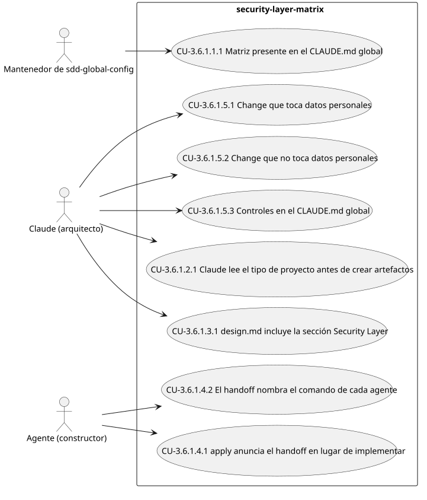
Fuente: [CAP-3.6.1.puml](diagramas/CAP-3.6.1.puml)

**CU-3.6.1.1.1 [3.6.1.1] Matriz presente en el CLAUDE.md global** — Actor: Claude (arquitecto de software)

- **WHEN** se lee el CLAUDE.md global
- **THEN** contiene la sección `## Capa de Seguridad por Tipo de Proyecto`
- **AND** define controles mínimos para `frontend`, `backend-api`, `etl` / `scripts` y `fullstack`

**CU-3.6.1.2.1 [3.6.1.2] Claude lee el tipo de proyecto antes de crear artefactos** — Actor: Claude (arquitecto de software)

- **WHEN** Claude va a crear un artefacto (`proposal.md`, `design.md`, `specs/*.md`) en un proyecto con OpenSpec
- **THEN** lee `project_type` del bloque `context:` de `openspec/config.yaml`
- **AND** aplica los controles mínimos de ese tipo

**CU-3.6.1.3.1 [3.6.1.3] design.md incluye la sección Security Layer** — Actor: Claude (arquitecto de software)

- **WHEN** se crea un nuevo change y se genera su `design.md`
- **THEN** el `design.md` contiene una sección `## Security Layer`
- **AND** la sección lista los controles del tipo de proyecto que aplican al change y cómo se implementan

**CU-3.6.1.4.1 [3.6.1.4] apply anuncia el handoff en lugar de implementar** — Actor: Claude (arquitecto de software)

- **WHEN** Claude ejecuta `/opsx:apply` sobre un change con tareas pendientes
- **THEN** anuncia el handoff al Agente y lista las tareas pendientes
- **AND** no realiza cambios de código

**CU-3.6.1.4.2 [3.6.1.4] El handoff nombra el comando de cada agente** — Actor: Claude (arquitecto de software)

- **WHEN** Claude anuncia el handoff al terminar `/opsx:propose` o `/opsx:apply`
- **THEN** el anuncio incluye `/openspec-apply-change {nombre}` para Antigravity y `/opsx-apply {nombre}` para Cursor

**CU-3.6.1.5.1 [3.6.1.5] Change que toca datos personales** — Actor: Claude (arquitecto de software)

- **WHEN** `## Datos` declara `- leads (nombre, teléfono, email): formulario web (externo) | personal` y el change agrega un campo al formulario de leads
- **THEN** la `## Security Layer` del design incluye los controles para datos personales

**CU-3.6.1.5.2 [3.6.1.5] Change que no toca datos personales** — Actor: Claude (arquitecto de software)

- **WHEN** el change solo modifica estilos de la web
- **THEN** la `## Security Layer` no está obligada a incluir los controles para datos personales

**CU-3.6.1.5.3 [3.6.1.5] Controles en el CLAUDE.md global** — Actor: Claude (arquitecto de software)

- **WHEN** se lee la Capa de Seguridad del `CLAUDE.md` global
- **THEN** hay una subsección de datos personales con los cinco controles del requirement

### 3.5 Requisitos Funcionales

#### 3.5.1 agent-cli-permissions

Clasificación: Funcional (heurística de palabras clave).

Propósito: Define cómo se replica en cada máquina la configuración del CLI del Agente sin versionar la configuración personal: baseline de permisos, allowlist base de comandos, workspaces de confianza declarados por máquina, barra de estado especificada por comportamiento e instalación documentada paso a paso.

**3.5.1.1 La configuración personal del CLI del Agente no se versiona**

El repositorio SHALL NOT versionar la carpeta `.gemini/` con archivos de configuración personal del CLI del Agente, porque contienen rutas de la máquina, workspaces de confianza y permisos. El repositorio SHALL versionar en su lugar una plantilla de `settings.json` sin datos de la máquina en `templates/antigravity/settings.json`.

- Riesgo: Bajo · Dependencia: Ninguna identificada · Dificultad: Nominal
- Escenarios: 2
- Origen: `openspec/specs/agent-cli-permissions/spec.md`

**3.5.1.2 Baseline de permisos del Agente en una máquina nueva**

Una máquina que use esta configuración SHALL tener en `~/.gemini/antigravity-cli/settings.json` los valores `toolPermission` en `always-proceed`, `artifactReviewPolicy` en `always-proceed` y `allowNonWorkspaceAccess` en `true`.

- Riesgo: Bajo · Dependencia: Ninguna identificada · Dificultad: Nominal
- Escenarios: 1
- Origen: `openspec/specs/agent-cli-permissions/spec.md`

**3.5.1.3 Allowlist base de comandos**

La plantilla SHALL incluir en `permissions.allow` únicamente los comandos genéricos `cmd.exe`, `git status`, `git diff`, `git branch`, `git restore`, `openspec` y `powershell`. La plantilla SHALL NOT incluir comandos puntuales, como un `git commit` con archivos de un proyecto o scripts de una sesión identificados por un id.

- Riesgo: Bajo · Dependencia: Ninguna identificada · Dificultad: Nominal
- Escenarios: 1
- Origen: `openspec/specs/agent-cli-permissions/spec.md`

**3.5.1.4 Workspaces de confianza declarados por máquina**

La plantilla SHALL incluir `trustedWorkspaces` con un valor de ejemplo con placeholder, y cada máquina SHALL declarar sus propios workspaces de confianza. Los workspaces reales SHALL NOT versionarse.

- Riesgo: Bajo · Dependencia: Ninguna identificada · Dificultad: Nominal
- Escenarios: 1
- Origen: `openspec/specs/agent-cli-permissions/spec.md`

**3.5.1.5 Barra de estado especificada por comportamiento**

La barra de estado del CLI del Agente SHALL generarse en cada máquina por el propio CLI a partir de este requisito, y el repositorio SHALL NOT versionar sus scripts. La plantilla SHALL configurar `statusLine` con `"enabled": true` y un comando que apunte a `statusline.bat` dentro de `~/.gemini/antigravity-cli/scratch/`. La barra SHALL leer por entrada estándar el JSON que envía el CLI y escribir una única línea con el formato `<proyecto>   <contexto>%   <cuota>% <reinicio>  (<rama>)  <modelo>`, con tres espacios entre proyecto, contexto y cuota, y dos espacios antes de la rama y del modelo. Los campos SHALL obtenerse así:

- `<proyecto>`: el último segmento de `workspace.project_dir`; si no existe, el de `cwd`; si no hay entrada válida, el nombre del directorio actual; `desconocido` si nada de lo anterior aplica.
- `<contexto>`: `context_window.used_percentage` redondeado, o `0` si falta, en verde con secuencias ANSI.
- `<cuota>` y `<reinicio>`, de la cuota de 5 horas: se usa `3p-5h` cuando existe y su `remaining_fraction` es menor que 1; si no, `gemini-5h`; si no, `3p-5h`. `<cuota>` es el redondeo de `(1 - remaining_fraction) * 100`, o `0` si no hay cuota. `<reinicio>` es `<h>h<mm>m` calculado desde `reset_in_seconds` cuando es mayor que 0, y se omite en otro caso.
- `<rama>`: la salida de `git rev-parse --abbrev-ref HEAD` ejecutado en `cwd` (o en el directorio actual si `cwd` no existe); el bloque `(<rama>)` se omite si no hay repositorio.
- `<modelo>`: `model.display_name`, o `model.id` si falta; se omite si no hay ninguno.

La barra SHALL NOT fallar ante una entrada vacía o un JSON inválido.

- Riesgo: Bajo · Dependencia: Ninguna identificada · Dificultad: Nominal
- Escenarios: 4
- Origen: `openspec/specs/agent-cli-permissions/spec.md`

**3.5.1.6 La instalación por máquina está documentada**

El `README.md`, `templates/antigravity/README.md` y la guía de uso (`docs/modo-de-uso.md`) SHALL describir la instalación por máquina de la plantilla de permisos y cómo pedirle al CLI del Agente que genere la barra de estado a partir del requisito «Barra de estado», indicando el destino y los valores que hay que completar, y qué hacer si la barra no aparece (`statusLine.enabled` en `false`).

- Riesgo: Bajo · Dependencia: Ninguna identificada · Dificultad: Nominal
- Escenarios: 2
- Origen: `openspec/specs/agent-cli-permissions/spec.md`

**3.5.1.7 Permisos de ejecución del Agente en Cursor documentados**

El setup por máquina de `README.md`, `templates/cursor/README.md` y `docs/modo-de-uso.md` SHALL describir cómo configurar en Cursor la ejecución automática de comandos del Agente con una allowlist genérica: `git status`, `git diff`, `git branch`, `git restore` y `openspec`. La documentación SHALL advertir que agregar `powershell` o `cmd.exe` permite ejecutar cualquier comando sin confirmación y SHALL NOT incluir rutas reales ni el nombre de usuario. Esta configuración vive en el IDE de Cursor y no se versiona; los requisitos de permisos de Antigravity de esta spec no cambian.

- Riesgo: Bajo · Dependencia: Ninguna identificada · Dificultad: Nominal
- Escenarios: 3
- Origen: `openspec/specs/agent-cli-permissions/spec.md`

#### 3.5.2 doc-folder-structure

Clasificación: Funcional (heurística de palabras clave).

Propósito: Define que la documentación de reglas de negocio del proyecto vive en una carpeta `docs/` en la raíz (`workflow.md` y la guía de uso) y que `README.md` la referencia como punto de entrada.

**3.5.2.1 Carpeta `docs/` existe en la raíz del proyecto**

El proyecto SHALL tener un directorio `docs/` en la raíz como carpeta canónica para toda la documentación de reglas de negocio del workflow SDD Híbrido.

- Riesgo: Bajo · Dependencia: Ninguna identificada · Dificultad: Nominal
- Escenarios: 1
- Origen: `openspec/specs/doc-folder-structure/spec.md`

**3.5.2.2 `workflow.md` reside en `docs/`**

El archivo de workflow SDD Híbrido SHALL estar ubicado en `docs/workflow.md`. El archivo `WORKFLOW.md` en la raíz SHALL ser eliminado.

- Riesgo: Bajo · Dependencia: Ninguna identificada · Dificultad: Nominal
- Escenarios: 2
- Origen: `openspec/specs/doc-folder-structure/spec.md`

**3.5.2.3 La guía de uso reside en `docs/`**

La guía de uso SHALL estar ubicada en `docs/modo-de-uso.md` (fuente) y `docs/modo-de-uso.docx` (versión derivada). La carpeta `Modo de Uso/` SHALL ser eliminada.

- Riesgo: Bajo · Dependencia: Ninguna identificada · Dificultad: Nominal
- Escenarios: 2
- Origen: `openspec/specs/doc-folder-structure/spec.md`

**3.5.2.4 `README.md` referencia `docs/` como punto de entrada**

El `README.md` SHALL incluir una sección que dirija al lector a `docs/` para la documentación detallada del workflow y reglas de negocio.

- Riesgo: Bajo · Dependencia: Ninguna identificada · Dificultad: Nominal
- Escenarios: 1
- Origen: `openspec/specs/doc-folder-structure/spec.md`

#### 3.5.3 docs-portable-paths

Clasificación: Funcional (heurística de palabras clave).

Propósito: Garantiza que la documentación de `docs/` funcione en cualquier máquina sin exponer datos del entorno local: sin rutas absolutas con el usuario de la PC y con el `.docx` de la guía de uso siempre alineado con su `.md`.

**3.5.3.1 La documentación de `docs/` no incluye rutas absolutas del entorno local**

Los documentos de `docs/` (`.md` y `.docx`) SHALL NOT contener rutas absolutas que revelen el usuario o la máquina local (por ejemplo `C:\Users\<usuario>\...`). Las rutas SHALL expresarse con placeholders entre llaves (por ejemplo `{ruta-del-proyecto}`) o con variables de entorno (por ejemplo `$env:APPDATA`).

- Riesgo: Bajo · Dependencia: Ninguna identificada · Dificultad: Nominal
- Escenarios: 2
- Origen: `openspec/specs/docs-portable-paths/spec.md`

**3.5.3.2 El `.docx` de la guía de uso refleja el `.md`**

`docs/modo-de-uso.docx` SHALL regenerarse desde `docs/modo-de-uso.md` cada vez que este cambie, de modo que ambos tengan el mismo contenido.

- Riesgo: Bajo · Dependencia: Ninguna identificada · Dificultad: Nominal
- Escenarios: 1
- Origen: `openspec/specs/docs-portable-paths/spec.md`

#### 3.5.4 project-claude-md

Clasificación: Funcional (heurística de palabras clave).

Propósito: Define el contenido de los `CLAUDE.md` de cada proyecto: conservan lo propio del proyecto y remiten al flujo OpenSpec global, sin instruir el flujo SDD manual y nombrando al constructor como "el Agente".

**3.5.4.1 El CLAUDE.md de proyecto remite al flujo global**

El `CLAUDE.md` de un proyecto que usa OpenSpec SHALL incluir una sección "Workflow SDD / OpenSpec" que remita a las reglas globales (`~/.claude/CLAUDE.md`) e indique que las features nuevas empiezan con `/opsx:propose`. El archivo SHALL NOT repetir las reglas globales del workflow (roles, flujo por change, reglas de Git, seguridad universal).

- Riesgo: Bajo · Dependencia: Ninguna identificada · Dificultad: Nominal
- Escenarios: 2
- Origen: `openspec/specs/project-claude-md/spec.md`

**3.5.4.2 El CLAUDE.md de proyecto no instruye el flujo SDD manual**

El `CLAUDE.md` de un proyecto que usa OpenSpec SHALL NOT instruir a Claude a generar prompts para un agente concreto, a crear `spec.yaml`, `Task.md` o `threat-model.md` como artefactos de changes nuevos, a seguir fases OPCX ni a usar `change-map.md` como fuente del change activo. El `specs/` legacy y `change-map.md` SHALL mencionarse, si existen, solo como referencia histórica, y el change activo SHALL obtenerse con `openspec list --json`.

- Riesgo: Bajo · Dependencia: Ninguna identificada · Dificultad: Nominal
- Escenarios: 2
- Origen: `openspec/specs/project-claude-md/spec.md`

**3.5.4.3 El rol de constructor se nombra "el Agente"**

El `CLAUDE.md` de un proyecto que usa OpenSpec SHALL nombrar al constructor como "el Agente" y SHALL NOT atribuir el rol a una herramienta concreta (Copilot, Gemini, Antigravity, Cursor). Los nombres de archivo y comandos que impone una herramienta, como `.github/copilot-instructions.md`, `.cursor/rules/sdd-workflow.mdc` o `/opsx-apply`, SHALL conservarse tal cual.

- Riesgo: Bajo · Dependencia: Ninguna identificada · Dificultad: Nominal
- Escenarios: 1
- Origen: `openspec/specs/project-claude-md/spec.md`

**3.5.4.4 El contenido propio del proyecto se conserva**

Al alinear un `CLAUDE.md`, el contenido propio del proyecto (descripción, stack, arquitectura, contratos de comportamiento, reglas de arquitectura, restricciones del entorno, IDs de recursos, riesgos, watchlist y estado) SHALL conservarse sin cambios de significado. Las rutas absolutas que revelen el usuario local SHALL reemplazarse por placeholders con llaves (por ejemplo `{proyectos}`) o rutas relativas; cuando la ruta sea una dependencia funcional de la regla (por ejemplo consultas Power Query que apuntan al escritorio del usuario), el placeholder SHALL conservar el sentido (por ejemplo `{escritorio}\normalizacionLeads`) y la regla SHALL aclarar que corresponde al usuario de cada equipo. Las rutas de archivos del repo que queden SHALL corresponder a archivos existentes.

- Riesgo: Bajo · Dependencia: Ninguna identificada · Dificultad: Nominal
- Escenarios: 4
- Origen: `openspec/specs/project-claude-md/spec.md`

#### 3.5.5 project-context-schema

Clasificación: Funcional (heurística de palabras clave).

Propósito: Define la convención de subsecciones fijas y opcionales (`## Glosario`, `## Actores y Procesos de Negocio`, `## Objetivos de Negocio`) dentro del campo `context:` de `openspec/config.yaml`, para que el conocimiento de negocio del proyecto viva en un único lugar reusado por toda operación de OpenSpec, con edición quirúrgica por subsección y advertencia de tamaño antes del límite del CLI.

**3.5.5.1 Subsecciones estructuradas dentro de `context:`**

El campo `context:` de `openspec/config.yaml` SHALL admitir subsecciones opcionales con encabezados Markdown fijos — `## Glosario`, `## Actores y Procesos de Negocio` (con sub-encabezados `### Actores` y `### Procesos`), `## Objetivos de Negocio`, `## Tests`, `## Arquitectura` (formato definido en la capability `project-architecture`), `## Alcance`, `## Datos` y `## Stack` (formato definido en la capability `project-profile`) — para conocimiento del proyecto reusable en toda operación de OpenSpec. Cualquier skill que escriba ahí SHALL appendear estas subsecciones al final del texto existente y NO SHALL sobrescribir ni reordenar el contenido previo a ellas. Si `openspec/config.yaml` no existe, o existe sin un `context:` activo (ausente o solo comentado) o sin `project_type`, la skill que necesite escribir una subsección SHALL completar lo que falta antes de escribirla — `schema: spec-driven` si falta el archivo, `project_type` preguntado una vez al usuario, `context:` con una línea que describa el proyecto — sin tocar el resto del archivo (claves, `rules` y comentarios existentes).

- Riesgo: Bajo · Dependencia: Ninguna identificada · Dificultad: Nominal
- Escenarios: 8
- Origen: `openspec/specs/project-context-schema/spec.md`

**3.5.5.2 Formato de cada subsección**

Cada subsección SHALL usar una lista simple `- <clave>: <descripción>`: Glosario (término/definición), Objetivos de Negocio (id/descripción). "Actores y Procesos de Negocio" SHALL tener dos sub-listas bajo `### Actores` y `### Procesos`, cada una con el mismo formato (nombre/descripción). "Tests" SHALL usar claves fijas: `comando` (obligatoria; el valor `ninguno` indica que el proyecto no tiene tests automáticos), `comando-rapido` (opcional), `timeout` (obligatoria cuando `comando` no es `ninguno`, en minutos), `entorno` (opcional: requisitos para correr los tests, por ejemplo servicios de docker compose de test) y `excluir` (opcional: rutas que no cuentan como código para los tests de caracterización). Las claves opcionales que no se declaran SHALL omitirse: no se escriben con valores de relleno como "no declarado" o "ninguno". Al preguntar, la skill SHALL mostrar el `timeout` con su unidad (minutos).

- Riesgo: Bajo · Dependencia: Ninguna identificada · Dificultad: Nominal
- Escenarios: 4
- Origen: `openspec/specs/project-context-schema/spec.md`

**3.5.5.3 Advertencia de tamaño antes de escribir**

Antes de escribir en `context:`, una skill SHALL calcular el tamaño resultante en bytes y SHALL advertir si supera un umbral de alerta (40KB) sin bloquear la escritura, dado que el CLI de OpenSpec descarta el campo `context` completo (no solo el excedente) si supera su límite duro de 50KB.

- Riesgo: Bajo · Dependencia: Ninguna identificada · Dificultad: Nominal
- Escenarios: 2
- Origen: `openspec/specs/project-context-schema/spec.md`

#### 3.5.6 project-onboarding

Clasificación: Funcional (heurística de palabras clave).

Propósito: Define cómo se prepara una máquina y cómo se inicia un proyecto en el workflow: el setup instala las skills y los comandos globales de Claude, los proyectos se inician solo con el Agente (`openspec init --tools <agente>`) y los que tienen copias locales de Claude se limpian para que no pisen a las globales.

**3.5.6.1 El setup por máquina instala skills y comandos globales de Claude**

El setup por máquina SHALL instalar en `~/.claude/skills/` todas las skills de `skills/` y en `~/.claude/commands/` los comandos de `.claude/commands/`, porque los comandos son lo que ejecutan `/opsx:*` y las skills los complementan. Las guías SHALL indicar hacerlo con `pwsh scripts/instalar.ps1` desde la raíz del repo (con `-Simular` para ver antes qué cambia), que además instala el `CLAUDE.md` y sincroniza el espejo del vault, y NO SHALL indicar copiarlos a mano.

- Riesgo: Bajo · Dependencia: Ninguna identificada · Dificultad: Nominal
- Escenarios: 1
- Origen: `openspec/specs/project-onboarding/spec.md`

**3.5.6.2 Los proyectos se inician solo con el Agente**

Las guías SHALL indicar `openspec init --tools <agente>` para iniciar un proyecto, con `<agente>` igual a `antigravity` o `cursor`, y SHALL NOT incluir `claude` en `--tools`, para que Claude use los comandos y skills globales. Las guías SHALL indicar cómo comprobar la instalación: `.agents/skills/openspec-apply-change/` para Antigravity o `.cursor/commands/opsx-apply.md` para Cursor. Las guías SHALL NOT pedir "liberar el slot de apply".

- Riesgo: Bajo · Dependencia: Ninguna identificada · Dificultad: Nominal
- Escenarios: 3
- Origen: `openspec/specs/project-onboarding/spec.md`

**3.5.6.3 Los proyectos con copias locales de Claude se limpian**

Las guías SHALL describir cómo eliminar de un proyecto existente las copias locales de Claude: los comandos de `.claude/commands/opsx/` y las skills `.claude/skills/openspec-*`. Las guías SHALL indicar que, si están versionadas, la eliminación se commitea aparte y desde la rama principal, y que `openspec update` no las vuelve a generar.

- Riesgo: Bajo · Dependencia: Ninguna identificada · Dificultad: Nominal
- Escenarios: 2
- Origen: `openspec/specs/project-onboarding/spec.md`

**3.5.6.4 Reglas del Agente por proyecto en Cursor**

El repositorio SHALL versionar la plantilla `templates/cursor/sdd-workflow.mdc`, y las guías SHALL indicar instalarla en `.cursor/rules/sdd-workflow.mdc` de cada proyecto que usa Cursor como Agente con `scripts/sincronizar-proyecto.ps1`, junto con `AGENTS.md` y `.github/copilot-instructions.md` según el agente. La plantilla SHALL aplicarse siempre (`alwaysApply: true`), remitir al espejo del vault `_global/reglas-globales.md` y no contener rutas con el usuario local.

- Riesgo: Bajo · Dependencia: Ninguna identificada · Dificultad: Nominal
- Escenarios: 3
- Origen: `openspec/specs/project-onboarding/spec.md`

**3.5.6.5 El setup por máquina se hace por agente**

El setup por máquina de `README.md` y `docs/modo-de-uso.md` SHALL tener pasos separados para cada agente (Antigravity: `GEMINI.md` y `settings.json`; Cursor: ejecución automática) e indicar que cada persona sigue solo los del agente que usa. El paso de Antigravity SHALL instalar `templates\antigravity\GEMINI.md` en `~/.gemini/GEMINI.md` con `scripts/instalar.ps1` (que lo instala cuando existe la carpeta `~/.gemini`) y seguir copiando `settings.json` solo si no existe. El repositorio SHALL seguir versionando las plantillas de Antigravity.

- Riesgo: Bajo · Dependencia: Ninguna identificada · Dificultad: Nominal
- Escenarios: 3
- Origen: `openspec/specs/project-onboarding/spec.md`

**3.5.6.6 Agregar Cursor a proyectos existentes**

Las guías SHALL describir cómo sumar Cursor a un proyecto que ya usa OpenSpec con Antigravity: ejecutar `openspec init --tools cursor` (conserva la configuración y suma la herramienta) e instalar `.cursor/rules/sdd-workflow.mdc`. Las guías SHALL indicar que las carpetas de Antigravity (`.agents/` y la anterior `.agent/`) solo se eliminan si el proyecto deja de usar Antigravity, en un commit aparte y desde la rama principal.

- Riesgo: Bajo · Dependencia: Ninguna identificada · Dificultad: Nominal
- Escenarios: 2
- Origen: `openspec/specs/project-onboarding/spec.md`

**3.5.6.7 El vault documenta la carpeta de resúmenes del apply**

Las guías SHALL describir la carpeta `projects/<proyecto>/apply/` del vault (dónde el Agente deja la copia del resumen del apply) e indicar que `projects/*/apply/` está en el `.gitignore` del vault, por lo que no se sube a git y el verify solo se corre en la máquina del apply. El `CLAUDE.md` global SHALL incluir `apply/` en la estructura del vault.

- Riesgo: Bajo · Dependencia: Ninguna identificada · Dificultad: Nominal
- Escenarios: 2
- Origen: `openspec/specs/project-onboarding/spec.md`

**3.5.6.8 Actualizar OpenSpec en un proyecto existente**

Las guías SHALL describir cómo actualizar un proyecto que ya usa OpenSpec: ejecutar `openspec update`, revisar con `git status` y `git diff` lo que cambió y commitearlo aparte. Si el proyecto tenía `.agent/`, las guías SHALL indicar que `openspec update` crea `.agents/` y deja `.agent/` cuando sus archivos difieren, y que se compara y elimina `.agent/` en un commit aparte desde la rama principal.

- Riesgo: Bajo · Dependencia: Ninguna identificada · Dificultad: Nominal
- Escenarios: 2
- Origen: `openspec/specs/project-onboarding/spec.md`

**3.5.6.9 La telemetría de OpenSpec se desactiva por máquina**

El setup por máquina de `README.md` y `docs/modo-de-uso.md` SHALL indicar `openspec config set telemetry.enabled false`, con la comprobación `openspec config get telemetry.enabled`, porque las máquinas de la empresa no deben enviar telemetría de uso a terceros.

- Riesgo: Bajo · Dependencia: Ninguna identificada · Dificultad: Nominal
- Escenarios: 2
- Origen: `openspec/specs/project-onboarding/spec.md`

**3.5.6.10 Instalación del comando odd-apply**

`scripts/instalar.ps1` SHALL instalar la skill `odd-apply` en `<Destino>/.gemini/skills/odd-apply/SKILL.md` solo si existe `<Destino>/.gemini`, con el mismo control de cambios locales y manifiesto que `GEMINI.md`. `scripts/sincronizar-proyecto.ps1` SHALL copiar el comando a `.cursor/commands/odd-apply.md` si sincroniza Cursor y a `.github/prompts/odd-apply.prompt.md` si sincroniza Copilot, sin tocar otros archivos de esas carpetas. `-Comprobar` SHALL incluirlos.

- Riesgo: Bajo · Dependencia: Ninguna identificada · Dificultad: Nominal
- Escenarios: 5
- Origen: `openspec/specs/project-onboarding/spec.md`

#### 3.5.7 srs-generation

Clasificación: Funcional (heurística de palabras clave).

Propósito: Define la skill `srs-generate`, que arma y mantiene `docs/srs.md` por agregación de las specs vigentes: estructura fija, IDs jerárquicos estables, casos de uso con diagramas, matriz de trazabilidad, entrevista guiada para las secciones de negocio, modo bootstrap, regeneración segura y exclusión de secrets.

**3.5.7.1 Estructura fija del SRS**

`docs/srs.md` SHALL seguir siempre el mismo esqueleto de secciones y numeración, tomado de la Parte 1 (el SRS de ejemplo) del documento de referencia del usuario: `1. Introducción` (1.1 Alcance, 1.2 Objetivos), `2. Información del Dominio del Problema` (2.1 Introducción al dominio, 2.2 Glosario de Términos), `3. Necesidades de Negocio` (3.1 Objetivos de negocio de clientes/usuarios, 3.2 Objetivos de Negocio, 3.3 Actores y Procesos de Negocio, 3.4 Casos de Uso, 3.5 Requisitos Funcionales, 3.6 Requisitos No Funcionales, 3.7 Matriz de Trazabilidad). La skill NO SHALL usar una estructura distinta ni copiar el contenido específico del proyecto de ejemplo del documento de referencia (Chef, Plato, Reserva, etc.).

- Riesgo: Bajo · Dependencia: Ninguna identificada · Dificultad: Nominal
- Escenarios: 3
- Origen: `openspec/specs/srs-generation/spec.md`

**3.5.7.2 Portada, tabla de contenidos y formato de tabla**

`docs/srs.md` SHALL abrir con un encabezado de identificación (título del documento, nombre del proyecto, fecha de generación y estado: "borrador" si quedan secciones pendientes o inferidas, o diagramas de caso de uso sin renderizar a SVG; "completo" si no) seguido de una tabla de contenidos derivada de sus propios headings. Las secciones "3.1/3.2 Objetivos de Negocio", "3.3 Actores y Procesos de Negocio" y "3.6 Requisitos No Funcionales" SHALL presentarse en formato de tabla, como en el documento de referencia, y no como texto corrido.

- Riesgo: Bajo · Dependencia: Ninguna identificada · Dificultad: Nominal
- Escenarios: 3
- Origen: `openspec/specs/srs-generation/spec.md`

**3.5.7.3 Identificadores jerárquicos estables**

Cada requirement de 3.5/3.6 SHALL recibir un identificador jerárquico (`3.5.<n>.<m>` / `3.6.<n>.<m>`, con `<n>` = orden de la capability y `<m>` = orden del requirement dentro de ella). El mapeo capability+requirement → ID SHALL persistirse en `docs/srs.meta.yaml`. Un ID ya asignado NO SHALL reasignarse ni renumerarse en regeneraciones posteriores: los requirements nuevos toman el siguiente número libre. Las capabilities SHALL presentarse en 3.5/3.6 ordenadas por su ID jerárquico y NO por nombre de carpeta, de modo que una capability nueva con nombre alfabéticamente anterior quede al final y no desplace a las existentes. Cada Caso de Uso de 3.4 SHALL tener el ID `CU-<ID del requirement>.<n>`, con `<n>` = posición del escenario dentro de su requirement (1, 2, …) y NO un número correlativo global, y su título SHALL citar además el ID del requirement del que proviene. Agregar capabilities o requirements NO SHALL cambiar el ID de los casos de uso existentes. La Matriz de Trazabilidad de 3.7 SHALL usar esos IDs.

- Riesgo: Bajo · Dependencia: Ninguna identificada · Dificultad: Nominal
- Escenarios: 6
- Origen: `openspec/specs/srs-generation/spec.md`

**3.5.7.4 Atributos de Riesgo, Dependencia y Dificultad por requirement**

Cada requirement de 3.5/3.6 SHALL mostrar los atributos Riesgo, Dependencia y Dificultad. La skill SHALL aplicarles un valor por defecto (Riesgo: Bajo, Dependencia: Ninguna identificada, Dificultad: Nominal) y SHALL hacer una única pregunta consolidada en la entrevista guiada para marcar excepciones, en vez de preguntar los tres atributos por cada requirement. Los valores SHALL poder corregirse editando `docs/srs.meta.yaml`, indexados por el ID jerárquico del requirement, y la siguiente regeneración SHALL respetarlos.

- Riesgo: Bajo · Dependencia: Ninguna identificada · Dificultad: Nominal
- Escenarios: 3
- Origen: `openspec/specs/srs-generation/spec.md`

**3.5.7.5 Requisitos Funcionales y No Funcionales por agregación, con prioridad**

La skill SHALL completar "3.5 Requisitos Funcionales" y "3.6 Requisitos No Funcionales" leyendo `openspec/specs/**/spec.md` (capabilities vigentes) del proyecto destino, agrupando cada capability según la heurística de palabras clave (performance, seguridad, escalabilidad, disponibilidad, usabilidad, mantenibilidad, compliance sobre `## Purpose` y los requirements). Cada requirement en 3.6 SHALL llevar una prioridad (por ejemplo Deseable/Alta/Crítica/Media, como en el documento de referencia) obtenida de la entrevista guiada o de `docs/srs.meta.yaml`.

- Riesgo: Bajo · Dependencia: Ninguna identificada · Dificultad: Nominal
- Escenarios: 3
- Origen: `openspec/specs/srs-generation/spec.md`

**3.5.7.6 Casos de Uso con diagrama UML y, cuando corresponda, diagrama de flujo o secuencia**

Cada `#### Scenario:` de una spec del proyecto destino SHALL convertirse en un Caso de Uso dentro de "3.4 Casos de Uso", con un diagrama UML de caso de uso en PlantUML (actor(es) inferido(s) del `WHEN`, sistema y el caso de uso como óvalo). El diagrama SHALL escribirse en `docs/diagramas/<ID del caso de uso>.puml` con el motor de layout interno de PlantUML (sin Graphviz), y el Caso de Uso SHALL mostrar la imagen `.svg` generada y un link a esa fuente; la skill NO SHALL escribir bloques PlantUML inline en `docs/srs.md`. Cuando el `WHEN/THEN` del escenario tenga más de un paso o involucre más de un actor, la skill SHALL agregar además un diagrama Mermaid inline: flowchart para una secuencia de pasos de un solo actor, sequence diagram cuando hay interacción entre dos o más actores. La skill NO SHALL usar PlantUML para flujo/secuencia ni Mermaid para el diagrama de caso de uso.

- Riesgo: Bajo · Dependencia: Ninguna identificada · Dificultad: Nominal
- Escenarios: 4
- Origen: `openspec/specs/srs-generation/spec.md`

**3.5.7.7 Guard de escala y alcance acotado**

La skill SHALL aceptar un alcance opcional (lista de capabilities a incluir; por defecto, todas). Antes de generar, la skill SHALL contar los escenarios y requirements en alcance y mostrar el conteo con una estimación del tamaño; si supera un umbral configurable (por defecto ~40 casos de uso), la skill SHALL pedir confirmación u ofrecer acotar el alcance antes de continuar. Por encima del umbral, la skill SHALL generar un solo diagrama de casos de uso por capability (modo agrupado, en `docs/diagramas/CAP-<ID de la capability>.puml` con su `.svg`) en vez de uno por escenario, y NO SHALL generar los diagramas Mermaid de flujo/secuencia por escenario salvo que el alcance acotado quede por debajo del umbral.

- Riesgo: Bajo · Dependencia: Ninguna identificada · Dificultad: Nominal
- Escenarios: 3
- Origen: `openspec/specs/srs-generation/spec.md`

**3.5.7.8 Semáforo de cobertura**

`docs/srs.md` SHALL cerrar con una sección de cobertura que muestre qué porcentaje del contenido proviene de specs, de inferencia (bootstrap), de la entrevista guiada o sigue pendiente (secciones marcadas TBD).

- Riesgo: Bajo · Dependencia: Ninguna identificada · Dificultad: Nominal
- Escenarios: 1
- Origen: `openspec/specs/srs-generation/spec.md`

**3.5.7.9 Matriz de Trazabilidad**

La skill SHALL completar "3.7 Matriz de Trazabilidad" cruzando automáticamente los Casos de Uso de 3.4 con los Requisitos Funcionales de 3.5, sin trabajo manual adicional. Cada fila SHALL citar el ID del caso de uso (`CU-…`) y el ID del requirement funcional del que proviene.

- Riesgo: Bajo · Dependencia: Ninguna identificada · Dificultad: Nominal
- Escenarios: 2
- Origen: `openspec/specs/srs-generation/spec.md`

**3.5.7.10 Entrevista guiada para secciones sin fuente formal**

Para "2.2 Glosario de Términos", "3.1/3.2 Objetivos de Negocio" y "3.3 Actores y Procesos de Negocio" — que no salen de ninguna spec ni del código — la skill SHALL ofrecer una entrevista guiada corta la primera vez que se genera el SRS del proyecto. Las respuestas de Glosario, Objetivos de Negocio, Actores y Procesos de Negocio SHALL persistirse en las subsecciones correspondientes del `context:` de `openspec/config.yaml` (capability `project-context-schema`), NO SHALL persistirse en `docs/srs.meta.yaml`. La prioridad de cada Requisito No Funcional (3.6) SHALL seguir persistiéndose en `docs/srs.meta.yaml`, sin cambios. En regeneraciones siguientes, la skill SHALL leer las subsecciones de `context:` primero y SHALL preguntar solo por los gaps nuevos desde la última corrida (un actor, proceso, término u objetivo que aparece en un escenario nuevo, o una capability sin prioridad asignada en 3.6), sin repetir preguntas ya respondidas.

- Riesgo: Bajo · Dependencia: Ninguna identificada · Dificultad: Nominal
- Escenarios: 4
- Origen: `openspec/specs/srs-generation/spec.md`

**3.5.7.11 Modo bootstrap para proyectos sin specs de OpenSpec**

Si `openspec/specs/` está vacío o no cubre partes evidentes del proyecto, la skill SHALL ofrecer un modo bootstrap que lee código, README y configuración existentes para completar un primer borrador de 3.5/3.6, marcando cada sección resultante como inferida. El modo bootstrap NO SHALL sustituir a la entrevista guiada para las secciones de negocio (2.2, 3.1-3.3): esas siempre se completan por entrevista, nunca por inferencia automática del código.

- Riesgo: Bajo · Dependencia: Ninguna identificada · Dificultad: Nominal
- Escenarios: 2
- Origen: `openspec/specs/srs-generation/spec.md`

**3.5.7.12 Regeneración segura con confirmación**

Si `docs/srs.md` ya existe, la skill SHALL mostrar un resumen de las secciones que cambiarían antes de sobrescribir el archivo y SHALL pedir confirmación explícita. La skill NO SHALL sobrescribir `docs/srs.md` sin confirmación.

- Riesgo: Bajo · Dependencia: Ninguna identificada · Dificultad: Nominal
- Escenarios: 2
- Origen: `openspec/specs/srs-generation/spec.md`

**3.5.7.13 Enganche opcional en el archive**

`skills/openspec-archive-change/SKILL.md` y `.claude/commands/opsx/archive.md` SHALL ofrecer el SRS del proyecto al final de la fase de la rama del archive, antes del merge: regenerarlo si `docs/srs.md` ya existe, o generarlo por primera vez si no existe, invocando `srs-generate` solo si el usuario acepta. La oferta SHALL hacerse en todos los proyectos y en cada archive. Si el usuario acepta, el resultado SHALL commitearse en la misma rama del change con `docs: regenerar SRS` (o `docs: generar SRS`) y el trailer `Spec-ID: <nombre>`, aparte del commit del archive, para que entre en el mismo PR. La fase del vault NO SHALL ofrecer el SRS. El archive NO SHALL bloquearse ni generar el SRS sin la aceptación del usuario.

- Riesgo: Bajo · Dependencia: Ninguna identificada · Dificultad: Nominal
- Escenarios: 4
- Origen: `openspec/specs/srs-generation/spec.md`

**3.5.7.14 Trazabilidad de origen por requirement**

Cada requirement que aparece en 3.5/3.6 del SRS generado SHALL indicar su fuente: la capability y ruta del `spec.md` de origen, la marca de "inferido del código" cuando viene del modo bootstrap, o la marca de "entrevista" cuando el dato (como la prioridad) viene de `docs/srs.meta.yaml`.

- Riesgo: Bajo · Dependencia: Ninguna identificada · Dificultad: Nominal
- Escenarios: 2
- Origen: `openspec/specs/srs-generation/spec.md`

**3.5.7.15 Exclusión de secrets y rutas absolutas en el bootstrap**

El modo bootstrap NO SHALL leer ni citar el contenido de archivos excluidos por el `.gitignore` del proyecto destino, ni de `*.env`, `*.key`, `*.pem`, `*.p12` o `secrets/` aunque no estén en `.gitignore`. Antes de incluir un valor literal encontrado en código o configuración, la skill SHALL descartar strings que matcheen patrones típicos de credenciales, y SHALL reemplazar rutas absolutas que contengan el nombre de usuario de la máquina por un placeholder.

- Riesgo: Bajo · Dependencia: Ninguna identificada · Dificultad: Nominal
- Escenarios: 2
- Origen: `openspec/specs/srs-generation/spec.md`

**3.5.7.16 Renderizado de diagramas PlantUML a SVG**

La skill SHALL generar el `.svg` de cada `.puml` de caso de uso con Java y una versión fija de `plantuml.jar`, guardada en una caché del usuario fuera del repo. Si el jar falta, SHALL bajarlo solo de la URL fija y verificar su SHA-256 antes de ejecutarlo. Si no hay Java, si el jar no se puede obtener o verificar, o si un `.puml` no se puede renderizar, SHALL conservar los `.puml`, enlazar solo a la fuente, avisarlo en el resumen y dejar el SRS en "borrador". SHALL borrar los `.puml` y `.svg` con su patrón de nombre que ya no correspondan a ningún diagrama vigente, y listar en la regeneración segura los archivos que crea y borra.

- Riesgo: Bajo · Dependencia: Ninguna identificada · Dificultad: Nominal
- Escenarios: 7
- Origen: `openspec/specs/srs-generation/spec.md`

#### 3.5.8 test-driven-verification

Clasificación: Funcional (heurística de palabras clave).

Propósito: Define cómo se verifica un change con tests ejecutados en vez de inferencia: Test Plan por escenario en el `design.md`, marcadores de ID, tests primero y de caracterización en `tasks.md`, ejecución segura en el verify con suite completa cuando se modifica código existente, verificación manual justificada y compatibilidad con changes sin Test Plan.

**3.5.8.1 Test Plan por escenario en el diseño**

Al crear un change, `openspec-propose` (skill y comando `/opsx:propose`) SHALL incluir en `design.md` una sección `## Test Plan` que liste cada escenario de las delta specs del change con un ID estable dentro del change (`S01`, `S02`…), el requirement y el escenario al que corresponde, y su verificación: un test automático (archivo previsto) o `manual` con motivo y pasos concretos. La sección SHALL indicar el comando de tests que se va a usar, tomado de la subsección `## Tests` del `context:` de `openspec/config.yaml`.

- Riesgo: Bajo · Dependencia: Ninguna identificada · Dificultad: Nominal
- Escenarios: 3
- Origen: `openspec/specs/test-driven-verification/spec.md`

**3.5.8.2 Marcador de ID en cada test**

Cada test automático del Test Plan SHALL llevar, en su nombre o en un comentario o docstring, el marcador `test-plan: <nombre-change>/<ID>` (por ejemplo `test-plan: patentamientos-etl-multiformato/S03`). El verify SHALL buscar los tests por ese marcador y NO SHALL depender del nombre ni de la ruta del archivo de test.

- Riesgo: Bajo · Dependencia: Ninguna identificada · Dificultad: Nominal
- Escenarios: 2
- Origen: `openspec/specs/test-driven-verification/spec.md`

**3.5.8.3 Tests primero en tasks.md**

`openspec-propose` SHALL ordenar `tasks.md` de modo que las tareas de tests precedan a las de implementación que cubren: los tests de caracterización antes de modificar el código existente que fijan, y los tests de escenarios antes de implementar esos escenarios. Cada tarea de test SHALL indicar los IDs que cubre y el comando para correrla. Si el proyecto no tiene infraestructura de tests pero declara un comando, SHALL agregar una tarea inicial para armarla y mencionarlo en `proposal.md`.

- Riesgo: Bajo · Dependencia: Ninguna identificada · Dificultad: Nominal
- Escenarios: 2
- Origen: `openspec/specs/test-driven-verification/spec.md`

**3.5.8.4 Tests de caracterización del código existente modificado**

Cuando un change modifica código existente (funciones, variables o constantes globales, endpoints que ya existían), el Test Plan SHALL incluir tests de caracterización (`C01`, `C02`…) que fijen el comportamiento actual de las partes tocadas, con el archivo existente al que corresponden. En `tasks.md`, el Agente SHALL escribirlos y correrlos en verde antes de modificar ese código, y correrlos de nuevo después. Si el change cambia ese comportamiento a propósito, el Test Plan SHALL explicarlo y la tarea SHALL actualizar el test.

- Riesgo: Bajo · Dependencia: Ninguna identificada · Dificultad: Nominal
- Escenarios: 2
- Origen: `openspec/specs/test-driven-verification/spec.md`

**3.5.8.5 Verify ejecuta los tests del plan**

Para un change con `## Test Plan`, `openspec-verify-change` (skill y comando `/opsx:verify`) SHALL ejecutar el comando de tests declarado y reportar como CRITICAL cada ID automático (`Sxx` o `Cxx`) sin test encontrado por su marcador o con su test fallando. Si los tests no se pueden ejecutar (comando ausente, entorno no disponible, error de ejecución o tiempo máximo superado), SHALL reportar CRITICAL "no se pudo ejecutar" con el motivo y NO SHALL dar el change por verificado.

- Riesgo: Bajo · Dependencia: Ninguna identificada · Dificultad: Nominal
- Escenarios: 3
- Origen: `openspec/specs/test-driven-verification/spec.md`

**3.5.8.6 Suite completa cuando el change modifica código existente**

El verify SHALL determinar con el diff contra la rama principal (`main` o `master`) si el change modifica archivos de código existentes, sin contar los archivos de `openspec/`, `docs/`, los tests, los `.md` y las rutas de `excluir`. Si solo agrega archivos, SHALL correr solo los tests del plan. Si modifica código existente, o si el Test Plan lo fuerza, SHALL correr además la suite completa en la rama del change y en la rama principal, y comparar: un test que pasa en la principal y falla en la rama es CRITICAL (regresión); uno que ya fallaba en la principal es WARNING ("fallaba antes del change"). La comparación SHALL hacerse con los nombres de los tests que fallan en cada lado, tomados de la salida del comando tal cual se ejecutó; si esa salida no muestra los nombres de los tests que fallan, SHALL reportar WARNING y recomendar declarar en `## Tests` un `comando` que los muestre. SHALL reportar CRITICAL cada archivo de código existente modificado que no tenga ningún `Cxx` en el Test Plan.

- Riesgo: Bajo · Dependencia: Ninguna identificada · Dificultad: Nominal
- Escenarios: 6
- Origen: `openspec/specs/test-driven-verification/spec.md`

**3.5.8.7 Revisión del contenido de los tests**

El verify SHALL leer cada test del plan y comprobar que verifique el THEN de su escenario (o, para un `Cxx`, el comportamiento que dice fijar). Si el test no tiene afirmaciones sobre el resultado, o reemplaza con mocks justo la parte que el escenario pide probar, SHALL reportar WARNING con el ID y el motivo. Para diseño y seguridad SHALL leer el diff del change contra la rama principal y NO SHALL buscar por palabras clave en todo el repositorio.

- Riesgo: Bajo · Dependencia: Ninguna identificada · Dificultad: Nominal
- Escenarios: 2
- Origen: `openspec/specs/test-driven-verification/spec.md`

**3.5.8.8 Verificación manual justificada**

Cada ID `manual` del Test Plan SHALL tener motivo y pasos concretos, y una tarea en `tasks.md` que los ejecute. El verify SHALL controlar esas tareas como parte de la completitud y SHALL mostrar en el reporte el porcentaje de escenarios manuales. Si ese porcentaje supera el 50% en un proyecto cuyo comando de tests no es `ninguno`, SHALL reportar WARNING.

- Riesgo: Bajo · Dependencia: Ninguna identificada · Dificultad: Nominal
- Escenarios: 3
- Origen: `openspec/specs/test-driven-verification/spec.md`

**3.5.8.9 Seguridad al ejecutar tests**

El verify SHALL ejecutar solo los comandos declarados en la subsección `## Tests` (`comando` o `comando-rapido`), tal cual están escritos (sin agregar flags ni opciones, ni siquiera de reporte), con el tiempo máximo declarado, y NO SHALL ejecutar comandos armados a partir de la salida de los tests ni del contenido del repositorio. Para correr la suite en la rama principal SHALL usar un worktree temporal fuera del repositorio y eliminarlo al terminar. En el reporte y en el vault SHALL incluir solo nombres de tests y resultados, sin copiar logs completos.

- Riesgo: Bajo · Dependencia: Ninguna identificada · Dificultad: Nominal
- Escenarios: 2
- Origen: `openspec/specs/test-driven-verification/spec.md`

**3.5.8.10 Compatibilidad con changes sin Test Plan**

Si el `design.md` de un change no tiene `## Test Plan` (changes creados antes de esta regla), el verify SHALL usar el método de verificación anterior (búsqueda por requirement y escenario) y SHALL avisar al principio del reporte que el change no tiene Test Plan.

- Riesgo: Bajo · Dependencia: Ninguna identificada · Dificultad: Nominal
- Escenarios: 1
- Origen: `openspec/specs/test-driven-verification/spec.md`

**3.5.8.11 Regla para el Agente**

Las instrucciones del Agente (`templates/copilot/copilot-instructions.md`, `templates/antigravity/GEMINI.md`) y el `CLAUDE.md` global SHALL indicar que una tarea de tests no se marca `[x]` si su test no pasa, que los tests llevan el marcador `test-plan: <nombre-change>/<ID>` y que los tests de caracterización se corren en verde antes de modificar el código que fijan.

- Riesgo: Bajo · Dependencia: Ninguna identificada · Dificultad: Nominal
- Escenarios: 2
- Origen: `openspec/specs/test-driven-verification/spec.md`

**3.5.8.12 El verify lee el resumen del apply desde el vault**

`/opsx:verify` y `openspec-verify-change` SHALL leer `projects/<proyecto>/apply/AAAA-MM-DD-<change>.md` del vault, contrastar cada `[x]` con su evidencia y con el diff, y citar la ruta sin pegar su contenido. SHALL reportar CRITICAL cuando falta evidencia o el archivo, o cuando no existe el vault, y NO SHALL dar la evidencia por verificada, salvo que el usuario la entregue por otra vía.

- Riesgo: Bajo · Dependencia: Ninguna identificada · Dificultad: Nominal
- Escenarios: 4
- Origen: `openspec/specs/test-driven-verification/spec.md`

**3.5.8.13 Marca de tareas del usuario en el propose**

`openspec-propose` y `/opsx:propose` SHALL escribir la marca literal `(lo corre el usuario)` justo después del ID en toda tarea manual de `tasks.md` que necesita al usuario (una sesión real de Claude Code o del Agente, otro proyecto, otra máquina o credenciales propias), y SHALL indicar en la tarea que queda `[ ]` hasta que el usuario la confirme.

- Riesgo: Bajo · Dependencia: Ninguna identificada · Dificultad: Nominal
- Escenarios: 1
- Origen: `openspec/specs/test-driven-verification/spec.md`

**3.5.8.14 Control de tareas del usuario en el verify**

`openspec-verify-change` y `/opsx:verify` SHALL buscar la marca `(lo corre el usuario)` en `tasks.md` sin distinguir mayúsculas. Una tarea con la marca en `[x]` SHALL contar solo si el usuario confirma en el verify que la corrió él; si no, SHALL reportar CRITICAL "tarea del usuario sin confirmar". Una tarea con la marca en `[ ]` SHALL seguir siendo CRITICAL de completitud hasta que el usuario pegue la salida de sus pasos. Las tareas sin la marca SHALL controlarse como hasta ahora.

- Riesgo: Bajo · Dependencia: Ninguna identificada · Dificultad: Nominal
- Escenarios: 5
- Origen: `openspec/specs/test-driven-verification/spec.md`

#### 3.5.9 spec-purpose

Clasificación: Funcional (heurística de palabras clave).

Propósito: Define que toda spec vigente tiene un `## Purpose` redactado y que el archive lo completa al crear una capability nueva, reemplazando el texto TBD que deja el CLI de OpenSpec.

**3.5.9.1 Toda spec vigente tiene propósito**

Cada `openspec/specs/<capability>/spec.md` SHALL tener una sección `## Purpose` con un texto que describa qué cubre la capability. NO SHALL contener el texto "TBD - created by archiving change" que deja el CLI de OpenSpec.

- Riesgo: Bajo · Dependencia: Ninguna identificada · Dificultad: Nominal
- Escenarios: 3
- Origen: `openspec/specs/spec-purpose/spec.md`

**3.5.9.2 El archive completa el propósito de capabilities nuevas**

Cuando el sync del archive crea una spec nueva en `openspec/specs/` con el `## Purpose` en TBD, el archive SHALL reemplazar ese texto por un propósito derivado de la descripción de la capability en la sección "New Capabilities" del `proposal.md` del change, y SHALL mostrarlo en el resumen final para que el usuario lo revise. NO SHALL modificar el `## Purpose` de specs que ya tienen uno redactado.

- Riesgo: Bajo · Dependencia: Ninguna identificada · Dificultad: Nominal
- Escenarios: 2
- Origen: `openspec/specs/spec-purpose/spec.md`

#### 3.5.10 agent-templates

Clasificación: Funcional (heurística de palabras clave).

Propósito: Define la estructura de plantillas por agente en `templates/` (una carpeta por agente con sus reglas, su configuración cuando el agente la soporta y un README de instalación) y la matriz que indica qué soporta cada agente según su documentación oficial.

**3.5.10.1 Una carpeta por agente en templates**

`templates/` SHALL tener una carpeta por agente soportado (`antigravity/`, `copilot/`, `cursor/`) y una carpeta `comun/` para lo que lee más de un agente. Cada carpeta SHALL contener un `README.md` que diga para qué agente es, qué archivos trae y dónde se instala cada uno. NO SHALL quedar plantillas sueltas en la raíz de `templates/`, salvo `templates/README.md`, ni una carpeta `gemini/`.

- Riesgo: Bajo · Dependencia: Ninguna identificada · Dificultad: Nominal
- Escenarios: 2
- Origen: `openspec/specs/agent-templates/spec.md`

**3.5.10.2 Matriz de soporte por agente**

`templates/README.md` SHALL tener una tabla con una fila por agente soportado (Antigravity, Copilot, Codex, Cursor) y columnas para reglas, permisos y barra de estado, indicando en cada celda la plantilla o el documento que lo cubre o, si no hay, el motivo ("no soportado" o "no verificado"). Una capacidad SHALL figurar como cubierta solo si la documentación oficial del agente la confirma. La matriz NO SHALL incluir Gemini CLI, retirado por Google.

- Riesgo: Bajo · Dependencia: Ninguna identificada · Dificultad: Nominal
- Escenarios: 4
- Origen: `openspec/specs/agent-templates/spec.md`

**3.5.10.3 Mismas reglas de ejecución en todas las plantillas de reglas**

Los archivos de reglas de las plantillas (`templates/antigravity/GEMINI.md`, `templates/copilot/copilot-instructions.md`, `templates/cursor/sdd-workflow.mdc` y `templates/comun/AGENTS.md`) SHALL incluir las mismas 8 reglas de ejecución del Agente del `CLAUDE.md` global. La regla 7 SHALL pedir además guardar una copia completa del resumen final en `projects/<proyecto>/apply/AAAA-MM-DD-<change>.md` del vault. Los cuatro archivos SHALL generarse desde `templates/fuente/` con `scripts/generar-plantillas.ps1`, SHALL empezar (en `.mdc`, después del frontmatter) con un comentario que diga que el archivo se genera desde `templates/fuente/` y no se edita a mano, y SHALL terminar con el título `## Propio del proyecto` y un comentario que diga que lo que se agregue debajo se conserva al sincronizar.

- Riesgo: Bajo · Dependencia: Ninguna identificada · Dificultad: Nominal
- Escenarios: 4
- Origen: `openspec/specs/agent-templates/spec.md`

**3.5.10.4 Handoff ODD en las plantillas de reglas**

Las cuatro plantillas de reglas del Agente (`templates/comun/AGENTS.md`, `templates/copilot/copilot-instructions.md`, `templates/cursor/sdd-workflow.mdc` y `templates/antigravity/GEMINI.md`) SHALL tener una sección `## Handoff ODD`, con texto idéntico, que diga que el Agente: lee `docs/odd/<nombre>.md`; trabaja solo en el branch `odd/<nombre>` y en los archivos permitidos; aplica las mismas reglas de ejecución que en SDD; pega la evidencia en `## Evidencia` del documento en vez de escribir la nota `apply\` del vault; frena y avisa "escalar a SDD" si al implementar se cumple un criterio SDD; frena y avisa "falta en el alcance" si necesita tocar un archivo que no está en "Archivos permitidos" sin que se cumpla un criterio SDD; y commitea con `Spec-ID: odd-<nombre>`. La sección SHALL salir de un único fragmento de la fuente, `templates/fuente/fragmentos/handoff-odd.md`, incluido en los cuatro esqueletos después de las reglas de ejecución, y las plantillas SHALL regenerarse con `scripts/generar-plantillas.ps1`. La regla 7 de cada plantilla y la del `CLAUDE.md` global SHALL terminar con la excepción ODD: en un handoff ODD, la evidencia va en `## Evidencia` del documento y no se escribe la nota `apply\` del vault.

- Riesgo: Bajo · Dependencia: Ninguna identificada · Dificultad: Nominal
- Escenarios: 5
- Origen: `openspec/specs/agent-templates/spec.md`

**3.5.10.5 Comando odd-apply para el Agente**

`scripts/generar-plantillas.ps1` SHALL generar, desde una sola fuente en `templates/fuente/`, el comando `/odd-apply <nombre>` del Agente: `templates/antigravity/skills/odd-apply/SKILL.md`, `templates/cursor/commands/odd-apply.md` y `templates/copilot/prompts/odd-apply.prompt.md`, con el mismo cuerpo. `-Comprobar` SHALL fallar si alguno difiere de la fuente. La matriz de `templates/README.md` SHALL tener la columna "Comando ODD".

- Riesgo: Bajo · Dependencia: Ninguna identificada · Dificultad: Nominal
- Escenarios: 4
- Origen: `openspec/specs/agent-templates/spec.md`

**3.5.10.6 Regla 1 con tareas del usuario**

La regla 1 de ejecución del Agente ("Evidencia antes de `[x]`"), en `templates/fuente/fragmentos/reglas-ejecucion.md` y en todo lo que se genera desde ella (las cuatro plantillas de reglas y el bloque de reglas de `.claude/CLAUDE.md`), SHALL nombrar la marca `(lo corre el usuario)` de `tasks.md`. SHALL decir que el Agente deja esas tareas en `[ ]` aunque el usuario le pida correrlas, y que lo que haya corrido lo pega en el resumen del apply como "evidencia para que confirme el usuario".

- Riesgo: Bajo · Dependencia: Ninguna identificada · Dificultad: Nominal
- Escenarios: 3
- Origen: `openspec/specs/agent-templates/spec.md`

#### 3.5.11 project-architecture

Clasificación: Funcional (heurística de palabras clave).

Propósito: Define la declaración de la arquitectura de carpetas de cada proyecto, la estructura sugerida por tipo de proyecto, cómo la usan el propose, el Agente y el verify, y la migración de los proyectos que no la tienen.

**3.5.11.1 Declaración de la arquitectura en el context**

Un proyecto SHALL poder declarar su arquitectura en la subsección `## Arquitectura` del `context:` de `openspec/config.yaml`, con una línea por carpeta: `- <ruta>/: <qué va> | no importa: <ruta>/, <ruta>/`, donde el segmento `| no importa:` es opcional. Las claves sin `/` final son reservadas: `comando` y `timeout` (herramienta de imports opcional, `timeout` en minutos y obligatorio si hay `comando`), `estado` (solo `inferido — revisar`), `nivel` (`0`, `1-nucleo-funcional`, `2-capas`, `2-tuberias`, `3-hexagonal` o `3-modular`; si falta, el proyecto está sin evaluar), `tamaño` (`<aviso>, <advertencia>` en líneas) y `tamaño-excluir` (rutas separadas por coma). Los archivos sueltos en la raíz del repo y las carpetas `openspec/`, `docs/` y las que empiezan con `.` SHALL considerarse siempre permitidas sin declararse. Una subcarpeta nueva dentro de una carpeta declarada SHALL considerarse permitida.

- Riesgo: Bajo · Dependencia: Ninguna identificada · Dificultad: Nominal
- Escenarios: 5
- Origen: `openspec/specs/project-architecture/spec.md`

**3.5.11.2 Estructura sugerida por tipo de proyecto**

El `CLAUDE.md` global SHALL incluir una sección "Arquitectura del proyecto" con una tabla compacta de estructura sugerida por `project_type` (`frontend`, `backend-api`, `fullstack`, `etl`/`scripts`, `tooling`/`config`), con las carpetas y las prohibiciones de importación principales. Para `fullstack` SHALL distinguir una sola app (separación dentro de `src/`: rutas en `src/app/`, que compone; servidor en `src/backend/`; componentes en `src/frontend/`, que no importa `src/backend/`) y monorepo (`apps/web`, `apps/api`, `packages/shared`). La tabla SHALL presentarse como punto de partida, no como obligación. La Security Layer de `fullstack` SHALL recomendar que, en Next.js, los módulos de servidor importen `server-only`.

- Riesgo: Bajo · Dependencia: Ninguna identificada · Dificultad: Nominal
- Escenarios: 2
- Origen: `openspec/specs/project-architecture/spec.md`

**3.5.11.3 El propose pide o infiere la arquitectura**

`/opsx:propose` SHALL leer `## Arquitectura` del `context:`. Si falta, SHALL preguntarla una sola vez (en la misma pregunta que `project_type` y `## Tests` si también faltan), ofreciendo una propuesta inferida de las carpetas de primer nivel del repo y de `src/`, combinada con la estructura sugerida para el `project_type`. Si el usuario no sabe, SHALL escribir la propuesta inferida con `- estado: inferido — revisar` y mencionarlo en el resumen. El `design.md` de cada change SHALL incluir una sección `## Ubicación de archivos` con la carpeta declarada de cada archivo nuevo; si el change necesita una carpeta nueva, el design SHALL decirlo y una tarea SHALL agregarla a `## Arquitectura`.

- Riesgo: Bajo · Dependencia: Ninguna identificada · Dificultad: Nominal
- Escenarios: 4
- Origen: `openspec/specs/project-architecture/spec.md`

**3.5.11.4 Regla 8 del Agente**

Las reglas de ejecución del Agente SHALL incluir una regla 8 "Respetar la arquitectura": los archivos nuevos van en la carpeta que indica el `design.md` dentro de las declaradas en `## Arquitectura`; el Agente NO SHALL crear carpetas fuera de las declaradas (sí subcarpetas de una declarada) ni agregar imports que una carpeta tiene prohibidos; si necesita una carpeta nueva que el design no prevé, SHALL frenar y preguntar. Al generar desde una plantilla o scaffolder, SHALL listar en el resumen del apply los archivos de ejemplo que trae y borrar los que el design no pide. Si el proyecto no declara `## Arquitectura`, SHALL seguir el design y avisarlo en el resumen. Si el design incluye `## Recomendación de arquitectura`, SHALL aplicar sus pautas para el Agente aunque el verify no pueda controlarlas.

- Riesgo: Bajo · Dependencia: Ninguna identificada · Dificultad: Nominal
- Escenarios: 4
- Origen: `openspec/specs/project-architecture/spec.md`

**3.5.11.5 El verify controla la arquitectura en el diff**

`/opsx:verify` SHALL controlar la arquitectura solo sobre el diff del change contra la rama principal. Por cada archivo agregado fuera de las carpetas permitidas SHALL reportar WARNING. Por cada import agregado (TS/JS: `import … from`, `export … from`, `import()`, `require()`; Python: `import` y `from … import`) que resuelva a una carpeta que la carpeta del archivo tiene prohibida SHALL reportar CRITICAL, resolviendo rutas relativas y los alias literales de `tsconfig.json`. Un import que no pueda resolver NO SHALL reportarse como desvío, pero SHALL contarse en el reporte. Si `## Arquitectura` declara `comando`, SHALL ejecutarlo literal con su `timeout`, con las mismas reglas de seguridad que `## Tests`, y reportar CRITICAL si falla o no se puede ejecutar. Si el proyecto no declara `## Arquitectura`, SHALL saltear estos controles y reportar una SUGGESTION.

- Riesgo: Bajo · Dependencia: Ninguna identificada · Dificultad: Nominal
- Escenarios: 5
- Origen: `openspec/specs/project-architecture/spec.md`

**3.5.11.6 El verify controla la coherencia del nivel**

Si `## Arquitectura` declara un `nivel` distinto de `0`, `/opsx:verify` SHALL contar las líneas con `| no importa:` y, si son menos que el mínimo de la receta de ese nivel, SHALL reportar una SUGGESTION con el nivel, el mínimo y la cantidad encontrada. Un `nivel` que no corresponde a ninguna receta SHALL reportarse como SUGGESTION. Sin `nivel`, NO SHALL hacer este control.

- Riesgo: Bajo · Dependencia: Ninguna identificada · Dificultad: Nominal
- Escenarios: 3
- Origen: `openspec/specs/project-architecture/spec.md`

**3.5.11.7 El verify mide el tamaño de los archivos que crecen**

Si `## Arquitectura` declara `tamaño`, `/opsx:verify` SHALL medir las líneas de cada archivo de código que el diff agrega o agranda (más líneas agregadas que borradas). Si supera el aviso, SHALL reportar SUGGESTION; si supera la advertencia, WARNING con las responsabilidades que mezcla y una propuesta de partición. NUNCA SHALL reportarlo como CRITICAL. Sin `tamaño`, NO SHALL medir.

- Riesgo: Bajo · Dependencia: Ninguna identificada · Dificultad: Nominal
- Escenarios: 4
- Origen: `openspec/specs/project-architecture/spec.md`

**3.5.11.8 Exclusiones de la señal de tamaño**

La señal de tamaño SHALL medir solo archivos de código (por extensión) y SHALL excluir siempre los tests, los archivos generados, los datos y fixtures, las migraciones, los lockfiles y los archivos minificados, además de las rutas de `tamaño-excluir`. Los archivos de Markdown, YAML y JSON NO SHALL medirse.

- Riesgo: Bajo · Dependencia: Ninguna identificada · Dificultad: Nominal
- Escenarios: 3
- Origen: `openspec/specs/project-architecture/spec.md`

#### 3.5.12 architecture-advisor

Clasificación: Funcional (heurística de palabras clave).

Propósito: Define cómo Claude asesora sobre la arquitectura de un proyecto a medida que se desarrolla: la escalera de niveles y sus recetas, la recomendación con evidencia en el propose, el diagnóstico de proyectos existentes y la guía para estudiar.

**3.5.12.1 Escalera de niveles**

La arquitectura de un proyecto SHALL describirse con una escalera de cuatro niveles: 0 sin estilo, 1 núcleo funcional (cálculos separados de conexiones), 2 capas o tuberías y filtros, y 3 hexagonal o monolito modular. El nivel 0 SHALL ser válido. Claude SHALL recomendar subir de nivel solo cuando encuentre en el código una señal que la receta del nivel siguiente nombra, y NO SHALL recomendar un nivel por teoría o por tipo de proyecto solamente.

- Riesgo: Bajo · Dependencia: Ninguna identificada · Dificultad: Nominal
- Escenarios: 2
- Origen: `openspec/specs/architecture-advisor/spec.md`

**3.5.12.2 Recetas por nivel**

Cada nivel distinto de 0 SHALL tener al menos una receta, instalada con la skill `arquitectura`, con: las señales que la justifican, las carpetas tipo y su propósito, las reglas `no importa:` que genera, la cantidad mínima de reglas `no importa:` que exige, pautas para el Agente que el verify no puede controlar, cuándo no aplicarla y su adaptación por `project_type`.

- Riesgo: Bajo · Dependencia: Ninguna identificada · Dificultad: Nominal
- Escenarios: 3
- Origen: `openspec/specs/architecture-advisor/spec.md`

**3.5.12.3 El propose recomienda un nivel con evidencia**

Cuando un change cruza una señal de la receta del nivel siguiente al declarado, `/opsx:propose` SHALL agregar al `design.md` una sección `## Recomendación de arquitectura` con cinco partes: qué vio (archivos concretos), qué problema trae, qué propone (nivel, carpetas y reglas), cuánto cuesta y qué descartó. Si el change no cruza ninguna señal, el design NO SHALL incluir esa sección.

- Riesgo: Bajo · Dependencia: Ninguna identificada · Dificultad: Nominal
- Escenarios: 3
- Origen: `openspec/specs/architecture-advisor/spec.md`

**3.5.12.4 El usuario decide sobre la recomendación**

Ante una recomendación, `/opsx:propose` SHALL preguntar al usuario una vez, con tres opciones: aplicarla en este change, aplicarla en un change aparte o no aplicarla todavía. Solo si elige aplicarla en este change, SHALL escribir en `## Arquitectura` el `nivel`, las carpetas y las reglas de la receta con edición quirúrgica, y `tasks.md` SHALL incluir las tareas para mover el código.

- Riesgo: Bajo · Dependencia: Ninguna identificada · Dificultad: Nominal
- Escenarios: 3
- Origen: `openspec/specs/architecture-advisor/spec.md`

**3.5.12.5 Señal de tamaño en proyectos nuevos**

Cuando `/opsx:propose` escribe `## Arquitectura` por primera vez en un proyecto sin archivos de código fuera de las carpetas implícitas, SHALL agregar `- tamaño: 500, 1000`. En un proyecto que ya tiene código, NO SHALL agregar `tamaño` salvo que el usuario apruebe una recomendación de nivel o lo pida.

- Riesgo: Bajo · Dependencia: Ninguna identificada · Dificultad: Nominal
- Escenarios: 2
- Origen: `openspec/specs/architecture-advisor/spec.md`

**3.5.12.6 Diagnóstico con la skill arquitectura**

La skill `/arquitectura` SHALL diagnosticar el proyecto actual sin crear un change ni modificar archivos de código. El informe SHALL incluir el nivel actual con evidencia, las señales encontradas con archivos concretos, la recomendación con las cinco partes y un plan de migración en changes chicos, de a una responsabilidad por change. Sin señales, SHALL decir que el nivel actual alcanza.

- Riesgo: Bajo · Dependencia: Ninguna identificada · Dificultad: Nominal
- Escenarios: 2
- Origen: `openspec/specs/architecture-advisor/spec.md`

**3.5.12.7 La skill arquitectura escribe solo con aprobación**

Después del informe, `/arquitectura` SHALL preguntar si se adopta la recomendación. Solo con aprobación SHALL escribir en `## Arquitectura` el `nivel`, las carpetas, las reglas y `tamaño`, con edición quirúrgica y el aviso de 40 KB, y sugerir crear el issue del primer change de refactor. Sin aprobación, NO SHALL escribir nada.

- Riesgo: Bajo · Dependencia: Ninguna identificada · Dificultad: Nominal
- Escenarios: 2
- Origen: `openspec/specs/architecture-advisor/spec.md`

**3.5.12.8 Guía para estudiar**

El repo SHALL incluir `docs/guia-arquitecturas.md`, escrita para alguien que no estudió arquitectura de software. SHALL explicar en simple la escalera de niveles, cada estilo y paradigma del catálogo (capas, hexagonal, clean, microservicios, EDA, monolito modular, SOA, serverless, tuberías y filtros, microkernel, cliente-servidor, P2P, DDD, MVC, patrones GoF y funcional) con un ejemplo de proyecto tipo Yacopini, y decir cuáles probablemente no se usen.

- Riesgo: Bajo · Dependencia: Ninguna identificada · Dificultad: Nominal
- Escenarios: 2
- Origen: `openspec/specs/architecture-advisor/spec.md`

**3.5.12.9 Claude sugiere la skill arquitectura**

Claude SHALL sugerir correr `/arquitectura`, en una línea con el motivo y sin correrla, al iniciar sesión y en el resumen de `/opsx:propose` si `## Arquitectura` no declara `nivel` o declara uno que no es receta; en `/opsx:verify` si un archivo del diff supera la advertencia de `tamaño`; y en la fase del vault de `/opsx:archive` si `arquitectura.md` queda en "sin evaluar". La sugerencia NO SHALL bloquear, ser un desvío ni repetirse en la misma operación.

- Riesgo: Bajo · Dependencia: Ninguna identificada · Dificultad: Nominal
- Escenarios: 6
- Origen: `openspec/specs/architecture-advisor/spec.md`

#### 3.5.13 project-profile

Clasificación: Funcional (heurística de palabras clave).

Propósito: Define la ficha del proyecto (alcance de la versión, datos que maneja y stack), cómo se completa con la skill `/ficha` y cómo la usan el propose y el Agente para cuidar el alcance, la seguridad de los datos y las dependencias.

**3.5.13.1 Formato de la ficha**

El `context:` de `openspec/config.yaml` SHALL admitir `## Alcance` (`- versión: <Vn>`, ítems `- incluye: <ítem>` y `- no incluye: <ítem>`), `## Datos` (`- <dato>: <origen> (externo|propio) | <personal|interno|público>`), `## Stack` (claves `lenguaje`, `framework`, `base-de-datos`, `integraciones`, `librerias`) y `## Calidad` (`- <atributo>: <objetivo> | <alta|media|baja>`, con atributo `rendimiento`, `disponibilidad`, `escalabilidad`, `costo` o `mantenibilidad`). Solo se escriben las claves declaradas, sin valores de relleno.

- Riesgo: Bajo · Dependencia: Ninguna identificada · Dificultad: Nominal
- Escenarios: 5
- Origen: `openspec/specs/project-profile/spec.md`

**3.5.13.2 La skill ficha completa lo que falta**

La skill `/ficha` SHALL revisar la descripción del `context:`, `## Objetivos de Negocio`, `## Alcance`, `## Datos`, `## Stack` y `## Calidad`, y preguntar solo por lo que falta, proponiendo el stack que se infiere del repo (archivos de dependencias). Para `## Calidad` SHALL preguntar qué atributos importan, con su objetivo y prioridad, y ofrecer "Ninguno por ahora", que no escribe la subsección. SHALL escribir con edición quirúrgica y el aviso de 40 KB, y NO SHALL reescribir ni normalizar una subsección que ya existe, aunque tenga otro formato.

- Riesgo: Bajo · Dependencia: Ninguna identificada · Dificultad: Nominal
- Escenarios: 4
- Origen: `openspec/specs/project-profile/spec.md`

**3.5.13.3 La ficha no guarda datos reales**

`/ficha` SHALL registrar en `## Datos` solo categorías de datos y sus campos (por ejemplo, "nombre, teléfono, email"), y NO SHALL escribir valores reales (nombres, números, documentos ni direcciones de personas), aunque aparezcan en el repo o en la respuesta del usuario.

- Riesgo: Bajo · Dependencia: Ninguna identificada · Dificultad: Nominal
- Escenarios: 1
- Origen: `openspec/specs/project-profile/spec.md`

**3.5.13.4 El propose avisa si falta la ficha**

Si a `openspec/config.yaml` le falta `## Alcance`, `## Datos`, `## Stack` o `## Calidad`, `/opsx:propose` SHALL avisarlo en el resumen final, nombrando lo que falta y sugiriendo `/ficha`, y NO SHALL preguntarlo ni bloquear el propose.

- Riesgo: Bajo · Dependencia: Ninguna identificada · Dificultad: Nominal
- Escenarios: 2
- Origen: `openspec/specs/project-profile/spec.md`

**3.5.13.5 El propose cuida el alcance**

Si el change pide algo que coincide con un ítem `no incluye` de `## Alcance`, `/opsx:propose` SHALL preguntarlo una vez con tres opciones: seguir y pasar el ítem a `incluye`, seguir sin tocar el alcance, o cancelar el propose. Solo con la primera SHALL editar `## Alcance`.

- Riesgo: Bajo · Dependencia: Ninguna identificada · Dificultad: Nominal
- Escenarios: 3
- Origen: `openspec/specs/project-profile/spec.md`

**3.5.13.6 El Agente respeta el stack**

La regla 4 del Agente SHALL decir que las librerías y servicios nuevos salen de `## Stack` o del `design.md` del change, y que si hace falta uno que no está en ninguno, el Agente frena y pregunta. El texto SHALL ser el mismo en el `CLAUDE.md` global y en las cuatro plantillas de reglas.

- Riesgo: Bajo · Dependencia: Ninguna identificada · Dificultad: Nominal
- Escenarios: 2
- Origen: `openspec/specs/project-profile/spec.md`

#### 3.5.14 integration-gate

Clasificación: Funcional (heurística de palabras clave).

Propósito: Define la puerta de integración que `/opsx:verify` aplica antes del merge: tres preguntas (dato inesperado, seguridad y explicabilidad) con resultado sí, no o pendiente, lo que el propose prepara para responderlas y la condición de merge.

**3.5.14.1 Sección Puerta de integración en el verify**

El reporte de `/opsx:verify` SHALL incluir una sección "Puerta de integración" con una fila por pregunta (dato inesperado, seguridad, explicabilidad), su resultado (`sí`, `no`, `pendiente` o `no evaluada`) y el motivo en una línea. Un `no` o un `pendiente` SHALL ser CRITICAL, y la evaluación final NO SHALL decir que el change está listo para archive.

- Riesgo: Bajo · Dependencia: Ninguna identificada · Dificultad: Nominal
- Escenarios: 2
- Origen: `openspec/specs/integration-gate/spec.md`

**3.5.14.2 El propose prepara el dato inválido**

Para cada requirement que toca un dato declarado en `## Datos` con origen `(externo)`, `/opsx:propose` SHALL agregar al menos un escenario cuyo nombre empiece con "Dato inválido:" (por ejemplo vacío, mal formado, duplicado o fuera de rango) y su fila en el Test Plan. Los requirements que no tocan datos externos NO SHALL estar obligados a tenerlo.

- Riesgo: Bajo · Dependencia: Ninguna identificada · Dificultad: Nominal
- Escenarios: 2
- Origen: `openspec/specs/integration-gate/spec.md`

**3.5.14.3 El verify controla el dato inesperado**

`/opsx:verify` SHALL responder `no` a la pregunta del dato inesperado si algún requirement de las delta specs que toca un dato externo de `## Datos` no tiene escenario "Dato inválido:", o si la verificación de ese escenario no pasa. SHALL responder `sí` si todos lo tienen y pasan, o si el change no toca datos externos.

- Riesgo: Bajo · Dependencia: Ninguna identificada · Dificultad: Nominal
- Escenarios: 3
- Origen: `openspec/specs/integration-gate/spec.md`

**3.5.14.4 Dato inesperado sin ficha**

Si el proyecto no declara `## Datos`, `/opsx:verify` SHALL responder `no evaluada` a la pregunta del dato inesperado, con un WARNING que sugiere completar la ficha con `/ficha`, y NO SHALL contarla como CRITICAL.

- Riesgo: Bajo · Dependencia: Ninguna identificada · Dificultad: Nominal
- Escenarios: 1
- Origen: `openspec/specs/integration-gate/spec.md`

**3.5.14.5 Cada control de seguridad dice cómo se verifica**

En la `## Security Layer` del `design.md`, `/opsx:propose` SHALL escribir para cada control aplicable cómo se verifica: un escenario del Test Plan (`Sxx`), una revisión del diff o una verificación manual con sus pasos.

- Riesgo: Bajo · Dependencia: Ninguna identificada · Dificultad: Nominal
- Escenarios: 1
- Origen: `openspec/specs/integration-gate/spec.md`

**3.5.14.6 El verify controla la seguridad**

`/opsx:verify` SHALL responder `no` a la pregunta de seguridad si un control de la `## Security Layer` no se cumple en el diff, si las líneas agregadas del diff contienen algo con forma de credencial (clave privada, token, contraseña o clave de API escrita en el código) o si un check de seguridad del PR (por ejemplo gitleaks u OSV-Scanner) falla. Si el repo no tiene escaneos, SHALL decirlo en el motivo sin bloquear.

- Riesgo: Bajo · Dependencia: Ninguna identificada · Dificultad: Nominal
- Escenarios: 3
- Origen: `openspec/specs/integration-gate/spec.md`

**3.5.14.7 El verify explica el código y pide confirmación**

`/opsx:verify` SHALL escribir, para cada archivo del diff fuera de `openspec/` (sin lockfiles ni archivos generados), una explicación en simple de qué hace y por qué cambió, y SHALL preguntar al usuario con `AskUserQuestion` si la entiende. Un "no" SHALL dar `no` en la pregunta de explicabilidad, con los archivos que no se entendieron y la recomendación de simplificar el código o pedir una explicación más detallada.

- Riesgo: Bajo · Dependencia: Ninguna identificada · Dificultad: Nominal
- Escenarios: 2
- Origen: `openspec/specs/integration-gate/spec.md`

**3.5.14.8 Explicabilidad sin interfaz**

Si `/opsx:verify` corre sin poder preguntar al usuario (por ejemplo con `claude -p`), la pregunta de explicabilidad SHALL quedar `pendiente`, aunque el pedido traiga una respuesta escrita, porque la confirmación tiene que venir de una persona en una sesión interactiva.

- Riesgo: Bajo · Dependencia: Ninguna identificada · Dificultad: Nominal
- Escenarios: 1
- Origen: `openspec/specs/integration-gate/spec.md`

**3.5.14.9 Condición de merge**

El `CLAUDE.md` global SHALL documentar la puerta de integración y que el merge solo se hace con el verify aprobado y las tres preguntas en `sí` (o la del dato inesperado en `no evaluada`). Para un ODD, SHALL documentar que el merge solo se hace con `/odd:verify` sin CRITICAL, seguridad y explicabilidad en `sí` y el dato inesperado en `no aplica (ODD)`, y que `no aplica (ODD)` no bloquea el merge. El checklist del PR de la skill `branch-pr` SHALL incluir la línea "Puerta de integración en sí (dato inesperado, seguridad, explicabilidad)" para un branch `change/`, y "Puerta de integración en sí (seguridad, explicabilidad; dato inesperado no aplica en ODD)" para un branch `odd/`.

- Riesgo: Bajo · Dependencia: Ninguna identificada · Dificultad: Nominal
- Escenarios: 3
- Origen: `openspec/specs/integration-gate/spec.md`

#### 3.5.15 odd-workflow

Clasificación: Funcional (heurística de palabras clave).

Propósito: Flujo ODD para cambios chicos: documento único `docs/odd/<nombre>.md`, cambio mínimo de spec cuando se modifican requirements de una sola capability, comandos `/odd`, `/odd:verify` y `/odd:close`, verify liviano con la puerta de integración y cierre en el vault de Obsidian.

**3.5.15.1 Documento ODD único y aprobado**

`/odd <nombre>` SHALL crear un único documento `docs/odd/<nombre>.md` en el proyecto, con frontmatter (`tipo: odd`, `nombre`, `creado`, `estado`, `branch`) y las secciones Objetivo, Problema, Alcance (con "Archivos permitidos"), Clasificación, Checklist, Criterios de aceptación (cada uno con su evidencia esperada), Evidencia, Progreso y Próximo paso. Claude SHALL pedir aprobación al usuario antes de crear el branch `odd/<nombre>` y anunciar el handoff. Un ODD NO SHALL tener `design.md` ni `tasks.md`. Si el pedido modifica requirements existentes de una sola capability, Claude SHALL escribir además un change mínimo `openspec/changes/odd-<nombre>/` con un `proposal.md` corto y un delta con solo `## MODIFIED Requirements`, SHALL validarlo con `openspec validate odd-<nombre> --strict` antes de pedir aprobación, y el checklist SHALL incluir ajustar el test de ese requirement. Si el proyecto tiene `docs/arquitectura/vision.md` y el ODD paga una deuda de su `## Hoja de ruta`, el `## Checklist` SHALL incluir la tarea de quitarla y "Archivos permitidos" SHALL incluir `docs/arquitectura/vision.md`.

- Riesgo: Bajo · Dependencia: Ninguna identificada · Dificultad: Nominal
- Escenarios: 4
- Origen: `openspec/specs/odd-workflow/spec.md`

**3.5.15.2 El Agente deja la evidencia en el documento**

En un handoff ODD, el Agente SHALL trabajar solo en el branch `odd/<nombre>` y en los archivos permitidos, SHALL marcar `[x]` solo con evidencia pegada en `## Evidencia`, SHALL commitear con el trailer `Spec-ID: odd-<nombre>` y SHALL dejar `estado: listo-para-verify`. NO SHALL escribir la nota `apply\` del vault.

- Riesgo: Bajo · Dependencia: Ninguna identificada · Dificultad: Nominal
- Escenarios: 1
- Origen: `openspec/specs/odd-workflow/spec.md`

**3.5.15.3 Verify liviano**

`/odd:verify <nombre>` SHALL reportar CRITICAL si: alguna tarea no tiene `[x]` con evidencia; algún criterio de aceptación no tiene la evidencia esperada; el diff toca archivos fuera de "Archivos permitidos"; algún criterio SDD que `## Clasificación` no anota como pasado por alto se cumple sobre el diff real (CRITICAL "escalar a SDD"); el change mínimo `openspec/changes/odd-<nombre>/`, si existe, no pasa `openspec validate --strict`, tiene secciones distintas de `## MODIFIED Requirements` o más de una capability (CRITICAL "escalar a SDD" por K1), o el diff no toca el test del requirement modificado cuando el proyecto declara `comando` en `## Tests`; falla un test en el branch que no falla en la rama principal, si el proyecto declara `comando` en `## Tests`; o la seguridad o la explicabilidad de la puerta de integración dan `no` o `pendiente`. La pregunta del dato inesperado SHALL quedar `no aplica (ODD)`. El control de alcance y la explicabilidad NO SHALL incluir el propio documento ODD. SHALL reportar WARNING si el documento pide actualizar `docs/arquitectura/vision.md` y el diff no lo toca. Sin CRITICAL, SHALL dejar `estado: verificado` y, si existe el change mínimo, SHALL correr `openspec archive odd-<nombre> -y` en el branch y commitear la spec actualizada con `Spec-ID: odd-<nombre>`, para que el código, el test y la spec entren en el mismo merge. Después de ese archive, SHALL ofrecer el SRS como el archive de un change SDD (regenerarlo si `docs/srs.md` existe, generarlo si no) y, si el usuario acepta, SHALL commitearlo en el mismo branch con `docs: regenerar SRS` (o `docs: generar SRS`) y `Spec-ID: odd-<nombre>`. El control de alcance SHALL permitir los archivos de ese change, `openspec/changes/archive/`, la spec de la capability declarada, `docs/srs.md`, `docs/srs.meta.yaml` y `docs/diagramas/`.

- Riesgo: Bajo · Dependencia: Ninguna identificada · Dificultad: Nominal
- Escenarios: 8
- Origen: `openspec/specs/odd-workflow/spec.md`

**3.5.15.4 Cierre en el vault de Obsidian**

Después del merge, `/odd:close <nombre>` SHALL escribir una nota en `$vault\projects\<proyecto>\archive\AAAA-MM-DD-odd-<nombre>.md` con frontmatter `tipo: odd`, `change`, `proyecto`, `fecha`, `status: cerrado` y `pr`, y las secciones Objetivo, Qué cambió, Evidencia, Clasificación y Documento completo, más la línea `Spec:` con la capability modificada y la carpeta archivada (o "sin cambios de spec") y la línea `SRS:` que dice si el SRS se regeneró en el branch (o "sin cambios de spec"). NO SHALL recomendar `/srs-generate` después del merge. SHALL agregar el link en `_index.md`, reescribir `arquitectura.md` del vault solo si el diff del ODD tocó `docs/arquitectura/vision.md`, actualizar `context.md` (`## Estado actual` y `## Último change`), y commitear el vault con `chore: {proyecto} — odd-close {nombre}` y pushearlo. NO SHALL crear commits ni pushear en el repo del proyecto: el documento ODD queda con `estado: verificado` y el cierre queda registrado solo en la nota del vault. NO SHALL copiar código ni valores sensibles en la nota. NO SHALL usar otra capa de memoria que el vault.

- Riesgo: Bajo · Dependencia: Ninguna identificada · Dificultad: Nominal
- Escenarios: 5
- Origen: `openspec/specs/odd-workflow/spec.md`

**3.5.15.5 Branches odd en el PR**

`pr-check.yml` SHALL aceptar branches que empiecen con `change/` o con `odd/`, y SHALL rechazar los demás. `branch-pr` SHALL aceptar `odd/{nombre}` y, en ese caso, controlar que exista `docs/odd/{nombre}.md` y que el trailer sea `Spec-ID: odd-{nombre}`.

- Riesgo: Bajo · Dependencia: Ninguna identificada · Dificultad: Nominal
- Escenarios: 2
- Origen: `openspec/specs/odd-workflow/spec.md`

**3.5.15.6 Estado del archive del ODD en el vault y en el PR**

Si `/odd:verify` archiva el change mínimo en el branch, SHALL dejar en `## Estado actual` de `context.md` "ODD `<nombre>` archivado en el branch, pendiente de merge"; sin cambio de spec, "ODD `<nombre>` verificado, pendiente de merge". Para un branch `odd/`, `branch-pr` SHALL sumar al checklist "Archive del change mínimo en el branch (si hay cambio de spec)" y pedir ese archive para el merge solo si hay cambio de spec.

- Riesgo: Bajo · Dependencia: Ninguna identificada · Dificultad: Nominal
- Escenarios: 3
- Origen: `openspec/specs/odd-workflow/spec.md`

**3.5.15.7 Handoff ODD con comando del Agente**

Al aprobar un ODD, `/odd` SHALL anunciar el handoff con la línea "Ejecutá en el Agente: `/odd-apply <nombre>`". Si al implementar el Agente avisa "falta en el alcance", Claude SHALL ampliar "Archivos permitidos" del documento con el motivo en `## Progreso` y pedir que el Agente siga, sin escalar a SDD si no se cumple ningún criterio de K1 a K10.

- Riesgo: Bajo · Dependencia: Ninguna identificada · Dificultad: Nominal
- Escenarios: 2
- Origen: `openspec/specs/odd-workflow/spec.md`

#### 3.5.16 rules-sync

Clasificación: Funcional (heurística de palabras clave).

Propósito: Fuente única de las plantillas de reglas del Agente, con generación y control de desincronización en el CI, instalación por máquina y sincronización por proyecto mediante scripts que frenan ante cambios locales.

**3.5.16.1 Plantillas generadas desde una fuente única**

Las partes compartidas de las plantillas de reglas del Agente SHALL vivir en `templates/fuente/fragmentos/`, y cada plantilla SHALL tener un esqueleto en `templates/fuente/esqueletos/` con líneas `<!-- incluir: <fragmento> -->`. `scripts/generar-plantillas.ps1` SHALL generar `templates/comun/AGENTS.md`, `templates/copilot/copilot-instructions.md`, `templates/cursor/sdd-workflow.mdc` y `templates/antigravity/GEMINI.md` reemplazando cada marca por su fragmento, en UTF-8 sin BOM y con fin de línea LF. Si un esqueleto nombra un fragmento que no existe, el script SHALL terminar con código distinto de 0 sin escribir ninguna plantilla.

- Riesgo: Bajo · Dependencia: Ninguna identificada · Dificultad: Nominal
- Escenarios: 2
- Origen: `openspec/specs/rules-sync/spec.md`

**3.5.16.2 Control de desincronización**

`generar-plantillas.ps1 -Comprobar` NO SHALL escribir archivos. SHALL terminar con código distinto de 0 y listar los archivos si alguna plantilla commiteada o algún comando de `.claude/commands/` difiere del generado (comparando sin diferencias de fin de línea ni BOM), o si el texto entre las marcas `<!-- inicio: reglas-ejecucion -->` y `<!-- fin: reglas-ejecucion -->` de `.claude/CLAUDE.md` no es igual al de `templates/fuente/fragmentos/reglas-ejecucion.md`, o si faltan las marcas. El repositorio SHALL correr este control, los tests de los scripts y `sincronizar-proyecto.ps1 -Proyecto . -Agentes copilot -Comprobar` en un workflow de GitHub Actions en cada PR.

- Riesgo: Bajo · Dependencia: Ninguna identificada · Dificultad: Nominal
- Escenarios: 7
- Origen: `openspec/specs/rules-sync/spec.md`

**3.5.16.3 Instalación por máquina**

`scripts/instalar.ps1` SHALL instalar en el `.claude` de `-Destino` (por defecto `$HOME`) el `CLAUDE.md` (la copia completa de `.claude/CLAUDE.md` o, cuando hay vault, el archivo de carga del requirement "Carga de las reglas de Claude desde el vault"), todos los archivos de `skills/` y los comandos de `.claude/commands/`, y `templates/antigravity/GEMINI.md` en `<Destino>/.gemini/GEMINI.md` solo si existe `<Destino>/.gemini`. SHALL guardar un manifiesto con el commit y el hash de cada archivo instalado y mostrar una tabla con el hash esperado y el instalado. Antes de copiar, SHALL clasificar cada destino existente como `igual`, `atrasado` (coincide con el manifiesto o con una versión de su fuente en la historia de git) o `con cambios locales`; si hay alguno `con cambios locales`, SHALL listarlo y terminar con código distinto de 0 sin copiar ningún archivo, salvo con `-Forzar`, que primero los respalda en la carpeta temporal del sistema. Con `-Simular` NO SHALL escribir nada.

- Riesgo: Bajo · Dependencia: Ninguna identificada · Dificultad: Nominal
- Escenarios: 5
- Origen: `openspec/specs/rules-sync/spec.md`

**3.5.16.4 Espejo del vault al instalar**

Salvo `-SinVault`, `instalar.ps1` SHALL escribir `_global/reglas-globales.md` en el vault de `-Vault` (por defecto `OBSIDIAN_VAULT`) con un encabezado que nombra como fuente a `.claude/CLAUDE.md` del repo `sdd-global-config`, el `commit` corto del repo, la fecha y el aviso de solo lectura, seguido del contenido de `.claude/CLAUDE.md` del repo. SHALL escribirlo antes que los archivos del destino, agregar solo ese archivo al índice, commitear con `chore: sdd-global-config — sync reglas` si hubo cambios y pushear. Si el push falla, SHALL avisar y terminar con código 0. Si el vault no está definido o no existe, SHALL avisar y seguir sin él.

- Riesgo: Bajo · Dependencia: Ninguna identificada · Dificultad: Nominal
- Escenarios: 2
- Origen: `openspec/specs/rules-sync/spec.md`

**3.5.16.5 Sincronización por proyecto**

`scripts/sincronizar-proyecto.ps1 -Proyecto <ruta>` SHALL actualizar `AGENTS.md`, `.github/copilot-instructions.md` y `.cursor/rules/sdd-workflow.mdc` (según `-Agentes`, o según los que el proyecto ya usa) y `.github/workflows/pr-check.yml` (con `-PrCheck` o si ya existe). Si el archivo tiene `## Propio del proyecto`, SHALL reemplazar lo anterior al título por lo generado y conservar lo de abajo. Si no lo tiene y es igual a una versión de su plantilla en la historia de git del repo, SHALL reemplazarlo. En cualquier otro caso SHALL marcarlo `bloqueado: contenido propio`, no escribirlo y terminar con código distinto de 0, salvo con `-Forzar`, que lo respalda y lo reemplaza. Con `-Comprobar` NO SHALL escribir y SHALL terminar con código distinto de 0 si algún archivo quedaría distinto o bloqueado. NO SHALL commitear, pushear ni crear ramas en el proyecto.

- Riesgo: Bajo · Dependencia: Ninguna identificada · Dificultad: Nominal
- Escenarios: 6
- Origen: `openspec/specs/rules-sync/spec.md`

**3.5.16.6 Scripts sin rutas personales ni ejecución de texto leído**

Los scripts y sus tests SHALL resolver las rutas desde `$HOME`, los parámetros, `OBSIDIAN_VAULT` y la ubicación del propio script, sin rutas absolutas escritas en el código ni nombres de usuario. NO SHALL ejecutar texto leído de archivos (`Invoke-Expression`). Los tests NO SHALL escribir en el `$HOME` real ni en el vault real.

- Riesgo: Bajo · Dependencia: Ninguna identificada · Dificultad: Nominal
- Escenarios: 1
- Origen: `openspec/specs/rules-sync/spec.md`

**3.5.16.7 Comandos de Claude generados desde las skills**

Las skills de `skills/` SHALL ser la única fuente del texto de los comandos de `.claude/commands/`. Cada comando SHALL tener en `templates/fuente/comandos/` un encabezado con su frontmatter y una o más líneas `<!-- incluir-skill: <skill> -->` (el cuerpo completo de `skills/<skill>/SKILL.md`, sin su frontmatter) o `<!-- incluir-skill: <skill>#<título> -->` (solo la sección `## <título>` de esa skill, hasta el siguiente título `## ` que no esté dentro de un bloque de código). `scripts/generar-plantillas.ps1` SHALL generar `.claude/commands/opsx/apply.md`, `opsx/archive.md`, `opsx/explore.md`, `opsx/propose.md`, `opsx/verify.md`, `odd/start.md`, `odd/verify.md`, `odd/close.md` y `odd.md` reemplazando cada marca por el texto que nombra, con un aviso de archivo generado después del frontmatter, en UTF-8 sin BOM y con fin de línea LF. `odd.md` SHALL ser idéntico a `odd/start.md`. Si una marca nombra una skill o una sección que no existe, el script SHALL terminar con código distinto de 0, nombrar el encabezado y la marca, y no escribir ningún archivo (ni plantillas ni comandos).

- Riesgo: Bajo · Dependencia: Ninguna identificada · Dificultad: Nominal
- Escenarios: 6
- Origen: `openspec/specs/rules-sync/spec.md`

**3.5.16.8 Bloque de reglas generado en el CLAUDE.md**

`.claude/CLAUDE.md` SHALL tener las reglas de ejecución del Agente entre las líneas `<!-- inicio: reglas-ejecucion -->` y `<!-- fin: reglas-ejecucion -->`. `scripts/generar-plantillas.ps1` SHALL reemplazar lo que hay entre esas marcas por el texto de `templates/fuente/fragmentos/reglas-ejecucion.md`, sin cambiar el resto del archivo. Si falta una marca, están repetidas o en orden inverso, SHALL terminar con código distinto de 0 sin escribir ningún archivo.

- Riesgo: Bajo · Dependencia: Ninguna identificada · Dificultad: Nominal
- Escenarios: 3
- Origen: `openspec/specs/rules-sync/spec.md`

**3.5.16.9 Carga de las reglas de Claude desde el vault**

Cuando hay vault, `instalar.ps1` SHALL instalar en `<Destino>/.claude/CLAUDE.md` un archivo de carga con un aviso de archivo generado, una instrucción para avisar al usuario si las reglas no cargaron y una línea `@<ruta absoluta del espejo>` con barras `/`. Sin vault (`-SinVault`, vault no definido o inexistente) o si la ruta del vault tiene espacios, SHALL instalar la copia completa de `.claude/CLAUDE.md` y, en el caso de los espacios, avisar el motivo.

- Riesgo: Bajo · Dependencia: Ninguna identificada · Dificultad: Nominal
- Escenarios: 4
- Origen: `openspec/specs/rules-sync/spec.md`

**3.5.16.10 Protección del espejo ante ediciones a mano**

Antes de escribir cualquier archivo, `instalar.ps1` SHALL clasificar el espejo como `igual`, `atrasado`, `con cambios locales` o `repo atrasado`, y mostrarlo en la tabla. Con `con cambios locales` SHALL terminar con código distinto de 0 sin escribir nada, salvo con `-Forzar`, que primero lo respalda. Con `repo atrasado` (el `commit` del encabezado del espejo no existe en el repo local) SHALL terminar con código distinto de 0 también con `-Forzar` y pedir actualizar el repo.

- Riesgo: Bajo · Dependencia: Ninguna identificada · Dificultad: Nominal
- Escenarios: 5
- Origen: `openspec/specs/rules-sync/spec.md`

**3.5.16.11 Comprobación de la instalación**

`instalar.ps1 -Comprobar` NO SHALL escribir en el destino, en el manifiesto ni en el vault. SHALL mostrar la tabla de estados y terminar con código 0 solo si todos los archivos del destino y el espejo (cuando hay vault) están `igual`; en cualquier otro caso SHALL terminar con código distinto de 0 y listar los que difieren. Si `-Vault` no se pasa y `OBSIDIAN_VAULT` no está en el proceso, SHALL usar el valor de la variable de usuario del sistema.

- Riesgo: Bajo · Dependencia: Ninguna identificada · Dificultad: Nominal
- Escenarios: 3
- Origen: `openspec/specs/rules-sync/spec.md`

**3.5.16.12 El repo como fuente única de las reglas**

`.claude/CLAUDE.md` SHALL declarar que las reglas se editan solo en el repo `sdd-global-config`, que `~/.claude/CLAUDE.md` y el espejo del vault los escribe solo `scripts/instalar.ps1`, y que al iniciar sesión Claude corre `instalar.ps1 -Comprobar` y avisa al usuario si falla, sin corregir las copias a mano. NO SHALL nombrar a `~/.claude/CLAUDE.md` como fuente canónica ni dar un comando para armar el espejo a mano. Las guías SHALL decir lo mismo.

- Riesgo: Bajo · Dependencia: Ninguna identificada · Dificultad: Nominal
- Escenarios: 2
- Origen: `openspec/specs/rules-sync/spec.md`

**3.5.16.13 Aviso de proyecto atrasado**

`scripts/sincronizar-proyecto.ps1 -Proyecto <ruta> -Aviso` NO SHALL escribir en el proyecto. SHALL controlar solo los archivos del Agente que ya existen en el proyecto, con el mismo criterio que la sincronización para distinguir al día, atrasado y bloqueado. SHALL terminar con código 0 si todo está al día o no hay archivos del Agente, y con código distinto de 0 si algún archivo está atrasado o bloqueado. NO SHALL combinarse con otros modos ni con `-Agentes` o `-PrCheck`.

- Riesgo: Bajo · Dependencia: Ninguna identificada · Dificultad: Nominal
- Escenarios: 7
- Origen: `openspec/specs/rules-sync/spec.md`

**3.5.16.14 Salida del aviso de proyecto**

La salida de `-Aviso` SHALL ser una sola línea, con rutas relativas al proyecto y sin rutas absolutas. SHALL decir si las reglas del Agente están al día o si el proyecto no tiene archivos del Agente; si hay atrasados, SHALL listarlos con el comando para actualizarlos; si hay bloqueados, SHALL listarlos con la indicación de pasar el contenido propio debajo de `## Propio del proyecto`.

- Riesgo: Bajo · Dependencia: Ninguna identificada · Dificultad: Nominal
- Escenarios: 5
- Origen: `openspec/specs/rules-sync/spec.md`

**3.5.16.15 Aviso al iniciar sesión en un proyecto**

`.claude/CLAUDE.md`, en "Al iniciar cada sesión", SHALL indicar que Claude corre `sincronizar-proyecto.ps1 -Proyecto . -Aviso` desde `$env:SDD_CONFIG_REPO` en todo proyecto con archivos del Agente, salvo en `sdd-global-config`, y que muestra la línea si el código de salida es distinto de 0. Claude NO SHALL sincronizar ni editar esos archivos por su cuenta.

- Riesgo: Bajo · Dependencia: Ninguna identificada · Dificultad: Nominal
- Escenarios: 3
- Origen: `openspec/specs/rules-sync/spec.md`

#### 3.5.17 software-architect-role

Clasificación: Funcional (heurística de palabras clave).

Propósito: Define el rol de arquitecto de software de Claude, que se suma a las reglas vigentes sin cambiarlas: ADRs del proyecto, visión con hoja de ruta, revisión de impacto en el `design.md`, resumen de arquitectura en el vault y controles del verify.

**3.5.17.1 Rol de arquitecto de software en las reglas globales**

El `CLAUDE.md` global SHALL tener una sección `## Rol de arquitecto de software` que defina cuatro responsabilidades de Claude: ADRs del proyecto, atributos de calidad, visión con hoja de ruta, y revisión de impacto. La sección SHALL decir que el rol se suma a las reglas vigentes sin cambiarlas, que Claude no escribe código ni archivos del proyecto (los documentos de arquitectura del repo los escribe el Agente desde el `design.md`) y que toda decisión de arquitectura se propone con alternativas y la aprueba el usuario. La tabla de roles SHALL nombrar a Claude como arquitecto de software.

- Riesgo: Bajo · Dependencia: Ninguna identificada · Dificultad: Nominal
- Escenarios: 2
- Origen: `openspec/specs/software-architect-role/spec.md`

**3.5.17.2 Revisión de impacto en el design**

`/opsx:propose` SHALL incluir en todo `design.md` nuevo una sección `## Impacto en el sistema`, antes de `## Ubicación de archivos`, con cuatro partes en negrita: **Componentes afectados** (módulos, integraciones, datos u otros proyectos fuera de los archivos del change, o "ninguno fuera del change"), **Atributos de calidad**, **Decisiones de arquitectura** (ADR nuevo, ADR que se reemplaza o "ninguna") y **Deuda técnica** (la que el change agrega, paga o descubre, o "ninguna").

- Riesgo: Bajo · Dependencia: Ninguna identificada · Dificultad: Nominal
- Escenarios: 2
- Origen: `openspec/specs/software-architect-role/spec.md`

**3.5.17.3 ADR para decisiones que duran más que un change**

Cuando un change toma una decisión que dura más que él (elegir o cambiar una tecnología de `## Stack`, cambiar el `nivel` de `## Arquitectura`, sumar o cambiar una integración externa, adoptar un patrón transversal, o resolver un compromiso entre dos atributos de calidad), `/opsx:propose` SHALL incluir en el `design.md` una sección `## ADR` con el texto completo del ADR y SHALL agregar en `tasks.md` una tarea para que el Agente lo guarde en `docs/adr/NNNN-<slug>.md`, con `NNNN` el número siguiente al mayor existente (o `0001`). El ADR SHALL tener título `# NNNN. <título>`, las líneas `Estado: aceptada`, `Fecha: AAAA-MM-DD` y `Change: <nombre>`, y las secciones `## Contexto`, `## Alternativas`, `## Decisión` y `## Consecuencias`. Si reemplaza a un ADR anterior, SHALL decir `Reemplaza a: NNNN` y la tarea SHALL cambiar el estado del anterior a `reemplazada por NNNN`. Claude NO SHALL escribir el archivo del ADR.

- Riesgo: Bajo · Dependencia: Ninguna identificada · Dificultad: Nominal
- Escenarios: 3
- Origen: `openspec/specs/software-architect-role/spec.md`

**3.5.17.4 Atributos de calidad en el propose**

Si `## Calidad` declara atributos con prioridad `alta`, `/opsx:propose` SHALL escribir en **Atributos de calidad** de `## Impacto en el sistema` una línea por cada uno: cómo lo afecta el change ("sin efecto" es válido) y, si lo afecta, `— Verificación: <cómo>` con `Sxx`, `revisión del diff: <qué se busca>` o `manual: <pasos>`. Si el proyecto no declara `## Calidad`, la parte SHALL decir "sin `## Calidad` declarada" y el resumen final SHALL sugerir `/ficha`, sin preguntar ni bloquear.

- Riesgo: Bajo · Dependencia: Ninguna identificada · Dificultad: Nominal
- Escenarios: 2
- Origen: `openspec/specs/software-architect-role/spec.md`

**3.5.17.5 Visión y hoja de ruta del proyecto**

Cada proyecto SHALL tener un documento vivo `docs/arquitectura/vision.md` con las secciones `## Propósito`, `## Contexto e integraciones`, `## Componentes`, `## Decisiones vigentes` (lista de ADRs aceptados con su link) y `## Hoja de ruta` (deuda técnica con el formato `- [alta|media|baja] <deuda> — origen: <change o ADR> — propuesta: <cómo pagarla>`). No SHALL copiar la ficha: el propósito y los atributos de calidad se referencian a `openspec/config.yaml`. Si el documento no existe, `/opsx:propose` SHALL incluir en el `design.md` su contenido inicial (inferido del repo y la ficha) y una tarea para que el Agente lo cree. Si `## Impacto en el sistema` nombra un ADR nuevo, componentes nuevos o deuda que se agrega o se paga, SHALL agregar una tarea para que el Agente lo actualice con lo que dice el `design.md`. Claude NO SHALL escribir el archivo.

- Riesgo: Bajo · Dependencia: Ninguna identificada · Dificultad: Nominal
- Escenarios: 2
- Origen: `openspec/specs/software-architect-role/spec.md`

**3.5.17.6 Resumen de arquitectura en el vault**

`/opsx:archive` SHALL reescribir `$vault\projects\<proyecto>\arquitectura.md` con frontmatter (`project`, `updated`) y las secciones `## Nivel` (el `nivel` de `## Arquitectura` o "sin evaluar"), `## Atributos de calidad` (los de `## Calidad` o "sin declarar"), `## Decisiones vigentes` (número y título de cada ADR aceptado) y `## Deuda prioritaria` (hasta 3 ítems de `## Hoja de ruta`, de mayor prioridad), más el link al documento del repo. Lo SHALL incluir en el commit del vault del archive. El inicio de sesión y `/opsx:explore` SHALL leerlo si existe. La nota NO SHALL copiar código ni valores sensibles. Si el vault no existe, se saltea y se avisa, como el resto de las operaciones del vault.

- Riesgo: Bajo · Dependencia: Ninguna identificada · Dificultad: Nominal
- Escenarios: 2
- Origen: `openspec/specs/software-architect-role/spec.md`

**3.5.17.7 El verify controla la arquitectura de software**

`/opsx:verify` SHALL agregar al reporte una tabla "Arquitectura de software" con: **Impacto en el sistema** (SUGGESTION si el `design.md` no tiene la sección); **Atributos de calidad** (aplica cada `— Verificación:` de esa parte; WARNING por cada una que no se cumple y WARNING "atributo sin verificación declarada" por cada atributo afectado sin ella); **ADR** (si el `design.md` tiene `## ADR`, WARNING si el diff no tiene el archivo en `docs/adr/` o si su título y su `## Decisión` no coinciden con el `design.md`); y **Visión** (WARNING si el `design.md` pide crear o actualizar `docs/arquitectura/vision.md` y el diff no lo toca). Estos controles NO SHALL dar CRITICAL ni cambiar la puerta de integración.

- Riesgo: Bajo · Dependencia: Ninguna identificada · Dificultad: Nominal
- Escenarios: 3
- Origen: `openspec/specs/software-architect-role/spec.md`

#### 3.5.18 work-classification

Clasificación: Funcional (heurística de palabras clave).

Propósito: Criterios cerrados (K1 a K10) para clasificar un pedido que cambia archivos como ODD (flujo liviano) o SDD (ciclo OpenSpec completo), qué criterios puede pasar por alto el usuario y cuándo un ODD se escala a SDD.

**3.5.18.1 Clasificar antes de escribir artefactos**

Ante todo pedido que implique cambiar archivos del proyecto, Claude SHALL clasificarlo como ODD o SDD antes de escribir cualquier artefacto, y SHALL anunciar en una línea la clasificación y los criterios que la justifican. Las preguntas y el `/opsx:explore` NO SHALL clasificarse.

- Riesgo: Bajo · Dependencia: Ninguna identificada · Dificultad: Nominal
- Escenarios: 2
- Origen: `openspec/specs/work-classification/spec.md`

**3.5.18.2 Criterios SDD**

Claude SHALL clasificar como SDD todo pedido que cumpla al menos uno de estos criterios, y como ODD el que no cumpla ninguno:
- K1: agrega o quita un comportamiento descrito en una spec vigente, crea una capability nueva o modifica requirements de más de una capability (modificar requirements existentes de una sola capability no cumple K1: va por ODD con un cambio mínimo de spec);
- K2: cambia cómo se lee, valida, transforma, guarda, registra, expone o envía un dato declarado en `## Datos` como `(externo)` o `personal`, o agrega o quita campos de ese dato (usarlo igual que antes no cumple K2);
- K3: toca autenticación, permisos, manejo de secretos o un control de la Security Layer;
- K4: agrega, quita o actualiza dependencias;
- K5: cambia un contrato hacia afuera (endpoints, formato de archivos, flags de CLI o esquema de base de datos);
- K6: cambia el nivel de arquitectura o mueve código entre capas o módulos;
- K7: toca más de 5 archivos, sin contar tests ni documentación;
- K8: el "qué" no está claro y hay alternativas que el usuario tiene que elegir;
- K9: el usuario pide SDD;
- K10: cumple un criterio de ADR del rol de arquitecto (elige o cambia una tecnología de `## Stack`, cambia el `nivel` de `## Arquitectura`, suma o cambia una integración externa, adopta un patrón transversal o resuelve un compromiso entre dos atributos de calidad).

Ante la duda sobre un criterio, Claude SHALL considerarlo cumplido.

- Riesgo: Bajo · Dependencia: Ninguna identificada · Dificultad: Nominal
- Escenarios: 7
- Origen: `openspec/specs/work-classification/spec.md`

**3.5.18.3 Cambio de clasificación por el usuario**

El usuario SHALL poder pasar cualquier pedido de ODD a SDD. SHALL poder pasar un pedido de SDD a ODD solo si ninguno de los criterios cumplidos es K1, K2, K3 o K10; en ese caso, el documento ODD SHALL anotar en `## Clasificación` qué criterio se pasó por alto y por pedido de quién. Si se cumple K1, K2, K3 o K10, Claude NO SHALL ofrecer ni aceptar ODD.

- Riesgo: Bajo · Dependencia: Ninguna identificada · Dificultad: Nominal
- Escenarios: 4
- Origen: `openspec/specs/work-classification/spec.md`

**3.5.18.4 Escalado a SDD**

Si durante un ODD se cumple un criterio SDD (porque el Agente lo detecta al implementar o porque el verify lo encuentra en el diff), el ODD SHALL quedar `escalado`, NO SHALL mergearse, y Claude SHALL ofrecer `/opsx:propose` usando el documento ODD como entrada.

- Riesgo: Bajo · Dependencia: Ninguna identificada · Dificultad: Nominal
- Escenarios: 1
- Origen: `openspec/specs/work-classification/spec.md`

#### 3.5.19 change-archive

Clasificación: Funcional (heurística de palabras clave).

Propósito: Define cuándo y en qué fases se archiva un change SDD: las specs, el archive y el SRS se commitean en la rama del change antes del merge, y el cierre en el vault de Obsidian se escribe después del merge.

**3.5.19.1 Archive en la rama antes del merge**

Con el change sin archivar y el verify aprobado, `/opsx:archive <nombre>` SHALL trabajar en `change/<nombre>`: sincronizar specs, mover el change a `openspec/changes/archive/`, completar el `## Purpose`, commitear `chore: archive <nombre>` con `Spec-ID: <nombre>` y ofrecer el SRS. Pushea la rama solo si el usuario confirma. Del vault solo SHALL actualizar `## Estado actual` de `context.md`.

- Riesgo: Bajo · Dependencia: Ninguna identificada · Dificultad: Nominal
- Escenarios: 4
- Origen: `openspec/specs/change-archive/spec.md`

**3.5.19.2 Change mergeado sin archivar**

Si el PR del change ya está mergeado y el change sigue sin archivar (flujo anterior), `/opsx:archive <nombre>` SHALL crear la rama `change/<nombre>-archive` desde la rama principal, hacer ahí la fase de la rama y pedir abrir el PR con `/branch-pr`. NO SHALL commitear en la rama principal.

- Riesgo: Bajo · Dependencia: Ninguna identificada · Dificultad: Nominal
- Escenarios: 1
- Origen: `openspec/specs/change-archive/spec.md`

**3.5.19.3 Cierre en el vault después del merge**

Con el change ya archivado en la rama principal y su PR mergeado, `/opsx:archive <nombre>` SHALL escribir las notas del vault: nota de archive, estado de la nota de decisions, `context.md`, `_index.md` y `arquitectura.md`. Después SHALL commitear y pushear el vault. NO SHALL crear commits en el repo del proyecto. Si el PR no está mergeado, SHALL frenar sin escribir en el vault.

- Riesgo: Bajo · Dependencia: Ninguna identificada · Dificultad: Nominal
- Escenarios: 3
- Origen: `openspec/specs/change-archive/spec.md`

**3.5.19.4 Orden documentado en reglas y guías**

El `CLAUDE.md` global SHALL decir que el archive de specs se hace en la rama del change antes del merge y el cierre en el vault después del merge. `README.md`, `docs/workflow.md` y `docs/modo-de-uso.md` SHALL mostrar el orden verify → archive en la rama → merge → cierre en el vault. El verify aprobado SHALL indicar `/opsx:archive` en la rama como próximo paso. El checklist del PR de `branch-pr` SHALL incluir el archive en la rama.

- Riesgo: Bajo · Dependencia: Ninguna identificada · Dificultad: Nominal
- Escenarios: 2
- Origen: `openspec/specs/change-archive/spec.md`

#### 3.5.20 product-backlog

Clasificación: Funcional (heurística de palabras clave).

Propósito: Define a los issues de GitHub como fuente única de lo pendiente de cada proyecto, con prioridad y tipo, su traza desde el proposal hasta el PR que los cierra y el SRS, y la vista generada `docs/backlog.md` que convive con el SRS.

**3.5.20.1 Issue de entrada con prioridad y tipo**

`issue-creation` SHALL pedir la prioridad (`prioridad:alta`, `prioridad:media` o `prioridad:baja`) y el tipo (`tipo:feature`, `tipo:deuda` o `tipo:bug`) del issue, SHALL crear en el repo las etiquetas del catálogo que falten y SHALL crear el issue con `status:needs-review` más esas dos etiquetas. Si la cuenta activa de `gh` no tiene permiso en el repo, SHALL frenar y decir qué cuenta activar.

- Riesgo: Bajo · Dependencia: Ninguna identificada · Dificultad: Nominal
- Escenarios: 2
- Origen: `openspec/specs/product-backlog/spec.md`
- Issue: #52

**3.5.20.2 Issue en el proposal**

`openspec-propose` y `/opsx:propose` SHALL controlar con `gh` el issue del change antes de crearlo y SHALL escribir `Issue: #NN` como primera línea de `proposal.md`. SHALL frenar si el issue no existe o está cerrado. Si el issue no tiene `status:approved`, SHALL preguntarle al usuario y, si confirma, agregar la etiqueta. Sin `gh`, sin red o sin permiso, SHALL avisar, escribir `Issue: pendiente` y seguir.

- Riesgo: Bajo · Dependencia: Ninguna identificada · Dificultad: Nominal
- Escenarios: 3
- Origen: `openspec/specs/product-backlog/spec.md`
- Issue: #52

**3.5.20.3 Cierre del issue con el PR**

`branch-pr` SHALL agregar `Closes #NN` al cuerpo del PR cuando el `proposal.md` del change, o el documento ODD, tiene `Issue: #NN`. Con `Issue: pendiente` o sin línea `Issue:`, SHALL abrir el PR sin `Closes` y decirlo en el resumen.

- Riesgo: Bajo · Dependencia: Ninguna identificada · Dificultad: Nominal
- Escenarios: 1
- Origen: `openspec/specs/product-backlog/spec.md`
- Issue: #52

**3.5.20.4 Generación del backlog**

`scripts/generar-backlog.ps1 -Proyecto <ruta>` SHALL escribir `docs/backlog.md` en el proyecto con los issues abiertos de su repo, agrupados por prioridad (alta, media, baja y sin prioridad) y ordenados por número, con su tipo y la marca `(bloqueado)` si corresponde. NO SHALL copiar el cuerpo de los issues. Si no puede leer los issues, NO SHALL tocar `docs/backlog.md` y SHALL terminar con 1. Con `-Entrada <archivo.json>` SHALL leer los issues de ese archivo en lugar de `gh`.

- Riesgo: Bajo · Dependencia: Ninguna identificada · Dificultad: Nominal
- Escenarios: 6
- Origen: `openspec/specs/product-backlog/spec.md`
- Issue: #52

**3.5.20.5 Backlog en el archive**

`openspec-archive-change` y `/opsx:archive` SHALL, en la fase de la rama y después del SRS, regenerar `docs/backlog.md` con `scripts/generar-backlog.ps1` desde `$env:SDD_CONFIG_REPO` si el archivo existe, o preguntarle al usuario si generarlo si no existe. SHALL commitear el archivo en la rama del change. Si el script falla, SHALL avisar y seguir con el archive.

- Riesgo: Bajo · Dependencia: Ninguna identificada · Dificultad: Nominal
- Escenarios: 1
- Origen: `openspec/specs/product-backlog/spec.md`
- Issue: #52

**3.5.20.6 Issue de origen en el SRS**

`srs-generate` SHALL anotar en cada requirement nuevo el issue del change que lo agregó, tomado de la línea `Issue: #NN` del `proposal.md` del change archivado, como atributo "Issue" en `docs/srs.md` y en el mapa `issues:` de `docs/srs.meta.yaml`. Si el change no tiene issue, SHALL omitir el atributo.

- Riesgo: Bajo · Dependencia: Ninguna identificada · Dificultad: Nominal
- Escenarios: 1
- Origen: `openspec/specs/product-backlog/spec.md`
- Issue: #52

**3.5.20.7 Hoja de ruta con número de issue**

El formato de las líneas de `## Hoja de ruta` de `docs/arquitectura/vision.md`, en `.claude/CLAUDE.md` y en la guía de visión de `openspec-propose`, SHALL admitir un final opcional `— issue: #NN`.

- Riesgo: Bajo · Dependencia: Ninguna identificada · Dificultad: Nominal
- Escenarios: 1
- Origen: `openspec/specs/product-backlog/spec.md`
- Issue: #52

**3.5.20.8 Issue opcional en el ODD**

`odd-change` y `/odd` SHALL permitir la línea `Issue: #NN` al principio del documento ODD cuando el pedido tiene un issue, y NO SHALL exigirla.

- Riesgo: Bajo · Dependencia: Ninguna identificada · Dificultad: Nominal
- Escenarios: 1
- Origen: `openspec/specs/product-backlog/spec.md`
- Issue: #52

### 3.6 Requisitos No Funcionales

#### 3.6.1 security-layer-matrix

Clasificación: No Funcional (seguridad). Prioridad de la capability: **Crítica** (entrevista guiada).

Propósito: Define los controles de seguridad mínimos por tipo de proyecto: la matriz en el `CLAUDE.md` global, la declaración de `project_type` en cada proyecto, la sección `## Security Layer` obligatoria en cada `design.md` y el rol de Claude en el apply.

| Campo | Valor |
|---|---|
| ID | 3.6.1.1 |
| Requisito | Matriz de seguridad en CLAUDE.md global |
| Descripción | El CLAUDE.md global SHALL contener una sección `## Capa de Seguridad por Tipo de Proyecto` con los controles mínimos para cada tipo: **`frontend`** - JWT: almacenar en httpOnly cookie, nunca en localStorage; implementar refresh token y validación de expiración - CSP: Content-Security-Policy header definido - XSS: sanitizar todo input antes de renderizar en el DOM - CSRF: token anti-CSRF en formularios con estado **`backend-api`** - JWT: middleware de validación en cada endpoint protegido - Rate limiting: respuesta 429 con Retry-After header - Auth/Authz: 401 para no autenticados, 403 para no autorizados - Validación de inputs: jsonschema o equivalente en todos los endpoints - CORS: lista blanca de dominios, nunca `*` en producción **`etl` / `scripts`** - Secrets: nunca hardcodeados — `.env` en `.gitignore` o variables del scheduler - Logging: no loguear PII, documentos ni credenciales - Error handling: capturar todas las excepciones, exit code != 0 en fallos - Inputs externos: validar formato antes de procesar **`fullstack`** - Aplicar todos los controles de `frontend` + `backend-api` - Definir boundary explícito frontend/backend en el design.md del change |
| Prioridad | Crítica |
| Riesgo | Bajo |
| Dependencia | Ninguna identificada |
| Dificultad | Nominal |
| Origen | `openspec/specs/security-layer-matrix/spec.md` |

| Campo | Valor |
|---|---|
| ID | 3.6.1.2 |
| Requisito | Declaración de project_type por proyecto |
| Descripción | Cada proyecto que usa OpenSpec SHALL declarar `project_type` en el bloque `context:` de `openspec/config.yaml`. Claude lee este campo al crear cualquier artefacto. |
| Prioridad | Crítica |
| Riesgo | Bajo |
| Dependencia | Ninguna identificada |
| Dificultad | Nominal |
| Origen | `openspec/specs/security-layer-matrix/spec.md` |

| Campo | Valor |
|---|---|
| ID | 3.6.1.3 |
| Requisito | Security Layer en cada design.md |
| Descripción | Todo `design.md` de un change SHALL incluir una sección `## Security Layer` que liste qué controles del tipo de proyecto aplican a ese cambio específico y cómo se implementan. |
| Prioridad | Crítica |
| Riesgo | Bajo |
| Dependencia | Ninguna identificada |
| Dificultad | Nominal |
| Origen | `openspec/specs/security-layer-matrix/spec.md` |

| Campo | Valor |
|---|---|
| ID | 3.6.1.4 |
| Requisito | Rol de Claude en apply |
| Descripción | Cuando Claude ejecuta `/opsx:apply`, Claude SHALL NOT escribir código; en cambio, SHALL: 1. Leer los artefactos del change (proposal, specs, design, tasks) 2. Anunciar: "Este change está listo para implementación. Ejecutá en el Agente: `/openspec-apply-change {nombre}` (Antigravity) o `/opsx-apply {nombre}` (Cursor)" 3. Listar las tareas pendientes como resumen para el Agente 4. Recordar: "Cuando el Agente termine, ejecutá `/opsx:verify {nombre}` aquí" |
| Prioridad | Crítica |
| Riesgo | Bajo |
| Dependencia | Ninguna identificada |
| Dificultad | Nominal |
| Origen | `openspec/specs/security-layer-matrix/spec.md` |

| Campo | Valor |
|---|---|
| ID | 3.6.1.5 |
| Requisito | Controles para datos personales |
| Descripción | La Capa de Seguridad del `CLAUDE.md` global SHALL incluir controles mínimos para datos personales, válidos para cualquier `project_type`: no loguearlos, pedir solo los campos necesarios, enmascararlos en salidas no productivas, no usar datos reales en tests ni fixtures y no exponerlos en URLs. Si `## Datos` declara un dato `personal` y el change lo toca, la `## Security Layer` del `design.md` SHALL incluir estos controles. |
| Prioridad | Crítica |
| Riesgo | Bajo |
| Dependencia | Ninguna identificada |
| Dificultad | Nominal |
| Origen | `openspec/specs/security-layer-matrix/spec.md` |

### 3.7 Matriz de Trazabilidad

Cruce de cada caso de uso (3.4) con el requisito funcional (3.5) del que proviene. Los casos de uso de requisitos no funcionales figuran con su ID de 3.6.

| Caso de uso | Escenario | Requisito |
|---|---|---|
| CU-3.5.1.1.1 | `.gemini/` fuera de git | 3.5.1.1 |
| CU-3.5.1.1.2 | Los archivos locales se conservan | 3.5.1.1 |
| CU-3.5.1.2.1 | Permisos replicados desde la plantilla | 3.5.1.2 |
| CU-3.5.1.3.1 | Allowlist genérica | 3.5.1.3 |
| CU-3.5.1.4.1 | Cada máquina declara los suyos | 3.5.1.4 |
| CU-3.5.1.5.1 | Línea con datos completos | 3.5.1.5 |
| CU-3.5.1.5.2 | Selección de la cuota | 3.5.1.5 |
| CU-3.5.1.5.3 | Entrada inválida | 3.5.1.5 |
| CU-3.5.1.5.4 | Barra prendida en la plantilla | 3.5.1.5 |
| CU-3.5.1.6.1 | Pasos de instalación visibles | 3.5.1.6 |
| CU-3.5.1.6.2 | Prompt para generar la barra de estado | 3.5.1.6 |
| CU-3.5.1.7.1 | Allowlist documentada | 3.5.1.7 |
| CU-3.5.1.7.2 | Advertencia sobre shells | 3.5.1.7 |
| CU-3.5.1.7.3 | Antigravity conserva su configuración | 3.5.1.7 |
| CU-3.5.2.1.1 | Directorio creado | 3.5.2.1 |
| CU-3.5.2.2.1 | Workflow accesible desde `docs/` | 3.5.2.2 |
| CU-3.5.2.2.2 | Archivo raíz eliminado | 3.5.2.2 |
| CU-3.5.2.3.1 | Guía accesible desde `docs/` | 3.5.2.3 |
| CU-3.5.2.3.2 | Carpeta origen eliminada | 3.5.2.3 |
| CU-3.5.2.4.1 | README actualizado | 3.5.2.4 |
| CU-3.5.3.1.1 | Guía de uso sin ruta local | 3.5.3.1 |
| CU-3.5.3.1.2 | Workflow sin ruta local | 3.5.3.1 |
| CU-3.5.3.2.1 | Docx regenerado sin ruta local | 3.5.3.2 |
| CU-3.5.4.1.1 | Sección de workflow presente | 3.5.4.1 |
| CU-3.5.4.1.2 | Sin reglas globales duplicadas | 3.5.4.1 |
| CU-3.5.4.2.1 | Sin términos del flujo manual | 3.5.4.2 |
| CU-3.5.4.2.2 | Specs legacy solo como referencia | 3.5.4.2 |
| CU-3.5.4.3.1 | Constructor sin herramienta concreta | 3.5.4.3 |
| CU-3.5.4.4.1 | Contratos y watchlist intactos | 3.5.4.4 |
| CU-3.5.4.4.2 | Sin ruta con usuario local | 3.5.4.4 |
| CU-3.5.4.4.3 | Ruta que es dependencia funcional | 3.5.4.4 |
| CU-3.5.4.4.4 | Rutas de archivos del repo existentes | 3.5.4.4 |
| CU-3.5.5.1.1 | Proyecto sin subsecciones previas | 3.5.5.1 |
| CU-3.5.5.1.2 | Proyecto con subsecciones ya presentes | 3.5.5.1 |
| CU-3.5.5.1.3 | Proyecto sin config.yaml | 3.5.5.1 |
| CU-3.5.5.1.4 | config.yaml sin context activo ni project_type | 3.5.5.1 |
| CU-3.5.5.1.5 | Usuario que no sabe el tipo de proyecto | 3.5.5.1 |
| CU-3.5.5.1.6 | Usuario que no sabe cómo se corren los tests | 3.5.5.1 |
| CU-3.5.5.1.7 | Arquitectura en la misma pregunta | 3.5.5.1 |
| CU-3.5.5.1.8 | Ficha en el context | 3.5.5.1 |
| CU-3.5.5.2.1 | Formato consistente | 3.5.5.2 |
| CU-3.5.5.2.2 | Subsección Tests con las claves fijas | 3.5.5.2 |
| CU-3.5.5.2.3 | Claves opcionales no declaradas | 3.5.5.2 |
| CU-3.5.5.2.4 | Proyecto sin tests automáticos | 3.5.5.2 |
| CU-3.5.5.3.1 | Tamaño dentro del umbral | 3.5.5.3 |
| CU-3.5.5.3.2 | Tamaño cerca del límite | 3.5.5.3 |
| CU-3.5.6.1.1 | Skills y comandos instalados | 3.5.6.1 |
| CU-3.5.6.2.1 | Comando de init sin claude | 3.5.6.2 |
| CU-3.5.6.2.2 | Un proyecto iniciado solo con el Agente no tiene copias de Claude | 3.5.6.2 |
| CU-3.5.6.2.3 | Comprobación de Antigravity con la carpeta nueva | 3.5.6.2 |
| CU-3.5.6.3.1 | Procedimiento de limpieza documentado | 3.5.6.3 |
| CU-3.5.6.3.2 | La limpieza es duradera | 3.5.6.3 |
| CU-3.5.6.4.1 | Instalación de la regla | 3.5.6.4 |
| CU-3.5.6.4.2 | Contenido de la regla | 3.5.6.4 |
| CU-3.5.6.4.3 | Cursor solo implementa | 3.5.6.4 |
| CU-3.5.6.5.1 | Pasos separados por agente | 3.5.6.5 |
| CU-3.5.6.5.2 | Plantillas de Antigravity presentes | 3.5.6.5 |
| CU-3.5.6.5.3 | Ruta nueva en el setup | 3.5.6.5 |
| CU-3.5.6.6.1 | Procedimiento documentado | 3.5.6.6 |
| CU-3.5.6.6.2 | Proyecto con los dos agentes | 3.5.6.6 |
| CU-3.5.6.7.1 | Carpeta documentada | 3.5.6.7 |
| CU-3.5.6.7.2 | Estructura del vault en el CLAUDE.md | 3.5.6.7 |
| CU-3.5.6.8.1 | Procedimiento de actualización documentado | 3.5.6.8 |
| CU-3.5.6.8.2 | Un proyecto con .agent/ se migra sin perder archivos | 3.5.6.8 |
| CU-3.5.6.9.1 | Paso de telemetría en el setup | 3.5.6.9 |
| CU-3.5.6.9.2 | Telemetría apagada en esta máquina | 3.5.6.9 |
| CU-3.5.6.10.1 | Máquina con Antigravity | 3.5.6.10 |
| CU-3.5.6.10.2 | Máquina sin Antigravity | 3.5.6.10 |
| CU-3.5.6.10.3 | Proyecto con Copilot y prompts de OpenSpec | 3.5.6.10 |
| CU-3.5.6.10.4 | Proyecto con Cursor | 3.5.6.10 |
| CU-3.5.6.10.5 | Comprobar con el comando atrasado | 3.5.6.10 |
| CU-3.5.7.1.1 | Misma estructura en cualquier proyecto | 3.5.7.1 |
| CU-3.5.7.1.2 | Sección sin contenido disponible | 3.5.7.1 |
| CU-3.5.7.1.3 | Numeración sin duplicados | 3.5.7.1 |
| CU-3.5.7.2.1 | Encabezado y estado del documento | 3.5.7.2 |
| CU-3.5.7.2.2 | Secciones en formato de tabla | 3.5.7.2 |
| CU-3.5.7.2.3 | Diagramas sin renderizar | 3.5.7.2 |
| CU-3.5.7.3.1 | Primera asignación de IDs | 3.5.7.3 |
| CU-3.5.7.3.2 | Regeneración con requirements nuevos | 3.5.7.3 |
| CU-3.5.7.3.3 | Caso de Uso cita su requirement | 3.5.7.3 |
| CU-3.5.7.3.4 | Orden de las capabilities por ID | 3.5.7.3 |
| CU-3.5.7.3.5 | ID de caso de uso derivado del requirement | 3.5.7.3 |
| CU-3.5.7.3.6 | Los IDs de casos de uso no cambian al agregar capabilities | 3.5.7.3 |
| CU-3.5.7.4.1 | Valores por defecto aplicados | 3.5.7.4 |
| CU-3.5.7.4.2 | Excepción marcada en la entrevista | 3.5.7.4 |
| CU-3.5.7.4.3 | Corrección manual respetada | 3.5.7.4 |
| CU-3.5.7.5.1 | Proyecto con specs vigentes | 3.5.7.5 |
| CU-3.5.7.5.2 | Clasificación visible y corregible | 3.5.7.5 |
| CU-3.5.7.5.3 | Requisito no funcional sin prioridad todavía | 3.5.7.5 |
| CU-3.5.7.6.1 | Caso de uso simple | 3.5.7.6 |
| CU-3.5.7.6.2 | Caso de uso con varios pasos de un solo actor | 3.5.7.6 |
| CU-3.5.7.6.3 | Caso de uso con interacción entre actores | 3.5.7.6 |
| CU-3.5.7.6.4 | Sin bloques PlantUML inline | 3.5.7.6 |
| CU-3.5.7.7.1 | Proyecto por debajo del umbral | 3.5.7.7 |
| CU-3.5.7.7.2 | Proyecto por encima del umbral | 3.5.7.7 |
| CU-3.5.7.7.3 | Alcance acotado a capabilities | 3.5.7.7 |
| CU-3.5.7.8.1 | Desglose de cobertura al final | 3.5.7.8 |
| CU-3.5.7.9.1 | Matriz generada automáticamente | 3.5.7.9 |
| CU-3.5.7.9.2 | La matriz cita los IDs de caso de uso y de requirement | 3.5.7.9 |
| CU-3.5.7.10.1 | Primera generación | 3.5.7.10 |
| CU-3.5.7.10.2 | Regeneración sin gaps nuevos | 3.5.7.10 |
| CU-3.5.7.10.3 | Regeneración con un gap nuevo | 3.5.7.10 |
| CU-3.5.7.10.4 | Migración de datos existentes en `docs/srs.meta.yaml` | 3.5.7.10 |
| CU-3.5.7.11.1 | Proyecto sin ninguna spec | 3.5.7.11 |
| CU-3.5.7.11.2 | Proyecto con specs parciales | 3.5.7.11 |
| CU-3.5.7.12.1 | Regenerar un SRS existente | 3.5.7.12 |
| CU-3.5.7.12.2 | El usuario cancela la regeneración | 3.5.7.12 |
| CU-3.5.7.13.1 | Archive en un proyecto que ya usa SRS | 3.5.7.13 |
| CU-3.5.7.13.2 | Archive en un proyecto sin SRS | 3.5.7.13 |
| CU-3.5.7.13.3 | Usuario que posterga la generación | 3.5.7.13 |
| CU-3.5.7.13.4 | El cierre en el vault no ofrece el SRS | 3.5.7.13 |
| CU-3.5.7.14.1 | Requirement basado en spec | 3.5.7.14 |
| CU-3.5.7.14.2 | Requirement inferido | 3.5.7.14 |
| CU-3.5.7.15.1 | Archivo de secretos ignorado | 3.5.7.15 |
| CU-3.5.7.15.2 | Ruta absoluta con usuario local | 3.5.7.15 |
| CU-3.5.7.16.1 | Java y jar disponibles | 3.5.7.16 |
| CU-3.5.7.16.2 | Jar ausente | 3.5.7.16 |
| CU-3.5.7.16.3 | Hash que no coincide | 3.5.7.16 |
| CU-3.5.7.16.4 | Sin Java | 3.5.7.16 |
| CU-3.5.7.16.5 | Diagramas huérfanos | 3.5.7.16 |
| CU-3.5.7.16.6 | Un diagrama con error | 3.5.7.16 |
| CU-3.5.7.16.7 | SVG desactualizado | 3.5.7.16 |
| CU-3.5.8.1.1 | Change con escenarios testeables | 3.5.8.1 |
| CU-3.5.8.1.2 | Escenario sin forma de testearse automáticamente | 3.5.8.1 |
| CU-3.5.8.1.3 | Proyecto sin subsección Tests | 3.5.8.1 |
| CU-3.5.8.2.1 | Test movido o renombrado | 3.5.8.2 |
| CU-3.5.8.2.2 | Test sin marcador | 3.5.8.2 |
| CU-3.5.8.3.1 | Orden de las tareas | 3.5.8.3 |
| CU-3.5.8.3.2 | Proyecto sin infraestructura de tests | 3.5.8.3 |
| CU-3.5.8.4.1 | Change que mueve funciones existentes | 3.5.8.4 |
| CU-3.5.8.4.2 | Cambio de comportamiento intencional | 3.5.8.4 |
| CU-3.5.8.5.1 | Todos los tests del plan pasan | 3.5.8.5 |
| CU-3.5.8.5.2 | Un test del plan falla | 3.5.8.5 |
| CU-3.5.8.5.3 | Entorno de test no disponible | 3.5.8.5 |
| CU-3.5.8.6.1 | Change que solo agrega archivos | 3.5.8.6 |
| CU-3.5.8.6.2 | Regresión fuera del diff | 3.5.8.6 |
| CU-3.5.8.6.3 | Test que ya fallaba | 3.5.8.6 |
| CU-3.5.8.6.4 | Archivo existente modificado sin caracterización | 3.5.8.6 |
| CU-3.5.8.6.5 | Salida sin nombres de los tests que fallan | 3.5.8.6 |
| CU-3.5.8.6.6 | Suite lenta | 3.5.8.6 |
| CU-3.5.8.7.1 | Test que no prueba el escenario | 3.5.8.7 |
| CU-3.5.8.7.2 | Revisión de diseño sobre el diff | 3.5.8.7 |
| CU-3.5.8.8.1 | Escenario manual sin motivo | 3.5.8.8 |
| CU-3.5.8.8.2 | Demasiados escenarios manuales | 3.5.8.8 |
| CU-3.5.8.8.3 | Proyecto sin tests automáticos | 3.5.8.8 |
| CU-3.5.8.9.1 | Salida de tests con un comando sugerido | 3.5.8.9 |
| CU-3.5.8.9.2 | Reporte sin logs | 3.5.8.9 |
| CU-3.5.8.10.1 | Change creado antes de la regla | 3.5.8.10 |
| CU-3.5.8.11.1 | Test en rojo al terminar la tarea | 3.5.8.11 |
| CU-3.5.8.11.2 | Formato del marcador en el CLAUDE.md global | 3.5.8.11 |
| CU-3.5.8.12.1 | Resumen presente y consistente | 3.5.8.12 |
| CU-3.5.8.12.2 | Tarea marcada sin evidencia | 3.5.8.12 |
| CU-3.5.8.12.3 | Resumen ausente | 3.5.8.12 |
| CU-3.5.8.12.4 | Vault inexistente | 3.5.8.12 |
| CU-3.5.8.13.1 | Marca en las tareas del usuario | 3.5.8.13 |
| CU-3.5.8.14.1 | Tarea del usuario marcada y confirmada | 3.5.8.14 |
| CU-3.5.8.14.2 | Tarea del usuario marcada por el Agente | 3.5.8.14 |
| CU-3.5.8.14.3 | Verify sin interfaz interactiva | 3.5.8.14 |
| CU-3.5.8.14.4 | Evidencia del usuario en el verify | 3.5.8.14 |
| CU-3.5.8.14.5 | Dato inválido: marca escrita de otra forma | 3.5.8.14 |
| CU-3.5.9.1.1 | Specs vigentes sin propósito en TBD | 3.5.9.1 |
| CU-3.5.9.1.2 | Propósito que describe la capability | 3.5.9.1 |
| CU-3.5.9.1.3 | Requirements intactos | 3.5.9.1 |
| CU-3.5.9.2.1 | Archive que crea una capability nueva | 3.5.9.2 |
| CU-3.5.9.2.2 | Archive que modifica una capability existente | 3.5.9.2 |
| CU-3.5.10.1.1 | Estructura por agente | 3.5.10.1 |
| CU-3.5.10.1.2 | README de instalación por agente | 3.5.10.1 |
| CU-3.5.10.2.1 | Agente con soporte parcial | 3.5.10.2 |
| CU-3.5.10.2.2 | Cursor cubierto por su carpeta | 3.5.10.2 |
| CU-3.5.10.2.3 | Antigravity con sus reglas | 3.5.10.2 |
| CU-3.5.10.2.4 | Sin Gemini CLI | 3.5.10.2 |
| CU-3.5.10.3.1 | Reglas presentes en cada plantilla | 3.5.10.3 |
| CU-3.5.10.3.2 | Copia del resumen en el vault | 3.5.10.3 |
| CU-3.5.10.3.3 | Regla 8 en cada plantilla | 3.5.10.3 |
| CU-3.5.10.3.4 | Aviso de archivo generado y sección propia | 3.5.10.3 |
| CU-3.5.10.4.1 | Sección presente en las cuatro | 3.5.10.4 |
| CU-3.5.10.4.2 | Excepción ODD en la regla 7 | 3.5.10.4 |
| CU-3.5.10.4.3 | Sección generada desde la fuente | 3.5.10.4 |
| CU-3.5.10.4.4 | El Agente encuentra un criterio SDD | 3.5.10.4 |
| CU-3.5.10.4.5 | Archivo fuera del alcance sin criterio SDD | 3.5.10.4 |
| CU-3.5.10.5.1 | Tres archivos con el mismo cuerpo | 3.5.10.5 |
| CU-3.5.10.5.2 | Control de arranque en el comando | 3.5.10.5 |
| CU-3.5.10.5.3 | Comando editado a mano | 3.5.10.5 |
| CU-3.5.10.5.4 | Matriz con el comando ODD | 3.5.10.5 |
| CU-3.5.10.6.1 | Regla en la fuente y en lo generado | 3.5.10.6 |
| CU-3.5.10.6.2 | Pedido del usuario | 3.5.10.6 |
| CU-3.5.10.6.3 | Plantillas regeneradas | 3.5.10.6 |
| CU-3.5.11.1.1 | Carpetas declaradas | 3.5.11.1 |
| CU-3.5.11.1.2 | Herramienta de imports declarada | 3.5.11.1 |
| CU-3.5.11.1.3 | Archivos de configuración en la raíz | 3.5.11.1 |
| CU-3.5.11.1.4 | Proyecto sin nivel declarado | 3.5.11.1 |
| CU-3.5.11.1.5 | Señal de tamaño declarada | 3.5.11.1 |
| CU-3.5.11.2.1 | Tabla por tipo | 3.5.11.2 |
| CU-3.5.11.2.2 | server-only en fullstack | 3.5.11.2 |
| CU-3.5.11.3.1 | Proyecto sin arquitectura declarada | 3.5.11.3 |
| CU-3.5.11.3.2 | Usuario que no sabe la arquitectura | 3.5.11.3 |
| CU-3.5.11.3.3 | Ubicación de archivos en el design | 3.5.11.3 |
| CU-3.5.11.3.4 | Change que necesita una carpeta nueva | 3.5.11.3 |
| CU-3.5.11.4.1 | Regla presente en todas las fuentes | 3.5.11.4 |
| CU-3.5.11.4.2 | Carpeta no prevista | 3.5.11.4 |
| CU-3.5.11.4.3 | Restos de plantilla | 3.5.11.4 |
| CU-3.5.11.4.4 | Pautas de la recomendación | 3.5.11.4 |
| CU-3.5.11.5.1 | Archivo fuera de las carpetas declaradas | 3.5.11.5 |
| CU-3.5.11.5.2 | Import prohibido | 3.5.11.5 |
| CU-3.5.11.5.3 | Proyecto sin arquitectura | 3.5.11.5 |
| CU-3.5.11.5.4 | Código existente mal ubicado | 3.5.11.5 |
| CU-3.5.11.5.5 | Herramienta declarada | 3.5.11.5 |
| CU-3.5.11.6.1 | Nivel sin sus reglas | 3.5.11.6 |
| CU-3.5.11.6.2 | Nivel con sus reglas | 3.5.11.6 |
| CU-3.5.11.6.3 | Nivel desconocido | 3.5.11.6 |
| CU-3.5.11.7.1 | Archivo que crece por encima del aviso | 3.5.11.7 |
| CU-3.5.11.7.2 | Archivo que crece por encima de la advertencia | 3.5.11.7 |
| CU-3.5.11.7.3 | Archivo grande que no crece | 3.5.11.7 |
| CU-3.5.11.7.4 | Proyecto sin tamaño declarado | 3.5.11.7 |
| CU-3.5.11.8.1 | Test largo | 3.5.11.8 |
| CU-3.5.11.8.2 | Ruta excluida por el proyecto | 3.5.11.8 |
| CU-3.5.11.8.3 | Documentación larga | 3.5.11.8 |
| CU-3.5.12.1.1 | Script chico sin señales | 3.5.12.1 |
| CU-3.5.12.1.2 | Señal concreta | 3.5.12.1 |
| CU-3.5.12.2.1 | Contenido de una receta | 3.5.12.2 |
| CU-3.5.12.2.2 | Variantes de un nivel | 3.5.12.2 |
| CU-3.5.12.2.3 | Criterio de desempate | 3.5.12.2 |
| CU-3.5.12.3.1 | Change que cruza una señal | 3.5.12.3 |
| CU-3.5.12.3.2 | Change sin señales | 3.5.12.3 |
| CU-3.5.12.3.3 | Señal excluida por la receta | 3.5.12.3 |
| CU-3.5.12.4.1 | Aplicar en este change | 3.5.12.4 |
| CU-3.5.12.4.2 | No aplicar todavía | 3.5.12.4 |
| CU-3.5.12.4.3 | Change aparte | 3.5.12.4 |
| CU-3.5.12.5.1 | Proyecto nuevo | 3.5.12.5 |
| CU-3.5.12.5.2 | Proyecto existente | 3.5.12.5 |
| CU-3.5.12.6.1 | Proyecto con un archivo enorme | 3.5.12.6 |
| CU-3.5.12.6.2 | Proyecto ordenado | 3.5.12.6 |
| CU-3.5.12.7.1 | Recomendación aprobada | 3.5.12.7 |
| CU-3.5.12.7.2 | Recomendación no aprobada | 3.5.12.7 |
| CU-3.5.12.8.1 | Estilo de topología | 3.5.12.8 |
| CU-3.5.12.8.2 | Relación con la escalera | 3.5.12.8 |
| CU-3.5.12.9.1 | Inicio de sesión sin nivel | 3.5.12.9 |
| CU-3.5.12.9.2 | Propose sin nivel | 3.5.12.9 |
| CU-3.5.12.9.3 | Verify con un archivo sobre la advertencia | 3.5.12.9 |
| CU-3.5.12.9.4 | Archive con nivel sin evaluar | 3.5.12.9 |
| CU-3.5.12.9.5 | Proyecto con nivel declarado | 3.5.12.9 |
| CU-3.5.12.9.6 | Dato inválido: nivel desconocido | 3.5.12.9 |
| CU-3.5.13.1.1 | Alcance con versión | 3.5.13.1 |
| CU-3.5.13.1.2 | Dato personal de origen externo | 3.5.13.1 |
| CU-3.5.13.1.3 | Stack sin claves de relleno | 3.5.13.1 |
| CU-3.5.13.1.4 | Atributo de calidad con prioridad | 3.5.13.1 |
| CU-3.5.13.1.5 | Calidad sin atributos de relleno | 3.5.13.1 |
| CU-3.5.13.2.1 | Proyecto sin ficha | 3.5.13.2 |
| CU-3.5.13.2.2 | Stack escrito a mano | 3.5.13.2 |
| CU-3.5.13.2.3 | Ficha completa | 3.5.13.2 |
| CU-3.5.13.2.4 | Falta solo la calidad | 3.5.13.2 |
| CU-3.5.13.3.1 | Usuario que pega un ejemplo real | 3.5.13.3 |
| CU-3.5.13.4.1 | Proyecto sin ficha | 3.5.13.4 |
| CU-3.5.13.4.2 | Proyecto sin calidad | 3.5.13.4 |
| CU-3.5.13.5.1 | Pasar el ítem al alcance | 3.5.13.5 |
| CU-3.5.13.5.2 | Seguir sin tocar el alcance | 3.5.13.5 |
| CU-3.5.13.5.3 | Cancelar | 3.5.13.5 |
| CU-3.5.13.6.1 | Librería no prevista | 3.5.13.6 |
| CU-3.5.13.6.2 | Texto en todas las fuentes | 3.5.13.6 |
| CU-3.5.14.1.1 | Las tres en sí | 3.5.14.1 |
| CU-3.5.14.1.2 | Una pregunta en no | 3.5.14.1 |
| CU-3.5.14.2.1 | Requirement con dato externo | 3.5.14.2 |
| CU-3.5.14.2.2 | Requirement sin dato externo | 3.5.14.2 |
| CU-3.5.14.3.1 | Falta el escenario | 3.5.14.3 |
| CU-3.5.14.3.2 | Escenario en rojo | 3.5.14.3 |
| CU-3.5.14.3.3 | Change sin datos externos | 3.5.14.3 |
| CU-3.5.14.4.1 | Proyecto sin Datos | 3.5.14.4 |
| CU-3.5.14.5.1 | Control con su verificación | 3.5.14.5 |
| CU-3.5.14.6.1 | Control incumplido | 3.5.14.6 |
| CU-3.5.14.6.2 | Credencial en el diff | 3.5.14.6 |
| CU-3.5.14.6.3 | Repo sin escaneos | 3.5.14.6 |
| CU-3.5.14.7.1 | Usuario que entiende | 3.5.14.7 |
| CU-3.5.14.7.2 | Usuario que no entiende un archivo | 3.5.14.7 |
| CU-3.5.14.8.1 | Verify no interactivo | 3.5.14.8 |
| CU-3.5.14.9.1 | Reglas documentadas | 3.5.14.9 |
| CU-3.5.14.9.2 | Checklist del PR | 3.5.14.9 |
| CU-3.5.14.9.3 | Checklist del PR de un ODD | 3.5.14.9 |
| CU-3.5.15.1.1 | Inicio de un ODD | 3.5.15.1 |
| CU-3.5.15.1.2 | ODD que paga deuda de la visión | 3.5.15.1 |
| CU-3.5.15.1.3 | ODD que modifica una spec | 3.5.15.1 |
| CU-3.5.15.1.4 | Estado en el vault al iniciar | 3.5.15.1 |
| CU-3.5.15.2.1 | Implementación completa | 3.5.15.2 |
| CU-3.5.15.3.1 | ODD aprobado | 3.5.15.3 |
| CU-3.5.15.3.2 | ODD con cambio de spec aprobado | 3.5.15.3 |
| CU-3.5.15.3.3 | ODD con cambio de spec y SRS | 3.5.15.3 |
| CU-3.5.15.3.4 | Delta que agrega un requirement | 3.5.15.3 |
| CU-3.5.15.3.5 | Criterio pasado por alto | 3.5.15.3 |
| CU-3.5.15.3.6 | El diff toca datos externos | 3.5.15.3 |
| CU-3.5.15.3.7 | Fuera de alcance | 3.5.15.3 |
| CU-3.5.15.3.8 | Visión sin actualizar | 3.5.15.3 |
| CU-3.5.15.4.1 | Cierre después del merge | 3.5.15.4 |
| CU-3.5.15.4.2 | Cierre de un ODD con cambio de spec | 3.5.15.4 |
| CU-3.5.15.4.3 | Cierre de un ODD que tocó la visión | 3.5.15.4 |
| CU-3.5.15.4.4 | Cierre sin merge | 3.5.15.4 |
| CU-3.5.15.4.5 | El inicio de sesión lee la nota | 3.5.15.4 |
| CU-3.5.15.5.1 | PR de un ODD | 3.5.15.5 |
| CU-3.5.15.5.2 | Branch fuera de convención | 3.5.15.5 |
| CU-3.5.15.6.1 | ODD con cambio de spec archivado | 3.5.15.6 |
| CU-3.5.15.6.2 | ODD sin cambio de spec | 3.5.15.6 |
| CU-3.5.15.6.3 | PR de un ODD | 3.5.15.6 |
| CU-3.5.15.7.1 | Handoff con el comando | 3.5.15.7 |
| CU-3.5.15.7.2 | Falta en el alcance | 3.5.15.7 |
| CU-3.5.16.1.1 | Generar las cuatro plantillas | 3.5.16.1 |
| CU-3.5.16.1.2 | Fragmento inexistente | 3.5.16.1 |
| CU-3.5.16.2.1 | Plantilla editada a mano | 3.5.16.2 |
| CU-3.5.16.2.2 | Comando editado a mano | 3.5.16.2 |
| CU-3.5.16.2.3 | Skill editada sin regenerar | 3.5.16.2 |
| CU-3.5.16.2.4 | Reglas del CLAUDE.md con otro título | 3.5.16.2 |
| CU-3.5.16.2.5 | Bloque de reglas del CLAUDE.md editado a mano | 3.5.16.2 |
| CU-3.5.16.2.6 | Todo sincronizado | 3.5.16.2 |
| CU-3.5.16.2.7 | Workflow de PR | 3.5.16.2 |
| CU-3.5.16.3.1 | Destino vacío | 3.5.16.3 |
| CU-3.5.16.3.2 | Cambio local | 3.5.16.3 |
| CU-3.5.16.3.3 | Forzar con respaldo | 3.5.16.3 |
| CU-3.5.16.3.4 | Simular | 3.5.16.3 |
| CU-3.5.16.3.5 | GEMINI.md con contenido propio | 3.5.16.3 |
| CU-3.5.16.4.1 | Espejo sincronizado | 3.5.16.4 |
| CU-3.5.16.4.2 | Sin vault | 3.5.16.4 |
| CU-3.5.16.5.1 | Proyecto nuevo | 3.5.16.5 |
| CU-3.5.16.5.2 | Conserva lo propio | 3.5.16.5 |
| CU-3.5.16.5.3 | Copia vieja reconocida | 3.5.16.5 |
| CU-3.5.16.5.4 | Contenido propio sin marcar | 3.5.16.5 |
| CU-3.5.16.5.5 | Comprobar | 3.5.16.5 |
| CU-3.5.16.5.6 | Sin commits en el proyecto | 3.5.16.5 |
| CU-3.5.16.6.1 | Revisión de los scripts | 3.5.16.6 |
| CU-3.5.16.7.1 | Comando con la skill completa | 3.5.16.7 |
| CU-3.5.16.7.2 | Comando con secciones de una skill | 3.5.16.7 |
| CU-3.5.16.7.3 | Título dentro de un bloque de código | 3.5.16.7 |
| CU-3.5.16.7.4 | Mismo texto para /odd y /odd:start | 3.5.16.7 |
| CU-3.5.16.7.5 | Dato inválido: skill inexistente | 3.5.16.7 |
| CU-3.5.16.7.6 | Dato inválido: sección inexistente | 3.5.16.7 |
| CU-3.5.16.8.1 | Bloque generado desde el fragmento | 3.5.16.8 |
| CU-3.5.16.8.2 | El resto del CLAUDE.md no cambia | 3.5.16.8 |
| CU-3.5.16.8.3 | Marcas faltantes | 3.5.16.8 |
| CU-3.5.16.9.1 | Archivo de carga con vault | 3.5.16.9 |
| CU-3.5.16.9.2 | Copia completa sin vault | 3.5.16.9 |
| CU-3.5.16.9.3 | Ruta del vault con espacios | 3.5.16.9 |
| CU-3.5.16.9.4 | Copia completa anterior pasa a archivo de carga | 3.5.16.9 |
| CU-3.5.16.10.1 | Espejo ya igual | 3.5.16.10 |
| CU-3.5.16.10.2 | Espejo editado a mano | 3.5.16.10 |
| CU-3.5.16.10.3 | Forzar con respaldo del espejo | 3.5.16.10 |
| CU-3.5.16.10.4 | Espejo atrasado | 3.5.16.10 |
| CU-3.5.16.10.5 | Repo atrasado | 3.5.16.10 |
| CU-3.5.16.11.1 | Instalación al día | 3.5.16.11 |
| CU-3.5.16.11.2 | Espejo distinto | 3.5.16.11 |
| CU-3.5.16.11.3 | Destino atrasado | 3.5.16.11 |
| CU-3.5.16.12.1 | Texto de las reglas globales | 3.5.16.12 |
| CU-3.5.16.12.2 | Texto de las guías | 3.5.16.12 |
| CU-3.5.16.13.1 | Proyecto al día | 3.5.16.13 |
| CU-3.5.16.13.2 | Archivo atrasado | 3.5.16.13 |
| CU-3.5.16.13.3 | Contenido propio sin marcar | 3.5.16.13 |
| CU-3.5.16.13.4 | Solo archivos existentes | 3.5.16.13 |
| CU-3.5.16.13.5 | Proyecto sin archivos del Agente | 3.5.16.13 |
| CU-3.5.16.13.6 | Parámetros incompatibles | 3.5.16.13 |
| CU-3.5.16.13.7 | Dato inválido: archivo del Agente vacío | 3.5.16.13 |
| CU-3.5.16.14.1 | Línea al día | 3.5.16.14 |
| CU-3.5.16.14.2 | Línea con atrasados | 3.5.16.14 |
| CU-3.5.16.14.3 | Línea con bloqueados | 3.5.16.14 |
| CU-3.5.16.14.4 | Línea sin archivos del Agente | 3.5.16.14 |
| CU-3.5.16.14.5 | Sin rutas absolutas en la salida | 3.5.16.14 |
| CU-3.5.16.15.1 | Paso en el inicio de sesión | 3.5.16.15 |
| CU-3.5.16.15.2 | Sin variable del repo | 3.5.16.15 |
| CU-3.5.16.15.3 | Documentación del modo aviso | 3.5.16.15 |
| CU-3.5.17.1.1 | Sección presente | 3.5.17.1 |
| CU-3.5.17.1.2 | Reglas vigentes intactas | 3.5.17.1 |
| CU-3.5.17.2.1 | Change que toca una integración | 3.5.17.2 |
| CU-3.5.17.2.2 | Change chico sin impacto | 3.5.17.2 |
| CU-3.5.17.3.1 | Cambio de base de datos | 3.5.17.3 |
| CU-3.5.17.3.2 | Recomendación de arquitectura aplicada | 3.5.17.3 |
| CU-3.5.17.3.3 | Decisión local | 3.5.17.3 |
| CU-3.5.17.4.1 | Atributo de prioridad alta afectado | 3.5.17.4 |
| CU-3.5.17.4.2 | Proyecto sin calidad declarada | 3.5.17.4 |
| CU-3.5.17.5.1 | Proyecto sin visión | 3.5.17.5 |
| CU-3.5.17.5.2 | Change que paga deuda | 3.5.17.5 |
| CU-3.5.17.6.1 | Archive con ADR nuevo | 3.5.17.6 |
| CU-3.5.17.6.2 | Inicio de sesión | 3.5.17.6 |
| CU-3.5.17.7.1 | ADR que no llegó al repo | 3.5.17.7 |
| CU-3.5.17.7.2 | Atributo de calidad que no se cumple | 3.5.17.7 |
| CU-3.5.17.7.3 | Design anterior al change | 3.5.17.7 |
| CU-3.5.18.1.1 | Pedido chico | 3.5.18.1 |
| CU-3.5.18.1.2 | Pregunta | 3.5.18.1 |
| CU-3.5.18.2.1 | Modificación de una spec | 3.5.18.2 |
| CU-3.5.18.2.2 | Comportamiento nuevo | 3.5.18.2 |
| CU-3.5.18.2.3 | Bug contra una spec vigente | 3.5.18.2 |
| CU-3.5.18.2.4 | Pedido ambiguo | 3.5.18.2 |
| CU-3.5.18.2.5 | Decisión de arquitectura | 3.5.18.2 |
| CU-3.5.18.2.6 | Dato usado igual que antes | 3.5.18.2 |
| CU-3.5.18.2.7 | Dato transformado | 3.5.18.2 |
| CU-3.5.18.3.1 | Dato externo | 3.5.18.3 |
| CU-3.5.18.3.2 | Criterio que se puede pasar por alto | 3.5.18.3 |
| CU-3.5.18.3.3 | Comportamiento nuevo pedido por ODD | 3.5.18.3 |
| CU-3.5.18.3.4 | Criterio de ADR | 3.5.18.3 |
| CU-3.5.18.4.1 | El Agente necesita una dependencia | 3.5.18.4 |
| CU-3.5.19.1.1 | Archive en la rama del change | 3.5.19.1 |
| CU-3.5.19.1.2 | Fuera de la rama del change | 3.5.19.1 |
| CU-3.5.19.1.3 | Carpeta de archive ya existente | 3.5.19.1 |
| CU-3.5.19.1.4 | Verify sin aprobar | 3.5.19.1 |
| CU-3.5.19.2.1 | Change del flujo anterior | 3.5.19.2 |
| CU-3.5.19.3.1 | Cierre después del merge | 3.5.19.3 |
| CU-3.5.19.3.2 | PR sin mergear | 3.5.19.3 |
| CU-3.5.19.3.3 | Dato inválido: config sin calidad ni nivel | 3.5.19.3 |
| CU-3.5.19.4.1 | Reglas de Git | 3.5.19.4 |
| CU-3.5.19.4.2 | Guías, verify y checklist del PR | 3.5.19.4 |
| CU-3.5.20.1.1 | Issue con prioridad y tipo | 3.5.20.1 |
| CU-3.5.20.1.2 | Cuenta sin permiso | 3.5.20.1 |
| CU-3.5.20.2.1 | Issue abierto y aprobado | 3.5.20.2 |
| CU-3.5.20.2.2 | Dato inválido: issue cerrado o inexistente | 3.5.20.2 |
| CU-3.5.20.2.3 | Sin gh o sin permiso | 3.5.20.2 |
| CU-3.5.20.3.1 | PR que cierra el issue | 3.5.20.3 |
| CU-3.5.20.4.1 | Issues agrupados por prioridad | 3.5.20.4 |
| CU-3.5.20.4.2 | Tipo y bloqueado | 3.5.20.4 |
| CU-3.5.20.4.3 | Issues sin prioridad y secciones vacías | 3.5.20.4 |
| CU-3.5.20.4.4 | Dato inválido: título con barra o salto de línea, o issue incompleto | 3.5.20.4 |
| CU-3.5.20.4.5 | No se pueden leer los issues | 3.5.20.4 |
| CU-3.5.20.4.6 | Archivo generado | 3.5.20.4 |
| CU-3.5.20.5.1 | Backlog regenerado en el archive | 3.5.20.5 |
| CU-3.5.20.6.1 | Requirement con issue | 3.5.20.6 |
| CU-3.5.20.7.1 | Formato con issue | 3.5.20.7 |
| CU-3.5.20.8.1 | ODD con o sin issue | 3.5.20.8 |
| CU-3.6.1.1.1 | Matriz presente en el CLAUDE.md global | 3.6.1.1 (no funcional) |
| CU-3.6.1.2.1 | Claude lee el tipo de proyecto antes de crear artefactos | 3.6.1.2 (no funcional) |
| CU-3.6.1.3.1 | design.md incluye la sección Security Layer | 3.6.1.3 (no funcional) |
| CU-3.6.1.4.1 | apply anuncia el handoff en lugar de implementar | 3.6.1.4 (no funcional) |
| CU-3.6.1.4.2 | El handoff nombra el comando de cada agente | 3.6.1.4 (no funcional) |
| CU-3.6.1.5.1 | Change que toca datos personales | 3.6.1.5 (no funcional) |
| CU-3.6.1.5.2 | Change que no toca datos personales | 3.6.1.5 (no funcional) |
| CU-3.6.1.5.3 | Controles en el CLAUDE.md global | 3.6.1.5 (no funcional) |

## Cobertura

Conteo por elemento del documento (requirements, casos de uso, ítems de entrevista y propósitos de capability):

| Origen | Elementos | % |
|---|---|---|
| Specs formales | 598 | 93,3 % |
| Inferido del código (bootstrap) | 0 | 0,0 % |
| Entrevista guiada | 43 | 6,7 % |
| Pendiente (Purpose en TBD) | 0 | 0,0 % |
